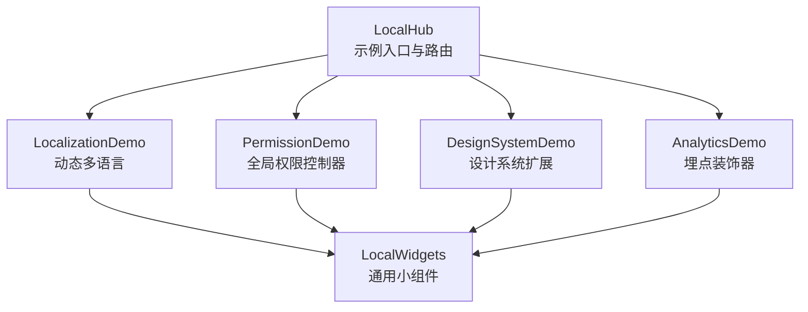
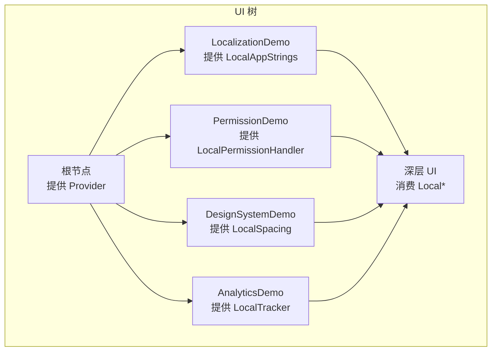
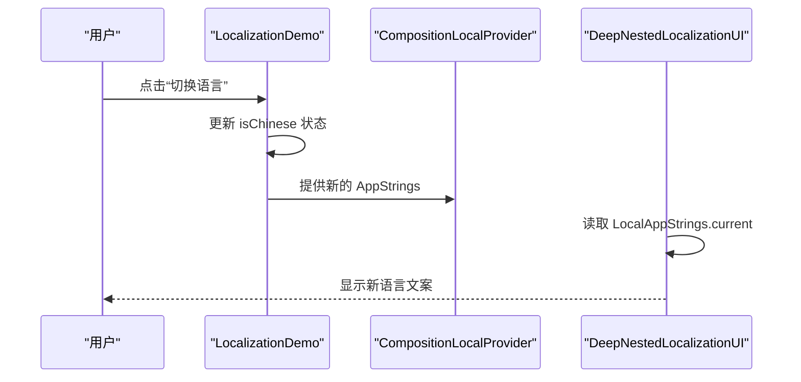
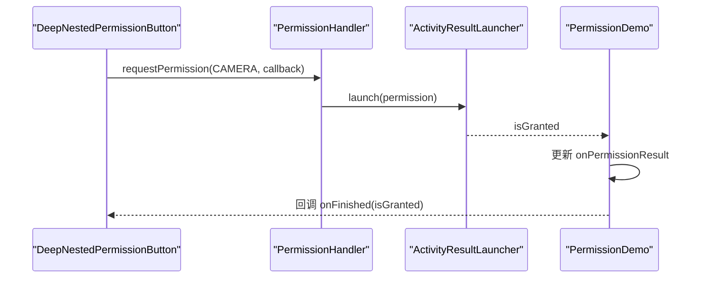
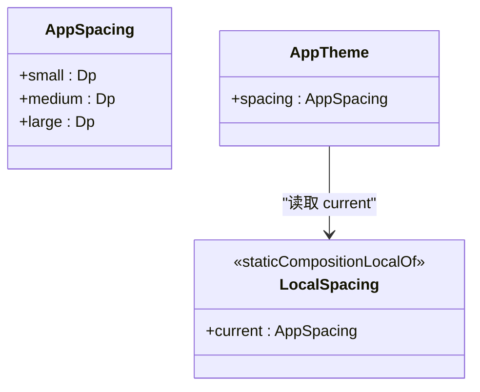
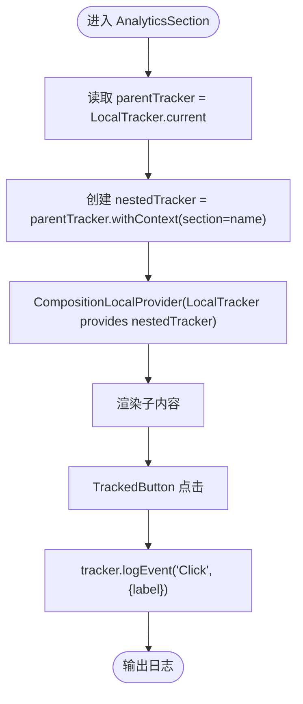
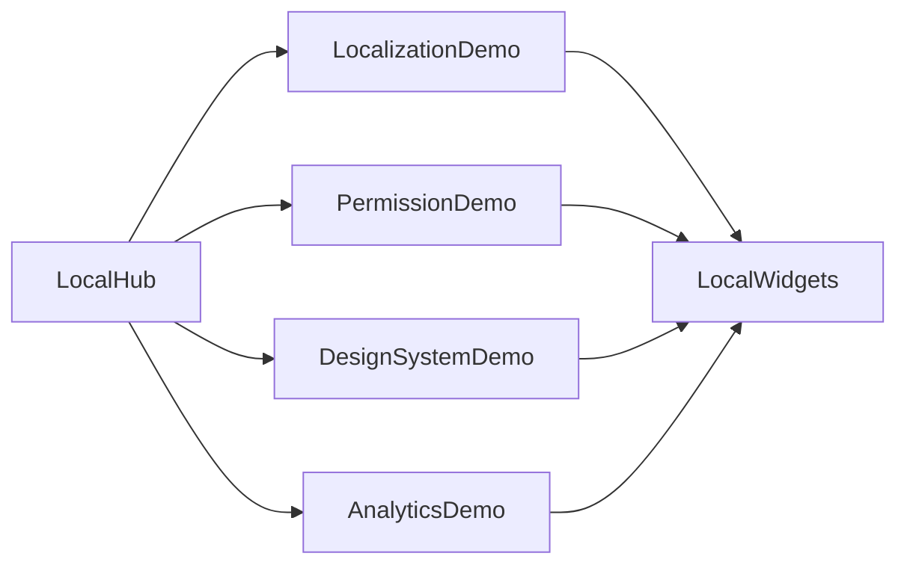

# CompositionLocal 跨层级状态

<cite>
**本文引用的文件**   
- [LocalHub.kt](file://app/src/main/java/com/example/composeup/compositionlocal/LocalHub.kt)
- [LocalWidgets.kt](file://app/src/main/java/com/example/composeup/compositionlocal/LocalWidgets.kt)
- [LocalizationDemo.kt](file://app/src/main/java/com/example/composeup/compositionlocal/LocalizationDemo.kt)
- [PermissionDemo.kt](file://app/src/main/java/com/example/composeup/compositionlocal/PermissionDemo.kt)
- [DesignSystemDemo.kt](file://app/src/main/java/com/example/composeup/compositionlocal/DesignSystemDemo.kt)
- [AnalyticsDemo.kt](file://app/src/main/java/com/example/composeup/compositionlocal/AnalyticsDemo.kt)
</cite>

## 目录
1. [引言](#引言)
2. [项目结构](#项目结构)
3. [核心组件](#核心组件)
4. [架构总览](#架构总览)
5. [详细组件分析](#详细组件分析)
6. [依赖关系分析](#依赖关系分析)
7. [性能与优化建议](#性能与优化建议)
8. [故障排查指南](#故障排查指南)
9. [结论](#结论)
10. [附录：最佳实践清单](#附录最佳实践清单)

## 引言
本技术文档围绕 CompositionLocal 在 Compose UI 树中的“跨层级状态传递”展开，结合仓库中 compositionlocal 模块的四个典型场景进行系统化讲解：
- 国际化支持：通过 staticCompositionLocalOf 提供 AppStrings，实现不重启 Activity 的动态语言切换。
- 权限管理：通过 compositionLocalOf 暴露 PermissionHandler，让深层 UI 无需关心 Launcher 位置即可发起权限请求。
- 设计系统扩展：通过 LocalSpacing 与 AppTheme.spacing 扩展 MaterialTheme，统一间距等设计维度。
- 埋点上下文：通过装饰器模式与 LocalTracker 将 Section 信息自动注入埋点上下文，实现嵌套 UI 的自动追踪。

此外，文档还将给出自定义 LocalProvider 的创建与使用模式、主题扩展与配置注入的实际案例、与传统依赖注入的对比与选择策略，以及性能优化与最佳实践。

## 项目结构
compositionlocal 模块以“入口导航 + 示例页面 + 通用小组件”的方式组织：
- LocalHub.kt：示例入口，负责展示不同主题并路由到对应 Demo。
- LocalizationDemo.kt：动态多语言切换。
- PermissionDemo.kt：全局权限控制器。
- DesignSystemDemo.kt：自定义设计系统扩展（间距）。
- AnalyticsDemo.kt：埋点统计装饰器。
- LocalWidgets.kt：复用的小组件（卡片、按钮行、舞台容器等）。

**图表来源**
- [LocalHub.kt:57-128](file://app/src/main/java/com/example/composeup/compositionlocal/LocalHub.kt#L57-L128)
- [LocalizationDemo.kt:45-66](file://app/src/main/java/com/example/composeup/compositionlocal/LocalizationDemo.kt#L45-L66)
- [PermissionDemo.kt:31-67](file://app/src/main/java/com/example/composeup/compositionlocal/PermissionDemo.kt#L31-L67)
- [DesignSystemDemo.kt:40-54](file://app/src/main/java/com/example/composeup/compositionlocal/DesignSystemDemo.kt#L40-L54)
- [AnalyticsDemo.kt:45-70](file://app/src/main/java/com/example/composeup/compositionlocal/AnalyticsDemo.kt#L45-L70)
- [LocalWidgets.kt:27-127](file://app/src/main/java/com/example/composeup/compositionlocal/LocalWidgets.kt#L27-L127)

**章节来源**
- [LocalHub.kt:30-55](file://app/src/main/java/com/example/composeup/compositionlocal/LocalHub.kt#L30-L55)
- [LocalHub.kt:57-128](file://app/src/main/java/com/example/composeup/compositionlocal/LocalHub.kt#L57-L128)
- [LocalWidgets.kt:27-127](file://app/src/main/java/com/example/composeup/compositionlocal/LocalWidgets.kt#L27-L127)

## 核心组件
- LocalAppStrings：静态 CompositionLocal，承载应用文案数据类 AppStrings，用于动态语言切换。
- LocalPermissionHandler：动态 CompositionLocal，暴露 PermissionHandler 接口，封装权限申请流程。
- LocalSpacing：静态 CompositionLocal，承载 AppSpacing 间距配置，配合 AppTheme.spacing 简化访问。
- LocalTracker：静态 CompositionLocal，承载 AppTracker 接口，用于埋点事件记录与上下文传播。
- AppTheme：对象扩展，提供只读 Composable 属性 spacing，作为设计系统的访问入口。
- BaseTracker：实现 AppTracker 的默认埋点实现，支持 withContext 装饰器模式叠加上下文。

这些组件共同构成“跨层级状态”的基础设施，使深层 UI 可以隐式获取主题、语言、权限能力与埋点上下文，避免参数逐层透传。

**章节来源**
- [LocalizationDemo.kt:21-43](file://app/src/main/java/com/example/composeup/compositionlocal/LocalizationDemo.kt#L21-L43)
- [PermissionDemo.kt:23-29](file://app/src/main/java/com/example/composeup/compositionlocal/PermissionDemo.kt#L23-L29)
- [DesignSystemDemo.kt:24-38](file://app/src/main/java/com/example/composeup/compositionlocal/DesignSystemDemo.kt#L24-L38)
- [AnalyticsDemo.kt:20-43](file://app/src/main/java/com/example/composeup/compositionlocal/AnalyticsDemo.kt#L20-L43)

## 架构总览
下图展示了 CompositionLocal 在 UI 树中的提供者与消费者关系，以及各 Demo 的职责分工。

**图表来源**
- [LocalizationDemo.kt:45-66](file://app/src/main/java/com/example/composeup/compositionlocal/LocalizationDemo.kt#L45-L66)
- [PermissionDemo.kt:31-67](file://app/src/main/java/com/example/composeup/compositionlocal/PermissionDemo.kt#L31-L67)
- [DesignSystemDemo.kt:40-54](file://app/src/main/java/com/example/composeup/compositionlocal/DesignSystemDemo.kt#L40-L54)
- [AnalyticsDemo.kt:45-70](file://app/src/main/java/com/example/composeup/compositionlocal/AnalyticsDemo.kt#L45-L70)

## 详细组件分析

### 国际化支持：动态多语言切换
- 原理
  - 使用 staticCompositionLocalOf 定义 LocalAppStrings，适合变化频率较低的配置型值。
  - 在 LocalizationDemo 根节点通过 CompositionLocalProvider 提供当前语言的 AppStrings。
  - 深层 UI 通过 LocalAppStrings.current 读取文案，无需从父级逐层传递。
- 优势
  - 避免 stringResource 对 Context 配置的强依赖，便于在纯 Compose 环境或测试中替换语言包。
  - 语言切换时仅触发相关重组，提升局部更新效率。
- 关键实现要点
  - AppStrings 数据类承载多语言文案。
  - LocalAppStrings 默认英文，可被覆盖为中文。
  - 切换按钮改变 isChinese 状态，重新提供新的 AppStrings。

**图表来源**
- [LocalizationDemo.kt:45-66](file://app/src/main/java/com/example/composeup/compositionlocal/LocalizationDemo.kt#L45-L66)
- [LocalizationDemo.kt:68-83](file://app/src/main/java/com/example/composeup/compositionlocal/LocalizationDemo.kt#L68-L83)

**章节来源**
- [LocalizationDemo.kt:21-43](file://app/src/main/java/com/example/composeup/compositionlocal/LocalizationDemo.kt#L21-L43)
- [LocalizationDemo.kt:45-66](file://app/src/main/java/com/example/composeup/compositionlocal/LocalizationDemo.kt#L45-L66)
- [LocalizationDemo.kt:68-83](file://app/src/main/java/com/example/composeup/compositionlocal/LocalizationDemo.kt#L68-L83)

### 权限管理：全局权限控制器
- 原理
  - 定义 PermissionHandler 接口，封装 requestPermission(permission, onResult)。
  - 使用 compositionLocalOf 定义 LocalPermissionHandler，并在 PermissionDemo 根节点提供具体实现。
  - 深层 UI 通过 LocalPermissionHandler.current 调用权限申请，无需感知 ActivityResultLauncher 的位置。
- 优势
  - 解耦深层 UI 与平台权限 API，提高可测试性与复用性。
  - 集中管理 Launcher 生命周期与回调处理。
- 关键实现要点
  - 在 PermissionDemo 中 remember launcher，并将结果转发给 onPermissionResult。
  - 通过 CompositionLocalProvider 提供 handler，使深层 UI 可直接调用。

**图表来源**
- [PermissionDemo.kt:31-67](file://app/src/main/java/com/example/composeup/compositionlocal/PermissionDemo.kt#L31-L67)
- [PermissionDemo.kt:69-81](file://app/src/main/java/com/example/composeup/compositionlocal/PermissionDemo.kt#L69-L81)

**章节来源**
- [PermissionDemo.kt:23-29](file://app/src/main/java/com/example/composeup/compositionlocal/PermissionDemo.kt#L23-L29)
- [PermissionDemo.kt:31-67](file://app/src/main/java/com/example/composeup/compositionlocal/PermissionDemo.kt#L31-L67)
- [PermissionDemo.kt:69-81](file://app/src/main/java/com/example/composeup/compositionlocal/PermissionDemo.kt#L69-L81)

### 设计系统扩展：自定义间距与主题访问
- 原理
  - 定义 AppSpacing 数据类，包含 small/medium/large 间距。
  - 使用 staticCompositionLocalOf 定义 LocalSpacing，并在 DesignSystemDemo 根节点提供自定义间距。
  - 通过 AppTheme.spacing 暴露只读 Composable 属性，简化深层 UI 访问。
- 优势
  - 统一设计维度，便于在不同屏幕尺寸或主题下切换间距策略。
  - 减少重复代码，提升一致性。
- 关键实现要点
  - AppTheme.spacing 是 @Composable 且 @ReadOnlyComposable，保证只读访问。
  - 在 ContentWithCustomSpacing 中使用 AppTheme.spacing.large/medium 控制布局。

**图表来源**
- [DesignSystemDemo.kt:24-38](file://app/src/main/java/com/example/composeup/compositionlocal/DesignSystemDemo.kt#L24-L38)
- [DesignSystemDemo.kt:40-54](file://app/src/main/java/com/example/composeup/compositionlocal/DesignSystemDemo.kt#L40-L54)
- [DesignSystemDemo.kt:56-74](file://app/src/main/java/com/example/composeup/compositionlocal/DesignSystemDemo.kt#L56-L74)

**章节来源**
- [DesignSystemDemo.kt:24-38](file://app/src/main/java/com/example/composeup/compositionlocal/DesignSystemDemo.kt#L24-L38)
- [DesignSystemDemo.kt:40-54](file://app/src/main/java/com/example/composeup/compositionlocal/DesignSystemDemo.kt#L40-L54)
- [DesignSystemDemo.kt:56-74](file://app/src/main/java/com/example/composeup/compositionlocal/DesignSystemDemo.kt#L56-L74)

### 埋点上下文：装饰器模式与上下文传播
- 原理
  - 定义 AppTracker 接口，包含 logEvent(event, params) 与 withContext(newParams...)。
  - BaseTracker 实现默认日志输出，withContext 返回新的 Tracker 实例，合并上下文。
  - AnalyticsSection 作为装饰器，读取 parentTracker，生成 nestedTracker，并通过 CompositionLocalProvider 提供。
  - TrackedButton 消费 LocalTracker.current，记录点击事件与标签。
- 优势
  - 通过装饰器模式自动累积 Section 上下文，避免手动传递埋点参数。
  - 保持 UI 简洁，埋点逻辑与业务逻辑解耦。
- 关键实现要点
  - LocalTracker 默认提供 BaseTracker，可在根节点替换为真实上报实现。
  - AnalyticsSection 使用 remember(parentTracker, name) 缓存嵌套 tracker，避免不必要的重建。

**图表来源**
- [AnalyticsDemo.kt:20-43](file://app/src/main/java/com/example/composeup/compositionlocal/AnalyticsDemo.kt#L20-L43)
- [AnalyticsDemo.kt:72-82](file://app/src/main/java/com/example/composeup/compositionlocal/AnalyticsDemo.kt#L72-L82)
- [AnalyticsDemo.kt:84-90](file://app/src/main/java/com/example/composeup/compositionlocal/AnalyticsDemo.kt#L84-L90)

**章节来源**
- [AnalyticsDemo.kt:20-43](file://app/src/main/java/com/example/composeup/compositionlocal/AnalyticsDemo.kt#L20-L43)
- [AnalyticsDemo.kt:45-70](file://app/src/main/java/com/example/composeup/compositionlocal/AnalyticsDemo.kt#L45-L70)
- [AnalyticsDemo.kt:72-82](file://app/src/main/java/com/example/composeup/compositionlocal/AnalyticsDemo.kt#L72-L82)
- [AnalyticsDemo.kt:84-90](file://app/src/main/java/com/example/composeup/compositionlocal/AnalyticsDemo.kt#L84-L90)

## 依赖关系分析
- 入口与示例
  - LocalHub 根据 LocalTopic 枚举路由到 LocalizationDemo、PermissionDemo、DesignSystemDemo、AnalyticsDemo。
- 示例与小组件
  - 所有 Demo 均复用 LocalWidgets 中的 Stage、ButtonRow、DemoButton、Note 等组件，保持一致的演示风格。
- CompositionLocal 的使用模式
  - 静态 vs 动态：LocalAppStrings、LocalSpacing、LocalTracker 使用 staticCompositionLocalOf；LocalPermissionHandler 使用 compositionLocalOf。
  - 提供者：每个 Demo 在根节点通过 CompositionLocalProvider 提供各自的 Local*。
  - 消费者：深层 UI 通过 Local*.current 读取，避免参数钻取。

**图表来源**
- [LocalHub.kt:57-128](file://app/src/main/java/com/example/composeup/compositionlocal/LocalHub.kt#L57-L128)
- [LocalWidgets.kt:27-127](file://app/src/main/java/com/example/composeup/compositionlocal/LocalWidgets.kt#L27-L127)

**章节来源**
- [LocalHub.kt:30-55](file://app/src/main/java/com/example/composeup/compositionlocal/LocalHub.kt#L30-L55)
- [LocalHub.kt:57-128](file://app/src/main/java/com/example/composeup/compositionlocal/LocalHub.kt#L57-L128)
- [LocalWidgets.kt:27-127](file://app/src/main/java/com/example/composeup/compositionlocal/LocalWidgets.kt#L27-L127)

## 性能与优化建议
- 选择合适的 Local 类型
  - staticCompositionLocalOf：适用于极少变化的配置型值（如语言、间距、默认埋点），变化时全树重组，但初始化开销更低。
  - compositionLocalOf：适用于频繁变化的值（如权限处理器、临时上下文），局部重组更细粒度。
- 最小化重组范围
  - 在 Provider 外层包裹必要的 State，确保只有受影响的子树重组。
  - 使用 remember 与 rememberUpdatedState 避免不必要的重建。
- 避免过度使用 CompositionLocal
  - 仅在确实需要跨层级传递时使用，优先使用参数传递或 ViewModel 管理状态。
- 埋点上下文的缓存
  - 使用 remember(parentTracker, name) 缓存嵌套 tracker，避免每次重组都创建新实例。
- 主题与设计的可扩展性
  - 通过 AppTheme.spacing 等只读 Composable 属性访问，避免直接操作 LocalSpacing，降低耦合。

[本节为通用指导，不直接分析具体文件]

## 故障排查指南
- “未提供 PermissionHandler”错误
  - 现象：在 PermissionDemo 中未包裹 CompositionLocalProvider(LocalPermissionHandler provides handler)，深层 UI 调用 LocalPermissionHandler.current 会抛出异常。
  - 排查：确认 PermissionDemo 根节点是否提供了 LocalPermissionHandler。
  - 参考路径：[PermissionDemo.kt:27-29](file://app/src/main/java/com/example/composeup/compositionlocal/PermissionDemo.kt#L27-L29)、[PermissionDemo.kt:52-66](file://app/src/main/java/com/example/composeup/compositionlocal/PermissionDemo.kt#L52-L66)
- 语言未切换
  - 现象：点击切换语言后 UI 未更新。
  - 排查：确认 isChinese 状态是否正确更新，并且 CompositionLocalProvider 是否重新提供新的 AppStrings。
  - 参考路径：[LocalizationDemo.kt:47-63](file://app/src/main/java/com/example/composeup/compositionlocal/LocalizationDemo.kt#L47-L63)
- 间距未生效
  - 现象：ContentWithCustomSpacing 中 Spacer 高度不符合预期。
  - 排查：确认 DesignSystemDemo 根节点是否提供了 LocalSpacing，并且 AppTheme.spacing 是否被正确读取。
  - 参考路径：[DesignSystemDemo.kt:40-54](file://app/src/main/java/com/example/composeup/compositionlocal/DesignSystemDemo.kt#L40-L54)、[DesignSystemDemo.kt:56-74](file://app/src/main/java/com/example/composeup/compositionlocal/DesignSystemDemo.kt#L56-L74)
- 埋点日志为空
  - 现象：点击按钮后无日志输出。
  - 排查：确认 AnalyticsDemo 根节点是否提供了 LocalTracker，并且 AnalyticsSection 是否正确嵌套与提供 nestedTracker。
  - 参考路径：[AnalyticsDemo.kt:45-70](file://app/src/main/java/com/example/composeup/compositionlocal/AnalyticsDemo.kt#L45-L70)、[AnalyticsDemo.kt:72-82](file://app/src/main/java/com/example/composeup/compositionlocal/AnalyticsDemo.kt#L72-L82)

**章节来源**
- [PermissionDemo.kt:27-29](file://app/src/main/java/com/example/composeup/compositionlocal/PermissionDemo.kt#L27-L29)
- [PermissionDemo.kt:52-66](file://app/src/main/java/com/example/composeup/compositionlocal/PermissionDemo.kt#L52-L66)
- [LocalizationDemo.kt:47-63](file://app/src/main/java/com/example/composeup/compositionlocal/LocalizationDemo.kt#L47-L63)
- [DesignSystemDemo.kt:40-54](file://app/src/main/java/com/example/composeup/compositionlocal/DesignSystemDemo.kt#L40-L54)
- [DesignSystemDemo.kt:56-74](file://app/src/main/java/com/example/composeup/compositionlocal/DesignSystemDemo.kt#L56-L74)
- [AnalyticsDemo.kt:45-70](file://app/src/main/java/com/example/composeup/compositionlocal/AnalyticsDemo.kt#L45-L70)
- [AnalyticsDemo.kt:72-82](file://app/src/main/java/com/example/composeup/compositionlocal/AnalyticsDemo.kt#L72-L82)

## 结论
CompositionLocal 在 Compose UI 树中提供了强大的“隐式上下文”能力，特别适合跨切面逻辑（主题、语言、权限、埋点）的传递。通过合理选择 staticCompositionLocalOf 与 compositionLocalOf，并结合装饰器模式与只读 Composable 属性，可以在保持 UI 简洁的同时实现高内聚、低耦合的架构。在实际项目中，应权衡其与 ViewModel、传统依赖注入的关系，遵循最小必要原则，避免滥用导致难以维护的“隐式依赖网”。

[本节为总结性内容，不直接分析具体文件]

## 附录：最佳实践清单
- 明确职责边界
  - 语言、间距、默认埋点等配置型上下文使用 staticCompositionLocalOf。
  - 权限处理器、临时上下文等可变能力使用 compositionLocalOf。
- 提供与消费分离
  - 在尽可能靠近根节点的 Composable 中提供 Local*，在深层 UI 中消费。
- 只读访问
  - 通过 AppTheme.spacing 等只读 Composable 属性访问 LocalSpacing，避免直接操作 Local*。
- 装饰器模式
  - 使用 withContext 累积上下文，避免手动传递参数。
- 性能优先
  - 使用 remember 缓存计算结果与嵌套 tracker。
  - 控制重组范围，避免全树重组。
- 与传统依赖注入的对比与选择
  - CompositionLocal：适合 UI 树的上下文传递，天然与重组机制协同。
  - 传统 DI（如 Hilt/Koin）：适合跨模块、跨进程的对象管理与生命周期控制。
  - 选择策略：UI 层上下文优先 CompositionLocal；跨层服务与资源管理优先 DI；两者互补而非互斥。

[本节为通用指导，不直接分析具体文件]