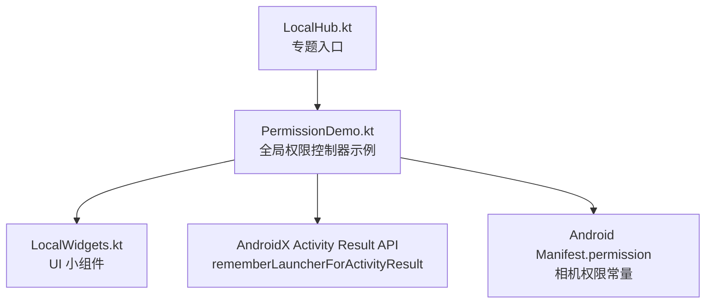
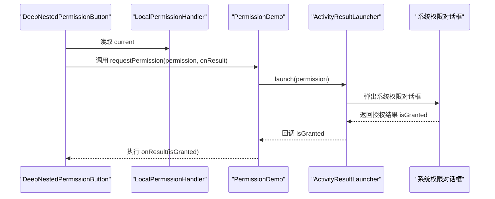
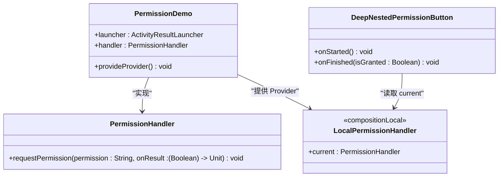
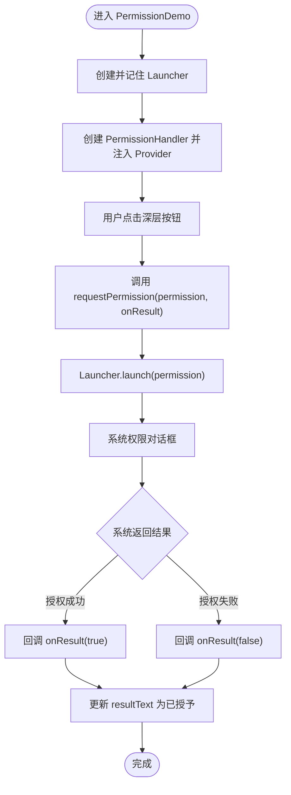
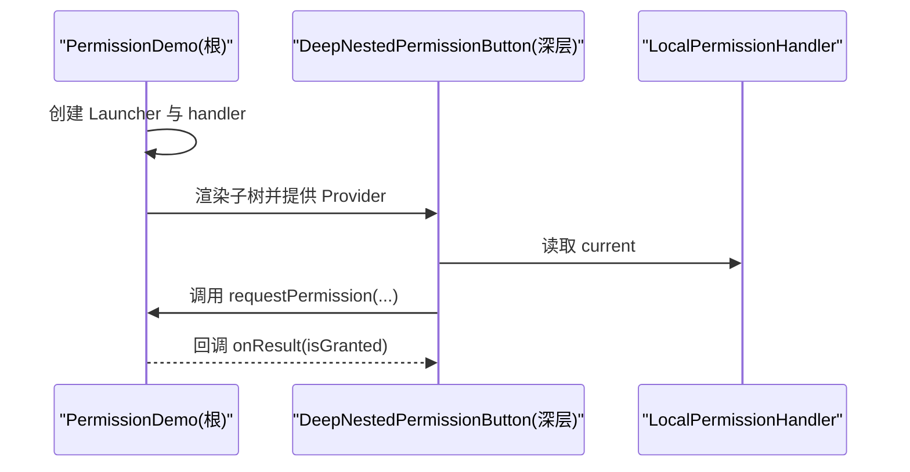
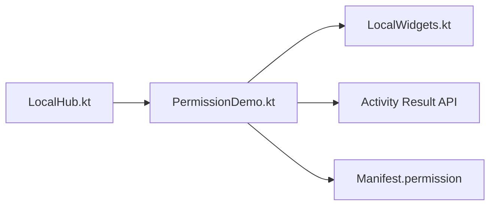

# 全局权限控制器

<cite>
**本文引用的文件**   
- [PermissionDemo.kt](file://app/src/main/java/com/example/composeup/compositionlocal/PermissionDemo.kt)
- [LocalHub.kt](file://app/src/main/java/com/example/composeup/compositionlocal/LocalHub.kt)
- [LocalWidgets.kt](file://app/src/main/java/com/example/composeup/compositionlocal/LocalWidgets.kt)
- [README.md](file://app/src/main/java/com/example/composeup/compositionlocal/README.md)
</cite>

## 目录
1. [引言](#引言)
2. [项目结构](#项目结构)
3. [核心组件](#核心组件)
4. [架构总览](#架构总览)
5. [详细组件分析](#详细组件分析)
6. [依赖关系分析](#依赖关系分析)
7. [性能与可维护性](#性能与可维护性)
8. [故障排查指南](#故障排查指南)
9. [结论](#结论)

## 引言
本技术文档围绕“全局权限控制器”展开，目标是说明如何通过 compositionLocalOf 在根节点统一管理 ActivityResultLauncher，让深层 UI 组件无需属性钻取即可发起权限请求。文档将深入解析 PermissionHandler 的设计模式、权限请求的生命周期管理、状态同步与错误处理机制，并给出统一结果回调的使用示例，帮助团队提升代码的可维护性与可读性。

## 项目结构
该能力位于 compositionlocal 模块中，主要包含以下文件：
- PermissionDemo.kt：定义 PermissionHandler 接口、LocalPermissionHandler 上下文以及权限演示页面。
- LocalHub.kt：CompositionLocal 专题入口，导航到 PermissionDemo 等子场景。
- LocalWidgets.kt：通用 UI 小组件（按钮、区块容器、提示文本等），被 PermissionDemo 复用。
- README.md：对 CompositionLocal 的用法与案例进行概览说明。

**图表来源**
- [LocalHub.kt:100-127](file://app/src/main/java/com/example/composeup/compositionlocal/LocalHub.kt#L100-L127)
- [PermissionDemo.kt:31-67](file://app/src/main/java/com/example/composeup/compositionlocal/PermissionDemo.kt#L31-L67)
- [PermissionDemo.kt:37-41](file://app/src/main/java/com/example/composeup/compositionlocal/PermissionDemo.kt#L37-L41)
- [PermissionDemo.kt:74-79](file://app/src/main/java/com/example/composeup/compositionlocal/PermissionDemo.kt#L74-L79)

**章节来源**
- [LocalHub.kt:30-55](file://app/src/main/java/com/example/composeup/compositionlocal/LocalHub.kt#L30-L55)
- [PermissionDemo.kt:1-82](file://app/src/main/java/com/example/composeup/compositionlocal/PermissionDemo.kt#L1-L82)
- [LocalWidgets.kt:1-127](file://app/src/main/java/com/example/composeup/compositionlocal/LocalWidgets.kt#L1-L127)
- [README.md:1-25](file://app/src/main/java/com/example/composeup/compositionlocal/README.md#L1-L25)

## 核心组件
- PermissionHandler：统一的权限请求抽象接口，屏蔽底层 Launcher 细节，向上暴露简洁的请求方法。
- LocalPermissionHandler：通过 compositionLocalOf 创建的 CompositionLocal，用于在 Compose 树中隐式传递 PermissionHandler 实例。
- PermissionDemo：根级组合函数，负责创建并持有 ActivityResultLauncher，提供 Provider 作用域，并将结果回传给调用方。
- DeepNestedPermissionButton：深层嵌套按钮示例，展示如何在不传递 launcher 的情况下发起权限请求。
- LocalWidgets：提供 Stage、ButtonRow、DemoButton、Note 等基础 UI 组件，用于构建演示界面。

**章节来源**
- [PermissionDemo.kt:23-29](file://app/src/main/java/com/example/composeup/compositionlocal/PermissionDemo.kt#L23-L29)
- [PermissionDemo.kt:31-67](file://app/src/main/java/com/example/composeup/compositionlocal/PermissionDemo.kt#L31-L67)
- [PermissionDemo.kt:69-81](file://app/src/main/java/com/example/composeup/compositionlocal/PermissionDemo.kt#L69-L81)
- [LocalWidgets.kt:66-127](file://app/src/main/java/com/example/composeup/compositionlocal/LocalWidgets.kt#L66-L127)

## 架构总览
下图展示了从深层 UI 到系统权限对话框再到结果回调的整体流程。PermissionDemo 在根部持有唯一的 Launcher，并通过 LocalPermissionHandler 向子树暴露统一接口；DeepNestedPermissionButton 仅依赖 LocalPermissionHandler.current 发起请求，避免属性钻取。

**图表来源**
- [PermissionDemo.kt:37-41](file://app/src/main/java/com/example/composeup/compositionlocal/PermissionDemo.kt#L37-L41)
- [PermissionDemo.kt:43-50](file://app/src/main/java/com/example/composeup/compositionlocal/PermissionDemo.kt#L43-L50)
- [PermissionDemo.kt:70-79](file://app/src/main/java/com/example/composeup/compositionlocal/PermissionDemo.kt#L70-L79)

## 详细组件分析

### PermissionHandler 设计与实现
- 设计目标
  - 抽象权限请求行为，隐藏 ActivityResultLauncher 的具体位置与生命周期。
  - 为上层 UI 提供稳定的 API：传入权限字符串与结果回调。
- 关键实现要点
  - 使用 compositionLocalOf 声明 LocalPermissionHandler，未提供时抛出错误，便于开发期快速发现问题。
  - PermissionDemo 内部用 rememberLauncherForActivityResult 创建唯一 Launcher，并在回调中转发结果给当前待处理的 onResult。
  - 通过 CompositionLocalProvider 将 handler 注入到子树，使深层组件可直接使用。

**图表来源**
- [PermissionDemo.kt:23-29](file://app/src/main/java/com/example/composeup/compositionlocal/PermissionDemo.kt#L23-L29)
- [PermissionDemo.kt:31-67](file://app/src/main/java/com/example/composeup/compositionlocal/PermissionDemo.kt#L31-L67)
- [PermissionDemo.kt:69-81](file://app/src/main/java/com/example/composeup/compositionlocal/PermissionDemo.kt#L69-L81)

**章节来源**
- [PermissionDemo.kt:23-29](file://app/src/main/java/com/example/composeup/compositionlocal/PermissionDemo.kt#L23-L29)
- [PermissionDemo.kt:31-67](file://app/src/main/java/com/example/composeup/compositionlocal/PermissionDemo.kt#L31-L67)

### 权限请求生命周期与状态同步
- 生命周期
  - PermissionDemo 在组合阶段创建 Launcher，并通过 remember 保证实例稳定。
  - 当用户点击深层按钮时，PermissionHandler.requestPermission 保存 onResult 并启动系统权限对话框。
  - 系统返回后，Launcher 回调触发，PermissionDemo 将结果转发给 onResult。
- 状态同步
  - PermissionDemo 使用 rememberState 管理 resultText，根据 onFinished 更新显示文案。
  - DeepNestedPermissionButton 通过 onStarted/onFinished 控制 UI 反馈，如“申请中…”、“已授予/被拒绝”。

**图表来源**
- [PermissionDemo.kt:37-41](file://app/src/main/java/com/example/composeup/compositionlocal/PermissionDemo.kt#L37-L41)
- [PermissionDemo.kt:43-50](file://app/src/main/java/com/example/composeup/compositionlocal/PermissionDemo.kt#L43-L50)
- [PermissionDemo.kt:56-66](file://app/src/main/java/com/example/composeup/compositionlocal/PermissionDemo.kt#L56-L66)

**章节来源**
- [PermissionDemo.kt:31-67](file://app/src/main/java/com/example/composeup/compositionlocal/PermissionDemo.kt#L31-L67)
- [PermissionDemo.kt:69-81](file://app/src/main/java/com/example/composeup/compositionlocal/PermissionDemo.kt#L69-L81)

### 错误处理与健壮性
- 缺失 Provider 的错误
  - LocalPermissionHandler 在未提供时直接抛出错误，有助于在开发阶段尽早发现配置遗漏。
- 回调为空保护
  - Launcher 回调中对 onPermissionResult 做空检查，避免重复或异常回调导致崩溃。
- 建议增强
  - 可为 PermissionHandler 增加更丰富的错误类型（如用户拒绝、运行时异常、权限不可用等）。
  - 可在 PermissionDemo 中记录日志或上报埋点，便于问题追踪。

**章节来源**
- [PermissionDemo.kt:27-29](file://app/src/main/java/com/example/composeup/compositionlocal/PermissionDemo.kt#L27-L29)
- [PermissionDemo.kt:37-41](file://app/src/main/java/com/example/composeup/compositionlocal/PermissionDemo.kt#L37-L41)

### 实际使用示例与最佳实践
- 在根节点提供 LocalPermissionHandler
  - 在 PermissionDemo 中通过 CompositionLocalProvider 注入 handler，确保子树可用。
- 深层组件直接使用 LocalPermissionHandler.current
  - DeepNestedPermissionButton 不关心 launcher 的位置，只调用 requestPermission 并处理结果。
- 避免属性钻取
  - 传统做法需要在每层组合函数中显式传递 launcher，容易冗余且难以维护；使用 CompositionLocal 后，只需在根节点提供一次。
- 结果处理
  - 通过 onFinished 回调统一处理 UI 状态更新，保持业务逻辑与 UI 表现解耦。

**图表来源**
- [PermissionDemo.kt:52-66](file://app/src/main/java/com/example/composeup/compositionlocal/PermissionDemo.kt#L52-L66)
- [PermissionDemo.kt:70-79](file://app/src/main/java/com/example/composeup/compositionlocal/PermissionDemo.kt#L70-L79)

**章节来源**
- [PermissionDemo.kt:52-66](file://app/src/main/java/com/example/composeup/compositionlocal/PermissionDemo.kt#L52-L66)
- [PermissionDemo.kt:70-79](file://app/src/main/java/com/example/composeup/compositionlocal/PermissionDemo.kt#L70-L79)

## 依赖关系分析
- 外部依赖
  - AndroidX Activity Result API：rememberLauncherForActivityResult 与 ActivityResultContracts.RequestPermission。
  - Android Manifest.permission：相机权限常量。
- 内部依赖
  - LocalHub 作为专题入口，导航到 PermissionDemo。
  - PermissionDemo 复用 LocalWidgets 中的 UI 组件。

**图表来源**
- [LocalHub.kt:100-127](file://app/src/main/java/com/example/composeup/compositionlocal/LocalHub.kt#L100-L127)
- [PermissionDemo.kt:37-41](file://app/src/main/java/com/example/composeup/compositionlocal/PermissionDemo.kt#L37-L41)
- [PermissionDemo.kt:74-79](file://app/src/main/java/com/example/composeup/compositionlocal/PermissionDemo.kt#L74-L79)
- [LocalWidgets.kt:66-127](file://app/src/main/java/com/example/composeup/compositionlocal/LocalWidgets.kt#L66-L127)

**章节来源**
- [LocalHub.kt:100-127](file://app/src/main/java/com/example/composeup/compositionlocal/LocalHub.kt#L100-L127)
- [PermissionDemo.kt:37-41](file://app/src/main/java/com/example/composeup/compositionlocal/PermissionDemo.kt#L37-L41)
- [PermissionDemo.kt:74-79](file://app/src/main/java/com/example/composeup/compositionlocal/PermissionDemo.kt#L74-L79)
- [LocalWidgets.kt:66-127](file://app/src/main/java/com/example/composeup/compositionlocal/LocalWidgets.kt#L66-L127)

## 性能与可维护性
- 性能
  - 使用 compositionLocalOf 而非 staticCompositionLocalOf，允许局部重组，减少不必要的重绘。
  - 仅在根节点创建并记住 Launcher，避免重复创建带来的开销。
- 可维护性
  - 通过 PermissionHandler 抽象权限请求，降低耦合度，便于替换实现或扩展功能。
  - 深层组件无需感知 launcher 的存在，提升代码可读性与可测试性。
- 建议
  - 将权限相关逻辑进一步封装为可复用的 UseCase 或 ViewModel，分离 UI 与业务。
  - 为不同权限类型建立统一的策略映射，简化多权限场景的处理。

[本节为通用指导，不直接分析具体文件]

## 故障排查指南
- 现象：运行时报错提示未提供 PermissionHandler
  - 原因：未在 CompositionLocalProvider 中提供 LocalPermissionHandler。
  - 解决：在 PermissionDemo 或其他根节点中使用 CompositionLocalProvider(LocalPermissionHandler provides handler)。
- 现象：权限回调未触发或状态未更新
  - 原因：onPermissionResult 未被正确赋值或回调被覆盖。
  - 解决：确保每次 requestPermission 都设置 onPermissionResult，并在回调中安全调用。
- 现象：深层组件无法访问权限接口
  - 原因：Provider 的作用域未覆盖目标组件。
  - 解决：将 Provider 放置在足够高的层级，确保目标组件在其作用域内。

**章节来源**
- [PermissionDemo.kt:27-29](file://app/src/main/java/com/example/composeup/compositionlocal/PermissionDemo.kt#L27-L29)
- [PermissionDemo.kt:37-41](file://app/src/main/java/com/example/composeup/compositionlocal/PermissionDemo.kt#L37-L41)
- [PermissionDemo.kt:52-66](file://app/src/main/java/com/example/composeup/compositionlocal/PermissionDemo.kt#L52-L66)

## 结论
通过 compositionLocalOf 在根节点统一管理 Launcher，并结合 PermissionHandler 抽象，可以显著降低权限请求的耦合度，避免属性钻取，提升代码的可维护性与可读性。PermissionDemo 展示了完整的生命周期管理与状态同步机制，配合 LocalWidgets 提供的 UI 组件，能够快速构建清晰的权限交互流程。建议在项目中推广此模式，并根据业务需求扩展错误处理与埋点能力。

[本节为总结性内容，不直接分析具体文件]