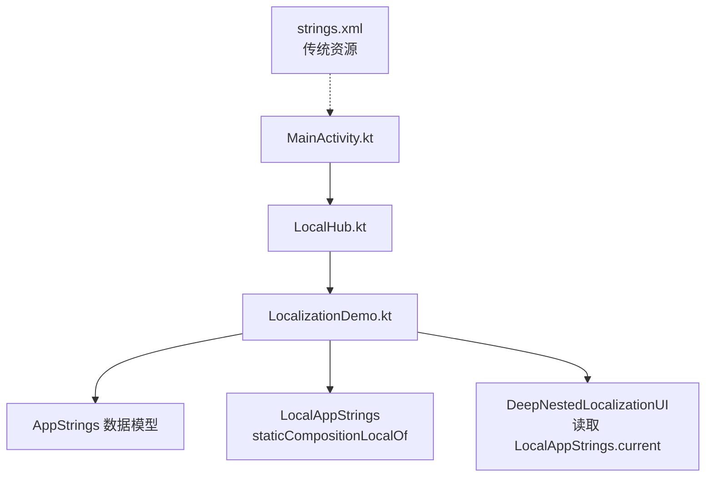
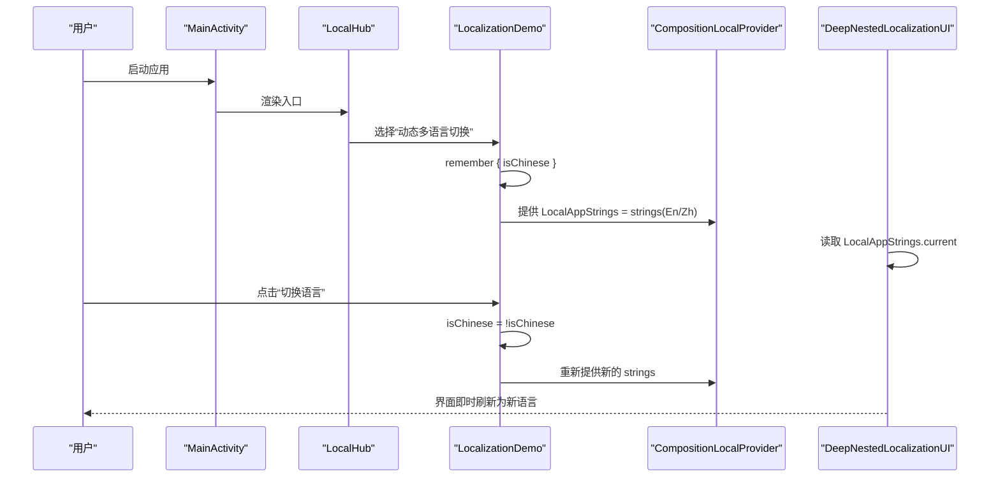
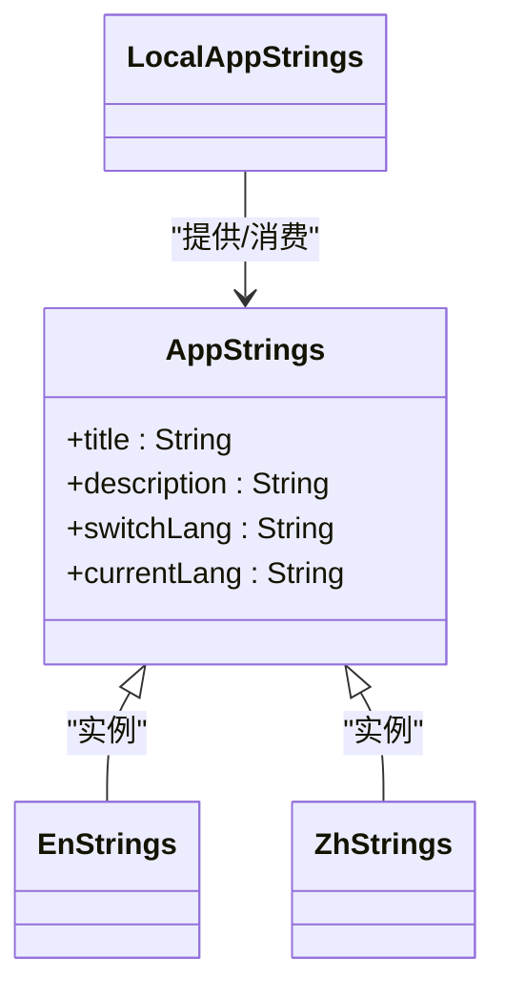
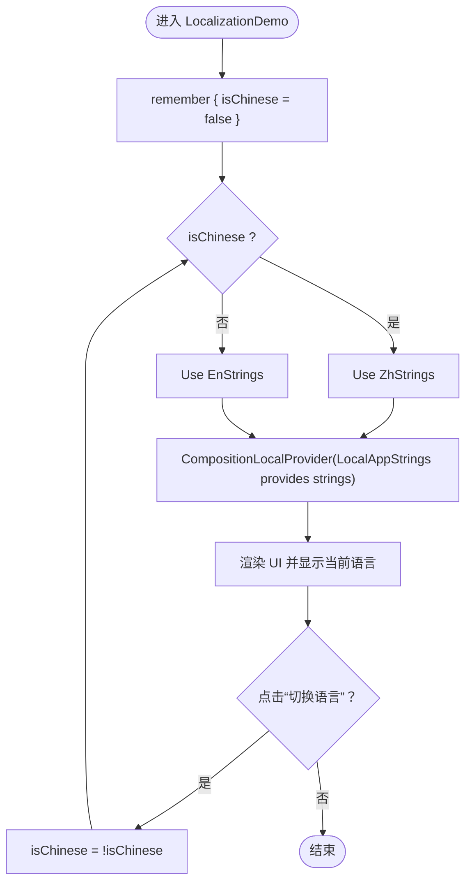
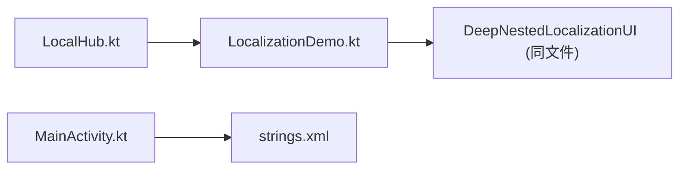

# 动态多语言切换

<cite>
**本文引用的文件**   
- [LocalizationDemo.kt](file://app/src/main/java/com/example/composeup/compositionlocal/LocalizationDemo.kt)
- [LocalHub.kt](file://app/src/main/java/com/example/composeup/compositionlocal/LocalHub.kt)
- [strings.xml](file://app/src/main/res/values/strings.xml)
- [MainActivity.kt](file://app/src/main/java/com/example/composeup/MainActivity.kt)
</cite>

## 目录
1. [简介](#简介)
2. [项目结构](#项目结构)
3. [核心组件](#核心组件)
4. [架构总览](#架构总览)
5. [详细组件分析](#详细组件分析)
6. [依赖关系分析](#依赖关系分析)
7. [性能与优化](#性能与优化)
8. [故障排查指南](#故障排查指南)
9. [结论](#结论)
10. [附录：使用指南与最佳实践](#附录使用指南与最佳实践)

## 简介
本技术文档围绕“动态多语言切换”展开，重点讲解如何在 Compose 中通过 staticCompositionLocalOf 实现应用内即时翻译切换，避免传统 stringResource 对 Context 配置的依赖。文档将深入解析 AppStrings 的设计模式与实现原理，展示在 Composable 中获取和更新当前语言设置的方法，并给出多语言资源的组织方式、动态加载机制与性能优化策略。同时提供与传统方案的对比说明，帮助读者在实际项目中落地可维护、高性能的多语言方案。

## 项目结构
本项目采用功能模块化的 Compose 示例工程，多语言相关代码集中在 compositionlocal 包下，资源文件位于 res/values/strings.xml。入口导航由 LocalHub 提供，具体演示页面 LocalizationDemo 展示了基于 CompositionLocal 的动态语言切换。

图表来源
- [LocalHub.kt:57-128](file://app/src/main/java/com/example/composeup/compositionlocal/LocalHub.kt#L57-L128)
- [LocalizationDemo.kt:21-83](file://app/src/main/java/com/example/composeup/compositionlocal/LocalizationDemo.kt#L21-L83)
- [MainActivity.kt:74-330](file://app/src/main/java/com/example/composeup/MainActivity.kt#L74-L330)
- [strings.xml:1-5](file://app/src/main/res/values/strings.xml#L1-L5)

章节来源
- [LocalHub.kt:30-55](file://app/src/main/java/com/example/composeup/compositionlocal/LocalHub.kt#L30-L55)
- [LocalizationDemo.kt:1-84](file://app/src/main/java/com/example/composeup/compositionlocal/LocalizationDemo.kt#L1-L84)
- [strings.xml:1-5](file://app/src/main/res/values/strings.xml#L1-L5)

## 核心组件
- AppStrings：封装一组文案的不可变数据类，作为多语言的最小单元。
- EnStrings/ZhStrings：不同语言的 AppStrings 实例。
- LocalAppStrings：通过 staticCompositionLocalOf 创建的 CompositionLocal，用于在 UI 树中隐式传递当前语言文案。
- LocalizationDemo：顶层 Composable，负责状态管理（isChinese）、提供 LocalAppStrings，并在按钮点击时切换语言。
- DeepNestedLocalizationUI：深层嵌套的 Composable，仅通过 LocalAppStrings.current 读取文案，无需参数透传。

章节来源
- [LocalizationDemo.kt:21-43](file://app/src/main/java/com/example/composeup/compositionlocal/LocalizationDemo.kt#L21-L43)
- [LocalizationDemo.kt:45-66](file://app/src/main/java/com/example/composeup/compositionlocal/LocalizationDemo.kt#L45-L66)
- [LocalizationDemo.kt:68-83](file://app/src/main/java/com/example/composeup/compositionlocal/LocalizationDemo.kt#L68-L83)

## 架构总览
下图展示了从入口到具体页面的调用链，以及 CompositionLocal 的提供与消费流程。

图表来源
- [MainActivity.kt:74-330](file://app/src/main/java/com/example/composeup/MainActivity.kt#L74-L330)
- [LocalHub.kt:57-128](file://app/src/main/java/com/example/composeup/compositionlocal/LocalHub.kt#L57-L128)
- [LocalizationDemo.kt:45-83](file://app/src/main/java/com/example/composeup/compositionlocal/LocalizationDemo.kt#L45-L83)

## 详细组件分析

### AppStrings 设计模式与实现原理
- 设计模式
  - 数据类聚合：将同一语言下的多个文案字段聚合为 AppStrings，便于整体替换与类型安全访问。
  - 语言实例化：为每种语言创建独立的 AppStrings 常量（如 EnStrings、ZhStrings），以函数式风格提供默认值。
  - 上下文注入：通过 staticCompositionLocalOf 创建 LocalAppStrings，在 UI 树中提供与消费，避免参数钻取。
- 实现要点
  - 使用 data class 保证不可变性与 equals/hashCode 语义，利于重组优化。
  - 使用 staticCompositionLocalOf 而非 compositionLocalOf，因为语言切换频率低，静态局部更适合减少运行时开销；但切换时会触发全树重组，需权衡。
  - 在根级 CompositionLocalProvider 中提供当前语言字符串，子组件直接读取 LocalAppStrings.current。

图表来源
- [LocalizationDemo.kt:21-43](file://app/src/main/java/com/example/composeup/compositionlocal/LocalizationDemo.kt#L21-L43)

章节来源
- [LocalizationDemo.kt:21-43](file://app/src/main/java/com/example/composeup/compositionlocal/LocalizationDemo.kt#L21-L43)

### 在 Composable 中获取与更新当前语言
- 获取
  - 在任何 Composable 中通过 LocalAppStrings.current 直接读取当前语言文案，无需显式参数传递。
- 更新
  - 在提供层（如 LocalizationDemo）维护 isChinese 状态，根据状态选择 EnStrings 或 ZhStrings，并通过 CompositionLocalProvider(LocalAppStrings provides strings) 覆盖当前上下文中的值。
  - 按钮点击时切换 isChinese，触发重组，子组件自动读取新值并刷新界面。

图表来源
- [LocalizationDemo.kt:45-66](file://app/src/main/java/com/example/composeup/compositionlocal/LocalizationDemo.kt#L45-L66)

章节来源
- [LocalizationDemo.kt:45-66](file://app/src/main/java/com/example/composeup/compositionlocal/LocalizationDemo.kt#L45-L66)

### 深层嵌套组件的语言读取
- DeepNestedLocalizationUI 不接收任何语言参数，直接从 LocalAppStrings.current 读取标题、描述与当前语言提示。
- 这种方式消除了“属性钻取”，提升了组件的可复用性与可读性。

章节来源
- [LocalizationDemo.kt:68-83](file://app/src/main/java/com/example/composeup/compositionlocal/LocalizationDemo.kt#L68-L83)

### 与传统多语言方案的对比
- 传统方案（stringResource）
  - 依赖 Activity/Context 的配置，无法在不重启 Activity 的情况下即时切换语言。
  - 在 Compose 中需要借助 Theme 或自定义 LocaleManager 进行配置，复杂度较高。
- 本方案（CompositionLocal + AppStrings）
  - 不依赖 Context 配置，直接在 UI 树中提供与消费，支持应用内即时切换。
  - 通过 staticCompositionLocalOf 降低运行时开销，适合低频变化的全局配置。
  - 更易于测试与组合，避免跨层参数传递。

章节来源
- [LocalizationDemo.kt:53-53](file://app/src/main/java/com/example/composeup/compositionlocal/LocalizationDemo.kt#L53-L53)
- [MainActivity.kt:74-330](file://app/src/main/java/com/example/composeup/MainActivity.kt#L74-L330)

## 依赖关系分析
- LocalHub 作为导航入口，根据用户选择渲染 LocalizationDemo。
- LocalizationDemo 提供 LocalAppStrings，供子组件 DeepNestedLocalizationUI 消费。
- MainActivity 中仍保留 stringResource 的使用，体现传统方案与本方案的并存与对比。

图表来源
- [LocalHub.kt:57-128](file://app/src/main/java/com/example/composeup/compositionlocal/LocalHub.kt#L57-L128)
- [LocalizationDemo.kt:45-83](file://app/src/main/java/com/example/composeup/compositionlocal/LocalizationDemo.kt#L45-L83)
- [MainActivity.kt:74-330](file://app/src/main/java/com/example/composeup/MainActivity.kt#L74-L330)
- [strings.xml:1-5](file://app/src/main/res/values/strings.xml#L1-L5)

章节来源
- [LocalHub.kt:57-128](file://app/src/main/java/com/example/composeup/compositionlocal/LocalHub.kt#L57-L128)
- [MainActivity.kt:74-330](file://app/src/main/java/com/example/composeup/MainActivity.kt#L74-L330)

## 性能与优化
- 使用 staticCompositionLocalOf
  - 适用于极少变化的全局配置（如语言、主题），可减少运行时开销。
  - 注意：当值变化时，会触发全树重组，因此应确保变更频率低且影响范围可控。
- 最小化重组范围
  - 将语言相关的 UI 尽量隔离在局部作用域，避免无关组件频繁重组。
- 延迟加载与缓存
  - 对于大型语言包，可在首次使用时按需加载，并结合内存缓存减少重复 IO。
- 与 compositionLocalOf 的选择
  - 若语言切换非常频繁（不建议），可使用 compositionLocalOf 以获得更细粒度的重组；但通常语言切换低频，staticCompositionLocalOf 更合适。

章节来源
- [LocalHub.kt:78-82](file://app/src/main/java/com/example/composeup/compositionlocal/LocalHub.kt#L78-L82)
- [LocalizationDemo.kt:42-43](file://app/src/main/java/com/example/composeup/compositionlocal/LocalizationDemo.kt#L42-L43)

## 故障排查指南
- 问题：切换语言后界面未刷新
  - 检查是否在 CompositionLocalProvider 中正确提供了新的 strings。
  - 确认子组件是否通过 LocalAppStrings.current 读取，而不是硬编码字符串。
- 问题：切换语言导致全树重组卡顿
  - 评估语言切换频率，考虑将语言包拆分并按需加载。
  - 将非语言相关的 UI 下沉到独立组件，缩小重组范围。
- 问题：与传统 stringResource 混用导致不一致
  - 明确边界：仅在需要即时切换的场景使用 CompositionLocal；其他场景继续使用 stringResource。
  - 在入口处统一处理语言状态，避免多处分散管理。

章节来源
- [LocalizationDemo.kt:45-83](file://app/src/main/java/com/example/composeup/compositionlocal/LocalizationDemo.kt#L45-L83)
- [MainActivity.kt:74-330](file://app/src/main/java/com/example/composeup/MainActivity.kt#L74-L330)

## 结论
通过 AppStrings 与 staticCompositionLocalOf 的组合，本方案实现了不依赖 Context 配置的应用内即时多语言切换，避免了传统 stringResource 的限制。该方案具备类型安全、易于测试、无参数钻取等优势，适合在 Compose 应用中广泛使用。结合合理的资源组织与性能优化策略，可以在保证用户体验的同时提升开发效率与维护性。

## 附录：使用指南与最佳实践
- 定义 AppStrings 数据类，并为每种语言创建实例。
- 使用 staticCompositionLocalOf 创建 LocalAppStrings，并在应用根节点提供默认语言。
- 在需要切换语言的页面维护语言状态，并通过 CompositionLocalProvider 覆盖当前上下文。
- 在所有需要文案的 Composable 中通过 LocalAppStrings.current 读取，避免参数透传。
- 与传统 stringResource 并存时，明确职责边界：即时切换用 CompositionLocal，静态资源用 stringResource。
- 针对大语言包进行按需加载与缓存，控制重组范围，提升性能。

章节来源
- [LocalizationDemo.kt:21-83](file://app/src/main/java/com/example/composeup/compositionlocal/LocalizationDemo.kt#L21-L83)
- [LocalHub.kt:78-82](file://app/src/main/java/com/example/composeup/compositionlocal/LocalHub.kt#L78-L82)
- [strings.xml:1-5](file://app/src/main/res/values/strings.xml#L1-L5)
- [MainActivity.kt:74-330](file://app/src/main/java/com/example/composeup/MainActivity.kt#L74-L330)