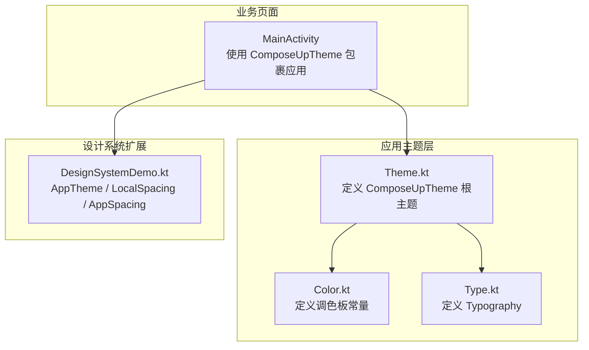
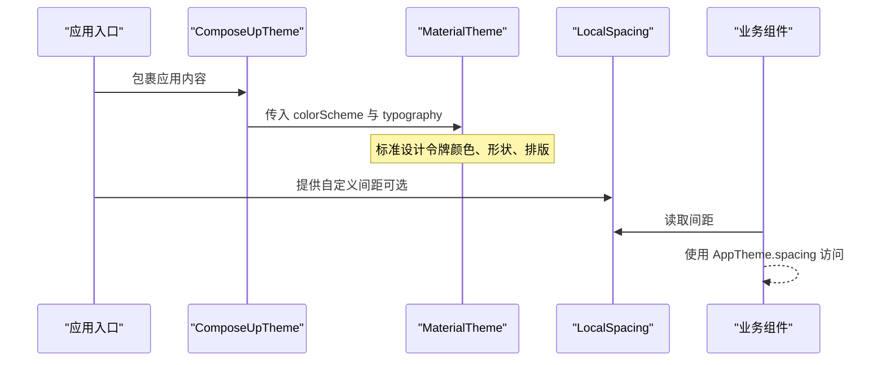
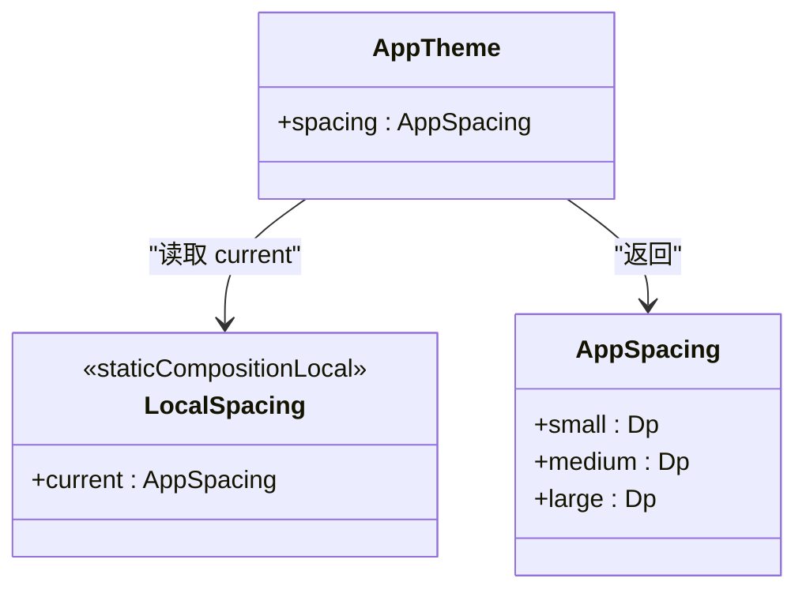
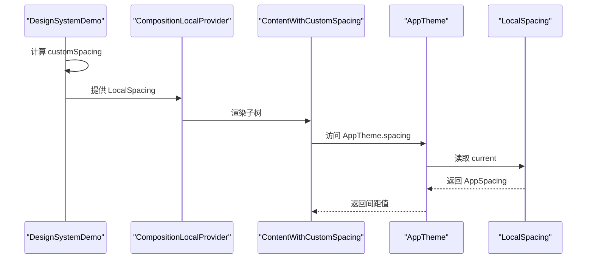
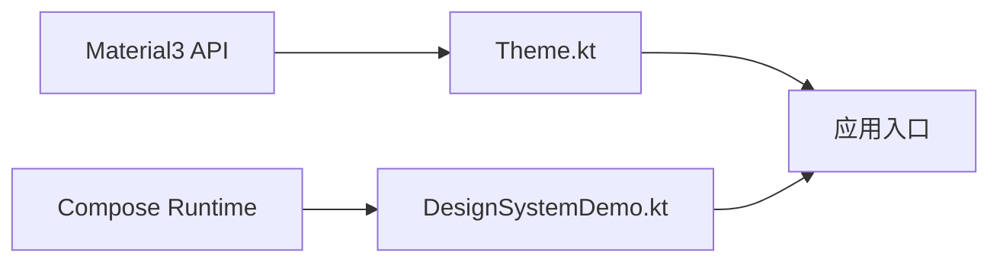

# 自定义设计系统扩展

<cite>
**本文引用的文件**   
- [Theme.kt](file://app/src/main/java/com/example/composeup/ui/theme/Theme.kt)
- [Color.kt](file://app/src/main/java/com/example/composeup/ui/theme/Color.kt)
- [Type.kt](file://app/src/main/java/com/example/composeup/ui/theme/Type.kt)
- [DesignSystemDemo.kt](file://app/src/main/java/com/example/composeup/compositionlocal/DesignSystemDemo.kt)
</cite>

## 目录
1. [引言](#引言)
2. [项目结构](#项目结构)
3. [核心组件](#核心组件)
4. [架构总览](#架构总览)
5. [详细组件分析](#详细组件分析)
6. [依赖关系分析](#依赖关系分析)
7. [性能考虑](#性能考虑)
8. [故障排查指南](#故障排查指南)
9. [结论](#结论)
10. [附录：设计规范到代码的映射建议](#附录设计规范到代码的映射建议)

## 引言
本文面向希望基于 Material Design 3 与 Jetpack Compose 构建可扩展、可维护的设计系统的工程师。重点包括：
- 如何在不侵入业务代码的前提下，扩展 MaterialTheme，新增如间距（Spacing）等设计维度。
- ReadOnlyComposable 的使用场景与设计原则。
- AppTheme.spacing 的实现模式与最佳实践。
- 设计令牌（Design Tokens）的管理方式、主题配置的层次结构与扩展机制。
- 将设计规范转化为可复用代码结构的完整示例。
- 与设计系统的集成方式与性能注意事项。

## 项目结构
本项目在 app 模块中采用“功能域 + 主题层”的组织方式：
- ui/theme：集中管理颜色、排版与根主题入口。
- compositionlocal：通过 CompositionLocal 提供跨层级共享的设计令牌，如间距。
- 其他业务模块按功能划分，不直接耦合具体 UI 细节。

图表来源
- [Theme.kt:35-57](file://app/src/main/java/com/example/composeup/ui/theme/Theme.kt#L35-L57)
- [Color.kt:1-11](file://app/src/main/java/com/example/composeup/ui/theme/Color.kt#L1-L11)
- [Type.kt:1-34](file://app/src/main/java/com/example/composeup/ui/theme/Type.kt#L1-L34)
- [DesignSystemDemo.kt:24-38](file://app/src/main/java/com/example/composeup/compositionlocal/DesignSystemDemo.kt#L24-L38)

章节来源
- [Theme.kt:35-57](file://app/src/main/java/com/example/composeup/ui/theme/Theme.kt#L35-L57)
- [Color.kt:1-11](file://app/src/main/java/com/example/composeup/ui/theme/Color.kt#L1-L11)
- [Type.kt:1-34](file://app/src/main/java/com/example/composeup/ui/theme/Type.kt#L1-L34)
- [DesignSystemDemo.kt:24-38](file://app/src/main/java/com/example/composeup/compositionlocal/DesignSystemDemo.kt#L24-L38)

## 核心组件
- 根主题入口 ComposeUpTheme：负责选择颜色方案、注入 MaterialTheme 的颜色与排版，并作为整个应用的组合上下文根。
- 设计令牌容器 AppSpacing：以数据类承载一组间距值，便于统一管理与替换。
- 全局访问器 AppTheme：通过静态对象暴露 spacing 属性，简化调用方读取逻辑。
- 作用域提供者 LocalSpacing：基于 staticCompositionLocalOf 创建的作用域变量，用于在不同区域覆盖默认间距。

章节来源
- [Theme.kt:35-57](file://app/src/main/java/com/example/composeup/ui/theme/Theme.kt#L35-L57)
- [DesignSystemDemo.kt:24-38](file://app/src/main/java/com/example/composeup/compositionlocal/DesignSystemDemo.kt#L24-L38)

## 架构总览
下图展示了从应用入口到主题与自定义设计令牌的流向：

图表来源
- [Theme.kt:35-57](file://app/src/main/java/com/example/composeup/ui/theme/Theme.kt#L35-L57)
- [DesignSystemDemo.kt:30-38](file://app/src/main/java/com/example/composeup/compositionlocal/DesignSystemDemo.kt#L30-L38)

## 详细组件分析

### 根主题 ComposeUpTheme
职责与行为：
- 根据系统深色模式与动态色彩能力选择颜色方案。
- 将颜色方案与排版注入 MaterialTheme，为子树提供标准设计令牌。
- 保持主题配置单一入口，避免在业务层散落主题设置。

关键点：
- 动态色彩仅在 Android 12+ 可用，需做版本判断。
- 主题函数应作为应用或页面的最外层包裹，确保所有子组件都能消费主题。

章节来源
- [Theme.kt:35-57](file://app/src/main/java/com/example/composeup/ui/theme/Theme.kt#L35-L57)

### 颜色与排版
- 颜色：集中定义浅色与深色两套色板，并通过 Material3 API 生成 ColorScheme。
- 排版：定义基础 Typography，后续可按品牌规范扩展更多文本样式。

章节来源
- [Color.kt:1-11](file://app/src/main/java/com/example/composeup/ui/theme/Color.kt#L1-L11)
- [Type.kt:1-34](file://app/src/main/java/com/example/composeup/ui/theme/Type.kt#L1-L34)

### 自定义设计令牌：间距（Spacing）
实现要点：
- 使用 data class 封装一组间距值，保证类型安全与可组合性。
- 通过 staticCompositionLocalOf 创建 LocalSpacing，提供默认值与作用域覆盖能力。
- 通过 object AppTheme 暴露 spacing 属性，简化调用方访问。

图表来源
- [DesignSystemDemo.kt:24-38](file://app/src/main/java/com/example/composeup/compositionlocal/DesignSystemDemo.kt#L24-L38)

#### 使用流程（序列图）

图表来源
- [DesignSystemDemo.kt:40-74](file://app/src/main/java/com/example/composeup/compositionlocal/DesignSystemDemo.kt#L40-L74)

章节来源
- [DesignSystemDemo.kt:24-74](file://app/src/main/java/com/example/composeup/compositionlocal/DesignSystemDemo.kt#L24-L74)

### ReadOnlyComposable 的使用与设计原则
- 用途：标记只读的组合式访问器，表明该 getter 不会触发重组，也不会产生副作用。
- 适用场景：从 CompositionLocal 读取不可变设计令牌（如间距、阴影、圆角等）。
- 设计原则：
  - 将只读访问器标注为 @ReadOnlyComposable，提升可读性与稳定性。
  - 避免在只读访问器中执行状态变更或副作用。
  - 将可变状态下沉到更高层，由 CompositionLocalProvider 提供。

章节来源
- [DesignSystemDemo.kt:32-38](file://app/src/main/java/com/example/composeup/compositionlocal/DesignSystemDemo.kt#L32-L38)

### AppTheme.spacing 的实现模式与最佳实践
- 模式：object + @Composable + @ReadOnlyComposable 的 getter，内部委托给 LocalSpacing.current。
- 优点：
  - 调用方无需显式传递 LocalSpacing，降低耦合。
  - 通过作用域覆盖，可在不同页面或屏幕尺寸下提供不同的间距策略。
- 最佳实践：
  - 将 AppTheme 作为设计令牌命名空间，后续可扩展 shadow、radius、elevation 等。
  - 对每个设计维度建立独立的 data class，避免巨型主题对象。
  - 在页面级或区域级使用 CompositionLocalProvider 覆盖默认值，实现响应式布局。

章节来源
- [DesignSystemDemo.kt:32-38](file://app/src/main/java/com/example/composeup/compositionlocal/DesignSystemDemo.kt#L32-L38)

### 设计令牌的管理与主题层次结构
- 层次结构：
  - 系统层：MaterialTheme.colorScheme、typography、shapes 等标准令牌。
  - 应用层：AppTheme.spacing 等自定义令牌，通过 CompositionLocal 注入。
  - 页面层：按需覆盖局部令牌，适配不同设备或业务场景。
- 扩展机制：
  - 新增维度时，新建 data class 与对应的 LocalXxx，并在 AppTheme 暴露只读访问器。
  - 在需要覆盖的区域使用 CompositionLocalProvider 提供新值。

章节来源
- [Theme.kt:35-57](file://app/src/main/java/com/example/composeup/ui/theme/Theme.kt#L35-L57)
- [DesignSystemDemo.kt:24-38](file://app/src/main/java/com/example/composeup/compositionlocal/DesignSystemDemo.kt#L24-L38)

### 将设计规范转化为可复用代码结构
- 步骤建议：
  1. 梳理设计规范（颜色、排版、间距、圆角、阴影等），拆分为独立的数据类。
  2. 为每个维度创建 LocalXxx 与 AppTheme 下的只读访问器。
  3. 在根主题或页面入口处提供默认值，必要时在区域级覆盖。
  4. 在业务组件中仅消费 AppTheme.xxxx，不直接引用原始单位或硬编码值。
- 收益：
  - 统一视觉语言，减少重复与不一致。
  - 支持多主题与多设备适配，改动集中在主题层。

[本节为概念性说明，不直接分析具体文件]

## 依赖关系分析
- 主题层依赖 Material3 提供的颜色与排版 API。
- 设计系统扩展依赖 Compose Runtime 的 CompositionLocal 机制。
- 业务组件依赖 AppTheme 暴露的只读访问器，从而间接消费设计令牌。

图表来源
- [Theme.kt:35-57](file://app/src/main/java/com/example/composeup/ui/theme/Theme.kt#L35-L57)
- [DesignSystemDemo.kt:24-38](file://app/src/main/java/com/example/composeup/compositionlocal/DesignSystemDemo.kt#L24-L38)

章节来源
- [Theme.kt:35-57](file://app/src/main/java/com/example/composeup/ui/theme/Theme.kt#L35-L57)
- [DesignSystemDemo.kt:24-38](file://app/src/main/java/com/example/composeup/compositionlocal/DesignSystemDemo.kt#L24-L38)

## 性能考虑
- 只读访问器：AppTheme.spacing 使用 @ReadOnlyComposable，避免不必要的重组。
- 作用域覆盖：尽量在稳定的边界（如页面级）提供 CompositionLocalProvider，减少频繁重建。
- 默认值稳定：AppSpacing 使用默认值，避免每次组合都创建新实例。
- 主题切换：动态色彩与深色模式切换应在合适时机进行，避免在高频重组路径中频繁重建主题。

[本节为通用性能建议，不直接分析具体文件]

## 故障排查指南
常见问题与定位思路：
- 无法读取间距：
  - 检查是否在 CompositionLocalProvider 的作用域内访问 LocalSpacing。
  - 确认 AppTheme.spacing 被正确标注为 @Composable 且位于组合上下文中。
- 间距未生效：
  - 检查是否提供了覆盖值，以及覆盖范围是否包含目标组件。
  - 确认覆盖值的类型与默认值一致。
- 主题未生效：
  - 确认 ComposeUpTheme 包裹了需要消费主题的组件。
  - 检查颜色方案与排版是否正确注入 MaterialTheme。

章节来源
- [DesignSystemDemo.kt:40-74](file://app/src/main/java/com/example/composeup/compositionlocal/DesignSystemDemo.kt#L40-L74)
- [Theme.kt:35-57](file://app/src/main/java/com/example/composeup/ui/theme/Theme.kt#L35-L57)

## 结论
通过将 MaterialTheme 的标准令牌与自定义设计令牌（如间距）分层管理，并使用 CompositionLocal 与只读访问器，可以在不侵入业务代码的前提下，构建可扩展、可维护的设计系统。AppTheme.spacing 的模式可作为后续扩展阴影、圆角、动效等维度的模板，帮助团队将设计规范稳定地落地为可复用的代码结构。

[本节为总结性内容，不直接分析具体文件]

## 附录：设计规范到代码的映射建议
- 颜色：
  - 将品牌主色、辅助色、语义色映射到 ColorScheme 字段。
  - 区分明暗主题，提供两套色板。
- 排版：
  - 将标题、正文、标签等映射到 Typography 的不同样式。
- 间距：
  - 将间距规范映射到 AppSpacing 的 small/medium/large 等字段。
- 形状与阴影：
  - 后续可新增 AppShape、AppShadow，并以相同模式接入 AppTheme。

[本节为概念性说明，不直接分析具体文件]