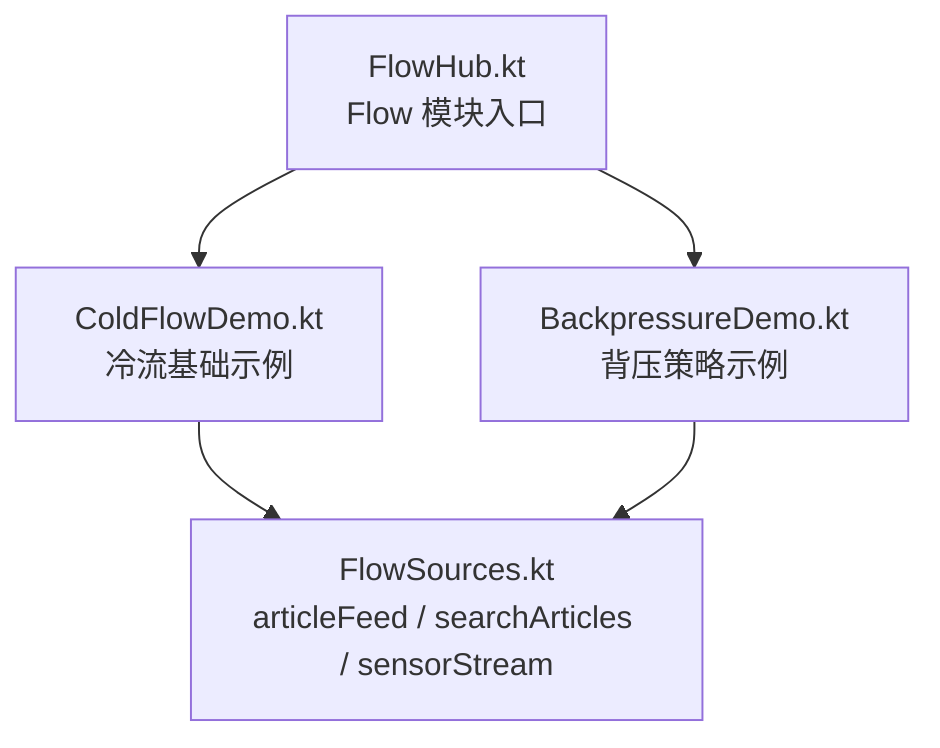
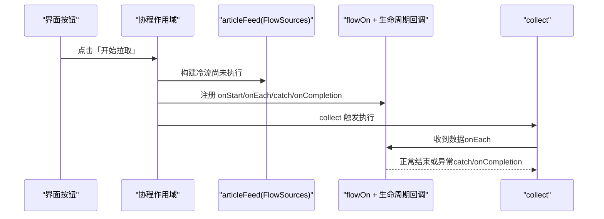
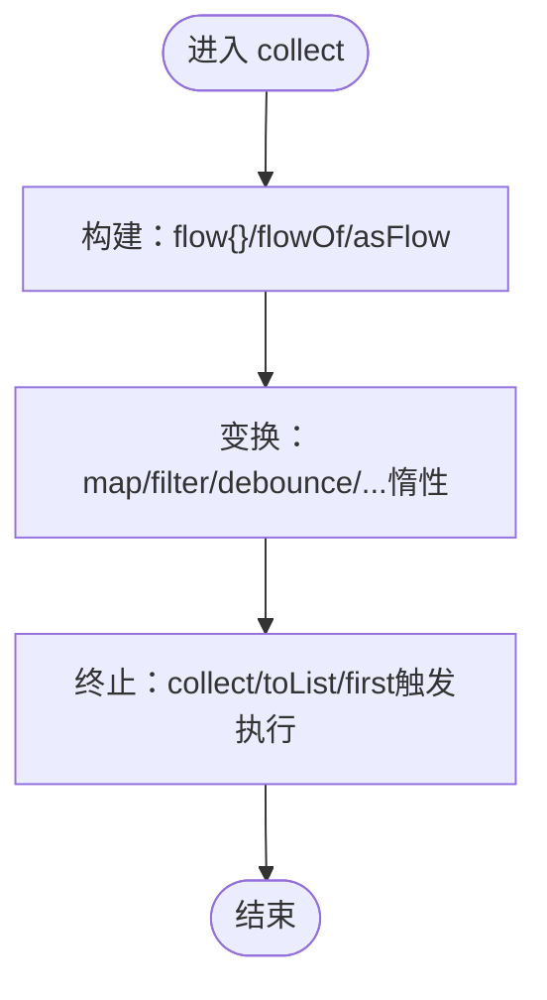
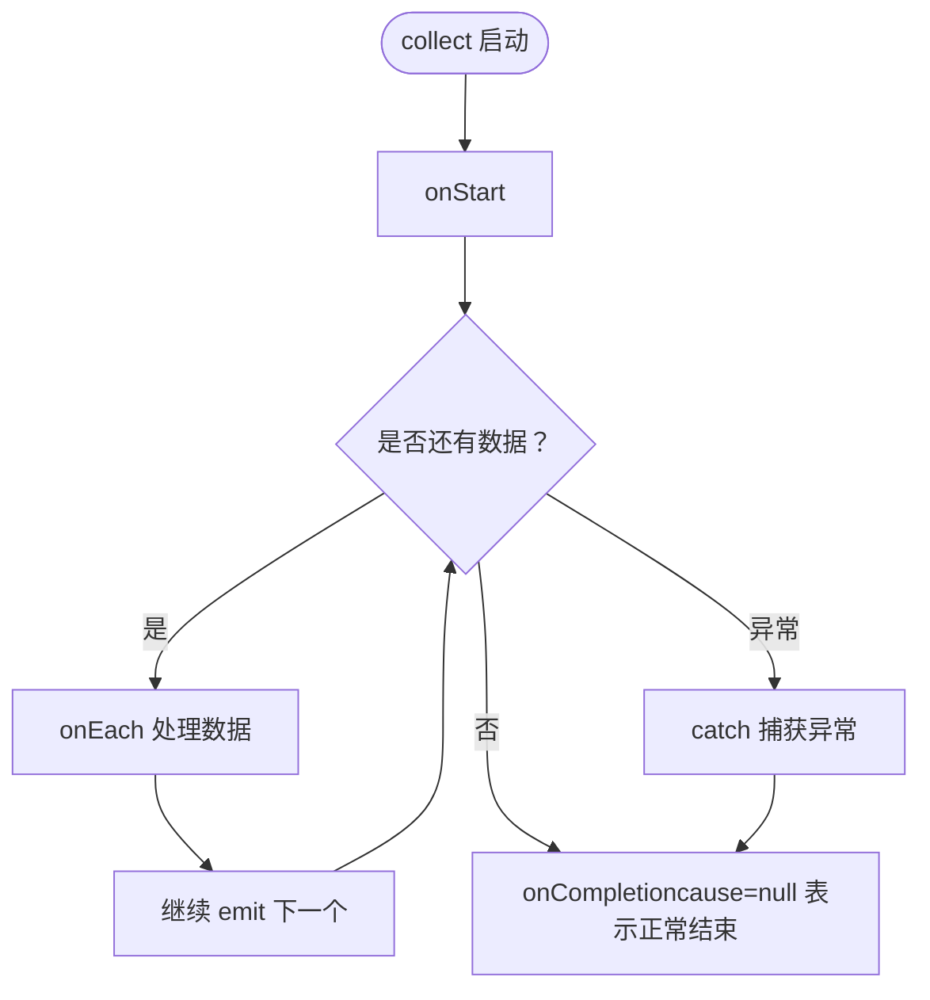
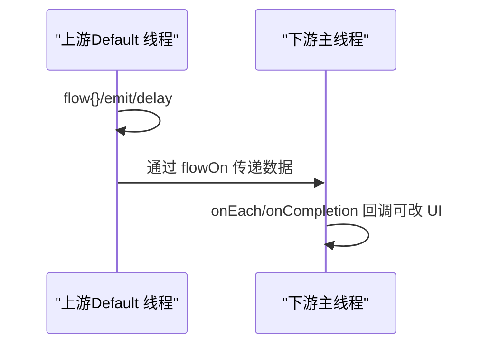
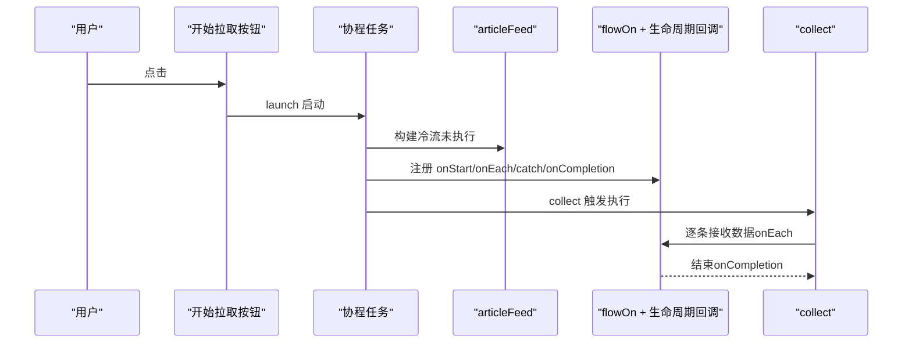
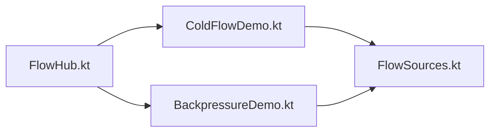
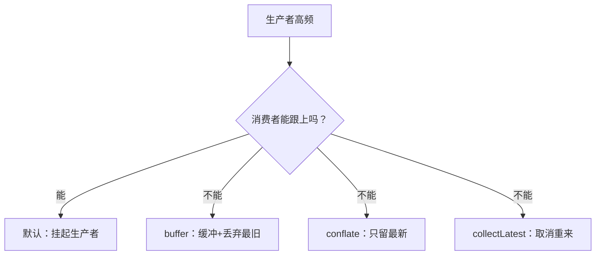

# Cold Flow 基础

<cite>
**本文引用的文件**   
- [ColdFlowDemo.kt](file://app/src/main/java/com/example/composeup/flow/ColdFlowDemo.kt)
- [BackpressureDemo.kt](file://app/src/main/java/com/example/composeup/flow/BackpressureDemo.kt)
- [FlowSources.kt](file://app/src/main/java/com/example/composeup/flow/FlowSources.kt)
- [FlowHub.kt](file://app/src/main/java/com/example/composeup/flow/FlowHub.kt)
- [README.md](file://app/src/main/java/com/example/composeup/flow/README.md)
</cite>

## 目录
1. [引言](#引言)
2. [项目结构](#项目结构)
3. [核心组件](#核心组件)
4. [架构总览](#架构总览)
5. [详细组件分析](#详细组件分析)
6. [依赖关系分析](#依赖关系分析)
7. [性能与背压](#性能与背压)
8. [故障排查指南](#故障排查指南)
9. [结论](#结论)

## 引言
本文件聚焦 Kotlin Flow 的“冷流”特性，围绕以下目标展开：
- 解释 Flow 为什么是冷流：只有 collect 时才执行，每次 collect 都从头开始。
- 对比 flowOf、asFlow、flow 构建器的使用场景与差异。
- 说明 emit 逐条发出数据的机制，以及 onStart/onEach/onCompletion/catch 等生命周期回调。
- 给出 flowOn 切换上游线程的实际案例。
- 提供一个模拟网络分页拉取的完整示例，展示“构建 → 变换 → 收集”三段式模式。
- 解释背压的默认行为与生产者-消费者模型。

## 项目结构
Flow 相关代码集中在 app/src/main/java/com/example/composeup/flow 包下，其中与本主题最相关的文件如下：
- FlowSources.kt：提供可复用的假数据源（文章流、搜索流、传感器流）。
- ColdFlowDemo.kt：演示冷流、emit、生命周期回调、flowOn、终止操作符。
- BackpressureDemo.kt：演示背压四种策略（默认、buffer、conflate、collectLatest）。
- FlowHub.kt：Flow 模块入口，负责话题导航到具体示例。
- README.md：模块级说明，包含心智模型、三段式、选型速查与实践清单。

图表来源
- [FlowHub.kt:94-170](file://app/src/main/java/com/example/composeup/flow/FlowHub.kt#L94-L170)
- [ColdFlowDemo.kt:48-153](file://app/src/main/java/com/example/composeup/flow/ColdFlowDemo.kt#L48-L153)
- [BackpressureDemo.kt:65-164](file://app/src/main/java/com/example/composeup/flow/BackpressureDemo.kt#L65-L164)
- [FlowSources.kt:41-76](file://app/src/main/java/com/example/composeup/flow/FlowSources.kt#L41-L76)

章节来源
- [FlowHub.kt:30-85](file://app/src/main/java/com/example/composeup/flow/FlowHub.kt#L30-L85)
- [README.md:94-108](file://app/src/main/java/com/example/composeup/flow/README.md#L94-L108)

## 核心组件
- 数据源（FlowSources.kt）
  - articleFeed：模拟一次网络分页拉取，内部用 delay 模拟耗时，逐条 emit。
  - searchArticles：模拟检索，配合 flatMapLatest 演示取消旧请求。
  - sensorStream：高频数据源，用于背压演示。
- 冷流示例（ColdFlowDemo.kt）
  - 通过按钮触发 collect，串联 onStart/onEach/catch/onCompletion。
  - 使用 flowOn 将上游切到后台线程，下游回调在主线程执行。
  - 演示终止操作符 toList/reduce/first。
- 背压示例（BackpressureDemo.kt）
  - 对比默认挂起、buffer、conflate、collectLatest 四种策略。
  - 统计生产数与消费数，直观体现背压效果。

章节来源
- [FlowSources.kt:8-21](file://app/src/main/java/com/example/composeup/flow/FlowSources.kt#L8-L21)
- [FlowSources.kt:41-76](file://app/src/main/java/com/example/composeup/flow/FlowSources.kt#L41-L76)
- [ColdFlowDemo.kt:32-47](file://app/src/main/java/com/example/composeup/flow/ColdFlowDemo.kt#L32-L47)
- [BackpressureDemo.kt:30-52](file://app/src/main/java/com/example/composeup/flow/BackpressureDemo.kt#L30-L52)

## 架构总览
下图展示了“构建 → 变换 → 收集”的三段式在真实示例中的调用链：按钮点击触发协程启动，调用 articleFeed 构建冷流；中间通过 flowOn 切换上游线程；随后依次经过 onStart/onEach/catch/onCompletion；最终由 collect 真正执行并逐条接收数据。

图表来源
- [ColdFlowDemo.kt:71-90](file://app/src/main/java/com/example/composeup/flow/ColdFlowDemo.kt#L71-L90)
- [FlowSources.kt:41-46](file://app/src/main/java/com/example/composeup/flow/FlowSources.kt#L41-L46)

## 详细组件分析

### 冷流与三段式（构建 → 变换 → 收集）
- 构建阶段
  - flow { }：灵活构建器，支持 suspend 函数与 delay，适合异步 IO。
  - flowOf(...)：已知固定值集合时快速创建流。
  - 集合.asFlow()：把 List/Range 等集合转为流。
- 变换阶段
  - map/filter/take 等中间操作符惰性返回新流，不触发执行。
- 收集阶段
  - collect/toList/first 等终止操作符才真正按下“开始键”。

图表来源
- [ColdFlowDemo.kt:120-139](file://app/src/main/java/com/example/composeup/flow/ColdFlowDemo.kt#L120-L139)
- [README.md:83-90](file://app/src/main/java/com/example/composeup/flow/README.md#L83-L90)

章节来源
- [ColdFlowDemo.kt:32-47](file://app/src/main/java/com/example/composeup/flow/ColdFlowDemo.kt#L32-L47)
- [ColdFlowDemo.kt:120-139](file://app/src/main/java/com/example/composeup/flow/ColdFlowDemo.kt#L120-L139)
- [README.md:83-90](file://app/src/main/java/com/example/composeup/flow/README.md#L83-L90)

### emit 逐条发出与生命周期回调
- emit 的作用
  - 在 flow { } 中逐条发出数据，而不是攒齐后一次性返回。
  - 配合 delay 模拟网络延迟，体现“流”的时间轴语义。
- 生命周期回调
  - onStart：collect 已启动，准备接收数据。
  - onEach：每收到一个值时的处理点。
  - catch：捕获上游异常（吞掉异常后 onCompletion 的 cause 通常为 null）。
  - onCompletion：流结束（正常或异常），可用于收尾逻辑。

图表来源
- [ColdFlowDemo.kt:75-90](file://app/src/main/java/com/example/composeup/flow/ColdFlowDemo.kt#L75-L90)
- [FlowSources.kt:41-46](file://app/src/main/java/com/example/composeup/flow/FlowSources.kt#L41-L46)

章节来源
- [ColdFlowDemo.kt:71-90](file://app/src/main/java/com/example/composeup/flow/ColdFlowDemo.kt#L71-L90)
- [FlowSources.kt:41-46](file://app/src/main/java/com/example/composeup/flow/FlowSources.kt#L41-L46)

### flowOn 切换上游线程
- flowOn 只影响上游：让 flow{}/emit/delay 在后台线程运行。
- 下游的 onEach/onCompletion 等回调仍在收集者所在线程（通常是主线程），便于安全更新 UI。
- 注意：flowOn 会引入内部缓冲 channel，改变背压表现。

图表来源
- [ColdFlowDemo.kt:78-83](file://app/src/main/java/com/example/composeup/flow/ColdFlowDemo.kt#L78-L83)

章节来源
- [ColdFlowDemo.kt:78-83](file://app/src/main/java/com/example/composeup/flow/ColdFlowDemo.kt#L78-L83)
- [README.md:212-213](file://app/src/main/java/com/example/composeup/flow/README.md#L212-L213)

### 模拟网络分页拉取：构建 → 变换 → 收集
- 构建：articleFeed 使用 flow { } 和 delay 模拟网络延迟，逐条 emit 标题。
- 变换：可使用 flowOn 切换上游线程；也可链式添加 map/filter 等操作符。
- 收集：collect 触发执行，onStart/onEach/catch/onCompletion 记录时间轴事件。

图表来源
- [ColdFlowDemo.kt:71-90](file://app/src/main/java/com/example/composeup/flow/ColdFlowDemo.kt#L71-L90)
- [FlowSources.kt:41-46](file://app/src/main/java/com/example/composeup/flow/FlowSources.kt#L41-L46)

章节来源
- [ColdFlowDemo.kt:71-90](file://app/src/main/java/com/example/composeup/flow/ColdFlowDemo.kt#L71-L90)
- [FlowSources.kt:41-46](file://app/src/main/java/com/example/composeup/flow/FlowSources.kt#L41-L46)

### 三种构建方式对比
- flow { }
  - 适用：需要 suspend 函数、delay、IO 操作的复杂构建逻辑。
  - 特点：灵活，逐条 emit，适合模拟网络/DB 读取。
- flowOf(...)
  - 适用：已知固定几个值的场景。
  - 特点：简洁，直接生成流。
- 集合.asFlow()
  - 适用：已有 List/Range 等集合，想转成流。
  - 特点：轻量转换，常用于测试或简单数据处理。

章节来源
- [ColdFlowDemo.kt:120-139](file://app/src/main/java/com/example/composeup/flow/ColdFlowDemo.kt#L120-L139)
- [README.md:114-137](file://app/src/main/java/com/example/composeup/flow/README.md#L114-L137)

## 依赖关系分析
- FlowHub 作为入口，根据选择渲染 ColdFlowDemo 或 BackpressureDemo。
- ColdFlowDemo 依赖 FlowSources.articleFeed 作为数据源。
- BackpressureDemo 依赖 FlowSources.sensorStream 制造高频数据。
- 三者共同遵循“构建 → 变换 → 收集”的模式，并通过 README 的心智模型统一理解。

图表来源
- [FlowHub.kt:163-170](file://app/src/main/java/com/example/composeup/flow/FlowHub.kt#L163-L170)
- [ColdFlowDemo.kt:48-153](file://app/src/main/java/com/example/composeup/flow/ColdFlowDemo.kt#L48-L153)
- [BackpressureDemo.kt:65-164](file://app/src/main/java/com/example/composeup/flow/BackpressureDemo.kt#L65-L164)
- [FlowSources.kt:41-76](file://app/src/main/java/com/example/composeup/flow/FlowSources.kt#L41-L76)

章节来源
- [FlowHub.kt:94-170](file://app/src/main/java/com/example/composeup/flow/FlowHub.kt#L94-L170)
- [README.md:94-108](file://app/src/main/java/com/example/composeup/flow/README.md#L94-L108)

## 性能与背压
- 默认背压行为
  - Flow 天生背压安全：emit 是挂起函数，消费者没准备好时，生产者自然被挂起，不会无界缓冲导致内存爆炸。
  - 代价：整体节奏被最慢的消费者拖慢。
- 四种策略对比
  - 默认：无需额外操作符，生产数等于消费数，一个不丢。
  - buffer：解耦上下游，各自全速；缓冲区满时可丢弃最旧值，允许积压削峰。
  - conflate：忙时只保留最新值，丢弃中间值，适合“只关心最新状态”。
  - collectLatest：新值到来即取消上一次处理，重新开始，适合“只处理最新请求”。

图表来源
- [BackpressureDemo.kt:30-52](file://app/src/main/java/com/example/composeup/flow/BackpressureDemo.kt#L30-L52)
- [BackpressureDemo.kt:88-106](file://app/src/main/java/com/example/composeup/flow/BackpressureDemo.kt#L88-L106)

章节来源
- [BackpressureDemo.kt:30-52](file://app/src/main/java/com/example/composeup/flow/BackpressureDemo.kt#L30-L52)
- [BackpressureDemo.kt:88-106](file://app/src/main/java/com/example/composeup/flow/BackpressureDemo.kt#L88-L106)
- [README.md:198-213](file://app/src/main/java/com/example/composeup/flow/README.md#L198-L213)

## 故障排查指南
- 常见问题
  - 误以为中间操作符会立即执行：它们惰性，只有终止操作符才触发。
  - 在后台线程修改 UI 状态：应确保 onEach/onCompletion 等回调在主线程执行（可通过 flowOn 控制上游线程）。
  - 忘记 catch 上游异常：catch 只捕获上游异常，且要放在 catch 之后的操作符异常它管不到。
  - 在 repeatOnLifecycle 的 block 里写非幂等逻辑：block 会被反复启停，需保证幂等。
- 建议做法
  - 使用 flowOn 将耗时上游切到后台线程；UI 更新留在主线程。
  - 对一次性事件使用 SharedFlow(replay=0)，避免重复消费。
  - 对 UI 状态使用 StateFlow，并以 update{} 原子读写。
  - 使用 collectAsStateWithLifecycle 安全收集，避免后台仍收集。

章节来源
- [ColdFlowDemo.kt:141-151](file://app/src/main/java/com/example/composeup/flow/ColdFlowDemo.kt#L141-L151)
- [README.md:255-273](file://app/src/main/java/com/example/composeup/flow/README.md#L255-L273)

## 结论
- Flow 是冷流：定义时不执行，每次 collect 都从头执行，像“点播”一样。
- 三段式是理解 Flow 的关键：构建（flow{}/flowOf/asFlow）、变换（中间操作符）、收集（终止操作符）。
- emit 逐条发出数据，配合 onStart/onEach/onCompletion/catch 可在时间轴上观察流的执行。
- flowOn 切换上游线程，不影响下游回调的执行线程，便于安全更新 UI。
- 背压默认安全，但可根据业务选择 buffer/conflate/collectLatest 来优化吞吐与资源占用。
- 推荐实践：UI 状态用 StateFlow，事件用 SharedFlow(replay=0)，Compose 中用 collectAsStateWithLifecycle 安全收集。