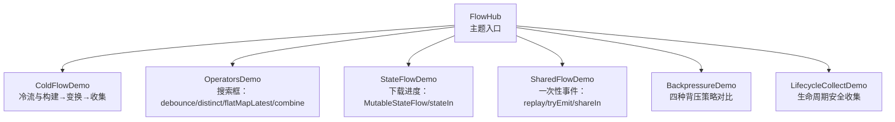
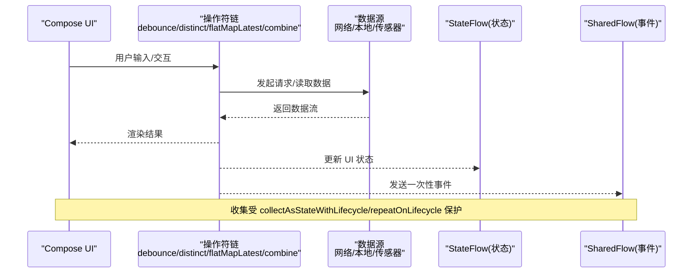
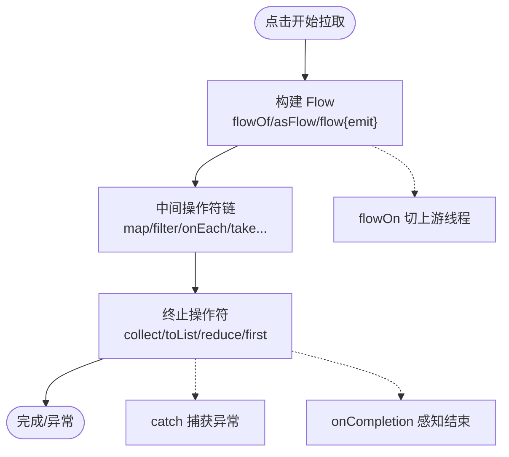
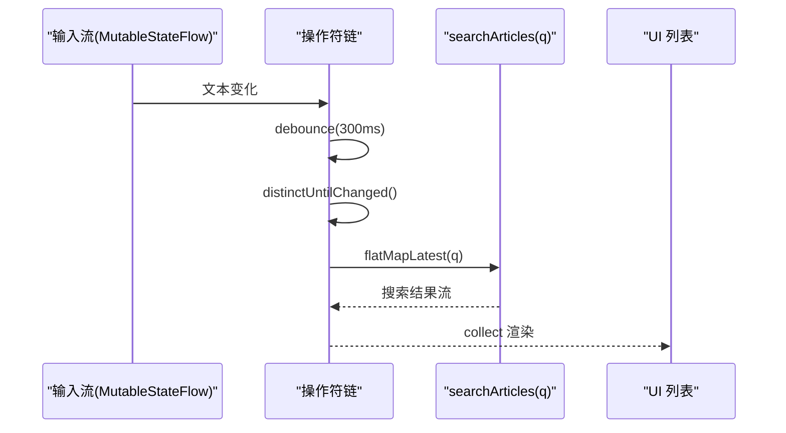
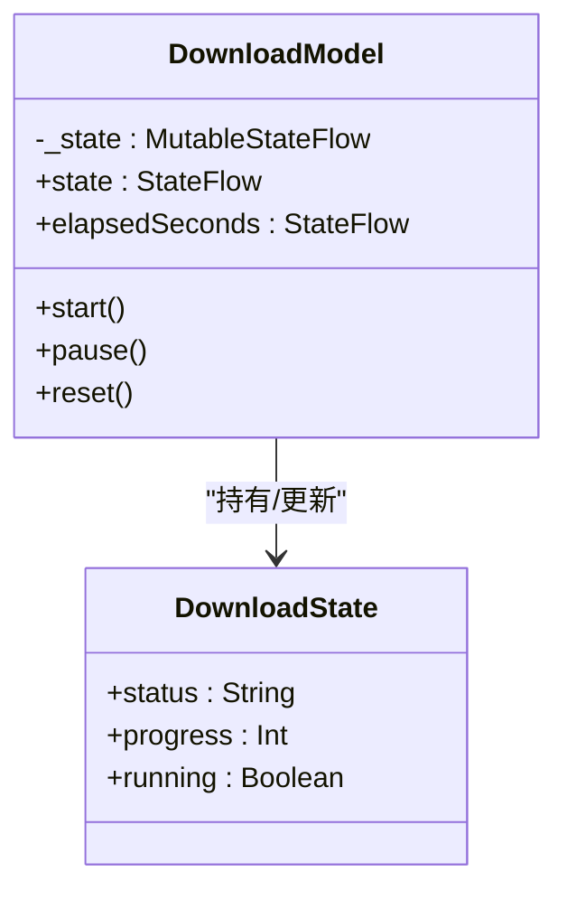
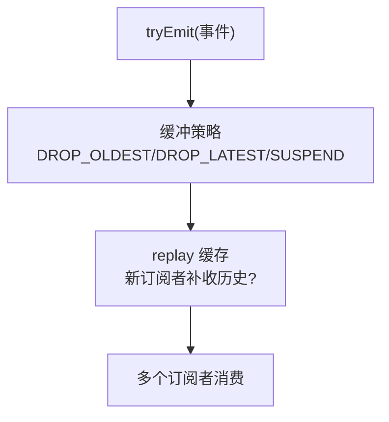
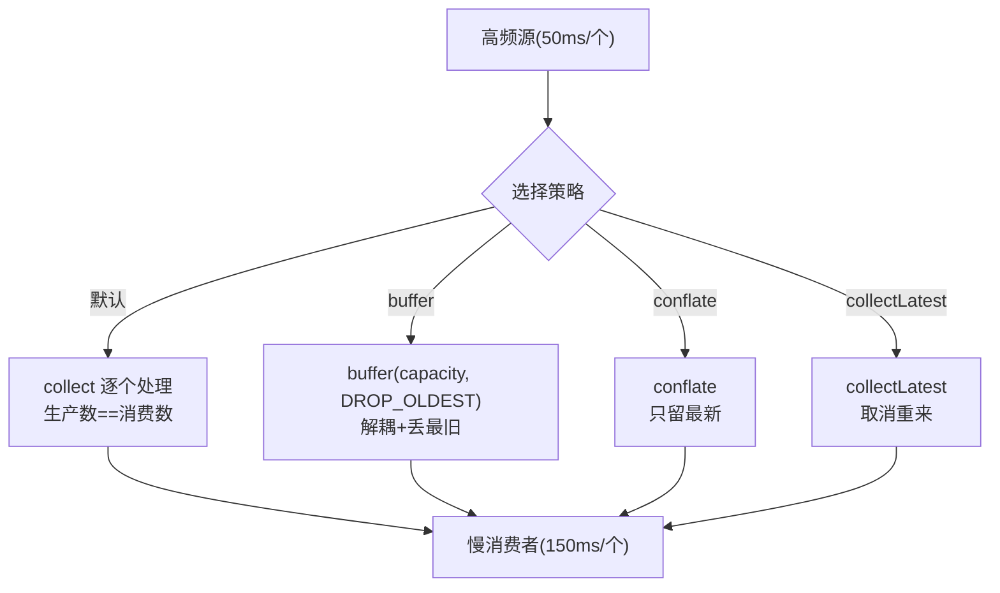
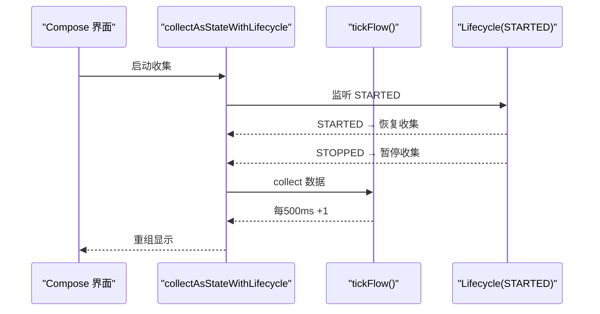
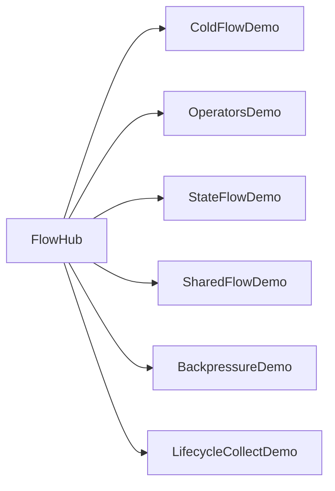

# Flow 全家桶

<cite>
**本文引用的文件**   
- [FlowHub.kt](file://app/src/main/java/com/example/composeup/flow/FlowHub.kt)
- [ColdFlowDemo.kt](file://app/src/main/java/com/example/composeup/flow/ColdFlowDemo.kt)
- [OperatorsDemo.kt](file://app/src/main/java/com/example/composeup/flow/OperatorsDemo.kt)
- [StateFlowDemo.kt](file://app/src/main/java/com/example/composeup/flow/StateFlowDemo.kt)
- [SharedFlowDemo.kt](file://app/src/main/java/com/example/composeup/flow/SharedFlowDemo.kt)
- [BackpressureDemo.kt](file://app/src/main/java/com/example/composeup/flow/BackpressureDemo.kt)
- [LifecycleCollectDemo.kt](file://app/src/main/java/com/example/composeup/flow/LifecycleCollectDemo.kt)
</cite>

## 目录
1. [引言](#引言)
2. [项目结构](#项目结构)
3. [核心组件](#核心组件)
4. [架构总览](#架构总览)
5. [详细组件分析](#详细组件分析)
6. [依赖关系分析](#依赖关系分析)
7. [性能与优化](#性能与优化)
8. [故障排查指南](#故障排查指南)
9. [结论](#结论)
10. [附录：最佳实践清单](#附录最佳实践清单)

## 引言
本仓库的 Flow 示例以一条真实业务主线串联：从一次网络请求出发，逐步加入检索、状态管理、事件通知、高频数据处理，最后落到与界面生命周期安全协作。覆盖的主题包括：
- Cold Flow 与 Hot Flow 的区别与适用场景
- StateFlow 与 SharedFlow 的实现要点与选型
- 操作符链式调用（防抖、去重、合并、展平）与性能优化
- 背压处理（默认挂起、buffer、conflate、collectLatest）
- 生命周期管理与错误处理
- 协程与 Flow 集成、Compose 中的响应式模式

这些内容全部由 app 模块下的 flow 包示例实现，便于在 Compose UI 中直接观察行为差异。

## 项目结构
flow 包采用“主题入口 + 专题示例”的组织方式：
- FlowHub.kt：统一入口，按主题导航到各示例页面
- 每个 .kt 文件对应一个主题：冷流、操作符、StateFlow、SharedFlow、背压、生命周期收集

图表来源
- [FlowHub.kt:92-172](file://app/src/main/java/com/example/composeup/flow/FlowHub.kt#L92-L172)

章节来源
- [FlowHub.kt:30-85](file://app/src/main/java/com/example/composeup/flow/FlowHub.kt#L30-L85)
- [FlowHub.kt:92-172](file://app/src/main/java/com/example/composeup/flow/FlowHub.kt#L92-L172)

## 核心组件
- 冷流（Cold Flow）：定义时不执行，每次 collect 从头执行；适合“按需拉取”的数据源。
- 热流（Hot Flow）：不依赖 collect 存在；StateFlow 始终有当前值并去重，SharedFlow 可配置 replay 与缓冲策略。
- 操作符：中间操作符惰性组合，终止操作符触发执行；常用 debounce、distinctUntilChanged、flatMapLatest、combine、zip。
- 背压：Flow 默认背压安全；必要时用 buffer/conflate/collectLatest 调整吞吐与丢弃策略。
- 生命周期：使用 collectAsStateWithLifecycle 或 repeatOnLifecycle 保证后台不浪费资源。
- 错误处理：catch 捕获上游异常，onCompletion 感知结束原因。

章节来源
- [ColdFlowDemo.kt:32-47](file://app/src/main/java/com/example/composeup/flow/ColdFlowDemo.kt#L32-L47)
- [StateFlowDemo.kt:34-48](file://app/src/main/java/com/example/composeup/flow/StateFlowDemo.kt#L34-L48)
- [SharedFlowDemo.kt:30-46](file://app/src/main/java/com/example/composeup/flow/SharedFlowDemo.kt#L30-L46)
- [OperatorsDemo.kt:34-49](file://app/src/main/java/com/example/composeup/flow/OperatorsDemo.kt#L34-L49)
- [BackpressureDemo.kt:30-64](file://app/src/main/java/com/example/composeup/flow/BackpressureDemo.kt#L30-L64)
- [LifecycleCollectDemo.kt:41-59](file://app/src/main/java/com/example/composeup/flow/LifecycleCollectDemo.kt#L41-L59)

## 架构总览
下图展示从 UI 到数据源的典型调用链：UI 通过操作符链对输入流进行变换，最终由终止操作符消费；状态类组件将结果暴露为 StateFlow，事件类组件通过 SharedFlow 广播一次性事件；所有收集均受生命周期门控保护。

图表来源
- [OperatorsDemo.kt:59-72](file://app/src/main/java/com/example/composeup/flow/OperatorsDemo.kt#L59-L72)
- [StateFlowDemo.kt:161-183](file://app/src/main/java/com/example/composeup/flow/StateFlowDemo.kt#L161-L183)
- [SharedFlowDemo.kt:51-67](file://app/src/main/java/com/example/composeup/flow/SharedFlowDemo.kt#L51-L67)
- [LifecycleCollectDemo.kt:64-77](file://app/src/main/java/com/example/composeup/flow/LifecycleCollectDemo.kt#L64-L77)

## 详细组件分析

### 冷流与“构建 → 变换 → 收集”三段式
- 构建：flowOf / asFlow / flow { emit } 定义数据来源
- 变换：map/filter/onEach/take 等中间操作符惰性组合
- 收集：collect/toList/reduce/first 等终止操作符触发执行
- 线程切换：flowOn 仅影响上游，下游回调仍在主线程更安全
- 生命周期与取消：cancel 协程会协作式取消上游 flow 的执行
- 错误处理：catch 捕获上游异常，onCompletion 感知结束原因

图表来源
- [ColdFlowDemo.kt:71-90](file://app/src/main/java/com/example/composeup/flow/ColdFlowDemo.kt#L71-L90)
- [ColdFlowDemo.kt:108-118](file://app/src/main/java/com/example/composeup/flow/ColdFlowDemo.kt#L108-L118)

章节来源
- [ColdFlowDemo.kt:32-47](file://app/src/main/java/com/example/composeup/flow/ColdFlowDemo.kt#L32-L47)
- [ColdFlowDemo.kt:71-90](file://app/src/main/java/com/example/composeup/flow/ColdFlowDemo.kt#L71-L90)
- [ColdFlowDemo.kt:108-118](file://app/src/main/java/com/example/composeup/flow/ColdFlowDemo.kt#L108-L118)
- [ColdFlowDemo.kt:141-151](file://app/src/main/java/com/example/composeup/flow/ColdFlowDemo.kt#L141-L151)

### 操作符链式调用与搜索框实战
- 搜索管线：debounce 防抖 → distinctUntilChanged 去重 → flatMapLatest 取消过期请求 → collect 渲染
- 多流聚合：combine 取各自最新值组合输出，zip 一一配对
- 高阶展平：flatMapLatest/Concat/Merge 控制内层流的并发与顺序

图表来源
- [OperatorsDemo.kt:59-72](file://app/src/main/java/com/example/composeup/flow/OperatorsDemo.kt#L59-L72)
- [OperatorsDemo.kt:74-98](file://app/src/main/java/com/example/composeup/flow/OperatorsDemo.kt#L74-L98)

章节来源
- [OperatorsDemo.kt:34-49](file://app/src/main/java/com/example/composeup/flow/OperatorsDemo.kt#L34-L49)
- [OperatorsDemo.kt:59-72](file://app/src/main/java/com/example/composeup/flow/OperatorsDemo.kt#L59-L72)
- [OperatorsDemo.kt:74-98](file://app/src/main/java/com/example/composeup/flow/OperatorsDemo.kt#L74-L98)
- [OperatorsDemo.kt:137-171](file://app/src/main/java/com/example/composeup/flow/OperatorsDemo.kt#L137-L171)

### StateFlow：持有“当前状态”的热流
- 特性：始终有初始值、conflated+去重、热流、支持同步读 .value
- 标准写法：私有 MutableStateFlow + 只读 asStateFlow 暴露；update 原子更新
- 冷流转热：stateIn(scope, SharingStarted.WhileSubscribed(...), 初始值)

图表来源
- [StateFlowDemo.kt:141-195](file://app/src/main/java/com/example/composeup/flow/StateFlowDemo.kt#L141-L195)

章节来源
- [StateFlowDemo.kt:34-48](file://app/src/main/java/com/example/composeup/flow/StateFlowDemo.kt#L34-L48)
- [StateFlowDemo.kt:107-137](file://app/src/main/java/com/example/composeup/flow/StateFlowDemo.kt#L107-L137)
- [StateFlowDemo.kt:161-195](file://app/src/main/java/com/example/composeup/flow/StateFlowDemo.kt#L161-L195)

### SharedFlow：可配置 replay 的事件热流
- 定位：一次性事件（Snackbar/Toast/导航），replay=0 避免重复消费
- 构造参数：replay、extraBufferCapacity、onBufferOverflow
- 发送：tryEmit 非阻塞，配合 DROP_OLDEST 不阻塞发送方
- 共享：shareIn 把冷流变成多订阅者共享的热流

图表来源
- [SharedFlowDemo.kt:51-67](file://app/src/main/java/com/example/composeup/flow/SharedFlowDemo.kt#L51-L67)
- [SharedFlowDemo.kt:148-163](file://app/src/main/java/com/example/composeup/flow/SharedFlowDemo.kt#L148-L163)

章节来源
- [SharedFlowDemo.kt:30-46](file://app/src/main/java/com/example/composeup/flow/SharedFlowDemo.kt#L30-L46)
- [SharedFlowDemo.kt:51-67](file://app/src/main/java/com/example/composeup/flow/SharedFlowDemo.kt#L51-L67)
- [SharedFlowDemo.kt:118-146](file://app/src/main/java/com/example/composeup/flow/SharedFlowDemo.kt#L118-L146)
- [SharedFlowDemo.kt:148-173](file://app/src/main/java/com/example/composeup/flow/SharedFlowDemo.kt#L148-L173)

### 背压处理：生产快于消费时的四种策略
- 默认：emit 是挂起函数，消费者没准备好则生产者挂起（天然背压安全）
- buffer：解耦上下游，缓冲区满按策略丢弃；允许少量积压削峰
- conflate：忙时丢弃中间值，只保留最新
- collectLatest：新值到来即取消上一次处理，重新开始

图表来源
- [BackpressureDemo.kt:30-52](file://app/src/main/java/com/example/composeup/flow/BackpressureDemo.kt#L30-L52)
- [BackpressureDemo.kt:85-107](file://app/src/main/java/com/example/composeup/flow/BackpressureDemo.kt#L85-L107)

章节来源
- [BackpressureDemo.kt:30-64](file://app/src/main/java/com/example/composeup/flow/BackpressureDemo.kt#L30-L64)
- [BackpressureDemo.kt:85-107](file://app/src/main/java/com/example/composeup/flow/BackpressureDemo.kt#L85-L107)
- [BackpressureDemo.kt:135-162](file://app/src/main/java/com/example/composeup/flow/BackpressureDemo.kt#L135-L162)

### 生命周期管理与安全收集
- 问题：持续流在后台仍收集会浪费资源甚至泄漏
- 方案：
  - Compose 首选：collectAsStateWithLifecycle
  - 通用手动：repeatOnLifecycle(STARTED)
  - 作为操作符：flowWithLifecycle(lifecycle, STARTED)
- 观察：切后台后安全计数停止，朴素计数继续增长

图表来源
- [LifecycleCollectDemo.kt:64-77](file://app/src/main/java/com/example/composeup/flow/LifecycleCollectDemo.kt#L64-L77)
- [LifecycleCollectDemo.kt:129-149](file://app/src/main/java/com/example/composeup/flow/LifecycleCollectDemo.kt#L129-L149)

章节来源
- [LifecycleCollectDemo.kt:41-59](file://app/src/main/java/com/example/composeup/flow/LifecycleCollectDemo.kt#L41-L59)
- [LifecycleCollectDemo.kt:64-77](file://app/src/main/java/com/example/composeup/flow/LifecycleCollectDemo.kt#L64-L77)
- [LifecycleCollectDemo.kt:129-160](file://app/src/main/java/com/example/composeup/flow/LifecycleCollectDemo.kt#L129-L160)

## 依赖关系分析
- FlowHub 作为入口，按主题分发到具体 Demo 组件
- 各 Demo 之间相对独立，但共享相同的 UI 辅助组件（按钮行、日志框、分段标题等）
- 状态与事件分别由 StateFlow 与 SharedFlow 承载，操作符链负责数据变换与合并
- 生命周期门控贯穿所有收集点，确保后台不浪费资源

图表来源
- [FlowHub.kt:163-170](file://app/src/main/java/com/example/composeup/flow/FlowHub.kt#L163-L170)

章节来源
- [FlowHub.kt:92-172](file://app/src/main/java/com/example/composeup/flow/FlowHub.kt#L92-L172)

## 性能与优化
- 操作符选择
  - 搜索：debounce + distinctUntilChanged + flatMapLatest，避免重复请求与闪烁
  - 多流聚合：combine 取最新值组合，适合 UI 状态聚合
- 背压策略
  - 默认背压安全；需要削峰用 buffer(DROP_OLDEST)，只需最新用 conflate，只处理最新请求用 collectLatest
- 线程切换
  - flowOn 仅影响上游，UI 状态更新留在主线程
- 热流启停
  - stateIn(WhileSubscribed) 无人订阅自动停止，节省资源
- 生命周期
  - 使用 collectAsStateWithLifecycle 或 repeatOnLifecycle，避免后台持续收集

章节来源
- [OperatorsDemo.kt:59-72](file://app/src/main/java/com/example/composeup/flow/OperatorsDemo.kt#L59-L72)
- [BackpressureDemo.kt:153-162](file://app/src/main/java/com/example/composeup/flow/BackpressureDemo.kt#L153-L162)
- [StateFlowDemo.kt:128-137](file://app/src/main/java/com/example/composeup/flow/StateFlowDemo.kt#L128-L137)
- [LifecycleCollectDemo.kt:151-160](file://app/src/main/java/com/example/composeup/flow/LifecycleCollectDemo.kt#L151-L160)

## 故障排查指南
- 异常未捕获
  - catch 必须放在可能抛出异常的中间操作符之前，否则无法捕获后续操作符抛出的异常
- 线程错乱导致 UI 更新崩溃
  - flowOn 仅切上游，UI 状态更新应在主线程的收集回调中进行
- 背压导致卡顿或内存暴涨
  - 根据业务选择合适策略：默认保序、buffer 削峰、conflate 丢中间值、collectLatest 取消重来
- 事件重复消费
  - 一次性事件使用 SharedFlow(replay=0)，避免新订阅者补收历史
- 后台持续收集耗电
  - 使用 collectAsStateWithLifecycle 或 repeatOnLifecycle，确保后台暂停收集
- 状态并发更新丢失
  - 使用 update { } 原子更新 StateFlow，避免 .value = 在并发下丢更新

章节来源
- [ColdFlowDemo.kt:141-151](file://app/src/main/java/com/example/composeup/flow/ColdFlowDemo.kt#L141-L151)
- [BackpressureDemo.kt:153-162](file://app/src/main/java/com/example/composeup/flow/BackpressureDemo.kt#L153-L162)
- [SharedFlowDemo.kt:165-173](file://app/src/main/java/com/example/composeup/flow/SharedFlowDemo.kt#L165-L173)
- [LifecycleCollectDemo.kt:151-160](file://app/src/main/java/com/example/composeup/flow/LifecycleCollectDemo.kt#L151-L160)
- [StateFlowDemo.kt:128-137](file://app/src/main/java/com/example/composeup/flow/StateFlowDemo.kt#L128-L137)

## 结论
该 Flow 示例以真实业务为主线，系统展示了冷流与热流、操作符链、背压、生命周期与错误处理的完整实践。推荐在项目中：
- 用 StateFlow 承载 UI 状态，SharedFlow 发送一次性事件
- 用 debounce/distinct/flatMapLatest 构建稳健的搜索管线
- 根据业务语义选择背压策略，避免默认策略带来的性能瓶颈
- 始终使用生命周期安全的收集方式，防止后台资源浪费
- 用 catch/onCompletion 完善错误处理与收尾逻辑

## 附录：最佳实践清单
- 冷流 vs 热流
  - 冷流：按需拉取，每次 collect 从头执行
  - 热流：不依赖 collect 存在；StateFlow 有初始值且去重，SharedFlow 可配置 replay 与缓冲
- 状态与事件分离
  - 状态：StateFlow（有初值、可同步读、去重）
  - 事件：SharedFlow(replay=0，不去重，避免重复消费)
- 操作符组合
  - 搜索：debounce → distinctUntilChanged → flatMapLatest → collect
  - 聚合：combine（最新值组合）、zip（成对配对）
- 背压策略
  - 默认保序；buffer 削峰；conflate 丢中间值；collectLatest 取消重来
- 生命周期
  - Compose 优先 collectAsStateWithLifecycle；通用场景用 repeatOnLifecycle(STARTED)
- 错误处理
  - catch 捕获上游异常；onCompletion 感知结束原因；flowOn 仅切上游

章节来源
- [StateFlowDemo.kt:128-137](file://app/src/main/java/com/example/composeup/flow/StateFlowDemo.kt#L128-L137)
- [SharedFlowDemo.kt:165-173](file://app/src/main/java/com/example/composeup/flow/SharedFlowDemo.kt#L165-L173)
- [OperatorsDemo.kt:137-171](file://app/src/main/java/com/example/composeup/flow/OperatorsDemo.kt#L137-L171)
- [BackpressureDemo.kt:153-162](file://app/src/main/java/com/example/composeup/flow/BackpressureDemo.kt#L153-L162)
- [LifecycleCollectDemo.kt:151-160](file://app/src/main/java/com/example/composeup/flow/LifecycleCollectDemo.kt#L151-L160)