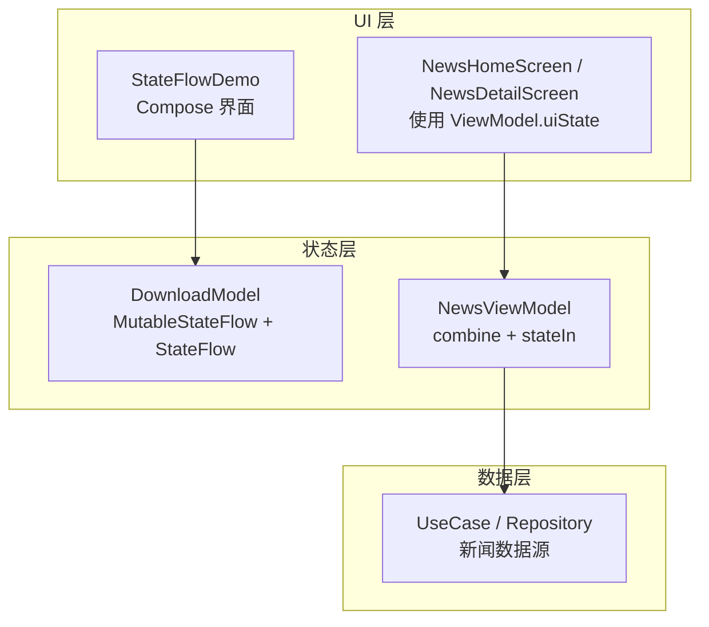
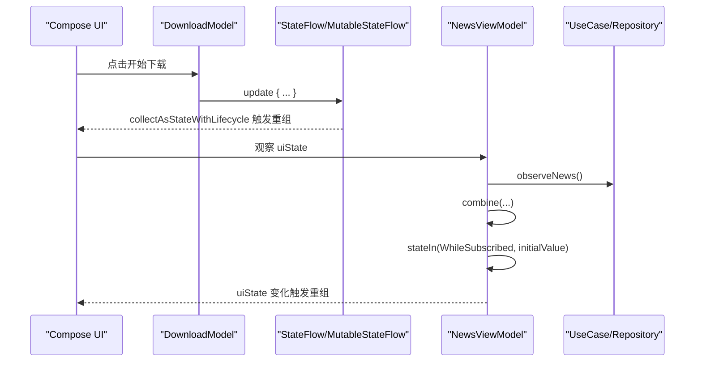
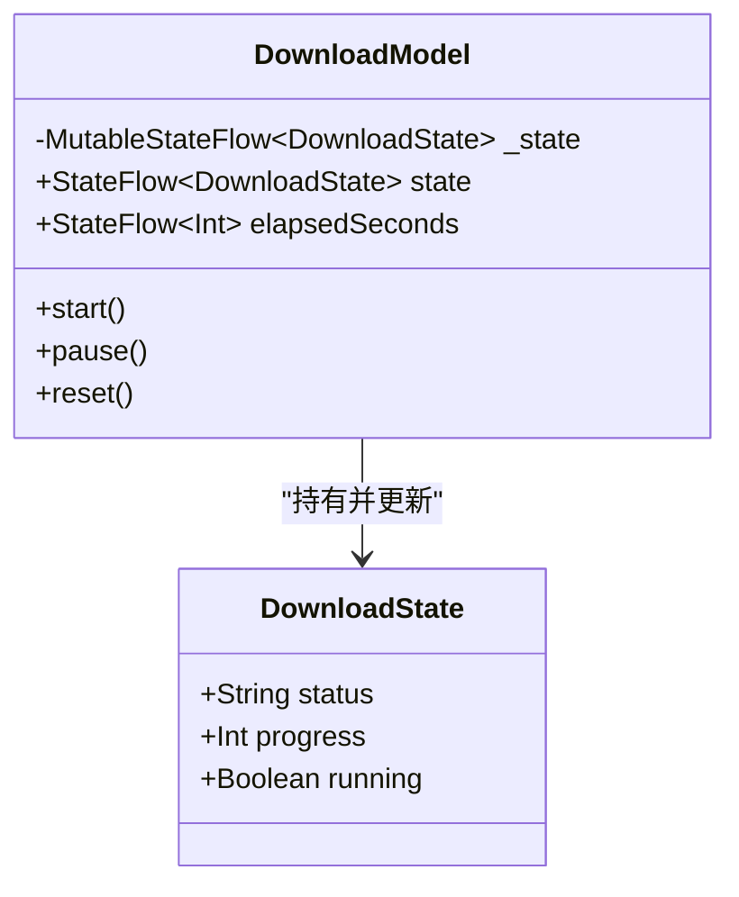
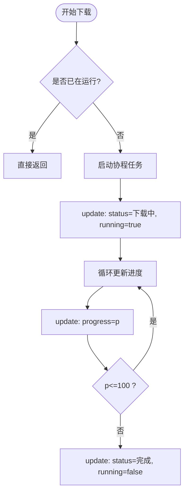
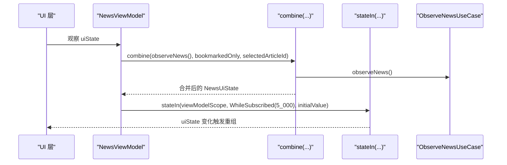
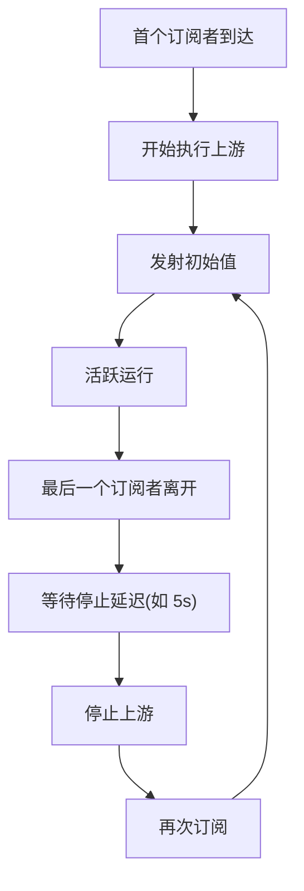

# StateFlow 状态管理

<cite>
**本文引用的文件**   
- [StateFlowDemo.kt](file://app/src/main/java/com/example/composeup/flow/StateFlowDemo.kt)
- [NewsViewModel.kt](file://app/src/main/java/com/example/composeup/architecture/ui/NewsViewModel.kt)
- [NewsUiState.kt](file://app/src/main/java/com/example/composeup/architecture/ui/NewsUiState.kt)
</cite>

## 目录
1. [引言](#引言)
2. [项目结构](#项目结构)
3. [核心组件](#核心组件)
4. [架构总览](#架构总览)
5. [详细组件分析](#详细组件分析)
6. [依赖关系分析](#依赖关系分析)
7. [性能考虑](#性能考虑)
8. [故障排查指南](#故障排查指南)
9. [结论](#结论)

## 引言
本文件围绕 StateFlow 的状态管理能力，结合仓库中的下载进度示例与 MVVM 新闻列表示例，系统讲解：
- StateFlow 作为热流的核心特性：始终持有当前值、自动去重（conflated + distinctUntilChanged）、适合承载 UI 状态。
- MutableStateFlow 与 StateFlow 的区别，以及通过 asStateFlow 暴露只读接口。
- update 方法与 .value 属性的同步读写方式。
- stateIn(WhileSubscribed) 将冷流转为热状态流的用法，包括停止策略和重新订阅机制。
- 在 Compose 中安全收集和使用 StateFlow 的完整流程。
- 在 MVVM 架构中的最佳实践与性能注意事项。

## 项目结构
与 StateFlow 直接相关的代码主要位于两个位置：
- flow 包下的 StateFlowDemo.kt：以“下载进度”为例，演示 MutableStateFlow、asStateFlow、update、stateIn(WhileSubscribed) 与 Compose 收集。
- architecture/ui 包下的 NewsViewModel.kt 与 NewsUiState.kt：展示在 MVVM 中用 combine + stateIn 组合多个来源，输出单一 UI 状态。

图表来源
- [StateFlowDemo.kt:49-139](file://app/src/main/java/com/example/composeup/flow/StateFlowDemo.kt#L49-L139)
- [NewsViewModel.kt:14-32](file://app/src/main/java/com/example/composeup/architecture/ui/NewsViewModel.kt#L14-L32)

章节来源
- [StateFlowDemo.kt:49-139](file://app/src/main/java/com/example/composeup/flow/StateFlowDemo.kt#L49-L139)
- [NewsViewModel.kt:14-32](file://app/src/main/java/com/example/composeup/architecture/ui/NewsViewModel.kt#L14-L32)

## 核心组件
- DownloadModel：封装下载进度的状态与行为，内部使用 MutableStateFlow 维护状态，并通过 asStateFlow 暴露只读 StateFlow；同时用 stateIn(WhileSubscribed) 把计时冷流升级为热 StateFlow。
- NewsViewModel：在 MVVM 中组合多个来源（新闻数据、收藏过滤、选中文章），输出统一的 uiState，同样使用 stateIn(WhileSubscribed) 控制生命周期。
- NewsUiState：不可变 UI 状态模型，提供派生属性用于 UI 显示与交互判断。

章节来源
- [StateFlowDemo.kt:141-194](file://app/src/main/java/com/example/composeup/flow/StateFlowDemo.kt#L141-L194)
- [NewsViewModel.kt:14-32](file://app/src/main/java/com/example/composeup/architecture/ui/NewsViewModel.kt#L14-L32)
- [NewsUiState.kt:7-28](file://app/src/main/java/com/example/composeup/architecture/ui/NewsUiState.kt#L7-L28)

## 架构总览
下图展示了从 UI 到状态再到数据源的调用链，以及 StateFlow 在其中的角色。

图表来源
- [StateFlowDemo.kt:161-194](file://app/src/main/java/com/example/composeup/flow/StateFlowDemo.kt#L161-L194)
- [NewsViewModel.kt:20-32](file://app/src/main/java/com/example/composeup/architecture/ui/NewsViewModel.kt#L20-L32)

## 详细组件分析

### 下载进度示例：StateFlow 与 Compose 集成
该示例完整演示了以下要点：
- 使用 MutableStateFlow 作为可写私有源，通过 asStateFlow 暴露只读 StateFlow，避免外部直接修改。
- 使用 update { } 基于旧值原子计算新值，并发安全且语义清晰。
- 支持 .value 同步读取当前快照，便于在非协程或非挂起场景下获取即时状态。
- 使用 stateIn(scope, SharingStarted.WhileSubscribed(5000), 初始值) 将冷流升级为热 StateFlow，实现“有人看才跑、无人看 5 秒后自动停”。

图表来源
- [StateFlowDemo.kt:141-194](file://app/src/main/java/com/example/composeup/flow/StateFlowDemo.kt#L141-L194)

#### 关键流程：开始下载与进度更新

图表来源
- [StateFlowDemo.kt:172-182](file://app/src/main/java/com/example/composeup/flow/StateFlowDemo.kt#L172-L182)

章节来源
- [StateFlowDemo.kt:49-139](file://app/src/main/java/com/example/composeup/flow/StateFlowDemo.kt#L49-L139)
- [StateFlowDemo.kt:161-194](file://app/src/main/java/com/example/composeup/flow/StateFlowDemo.kt#L161-L194)

### MVVM 示例：组合多来源并输出统一 UI 状态
NewsViewModel 将新闻数据、收藏过滤开关与选中文章 ID 组合成统一的 uiState，并使用 stateIn(WhileSubscribed) 控制上游执行与资源占用。

图表来源
- [NewsViewModel.kt:20-32](file://app/src/main/java/com/example/composeup/architecture/ui/NewsViewModel.kt#L20-L32)

章节来源
- [NewsViewModel.kt:14-32](file://app/src/main/java/com/example/composeup/architecture/ui/NewsViewModel.kt#L14-L32)
- [NewsUiState.kt:7-28](file://app/src/main/java/com/example/composeup/architecture/ui/NewsUiState.kt#L7-L28)

### 冷流转热状态流：stateIn(WhileSubscribed) 的行为
- 当有订阅者时，上游开始执行；最后一个订阅者离开后，延迟指定时间（如 5 秒）再停止上游，避免频繁启停。
- 重新订阅时，会立即发射初始值，保证 UI 能立刻渲染。
- 适用于 UI 状态或需要“按需运行”的后台任务，例如计时器、轮询等。

图表来源
- [StateFlowDemo.kt:166-168](file://app/src/main/java/com/example/composeup/flow/StateFlowDemo.kt#L166-L168)
- [NewsViewModel.kt:25-32](file://app/src/main/java/com/example/composeup/architecture/ui/NewsViewModel.kt#L25-L32)

## 依赖关系分析
- DownloadModel 依赖 MutableStateFlow 进行状态变更，对外暴露 StateFlow 只读接口。
- NewsViewModel 依赖 UseCase 提供的数据流，通过 combine 聚合，再用 stateIn 输出稳定的 UI 状态。
- UI 层通过 collectAsStateWithLifecycle 收集 StateFlow，确保生命周期安全地重组。

图表来源
- [StateFlowDemo.kt:161-168](file://app/src/main/java/com/example/composeup/flow/StateFlowDemo.kt#L161-L168)
- [NewsViewModel.kt:20-32](file://app/src/main/java/com/example/composeup/architecture/ui/NewsViewModel.kt#L20-L32)

章节来源
- [StateFlowDemo.kt:161-168](file://app/src/main/java/com/example/composeup/flow/StateFlowDemo.kt#L161-L168)
- [NewsViewModel.kt:20-32](file://app/src/main/java/com/example/composeup/architecture/ui/NewsViewModel.kt#L20-L32)

## 性能考虑
- 使用 update { } 而非 .value = 做“读-改-写”，避免并发下的竞态条件与丢失更新。
- StateFlow 自带 conflated 与 distinctUntilChanged，相同值的重复发射不会触发下游，减少不必要的重组。
- 使用 stateIn(WhileSubscribed) 控制上游生命周期，无人订阅时自动停止，降低 CPU 与内存占用。
- 在 Compose 中使用 collectAsStateWithLifecycle 收集 StateFlow，避免泄漏与无效重组。
- 在 MVVM 中尽量输出不可变的 UI 状态对象，减少 equals 比较开销的同时提升可读性。

章节来源
- [StateFlowDemo.kt:128-137](file://app/src/main/java/com/example/composeup/flow/StateFlowDemo.kt#L128-L137)
- [NewsViewModel.kt:25-32](file://app/src/main/java/com/example/composeup/architecture/ui/NewsViewModel.kt#L25-L32)

## 故障排查指南
- 现象：UI 不刷新或刷新异常
  - 检查是否正确使用 collectAsStateWithLifecycle 收集 StateFlow。
  - 确认 UI 状态对象实现了正确的 equals/hashCode（data class 默认正确）。
- 现象：状态被外部意外修改
  - 确保仅通过 MutableStateFlow 的 update 方法修改状态，对外暴露 asStateFlow 的只读接口。
- 现象：后台任务持续运行导致耗电
  - 检查 stateIn 的 SharingStarted 策略是否为 WhileSubscribed，并设置合理的停止延迟。
- 现象：并发更新丢失
  - 使用 update { } 替代 .value = 进行“读-改-写”，保证原子性。

章节来源
- [StateFlowDemo.kt:161-194](file://app/src/main/java/com/example/composeup/flow/StateFlowDemo.kt#L161-L194)
- [NewsViewModel.kt:25-32](file://app/src/main/java/com/example/composeup/architecture/ui/NewsViewModel.kt#L25-L32)

## 结论
StateFlow 作为热流，天然契合 UI 状态管理：它始终持有当前值、具备自动去重能力，并且可通过 stateIn(WhileSubscribed) 精确控制上游生命周期。在 MVVM 架构中，建议：
- 使用 MutableStateFlow 作为内部可写源，对外暴露 asStateFlow 的只读接口。
- 使用 update { } 进行并发安全的“读-改-写”。
- 使用 stateIn(WhileSubscribed) 将冷流转为热状态流，合理配置停止策略与初始值。
- 在 Compose 中使用 collectAsStateWithLifecycle 收集 StateFlow，确保生命周期安全与性能最优。