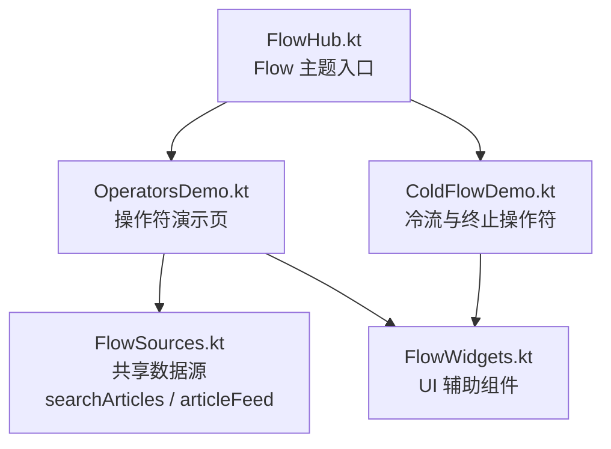
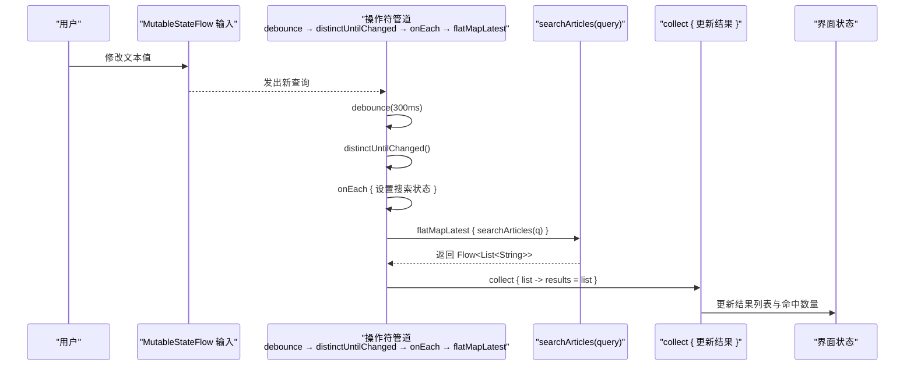
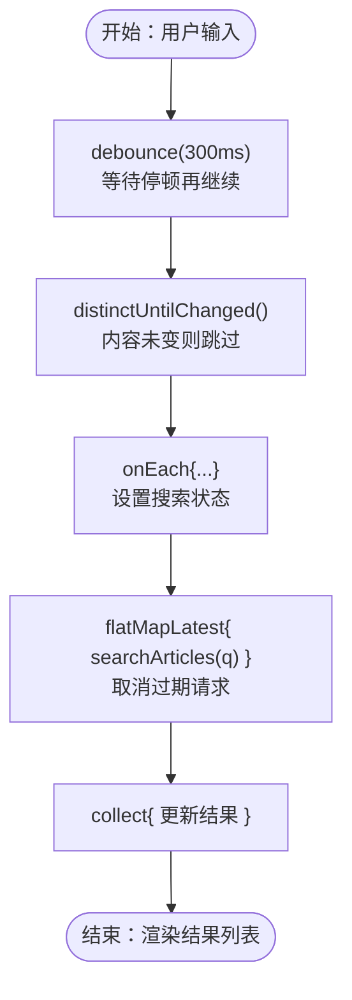
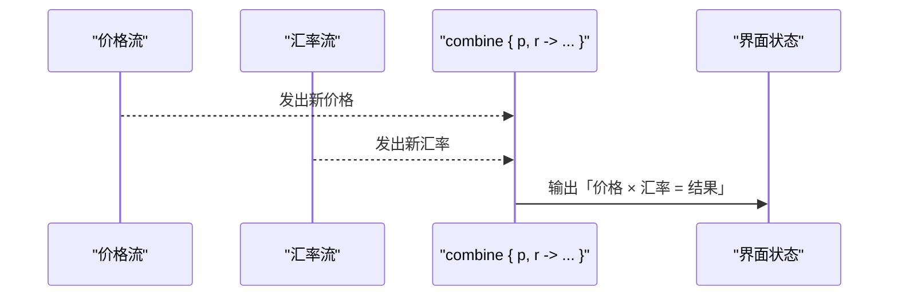
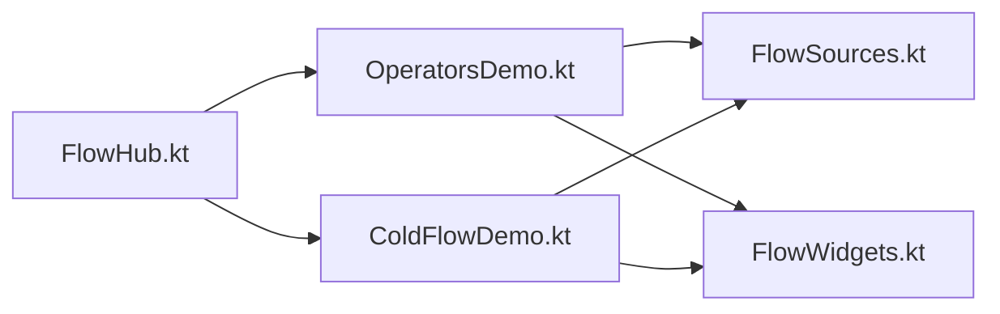

# 操作符链式调用

<cite>
**本文引用的文件**   
- [FlowHub.kt](file://app/src/main/java/com/example/composeup/flow/FlowHub.kt)
- [OperatorsDemo.kt](file://app/src/main/java/com/example/composeup/flow/OperatorsDemo.kt)
- [ColdFlowDemo.kt](file://app/src/main/java/com/example/composeup/flow/ColdFlowDemo.kt)
- [FlowSources.kt](file://app/src/main/java/com/example/composeup/flow/FlowSources.kt)
- [FlowWidgets.kt](file://app/src/main/java/com/example/composeup/flow/FlowWidgets.kt)
</cite>

## 目录
1. [引言](#引言)
2. [项目结构](#项目结构)
3. [核心组件](#核心组件)
4. [架构总览](#架构总览)
5. [详细组件分析](#详细组件分析)
6. [依赖关系分析](#依赖关系分析)
7. [性能与优化建议](#性能与优化建议)
8. [故障排查指南](#故障排查指南)
9. [结论](#结论)
10. [附录：搜索功能完整实现示例](#附录搜索功能完整实现示例)

## 引言
本文围绕 Flow 的「操作符链式调用」展开，目标是帮助读者用一套统一的思路构建高效的异步数据处理管道。文档重点包括：
- 操作符分类与用途：转换（map、filter、transform）、聚合（reduce、fold）、集合（toList、toSet）、控制流（take、drop、skip）。
- 搜索框防抖实战：debounce 防抖、distinctUntilChanged 去重、flatMapLatest 取消过期请求。
- 多流合并：combine 与 zip 的区别与用法。
- 性能优化与最佳实践。
- 完整的搜索功能组合示例，展示如何把多个操作符串成一条可维护的数据管线。

## 项目结构
本仓库在 `app/src/main/java/com/example/composeup/flow` 下提供一组 Flow 示例，其中与「操作符链式调用」直接相关的核心文件如下：
- `FlowHub.kt`：Flow 主题入口，负责导航到具体示例页面。
- `OperatorsDemo.kt`：操作符演示页，包含搜索框防抖、去重、取消旧请求、combine 合并两条流等。
- `ColdFlowDemo.kt`：冷流基础与终止操作符（toList、reduce、first）演示。
- `FlowSources.kt`：共享的假数据源，如文章列表、模拟检索、高频传感器流。
- `FlowWidgets.kt`：示例页面共用的 UI 辅助组件（SectionTitle、Note、Readout、CodeBlock 等）。

**图表来源**
- [FlowHub.kt:30-85](file://app/src/main/java/com/example/composeup/flow/FlowHub.kt#L30-L85)
- [OperatorsDemo.kt:34-49](file://app/src/main/java/com/example/composeup/flow/OperatorsDemo.kt#L34-L49)
- [FlowSources.kt:8-21](file://app/src/main/java/com/example/composeup/flow/FlowSources.kt#L8-L21)
- [FlowWidgets.kt:72-118](file://app/src/main/java/com/example/composeup/flow/FlowWidgets.kt#L72-L118)

**章节来源**
- [FlowHub.kt:30-85](file://app/src/main/java/com/example/composeup/flow/FlowHub.kt#L30-L85)
- [OperatorsDemo.kt:34-49](file://app/src/main/java/com/example/composeup/flow/OperatorsDemo.kt#L34-L49)

## 核心组件
- 操作符演示页（OperatorsDemo）：以「搜索框」为主线，串联 debounce、distinctUntilChanged、flatMapLatest，并演示 combine 合并两条独立流。
- 冷流演示页（ColdFlowDemo）：讲解冷流「构建 → 变换 → 收集」三段式，演示 toList、reduce、first 等终止操作符。
- 共享数据源（FlowSources）：提供 articleFeed、searchArticles、sensorStream 等可复用的 Flow 构造。
- UI 辅助组件（FlowWidgets）：提供 SectionTitle、Note、Readout、CodeBlock 等用于示例页面的展示组件。

**章节来源**
- [OperatorsDemo.kt:34-49](file://app/src/main/java/com/example/composeup/flow/OperatorsDemo.kt#L34-L49)
- [ColdFlowDemo.kt:32-47](file://app/src/main/java/com/example/composeup/flow/ColdFlowDemo.kt#L32-L47)
- [FlowSources.kt:8-21](file://app/src/main/java/com/example/composeup/flow/FlowSources.kt#L8-L21)
- [FlowWidgets.kt:72-118](file://app/src/main/java/com/example/composeup/flow/FlowWidgets.kt#L72-L118)

## 架构总览
下图展示了「搜索框」从输入到结果渲染的完整调用链，以及 combine 合并两条流的场景。

**图表来源**
- [OperatorsDemo.kt:52-72](file://app/src/main/java/com/example/composeup/flow/OperatorsDemo.kt#L52-L72)
- [FlowSources.kt:48-63](file://app/src/main/java/com/example/composeup/flow/FlowSources.kt#L48-L63)

## 详细组件分析

### 搜索框防抖与去重、取消过期请求
搜索框是 Flow 操作符的典型落地场景。其核心链路为：
- 使用 MutableStateFlow 承载输入，便于接入操作符。
- 通过 debounce 过滤连击，避免频繁触发检索。
- 通过 distinctUntilChanged 跳过相邻重复值，减少无效请求。
- 通过 flatMapLatest 保证只处理最新输入，自动取消上一次仍在进行的检索。
- 最终 collect 将结果写入 UI 状态。

**图表来源**
- [OperatorsDemo.kt:52-72](file://app/src/main/java/com/example/composeup/flow/OperatorsDemo.kt#L52-L72)
- [FlowSources.kt:48-63](file://app/src/main/java/com/example/composeup/flow/FlowSources.kt#L48-L63)

**章节来源**
- [OperatorsDemo.kt:52-72](file://app/src/main/java/com/example/composeup/flow/OperatorsDemo.kt#L52-L72)
- [FlowSources.kt:48-63](file://app/src/main/java/com/example/composeup/flow/FlowSources.kt#L48-L63)

### 转换操作符：map、filter、transform
- map：一对一变换，常用于把原始数据映射为 UI 所需模型。
- filter：条件过滤，常用于剔除无效或不符合条件的数据。
- transform：最灵活的中间操作符，支持可变数量的输出，适合复杂逻辑。

这些操作符在示例速查表中被列举，配合搜索管线可完成数据清洗与转换。

**章节来源**
- [OperatorsDemo.kt:137-162](file://app/src/main/java/com/example/composeup/flow/OperatorsDemo.kt#L137-L162)

### 聚合操作符：reduce、fold
- reduce：对序列进行归约，得到单个累积值。
- fold：类似 reduce，但允许指定初始值，更适合需要初始状态的聚合场景。

在冷流演示中，reduce 被用来计算总和；toList 和 first 也作为终止操作符示例出现。

**章节来源**
- [ColdFlowDemo.kt:103-118](file://app/src/main/java/com/example/composeup/flow/ColdFlowDemo.kt#L103-L118)

### 集合操作符：toList、toSet
- toList：把流收敛为 List，适合一次性收集所有结果。
- toSet：把流收敛为 Set，适合去重后的集合结果。

在冷流演示中，toList 被用作终止操作符示例，展示如何将流转换为具体集合。

**章节来源**
- [ColdFlowDemo.kt:103-118](file://app/src/main/java/com/example/composeup/flow/ColdFlowDemo.kt#L103-L118)

### 控制流操作符：take、drop、skip
- take(n)：只取前 n 个元素。
- drop(n)：丢弃前 n 个元素。
- skip(n)：与 drop 语义相近，常用于跳过初始阶段的数据。

在示例速查表中，take/drop 被用于截取流的前后段，配合其他操作符可实现分页、跳页等逻辑。

**章节来源**
- [OperatorsDemo.kt:137-162](file://app/src/main/java/com/example/composeup/flow/OperatorsDemo.kt#L137-L162)

### 多流合并：combine 与 zip
- combine：任一流更新时，都用「各自最新值」重新组合，适合聚合多个 UI 状态源。
- zip：严格按顺序一一配对，第 n 个只和第 n 个组合，某条流结束则整体结束，适合「成对」数据。

在 OperatorsDemo 中，combine 被用于合并价格流与汇率流，每次任一更新都重算结果。zip 在速查表中被对比说明。

**图表来源**
- [OperatorsDemo.kt:74-98](file://app/src/main/java/com/example/composeup/flow/OperatorsDemo.kt#L74-L98)

**章节来源**
- [OperatorsDemo.kt:74-98](file://app/src/main/java/com/example/composeup/flow/OperatorsDemo.kt#L74-L98)

### 完整搜索功能实现示例
以下是一个可落地的搜索功能组合示例，展示如何把多个操作符串成一条高效的数据管线：
- 输入：用户输入关键词。
- 防抖：debounce 等待用户停止输入一段时间再执行。
- 去重：distinctUntilChanged 跳过相邻重复值。
- 取消旧请求：flatMapLatest 确保只处理最新输入，自动取消上一次检索。
- 结果：collect 更新 UI 状态，显示匹配结果与命中数量。

该示例已在 OperatorsDemo 中实现，可直接参考对应代码路径。

**章节来源**
- [OperatorsDemo.kt:52-72](file://app/src/main/java/com/example/composeup/flow/OperatorsDemo.kt#L52-L72)

## 依赖关系分析
- OperatorsDemo 依赖 FlowSources 提供的 searchArticles 与 articleFeed。
- ColdFlowDemo 依赖 FlowSources 提供的 articleFeed。
- 两者都依赖 FlowWidgets 提供的 UI 辅助组件。
- FlowHub 作为入口，根据选择路由到 OperatorsDemo 或 ColdFlowDemo。

**图表来源**
- [FlowHub.kt:163-170](file://app/src/main/java/com/example/composeup/flow/FlowHub.kt#L163-L170)
- [OperatorsDemo.kt:52-72](file://app/src/main/java/com/example/composeup/flow/OperatorsDemo.kt#L52-L72)
- [ColdFlowDemo.kt:49-90](file://app/src/main/java/com/example/composeup/flow/ColdFlowDemo.kt#L49-L90)
- [FlowSources.kt:41-63](file://app/src/main/java/com/example/composeup/flow/FlowSources.kt#L41-L63)
- [FlowWidgets.kt:72-118](file://app/src/main/java/com/example/composeup/flow/FlowWidgets.kt#L72-L118)

**章节来源**
- [FlowHub.kt:163-170](file://app/src/main/java/com/example/composeup/flow/FlowHub.kt#L163-L170)
- [OperatorsDemo.kt:52-72](file://app/src/main/java/com/example/composeup/flow/OperatorsDemo.kt#L52-L72)
- [ColdFlowDemo.kt:49-90](file://app/src/main/java/com/example/composeup/flow/ColdFlowDemo.kt#L49-L90)
- [FlowSources.kt:41-63](file://app/src/main/java/com/example/composeup/flow/FlowSources.kt#L41-L63)
- [FlowWidgets.kt:72-118](file://app/src/main/java/com/example/composeup/flow/FlowWidgets.kt#L72-L118)

## 性能与优化建议
- 合理使用 debounce：为搜索输入设置合适的延迟时间，避免频繁触发后端检索。
- 使用 distinctUntilChanged：跳过相邻重复值，减少无效请求。
- 使用 flatMapLatest：确保只处理最新输入，自动取消过期请求，避免结果闪烁与资源浪费。
- 选择合适的聚合操作符：
  - reduce/fold：适用于需要累积计算的场景，注意初始值与线程安全。
  - toList/toSet：适用于一次性收集结果，注意内存占用。
- 控制流操作符：
  - take/drop/skip：用于分页、跳页、跳过初始数据，避免不必要的数据处理。
- 多流合并：
  - combine：适合 UI 状态聚合，任一流更新即重算。
  - zip：适合成对数据，严格一一配对。
- 线程切换：
  - flowOn：仅影响上游执行线程，下游回调仍由收集者线程执行，避免在主线程做耗时操作。
- 生命周期安全：
  - 使用 collectAsStateWithLifecycle 或 repeatOnLifecycle，确保在界面可见时才收集，避免后台浪费资源。

[本节为通用指导，不直接分析具体文件]

## 故障排查指南
- 搜索结果为空或闪烁：
  - 检查是否正确使用 flatMapLatest 取消过期请求。
  - 确认 debounce 与 distinctUntilChanged 的顺序与参数合理。
- 结果堆积或卡顿：
  - 检查是否误用 flatMapMerge 而非 flatMapLatest，导致并发过多。
  - 检查是否在高吞吐场景未使用背压策略（buffer/conflate/collectLatest）。
- 状态更新异常：
  - 确认 collect 回调在主线程执行，或使用 flowOn 正确切分上下游线程。
- 多流合并结果不符合预期：
  - 区分 combine 与 zip 的语义差异，确保选择正确的合并策略。

**章节来源**
- [OperatorsDemo.kt:52-72](file://app/src/main/java/com/example/composeup/flow/OperatorsDemo.kt#L52-L72)
- [ColdFlowDemo.kt:71-90](file://app/src/main/java/com/example/composeup/flow/ColdFlowDemo.kt#L71-L90)

## 结论
通过本仓库的 Flow 示例，我们可以清晰地看到：
- 操作符链式调用是构建异步数据处理管道的核心能力。
- 搜索框防抖、去重、取消过期请求的组合是真实业务中的标准写法。
- combine 与 zip 分别适用于不同的多流合并场景。
- 合理选择操作符与线程策略，能显著提升性能与用户体验。

[本节为总结性内容，不直接分析具体文件]

## 附录：搜索功能完整实现示例
以下提供一个完整的搜索功能实现示例，展示如何组合多个操作符构建高效的异步数据处理管道：
- 输入：用户输入关键词。
- 防抖：debounce 等待用户停止输入一段时间再执行。
- 去重：distinctUntilChanged 跳过相邻重复值。
- 取消旧请求：flatMapLatest 确保只处理最新输入，自动取消上一次检索。
- 结果：collect 更新 UI 状态，显示匹配结果与命中数量。

该示例已在 OperatorsDemo 中实现，可直接参考对应代码路径。

**章节来源**
- [OperatorsDemo.kt:52-72](file://app/src/main/java/com/example/composeup/flow/OperatorsDemo.kt#L52-L72)