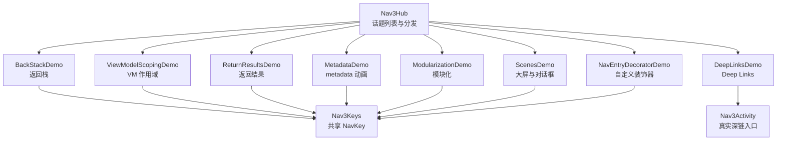
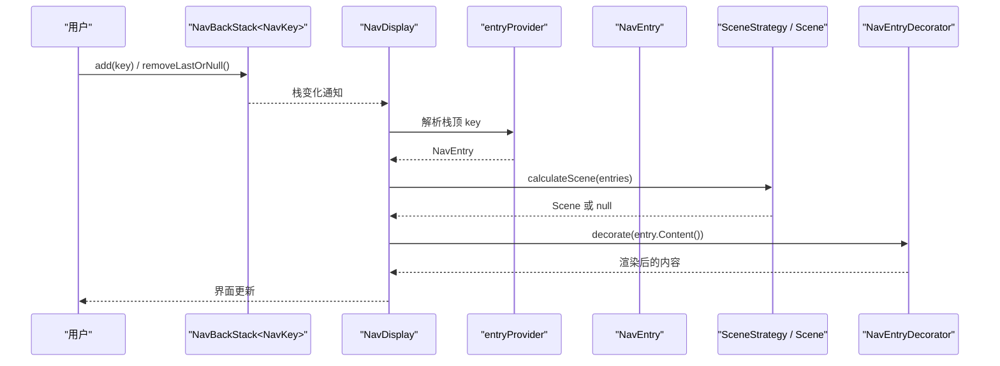
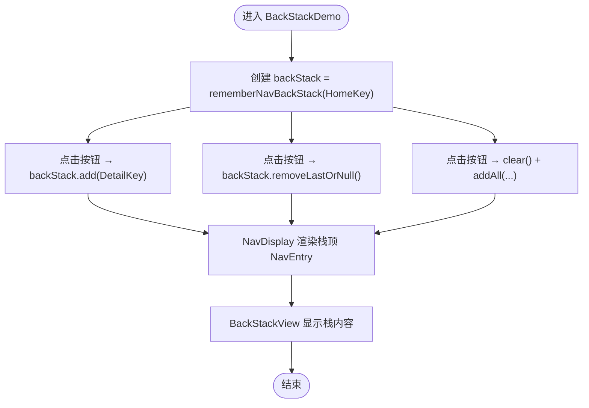
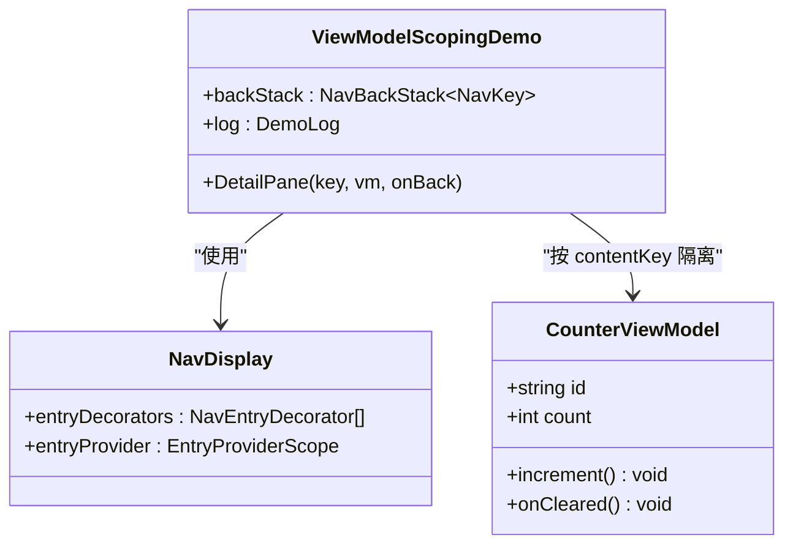
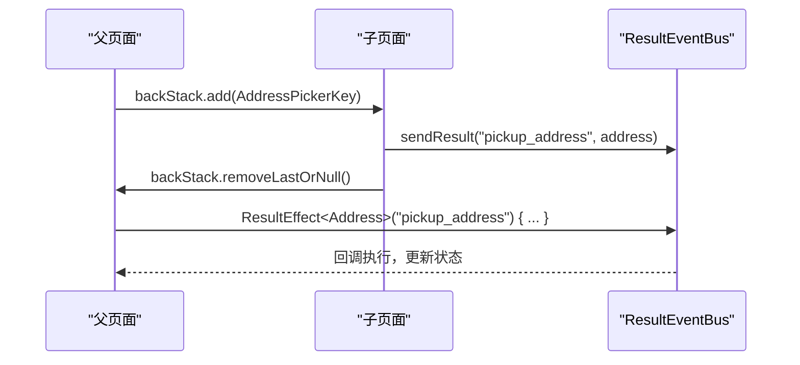
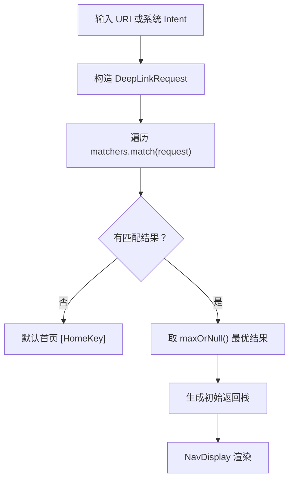
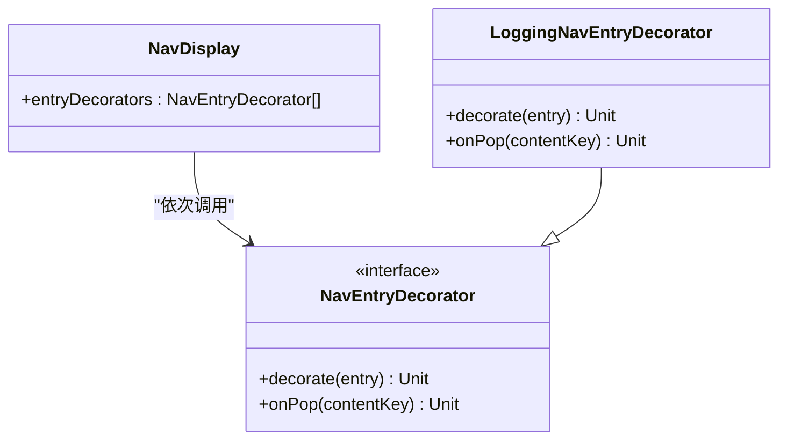
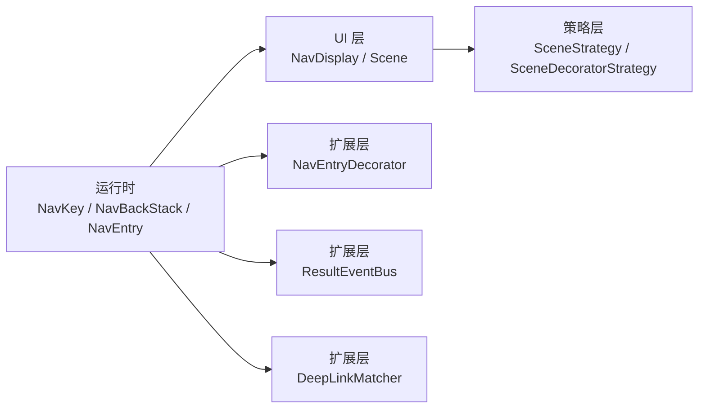

# Navigation 3 导航

<cite>
**本文引用的文件**   
- [README.md](file://app/src/main/java/com/example/composeup/navigation3/README.md)
- [Nav3Hub.kt](file://app/src/main/java/com/example/composeup/navigation3/Nav3Hub.kt)
- [Nav3Activity.kt](file://app/src/main/java/com/example/composeup/navigation3/Nav3Activity.kt)
- [BackStackDemo.kt](file://app/src/main/java/com/example/composeup/navigation3/BackStackDemo.kt)
- [ViewModelScopingDemo.kt](file://app/src/main/java/com/example/composeup/navigation3/ViewModelScopingDemo.kt)
- [ReturnResultsDemo.kt](file://app/src/main/java/com/example/composeup/navigation3/ReturnResultsDemo.kt)
- [MetadataDemo.kt](file://app/src/main/java/com/example/composeup/navigation3/MetadataDemo.kt)
- [ModularizationDemo.kt](file://app/src/main/java/com/example/composeup/navigation3/ModularizationDemo.kt)
- [DeepLinksDemo.kt](file://app/src/main/java/com/example/composeup/navigation3/DeepLinksDemo.kt)
- [ScenesDemo.kt](file://app/src/main/java/com/example/composeup/navigation3/ScenesDemo.kt)
- [NavEntryDecoratorDemo.kt](file://app/src/main/java/com/example/composeup/navigation3/NavEntryDecoratorDemo.kt)
- [Nav3Keys.kt](file://app/src/main/java/com/example/composeup/navigation3/Nav3Keys.kt)
- [Nav3Widgets.kt](file://app/src/main/java/com/example/composeup/navigation3/Nav3Widgets.kt)
</cite>

## 目录
1. [引言](#引言)
2. [项目结构](#项目结构)
3. [核心组件](#核心组件)
4. [架构总览](#架构总览)
5. [详细组件分析](#详细组件分析)
6. [依赖关系分析](#依赖关系分析)
7. [性能与优化](#性能与优化)
8. [调试与排错](#调试与排错)
9. [与传统 Fragment 导航的差异与迁移](#与传统-fragment-导航的差异与迁移)
10. [结论](#结论)

## 引言
本仓库的 `navigation3` 模块围绕 Jetpack Navigation 3（nav3）提供一套可交互、可验证的学习路径。它不是简单罗列 API，而是以「返回栈归你所有」为核心心智模型，串联以下主题：
- 声明式导航与返回栈管理
- ViewModel 作用域限制在 NavEntry
- 返回结果（ResultEventBus）
- metadata 驱动动画与布局
- 模块化导航（api/impl 拆分与组合）
- Deep Links 匹配与自定义 matcher
- Scenes 大屏适配与 Scene Decorator
- 自定义 NavEntryDecorator

这些示例共同构成一个完整的导航系统：从最基础的 push/pop 开始，逐步长出状态隔离、跨目的地通信、外部链接进入、自适应布局与统一装饰能力。

**章节来源**
- [README.md:1-31](file://app/src/main/java/com/example/composeup/navigation3/README.md#L1-L31)
- [Nav3Hub.kt:29-45](file://app/src/main/java/com/example/composeup/navigation3/Nav3Hub.kt#L29-L45)

## 项目结构
`navigation3` 包采用「主题 + 示例 + 共享工具」的组织方式：
- 入口与分发：`Nav3Hub.kt`
- 真实 deep link 入口 Activity：`Nav3Activity.kt`
- 共享导航 key：`Nav3Keys.kt`
- 教学 UI 组件：`Nav3Widgets.kt`
- 8 个独立示例：返回栈、ViewModel 作用域、返回结果、metadata、模块化、Deep Links、Scenes、自定义装饰器



**图表来源**
- [Nav3Hub.kt:116-199](file://app/src/main/java/com/example/composeup/navigation3/Nav3Hub.kt#L116-L199)
- [Nav3Activity.kt:38-94](file://app/src/main/java/com/example/composeup/navigation3/Nav3Activity.kt#L38-L94)
- [Nav3Keys.kt:6-35](file://app/src/main/java/com/example/composeup/navigation3/Nav3Keys.kt#L6-L35)

**章节来源**
- [README.md:191-207](file://app/src/main/java/com/example/composeup/navigation3/README.md#L191-L207)
- [Nav3Hub.kt:116-199](file://app/src/main/java/com/example/composeup/navigation3/Nav3Hub.kt#L116-L199)

## 核心组件
Navigation 3 的核心由三个角色组成：
- NavKey：内容的引用，通常是 `@Serializable` 的 data class/object
- NavEntry：目的地的内容 + metadata，由 entryProvider 把 key 解析而来
- NavDisplay：观察返回栈、渲染 UI、处理动画与返回

关键心智模型是：栈里放 key；entryProvider 把 key 变成 NavEntry；NavDisplay 负责渲染。push 就是往栈尾 add，pop 就是 removeLastOrNull。

| 概念 | 说明 | 典型用法 |
| --- | --- | --- |
| NavKey | 导航键，作为栈元素 | `data object HomeKey : NavKey` |
| NavEntry | 由 key 解析出的目的地内容与元信息 | `entry<HomeKey> { ... }` |
| NavDisplay | 渲染容器，负责显示栈顶或 Scene 计算的多个 entry | `NavDisplay(backStack = ..., entryProvider = ...)` |
| rememberNavBackStack | 创建可保存的返回栈 | `rememberNavBackStack(HomeKey)` |
| entryProvider | 注册 key 到 NavEntry 的映射 | `entryProvider { entry<Key> { ... } }` |

**章节来源**
- [README.md:62-91](file://app/src/main/java/com/example/composeup/navigation3/README.md#L62-L91)
- [BackStackDemo.kt:27-66](file://app/src/main/java/com/example/composeup/navigation3/BackStackDemo.kt#L27-L66)

## 架构总览
nav3 的运行时流程可以概括为：
1. 应用持有 `NavBackStack<NavKey>`
2. 用户操作修改栈（add/removeLastOrNull/clear/addAll）
3. NavDisplay 观察栈变化
4. entryProvider 根据栈顶 key 解析出 NavEntry
5. SceneStrategy 计算 Scene（单页、双栏、对话框等）
6. SceneDecoratorStrategy 对 Scene 做二次加工（如加顶栏）
7. NavEntryDecorator 对每个 NavEntry 做统一包裹（日志、VM 作用域、结果总线等）



**图表来源**
- [BackStackDemo.kt:36-66](file://app/src/main/java/com/example/composeup/navigation3/BackStackDemo.kt#L36-L66)
- [ScenesDemo.kt:77-131](file://app/src/main/java/com/example/composeup/navigation3/ScenesDemo.kt#L77-L131)
- [NavEntryDecoratorDemo.kt:56-86](file://app/src/main/java/com/example/composeup/navigation3/NavEntryDecoratorDemo.kt#L56-L86)

## 详细组件分析

### 返回栈管理
返回栈是 nav3 的地基。示例通过 `rememberNavBackStack(HomeKey)` 创建可跨配置变更和进程死亡存活的栈，并演示：
- push：`backStack.add(key)`
- pop：`backStack.removeLastOrNull()`
- 直接改写：`clear()` + `addAll(...)`
- 可视化：用 `BackStackView` 展示当前栈，栈顶在上



**图表来源**
- [BackStackDemo.kt:27-66](file://app/src/main/java/com/example/composeup/navigation3/BackStackDemo.kt#L27-L66)
- [Nav3Widgets.kt:192-254](file://app/src/main/java/com/example/composeup/navigation3/Nav3Widgets.kt#L192-L254)

**章节来源**
- [BackStackDemo.kt:17-139](file://app/src/main/java/com/example/composeup/navigation3/BackStackDemo.kt#L17-L139)
- [Nav3Widgets.kt:192-254](file://app/src/main/java/com/example/composeup/navigation3/Nav3Widgets.kt#L192-L254)

### ViewModel 作用域机制
默认 ViewModel 绑定到最近的 `ViewModelStoreOwner`（通常是 Activity），导致多个目的地共用实例。nav3 通过 `rememberViewModelStoreNavEntryDecorator()` 给每个 NavEntry 分配独立的 `ViewModelStore`，使 `viewModel()` 按 `contentKey` 隔离：
- 相同 key 复用同一 VM
- 不同 key 各自独立
- pop 出栈触发 onCleared



**图表来源**
- [ViewModelScopingDemo.kt:37-75](file://app/src/main/java/com/example/composeup/navigation3/ViewModelScopingDemo.kt#L37-L75)
- [ViewModelScopingDemo.kt:138-170](file://app/src/main/java/com/example/composeup/navigation3/ViewModelScopingDemo.kt#L138-L170)

**章节来源**
- [ViewModelScopingDemo.kt:24-116](file://app/src/main/java/com/example/composeup/navigation3/ViewModelScopingDemo.kt#L24-L116)

### 返回结果与参数传递
nav3 1.2.0 起使用 `ResultEventBus` 进行跨目的地回传数据，支持两种消费模型：
- 事件式：`ResultEffect<T>(resultKey = "...") { }`，按序处理一次性结果，可在协程中挂起
- 状态式：`resultBus.conflateAsState<T>(resultKey, defaultValue)`，只保留最新值并暴露为 Compose State

发送方通过 `resultBus.sendResult(resultKey, value)` 后 pop。寻址方式包括显式 key 与类型派生 key，但两者不互通。



**图表来源**
- [ReturnResultsDemo.kt:47-163](file://app/src/main/java/com/example/composeup/navigation3/ReturnResultsDemo.kt#L47-L163)

**章节来源**
- [ReturnResultsDemo.kt:32-203](file://app/src/main/java/com/example/composeup/navigation3/ReturnResultsDemo.kt#L32-L203)

### Deep Links 支持
nav3 使用 `DeepLinkRequest` + `DeepLinkMatcher` 支持外部链接进入。流程为：定义 matcher → 从 Intent/URI 造 request → 所有 matcher 匹配取最优 → 生成返回栈。

内置 matcher：
- `UriDeepLinkMatcher`：按 URI 模式匹配并抽取参数
- `StaticKeyDeepLinkMatcher`：匹配固定链接或特定 action
- `withBackStack`：将匹配结果包装成合成返回栈

自定义 matcher：继承 `DeepLinkMatcher` 实现 `matchRequest`，例如处理 `tel:` 这类 opaque URI。



**图表来源**
- [DeepLinksDemo.kt:51-145](file://app/src/main/java/com/example/composeup/navigation3/DeepLinksDemo.kt#L51-L145)
- [Nav3Activity.kt:40-94](file://app/src/main/java/com/example/composeup/navigation3/Nav3Activity.kt#L40-L94)

**章节来源**
- [DeepLinksDemo.kt:32-200](file://app/src/main/java/com/example/composeup/navigation3/DeepLinksDemo.kt#L32-L200)
- [Nav3Activity.kt:24-94](file://app/src/main/java/com/example/composeup/navigation3/Nav3Activity.kt#L24-L94)

### Scenes 大屏适配与模块化导航
Scenes 是渲染一个或多个 NavEntry 的布局单元，由 `SceneStrategy` 计算。示例展示了：
- 自定义双栏 Scene：宽屏时并排渲染 list/detail
- 内置 `DialogSceneStrategy`：挂 metadata 即弹对话框
- Scene Decorator：对算出来的 Scene 做第二阶段加工（如加顶栏）

模块化导航推荐 api/impl 拆分：
- api 模块只放 key
- impl 模块放 entryProvider builder 与内容
- 主 App 组合各模块 builder，或使用 DI 多绑定注入 Set

```mermaid
classDiagram
class TwoPaneSceneStrategy {
+calculateScene(entries) Scene?
}
class DialogSceneStrategy {
+dialog(properties) metadata
}
class TopBarSceneDecorator {
+decorateScene(scene) Scene
}
class ModularizationDemo {
+entryProvider { featureAEntries(); featureBEntries() }
}
TwoPaneSceneStrategy --> Scene : "计算"
DialogSceneStrategy --> Scene : "生成 OverlayScene"
TopBarSceneDecorator --> Scene : "装饰"
ModularizationDemo --> EntryProvider : "组合模块"
```

**图表来源**
- [ScenesDemo.kt:56-181](file://app/src/main/java/com/example/composeup/navigation3/ScenesDemo.kt#L56-L181)
- [ModularizationDemo.kt:33-88](file://app/src/main/java/com/example/composeup/navigation3/ModularizationDemo.kt#L33-L88)

**章节来源**
- [ScenesDemo.kt:43-265](file://app/src/main/java/com/example/composeup/navigation3/ScenesDemo.kt#L43-L265)
- [ModularizationDemo.kt:21-156](file://app/src/main/java/com/example/composeup/navigation3/ModularizationDemo.kt#L21-L156)

### 自定义 NavEntryDecorator
`NavEntryDecorator` 用 composable 包裹每个 NavEntry，适合统一日志、埋点、依赖注入、资源清理。两个关键回调：
- `decorate`：entry 进入组合时调用，必须调用 `entry.Content()`
- `onPop`：entry 离开组合时调用，用于清理状态

示例中的 `LoggingNavEntryDecorator` 演示了进入/离开日志与 CompositionLocal 注入。



**图表来源**
- [NavEntryDecoratorDemo.kt:44-150](file://app/src/main/java/com/example/composeup/navigation3/NavEntryDecoratorDemo.kt#L44-L150)

**章节来源**
- [NavEntryDecoratorDemo.kt:27-150](file://app/src/main/java/com/example/composeup/navigation3/NavEntryDecoratorDemo.kt#L27-L150)

## 依赖关系分析
nav3 的依赖关系围绕三个层次展开：
- 运行时层：`NavKey`、`NavBackStack`、`NavEntry`、`NavDisplay`
- UI 层：`Scene`、`SceneStrategy`、`SceneDecoratorStrategy`
- 扩展层：`NavEntryDecorator`、`ResultEventBus`、`DeepLinkMatcher`



**图表来源**
- [README.md:13-31](file://app/src/main/java/com/example/composeup/navigation3/README.md#L13-L31)
- [Nav3Hub.kt:32-45](file://app/src/main/java/com/example/composeup/navigation3/Nav3Hub.kt#L32-L45)

**章节来源**
- [README.md:13-31](file://app/src/main/java/com/example/composeup/navigation3/README.md#L13-L31)

## 性能与优化
基于示例代码与 README 的实践总结，nav3 的性能优化建议如下：
- 避免不必要的 recomposition：合理使用 `remember` 缓存策略与装饰器实例
- 控制栈深度：频繁 push 大量 Detail 可能导致内存压力，必要时使用 `clear()` 或替换策略
- 合理使用 Scene Strategy：宽屏双栏场景下，保持 Scene key 稳定以避免重复动画
- 装饰器顺序：`rememberSaveableStateHolderNavEntryDecorator()` 必须放在第一个，否则状态保存失效
- 结果总线：`ResultEventBus` 是内存总线，不适合跨进程存活的数据持久化

[本节为通用指导，不直接分析具体文件]

## 调试与排错
示例提供了多种调试手段：
- `LogBox`：记录装饰器回调、结果收发、deep link 匹配过程
- `BackStackView`：可视化当前返回栈
- `DemoLog`：可追加的运行日志，支持 `log("...")` 语法

常见问题与解决方案：
- API 核实：解包 AAR 查看类与方法签名，确认参数名与版本差异
- `entry` 不用 import：它是 `EntryProviderScope` 的成员函数
- 栈类型：`rememberNavBackStack` 返回 `NavBackStack<NavKey>`，不是 `SnapshotStateList`
- 装饰器顺序：SaveableStateHolder 必须放第一个
- ResultEventBus 寻址：显式 key 与类型派生 key 不互通
- Scene 的 key 与 equals：自定义 Scene 用 data class，key 从被装饰 Scene 派生

**章节来源**
- [README.md:212-221](file://app/src/main/java/com/example/composeup/navigation3/README.md#L212-L221)
- [Nav3Widgets.kt:127-190](file://app/src/main/java/com/example/composeup/navigation3/Nav3Widgets.kt#L127-L190)

## 与传统 Fragment 导航的差异与迁移
nav3 与 Navigation 2（Fragment 导航）的主要差异：
- 返回栈所有权：nav3 由开发者持有 `NavBackStack<NavKey>`，Navigation 2 由 `NavController` 管理
- 声明式：nav3 基于 Compose，Fragment 导航基于 FragmentTransaction
- 作用域：nav3 可通过装饰器将 VM 作用域限制在 NavEntry，Fragment 导航通常绑定到 Activity/Fragment
- Deep Links：nav3 使用 `DeepLinkMatcher`，Fragment 导航使用 XML 路由
- Scenes：nav3 支持自定义布局策略，Fragment 导航依赖 FragmentManager

迁移策略建议：
1. 先抽象 NavKey 对应现有 Fragment 路由
2. 逐步替换 Fragment 为 Compose 屏幕
3. 使用 `rememberNavBackStack` 替代 `NavController`
4. 用 `entryProvider` 替代 `NavController.navigate`
5. 用 `NavDisplay` 替代 `FragmentContainerView`
6. 逐步引入装饰器与 Scene 策略

[本节为概念性对比，不直接分析具体文件]

## 结论
Navigation 3 通过「返回栈归你所有」的设计，将导航的状态、布局、装饰完全交给开发者。结合示例中的 8 个主题，可以从基础返回栈逐步构建出完整的导航系统：状态隔离、跨目的地通信、外部链接进入、自适应布局与统一装饰。对于大型应用，模块化导航与自定义装饰器能显著提升可维护性与可扩展性。

[本节为总结，不直接分析具体文件]