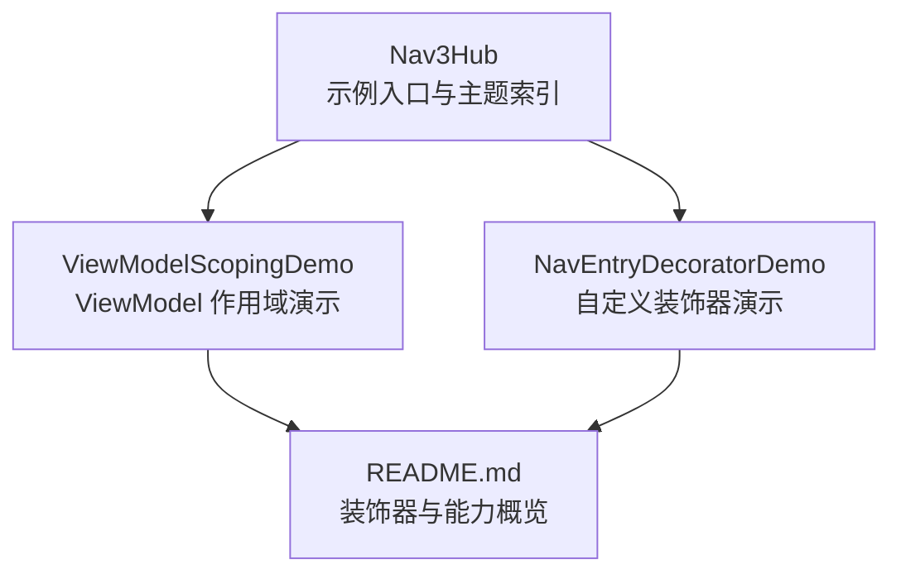
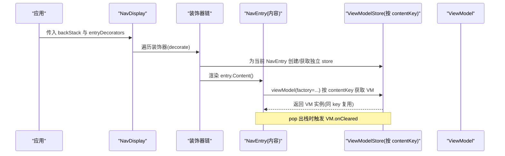
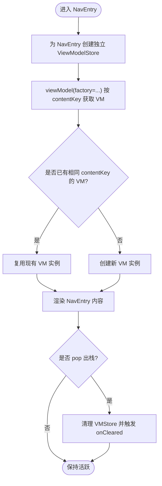
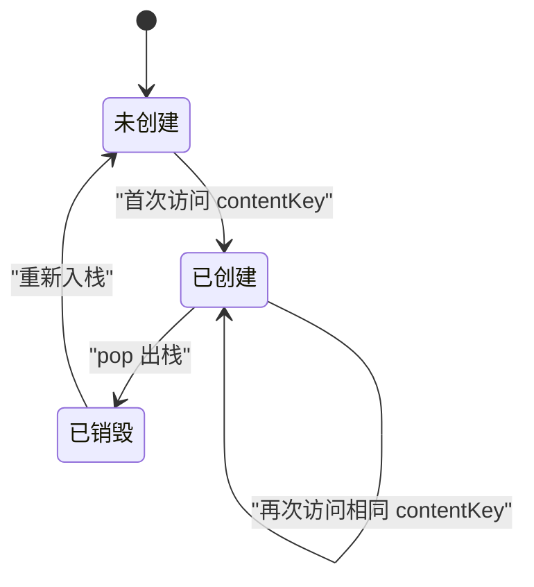
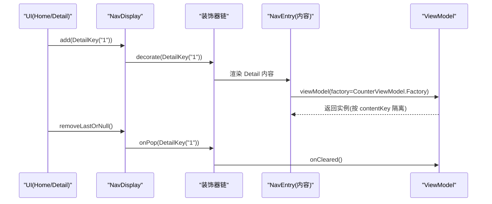
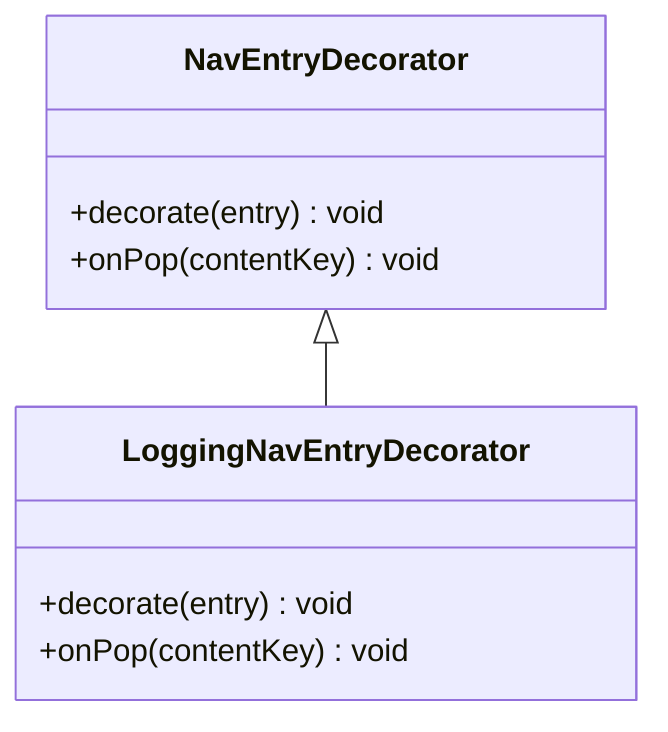
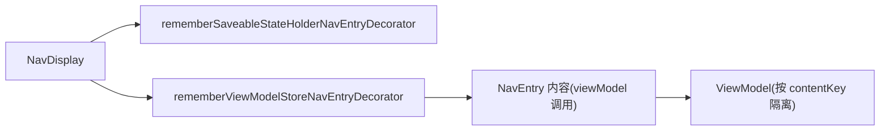

# ViewModel 作用域

<cite>
**本文引用的文件**   
- [ViewModelScopingDemo.kt](file://app/src/main/java/com/example/composeup/navigation3/ViewModelScopingDemo.kt)
- [NavEntryDecoratorDemo.kt](file://app/src/main/java/com/example/composeup/navigation3/NavEntryDecoratorDemo.kt)
- [README.md](file://app/src/main/java/com/example/composeup/navigation3/README.md)
- [Nav3Hub.kt](file://app/src/main/java/com/example/composeup/navigation3/Nav3Hub.kt)
</cite>

## 目录
1. [引言](#引言)
2. [项目结构](#项目结构)
3. [核心组件](#核心组件)
4. [架构总览](#架构总览)
5. [详细组件分析](#详细组件分析)
6. [依赖关系分析](#依赖关系分析)
7. [性能与内存优化](#性能与内存优化)
8. [故障排查指南](#故障排查指南)
9. [结论](#结论)

## 引言
本文聚焦 Navigation 3 的 ViewModel 作用域机制，围绕以下目标展开：
- 解释默认的 Activity 级别 ViewModel 绑定与 NavEntry 级别隔离的差异。
- 深入讲解 rememberViewModelStoreNavEntryDecorator 的工作原理与使用方法。
- 展示如何通过 contentKey 实现 ViewModel 的生命周期管理：同一 key 复用、不同实例独立、pop 出栈即清空。
- 给出实际场景下的配置示例与最佳实践，包括内存泄漏防护与性能优化建议。

本仓库中的 Navigation 3 示例位于 navigation3 包，其中 ViewModel 作用域演示集中在 ViewModelScopingDemo.kt；装饰器通用能力在 NavEntryDecoratorDemo.kt 中体现；导航主题索引在 Nav3Hub.kt 与 README.md 中说明。

**章节来源**
- [Nav3Hub.kt:58-64](file://app/src/main/java/com/example/composeup/navigation3/Nav3Hub.kt#L58-L64)
- [README.md:77-84](file://app/src/main/java/com/example/composeup/navigation3/README.md#L77-L84)

## 项目结构
Navigation 3 相关代码组织为“示例驱动”的结构：
- Nav3Hub.kt：导航示例入口与主题索引。
- ViewModelScopingDemo.kt：ViewModel 作用域限制在 NavEntry 的可交互示例。
- NavEntryDecoratorDemo.kt：自定义 NavEntryDecorator 的通用模式（日志、注入、清理）。
- README.md：对装饰器、Scene、元数据等能力的概览说明。

**图表来源**
- [Nav3Hub.kt:118-199](file://app/src/main/java/com/example/composeup/navigation3/Nav3Hub.kt#L118-L199)
- [ViewModelScopingDemo.kt:37-75](file://app/src/main/java/com/example/composeup/navigation3/ViewModelScopingDemo.kt#L37-L75)
- [NavEntryDecoratorDemo.kt:44-86](file://app/src/main/java/com/example/composeup/navigation3/NavEntryDecoratorDemo.kt#L44-L86)
- [README.md:77-84](file://app/src/main/java/com/example/composeup/navigation3/README.md#L77-L84)

**章节来源**
- [Nav3Hub.kt:118-199](file://app/src/main/java/com/example/composeup/navigation3/Nav3Hub.kt#L118-L199)
- [ViewModelScopingDemo.kt:37-75](file://app/src/main/java/com/example/composeup/navigation3/ViewModelScopingDemo.kt#L37-L75)
- [NavEntryDecoratorDemo.kt:44-86](file://app/src/main/java/com/example/composeup/navigation3/NavEntryDecoratorDemo.kt#L44-L86)
- [README.md:77-84](file://app/src/main/java/com/example/composeup/navigation3/README.md#L77-L84)

## 核心组件
- rememberViewModelStoreNavEntryDecorator：为每个 NavEntry 提供独立的 ViewModelStore，使 viewModel() 的作用域从 Activity 下沉到 NavEntry，并按 contentKey 隔离实例生命周期。
- rememberSaveableStateHolderNavEntryDecorator：负责 rememberSaveable 的状态保存，需放在装饰器列表第一个。
- NavDisplay + entryProvider：将返回栈中的 NavKey 解析为 NavEntry 并渲染；entryProvider 中通过 entry<T> 注册目的地。
- viewModel(factory=...)：在 NavEntry 内容中获取 ViewModel；当使用 rememberViewModelStoreNavEntryDecorator 后，该调用自动绑定到当前 NavEntry 的 ViewModelStore，并以 contentKey 作为实例键。

关键行为总结：
- 默认：viewModel() 绑定到最近的 ViewModelStoreOwner（通常是 Activity），所有目的地共享一个实例。
- 启用装饰器后：每个 NavEntry 拥有独立 ViewModelStore；相同 contentKey 复用同一 VM，不同 key 各自独立；pop 出栈触发 onCleared。

**章节来源**
- [ViewModelScopingDemo.kt:24-35](file://app/src/main/java/com/example/composeup/navigation3/ViewModelScopingDemo.kt#L24-L35)
- [ViewModelScopingDemo.kt:50-55](file://app/src/main/java/com/example/composeup/navigation3/ViewModelScopingDemo.kt#L50-L55)
- [README.md:77-84](file://app/src/main/java/com/example/composeup/navigation3/README.md#L77-L84)

## 架构总览
下图展示了 NavDisplay 如何结合装饰器与 entryProvider 工作，以及 viewModel() 如何在 NavEntry 内容中按 contentKey 隔离作用域。

**图表来源**
- [ViewModelScopingDemo.kt:44-75](file://app/src/main/java/com/example/composeup/navigation3/ViewModelScopingDemo.kt#L44-L75)
- [NavEntryDecoratorDemo.kt:44-86](file://app/src/main/java/com/example/composeup/navigation3/NavEntryDecoratorDemo.kt#L44-L86)

## 详细组件分析

### rememberViewModelStoreNavEntryDecorator 工作原理
- 作用：为每个 NavEntry 注入独立的 ViewModelStore，从而把 viewModel() 的作用域从 Activity 缩小到 NavEntry。
- 隔离键：contentKey。相同 contentKey 复用同一个 ViewModel 实例；不同 contentKey 各自独立。
- 生命周期：当某个 NavEntry 被 pop 出栈且离开组合时，对应 ViewModelStore 会清理其持有的 ViewModel，触发 onCleared。
- 使用位置：作为 NavDisplay.entryDecorators 之一，通常放在 rememberSaveableStateHolderNavEntryDecorator 之后。

**图表来源**
- [ViewModelScopingDemo.kt:24-35](file://app/src/main/java/com/example/composeup/navigation3/ViewModelScopingDemo.kt#L24-L35)
- [ViewModelScopingDemo.kt:50-55](file://app/src/main/java/com/example/composeup/navigation3/ViewModelScopingDemo.kt#L50-L55)

**章节来源**
- [ViewModelScopingDemo.kt:24-35](file://app/src/main/java/com/example/composeup/navigation3/ViewModelScopingDemo.kt#L24-L35)
- [ViewModelScopingDemo.kt:50-55](file://app/src/main/java/com/example/composeup/navigation3/ViewModelScopingDemo.kt#L50-L55)

### contentKey 驱动的 ViewModel 生命周期管理
- 同一 key 复用：例如 DetailKey("1") 多次进出栈，ViewModel 实例不变，状态保留。
- 不同实例独立：DetailKey("1") 与 DetailKey("2") 分别持有各自的 ViewModel，互不影响。
- pop 出栈即清空：当某个 NavEntry 被移除出栈，其 ViewModelStore 清理对应 VM，触发 onCleared。

**图表来源**
- [ViewModelScopingDemo.kt:24-35](file://app/src/main/java/com/example/composeup/navigation3/ViewModelScopingDemo.kt#L24-L35)
- [ViewModelScopingDemo.kt:138-170](file://app/src/main/java/com/example/composeup/navigation3/ViewModelScopingDemo.kt#L138-L170)

**章节来源**
- [ViewModelScopingDemo.kt:24-35](file://app/src/main/java/com/example/composeup/navigation3/ViewModelScopingDemo.kt#L24-L35)
- [ViewModelScopingDemo.kt:138-170](file://app/src/main/java/com/example/composeup/navigation3/ViewModelScopingDemo.kt#L138-L170)

### 使用方式与示例
- 在 NavDisplay 中注册两个装饰器：
  - rememberSaveableStateHolderNavEntryDecorator()：负责 rememberSaveable 状态保存，必须放列表第一个。
  - rememberViewModelStoreNavEntryDecorator()：为每个 NavEntry 提供独立 ViewModelStore。
- 在 entryProvider 中定义 entry<T>，并在内容里调用 viewModel(factory=...)，无需手动传 key，会自动按 contentKey 隔离。

**图表来源**
- [ViewModelScopingDemo.kt:44-75](file://app/src/main/java/com/example/composeup/navigation3/ViewModelScopingDemo.kt#L44-L75)
- [ViewModelScopingDemo.kt:138-170](file://app/src/main/java/com/example/composeup/navigation3/ViewModelScopingDemo.kt#L138-L170)

**章节来源**
- [ViewModelScopingDemo.kt:44-75](file://app/src/main/java/com/example/composeup/navigation3/ViewModelScopingDemo.kt#L44-L75)
- [ViewModelScopingDemo.kt:138-170](file://app/src/main/java/com/example/composeup/navigation3/ViewModelScopingDemo.kt#L138-L170)

### 自定义 NavEntryDecorator 的模式参考
虽然 rememberViewModelStoreNavEntryDecorator 已经封装了 ViewModelStore 逻辑，但理解 NavEntryDecorator 的通用模式有助于扩展：
- decorate：对每个 NavEntry 进入组合时调用，可注入依赖或包裹 UI，必须调用 entry.Content() 以真正渲染。
- onPop：当 NavEntry 离开组合时调用，用于清理与该 contentKey 关联的状态。

**图表来源**
- [NavEntryDecoratorDemo.kt:27-43](file://app/src/main/java/com/example/composeup/navigation3/NavEntryDecoratorDemo.kt#L27-L43)
- [NavEntryDecoratorDemo.kt:138-150](file://app/src/main/java/com/example/composeup/navigation3/NavEntryDecoratorDemo.kt#L138-L150)

**章节来源**
- [NavEntryDecoratorDemo.kt:27-43](file://app/src/main/java/com/example/composeup/navigation3/NavEntryDecoratorDemo.kt#L27-L43)
- [NavEntryDecoratorDemo.kt:138-150](file://app/src/main/java/com/example/composeup/navigation3/NavEntryDecoratorDemo.kt#L138-L150)

## 依赖关系分析
- NavDisplay 依赖 entryDecorators 列表，依次执行 decorate 回调，最终渲染 entry.Content()。
- rememberSaveableStateHolderNavEntryDecorator 必须在列表首位，确保 rememberSaveable 状态保存生效。
- rememberViewModelStoreNavEntryDecorator 在 Saveable 装饰器之后，为每个 NavEntry 提供独立 ViewModelStore。
- viewModel(factory=...) 在 NavEntry 内容中调用，受当前 NavEntry 的 ViewModelStore 影响，按 contentKey 隔离。

**图表来源**
- [ViewModelScopingDemo.kt:50-55](file://app/src/main/java/com/example/composeup/navigation3/ViewModelScopingDemo.kt#L50-L55)
- [NavEntryDecoratorDemo.kt:60-65](file://app/src/main/java/com/example/composeup/navigation3/NavEntryDecoratorDemo.kt#L60-L65)

**章节来源**
- [ViewModelScopingDemo.kt:50-55](file://app/src/main/java/com/example/composeup/navigation3/ViewModelScopingDemo.kt#L50-L55)
- [NavEntryDecoratorDemo.kt:60-65](file://app/src/main/java/com/example/composeup/navigation3/NavEntryDecoratorDemo.kt#L60-L65)

## 性能与内存优化
- 避免不必要的 VM 实例：尽量使用稳定的 contentKey，减少重复创建与销毁带来的开销。
- 合理拆分页面粒度：将需要独立状态的页面拆成独立 NavEntry，避免大 VM 承载过多职责。
- 及时释放资源：确保 VM 中不持有长生命周期的引用（如全局单例、静态集合），必要时在 onCleared 中清理。
- 装饰器顺序正确：rememberSaveableStateHolderNavEntryDecorator 必须放第一个，否则 rememberSaveable 状态可能无法正确保存。
- 控制栈深度：避免过深的返回栈导致多个 VM 同时存活，必要时使用 replace 或 clear 策略。

[本节为通用指导，不直接分析具体文件]

## 故障排查指南
- 现象：多个目的地共用同一个 ViewModel。
  - 原因：未添加 rememberViewModelStoreNavEntryDecorator，或装饰器顺序错误。
  - 处理：确保在 NavDisplay.entryDecorators 中添加该装饰器，并将 rememberSaveableStateHolderNavEntryDecorator 置于首位。
- 现象：pop 出栈后 ViewModel 未销毁。
  - 原因：未在 NavEntry 内容中使用 viewModel(factory=...)，或使用了错误的 ViewModelStoreOwner。
  - 处理：确认在 entry 内容中调用 viewModel(factory=...)，并确保装饰器链正确。
- 现象：rememberSaveable 状态丢失。
  - 原因：rememberSaveableStateHolderNavEntryDecorator 不在装饰器列表首位。
  - 处理：调整装饰器顺序，确保 Saveable 装饰器优先。

**章节来源**
- [ViewModelScopingDemo.kt:50-55](file://app/src/main/java/com/example/composeup/navigation3/ViewModelScopingDemo.kt#L50-L55)
- [NavEntryDecoratorDemo.kt:40-43](file://app/src/main/java/com/example/composeup/navigation3/NavEntryDecoratorDemo.kt#L40-L43)

## 结论
通过 rememberViewModelStoreNavEntryDecorator，Navigation 3 将 ViewModel 的作用域从 Activity 下沉到 NavEntry，并以 contentKey 作为实例隔离键。这使得：
- 同一 key 复用 VM，状态持久化于栈内；
- 不同 key 各自独立，避免跨页面状态污染；
- pop 出栈即触发 onCleared，便于资源清理与内存回收。

配合 rememberSaveableStateHolderNavEntryDecorator 与自定义 NavEntryDecorator，可以构建稳定、可维护且高性能的导航与状态管理体系。

[本节为总结性内容，不直接分析具体文件]