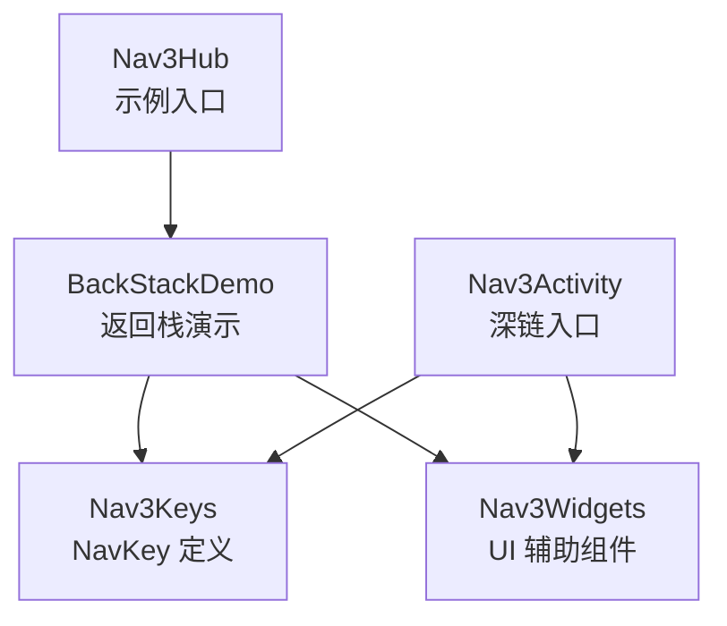
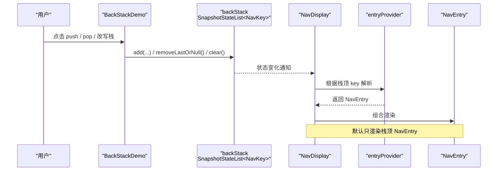
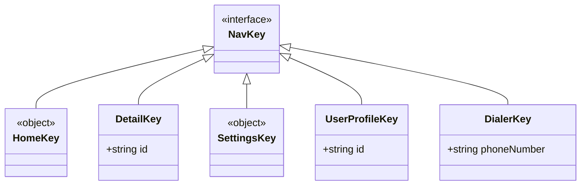
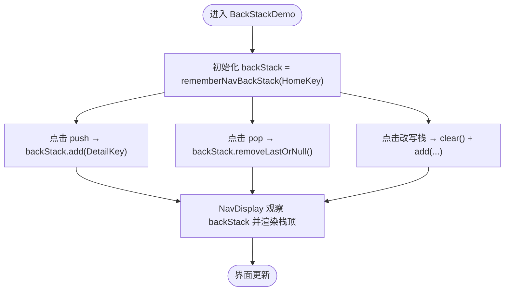
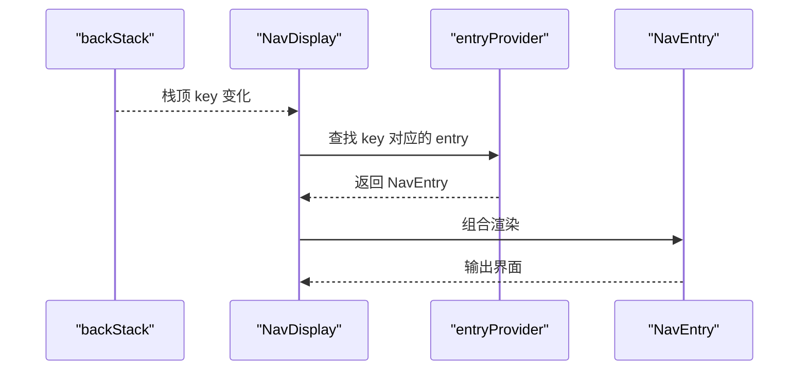
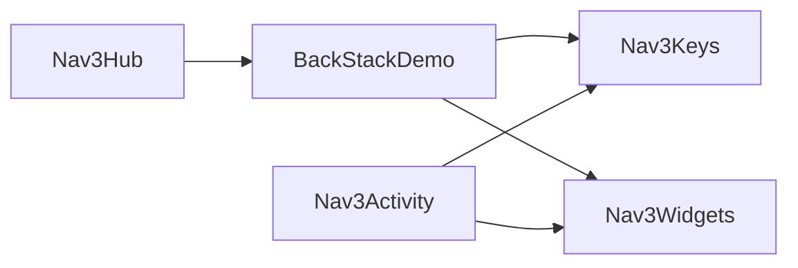

# 返回栈管理

<cite>
**本文引用的文件**   
- [Nav3Hub.kt](file://app/src/main/java/com/example/composeup/navigation3/Nav3Hub.kt)
- [BackStackDemo.kt](file://app/src/main/java/com/example/composeup/navigation3/BackStackDemo.kt)
- [Nav3Keys.kt](file://app/src/main/java/com/example/composeup/navigation3/Nav3Keys.kt)
- [Nav3Widgets.kt](file://app/src/main/java/com/example/composeup/navigation3/Nav3Widgets.kt)
- [Nav3Activity.kt](file://app/src/main/java/com/example/composeup/navigation3/Nav3Activity.kt)
</cite>

## 目录
1. [引言](#引言)
2. [项目结构](#项目结构)
3. [核心组件](#核心组件)
4. [架构总览](#架构总览)
5. [详细组件分析](#详细组件分析)
6. [依赖关系分析](#依赖关系分析)
7. [性能与优化建议](#性能与优化建议)
8. [故障排查指南](#故障排查指南)
9. [结论](#结论)

## 引言
本文聚焦 Navigation 3 的「返回栈管理」，围绕仓库中 navigation3 示例模块，解释以下关键问题：
- 「返回栈归你所有」的核心概念是什么。
- NavKey、rememberNavBackStack、NavBackStack 的职责与使用方式。
- 如何通过 add 前进（push）、removeLastOrNull 后退（pop），以及如何直接改写栈。
- NavDisplay 如何把 key 解析成 NavEntry 并渲染。
- 与传统 Fragment 导航的差异。
- 常见问题与性能优化建议。

本说明以 BackStackDemo 为主线，辅以 Nav3Keys、Nav3Widgets、Nav3Activity 等文件中的实际用法进行对照。

## 项目结构
navigation3 示例模块采用“主题入口 + 示例页面 + 共享 Key + 共享 UI 组件”的组织方式：
- Nav3Hub：导航示例的主题入口，列出 8 个专题，其中第一个是「管理返回栈」。
- BackStackDemo：演示返回栈的创建、push/pop、可视化与 NavDisplay 渲染。
- Nav3Keys：集中定义可被 rememberNavBackStack 持久化的 NavKey。
- Nav3Widgets：示例复用的小组件，包括 BackStackView、Pane、LogBox 等。
- Nav3Activity：真实 deep link 入口 Activity，展示从 Intent 合成初始返回栈并交给 NavDisplay。

**图表来源**
- [Nav3Hub.kt:118-199](file://app/src/main/java/com/example/composeup/navigation3/Nav3Hub.kt#L118-L199)
- [BackStackDemo.kt:28-135](file://app/src/main/java/com/example/composeup/navigation3/BackStackDemo.kt#L28-L135)
- [Nav3Keys.kt:1-36](file://app/src/main/java/com/example/composeup/navigation3/Nav3Keys.kt#L1-L36)
- [Nav3Widgets.kt:1-355](file://app/src/main/java/com/example/composeup/navigation3/Nav3Widgets.kt#L1-L355)
- [Nav3Activity.kt:38-95](file://app/src/main/java/com/example/composeup/navigation3/Nav3Activity.kt#L38-L95)

**章节来源**
- [Nav3Hub.kt:29-45](file://app/src/main/java/com/example/composeup/navigation3/Nav3Hub.kt#L29-L45)
- [BackStackDemo.kt:17-26](file://app/src/main/java/com/example/composeup/navigation3/BackStackDemo.kt#L17-L26)

## 核心组件
本节梳理「返回栈管理」相关的关键概念与 API：

- NavKey
  - 表示一个目的地的引用。返回栈里装的是 NavKey，不是内容本身。
  - 需要实现 NavKey 接口，并使用 @Serializable，以便 rememberNavBackStack 将栈序列化到 SavedState，支持配置变更和进程死亡后恢复。
  - 示例中定义了 HomeKey、DetailKey、SettingsKey、UserProfileKey、DialerKey 等。

- rememberNavBackStack
  - 创建一个 SnapshotStateList<NavKey>，即「返回栈」。
  - 支持传入初始 key 或多个 key；当匹配到 deep link 时，可以一次性生成多个 key 作为初始栈。
  - 生命周期由 Compose 管理，配合 @Serializable NavKey 可实现状态持久化。

- NavBackStack（SnapshotStateList<NavKey>）
  - 本质是一个可观察的状态列表。
  - 常用操作：
    - add(key)：前进（push）。
    - removeLastOrNull()：后退（pop），空栈时返回 null。
    - clear() / addAll(...)：直接改写栈，用于重置或批量构建。

- NavDisplay
  - 负责观察 backStack，并把栈顶 key 通过 entryProvider 解析为 NavEntry，再渲染到界面。
  - 默认只显示栈顶的一个 NavEntry（SinglePaneSceneStrategy）。
  - onBack 回调通常调用 backStack.removeLastOrNull()，处理系统返回键或预测性返回。

- entryProvider
  - 声明每个 NavKey 对应的 NavEntry 渲染逻辑。
  - 在 NavDisplay 内部根据当前 key 选择对应 entry 组合。

**章节来源**
- [Nav3Keys.kt:6-15](file://app/src/main/java/com/example/composeup/navigation3/Nav3Keys.kt#L6-L15)
- [Nav3Keys.kt:17-36](file://app/src/main/java/com/example/composeup/navigation3/Nav3Keys.kt#L17-L36)
- [BackStackDemo.kt:28-66](file://app/src/main/java/com/example/composeup/navigation3/BackStackDemo.kt#L28-L66)
- [BackStackDemo.kt:76-99](file://app/src/main/java/com/example/composeup/navigation3/BackStackDemo.kt#L76-L99)
- [Nav3Activity.kt:40-69](file://app/src/main/java/com/example/composeup/navigation3/Nav3Activity.kt#L40-L69)

## 架构总览
Navigation 3 的返回栈架构可以概括为：
- 应用持有 backStack（SnapshotStateList<NavKey>）。
- 用户操作修改 backStack（add/remove/clear）。
- NavDisplay 观察 backStack，用 entryProvider 把 key 解析成 NavEntry 并渲染。
- onBack 统一处理返回行为。

**图表来源**
- [BackStackDemo.kt:28-66](file://app/src/main/java/com/example/composeup/navigation3/BackStackDemo.kt#L28-L66)
- [BackStackDemo.kt:76-99](file://app/src/main/java/com/example/composeup/navigation3/BackStackDemo.kt#L76-L99)

## 详细组件分析

### NavKey 设计
NavKey 是返回栈的最小单位，代表一个目的地。示例中集中定义在 Nav3Keys.kt：
- HomeKey：主页。
- DetailKey(id)：详情页，id 区分不同实例。
- SettingsKey：设置页。
- UserProfileKey(id)：用户资料页，常用于 deep link。
- DialerKey(phoneNumber)：拨号页，用于自定义 matcher。

这些 key 都标注了 @Serializable，满足 rememberNavBackStack 的持久化要求。

**图表来源**
- [Nav3Keys.kt:17-36](file://app/src/main/java/com/example/composeup/navigation3/Nav3Keys.kt#L17-L36)

**章节来源**
- [Nav3Keys.kt:6-15](file://app/src/main/java/com/example/composeup/navigation3/Nav3Keys.kt#L6-L15)
- [Nav3Keys.kt:17-36](file://app/src/main/java/com/example/composeup/navigation3/Nav3Keys.kt#L17-L36)

### rememberNavBackStack 与 NavBackStack 的使用
BackStackDemo 展示了最基础的用法：
- 使用 rememberNavBackStack(HomeKey) 初始化返回栈。
- 通过 backStack.add(DetailKey(...)) 前进。
- 通过 backStack.removeLastOrNull() 后退。
- 通过 clear() + add(...) 直接改写栈。

**图表来源**
- [BackStackDemo.kt:28-66](file://app/src/main/java/com/example/composeup/navigation3/BackStackDemo.kt#L28-L66)
- [BackStackDemo.kt:76-99](file://app/src/main/java/com/example/composeup/navigation3/BackStackDemo.kt#L76-L99)

**章节来源**
- [BackStackDemo.kt:28-66](file://app/src/main/java/com/example/composeup/navigation3/BackStackDemo.kt#L28-L66)
- [BackStackDemo.kt:76-99](file://app/src/main/java/com/example/composeup/navigation3/BackStackDemo.kt#L76-L99)

### NavDisplay 如何将 key 解析成 NavEntry 并渲染
NavDisplay 接收 backStack 和 entryProvider：
- 观察 backStack 的变化。
- 取出栈顶 key。
- 在 entryProvider 中查找匹配的 entry。
- 组合该 NavEntry 的 Composable 内容。
- 默认只显示栈顶 NavEntry（SinglePaneSceneStrategy）。

**图表来源**
- [BackStackDemo.kt:34-66](file://app/src/main/java/com/example/composeup/navigation3/BackStackDemo.kt#L34-L66)

**章节来源**
- [BackStackDemo.kt:34-66](file://app/src/main/java/com/example/composeup/navigation3/BackStackDemo.kt#L34-L66)

### 手动管理返回栈状态的实际示例
BackStackDemo 提供了三类典型操作：
- 前进（push）：backStack.add(DetailKey("..."))。
- 后退（pop）：val popped = backStack.removeLastOrNull()。
- 直接改写栈：backStack.clear(); backStack.add(HomeKey); backStack.add(DetailKey("A")); backStack.add(DetailKey("B"))。

同时，onBack 回调中判断栈大小：
- 如果 size > 1，则弹出栈顶并记录日志。
- 否则退出到话题列表。

这些操作体现了「返回栈归你所有」：你可以自由增删、清空、重排，库只负责渲染。

**章节来源**
- [BackStackDemo.kt:76-99](file://app/src/main/java/com/example/composeup/navigation3/BackStackDemo.kt#L76-L99)
- [BackStackDemo.kt:34-48](file://app/src/main/java/com/example/composeup/navigation3/BackStackDemo.kt#L34-L48)

### 与传统 Fragment 导航的差异
- Fragment 导航：
  - 框架维护 NavController 与 BackStack。
  - 开发者通过 navigate(popBackStack...) 间接控制栈。
  - 状态通常保存在 ViewModel 或 Fragment 自身状态中。
- Navigation 3：
  - 开发者自己持有 backStack（SnapshotStateList<NavKey>）。
  - 直接对 List 做 add/remove/clear，语义清晰。
  - NavDisplay 仅负责渲染，不隐藏栈的内部结构。
  - 更贴近 Compose 的状态驱动思想。

这种差异让 Navigation 3 更适合 Compose 的响应式模型，也更容易做复杂场景（如多栈、分栏、对话框叠加）的扩展。

[本节为概念对比，不直接分析具体代码文件]

## 依赖关系分析
navigation3 示例模块内部的依赖关系如下：
- Nav3Hub 依赖 BackStackDemo 等示例页面。
- BackStackDemo 依赖 Nav3Keys（NavKey 定义）与 Nav3Widgets（UI 辅助组件）。
- Nav3Activity 依赖 Nav3Keys 与 Nav3Widgets，并在 onCreate 中构造 initialKeys 交给 rememberNavBackStack。

**图表来源**
- [Nav3Hub.kt:118-199](file://app/src/main/java/com/example/composeup/navigation3/Nav3Hub.kt#L118-L199)
- [BackStackDemo.kt:28-135](file://app/src/main/java/com/example/composeup/navigation3/BackStackDemo.kt#L28-L135)
- [Nav3Activity.kt:40-95](file://app/src/main/java/com/example/composeup/navigation3/Nav3Activity.kt#L40-L95)

**章节来源**
- [Nav3Hub.kt:118-199](file://app/src/main/java/com/example/composeup/navigation3/Nav3Hub.kt#L118-L199)
- [BackStackDemo.kt:28-135](file://app/src/main/java/com/example/composeup/navigation3/BackStackDemo.kt#L28-L135)
- [Nav3Activity.kt:40-95](file://app/src/main/java/com/example/composeup/navigation3/Nav3Activity.kt#L40-L95)

## 性能与优化建议
- 避免频繁重建 NavDisplay：
  - 将 NavDisplay 放在稳定的层级，避免每次重组都重新创建。
  - 只在 backStack 变化时触发渲染。
- 合理使用 entryProvider：
  - 将 entry 的 Composable 内容尽量轻量，避免在 entry 内执行昂贵计算。
  - 使用 remember 缓存派生数据。
- 谨慎直接改写栈：
  - clear + addAll 会触发较大范围的重绘，适合批量初始化或重置场景。
  - 日常 push/pop 优先使用 add/removeLastOrNull。
- 利用 NavKey 的序列化能力：
  - 确保 NavKey 是 @Serializable，减少状态丢失导致的重建。
- 结合 Scene 与装饰器：
  - 对于复杂布局（对话框、双栏），使用 SceneStrategy 与 SceneDecoratorStrategy，避免在 entry 内写大量布局逻辑。

[本节提供通用建议，不直接分析具体代码文件]

## 故障排查指南
- 无法跨配置变更或进程死亡恢复：
  - 检查 NavKey 是否实现 NavKey 接口且标注 @Serializable。
  - 参考 Nav3Keys 的定义方式。
- 点击返回无反应或误退出：
  - 检查 onBack 回调中对栈大小的判断。
  - 参考 BackStackDemo 中 size > 1 才 pop 的逻辑。
- 界面没有切换：
  - 确认 entryProvider 中已注册对应 NavKey 的 entry。
  - 确认 NavDisplay 的 backStack 确实发生变化。
- 深链未生效：
  - 检查 DeepLinkMatcher 是否正确匹配 URI。
  - 参考 Nav3Activity 中 matchers 与 withBackStack 的用法。

**章节来源**
- [Nav3Keys.kt:6-15](file://app/src/main/java/com/example/composeup/navigation3/Nav3Keys.kt#L6-L15)
- [BackStackDemo.kt:34-48](file://app/src/main/java/com/example/composeup/navigation3/BackStackDemo.kt#L34-L48)
- [Nav3Activity.kt:40-69](file://app/src/main/java/com/example/composeup/navigation3/Nav3Activity.kt#L40-L69)

## 结论
Navigation 3 的「返回栈归你所有」意味着：
- 返回栈是一个普通的 SnapshotStateList<NavKey>，由开发者持有并直接操作。
- NavDisplay 只负责观察栈并渲染栈顶 NavEntry。
- 通过 add、removeLastOrNull、clear + addAll，可以灵活实现前进、后退与批量改写。
- 相比传统 Fragment 导航，这种方式更贴合 Compose 的状态驱动模型，便于扩展复杂导航场景。

在实际项目中，建议：
- 将 NavKey 集中管理，并确保可序列化。
- 在合适的层级持有 backStack，避免不必要的重建。
- 使用 entryProvider 组织各目的地的渲染逻辑。
- 结合 deep link、Scene、装饰器等能力，构建可扩展的导航体系。

[本节为总结，不直接分析具体代码文件]