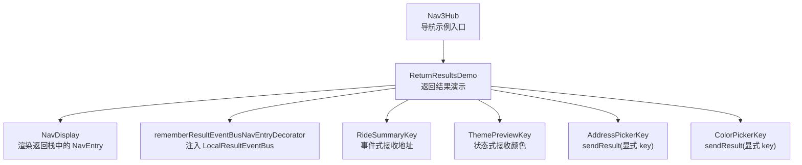
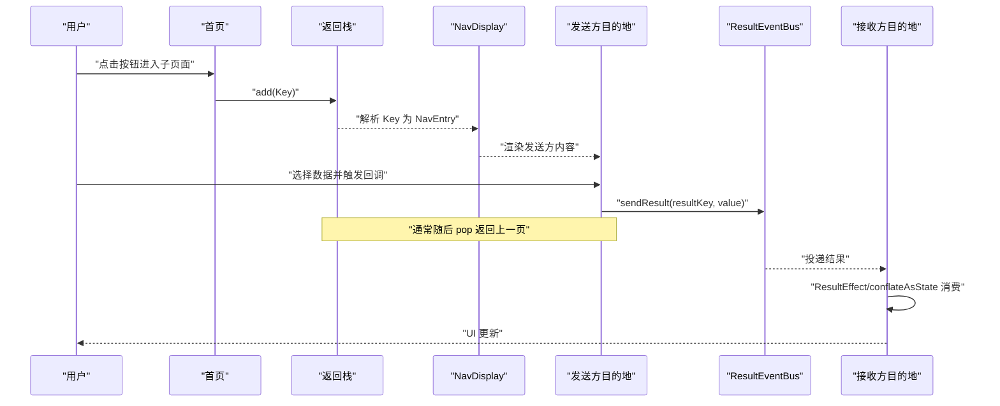
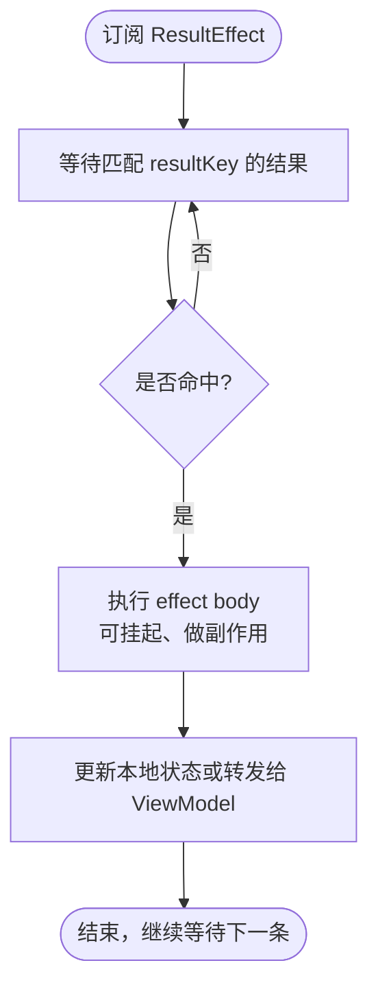
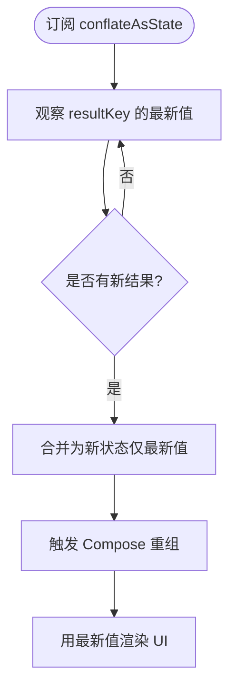
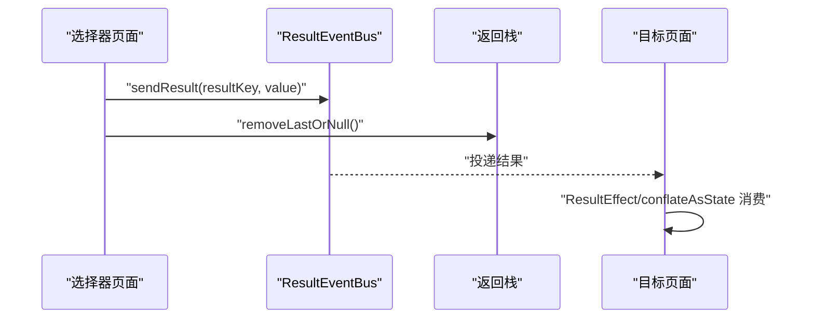
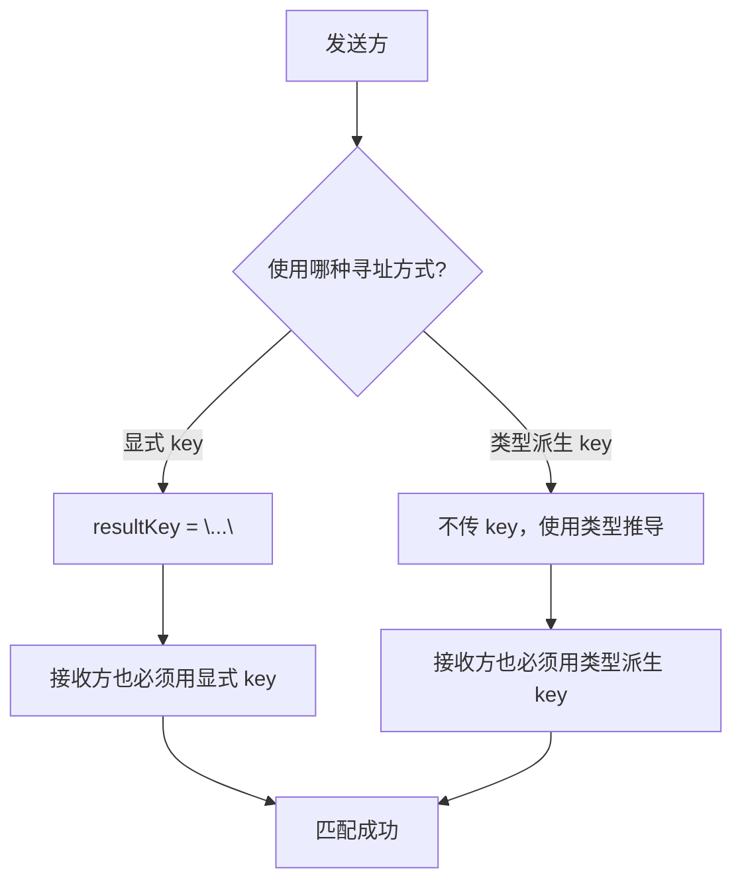
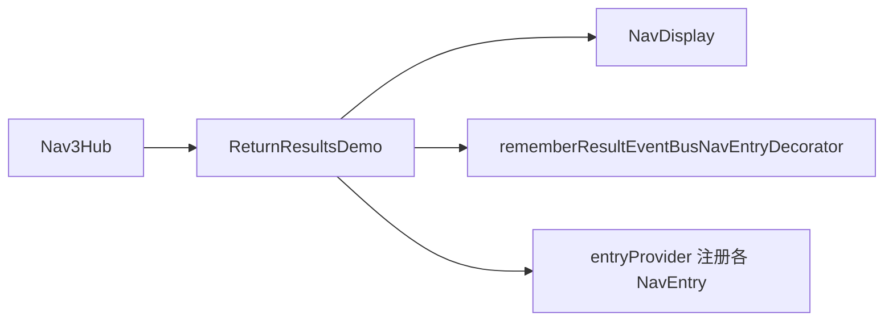

# 返回结果处理

<cite>
**本文引用的文件**   
- [ReturnResultsDemo.kt](file://app/src/main/java/com/example/composeup/navigation3/ReturnResultsDemo.kt)
- [Nav3Hub.kt](file://app/src/main/java/com/example/composeup/navigation3/Nav3Hub.kt)
</cite>

## 目录
1. [引言](#引言)
2. [项目结构定位](#项目结构定位)
3. [核心组件与职责](#核心组件与职责)
4. [架构总览](#架构总览)
5. [详细组件分析](#详细组件分析)
6. [依赖关系分析](#依赖关系分析)
7. [性能与线程安全](#性能与线程安全)
8. [错误处理与常见问题](#错误处理与常见问题)
9. [结论](#结论)
10. [附录：关键用法速查](#附录关键用法速查)

## 引言
本文围绕 Navigation 3 的返回结果处理机制展开，重点解释 ResultEventBus 的设计动机、跨目的地数据回传模式，以及两种消费模型的使用场景与差异：
- 事件式 ResultEffect：按序消费一次性结果，effect body 在协程中执行，适合副作用（写 ViewModel、弹提示等）。
- 状态式 conflateAsState：只保留最新值并暴露为 Compose State，适合轻量 UI 修饰（如主题色、滤镜）。

同时说明两种寻址方式：
- 显式 key：通过字符串 resultKey 区分同类型多实例。
- 类型派生 key：不传 key，使用类型的 KClass 生成键，适合领域内唯一类型。

发送方与接收方必须保持一致的寻址策略，二者不互通。

## 项目结构定位
本示例位于 navigation3 模块，作为 Jetpack Navigation 3 系列示例之一，负责演示“返回结果”这一能力。导航入口由 Nav3Hub 提供，具体演示逻辑集中在 ReturnResultsDemo 中。

**图表来源**
- [Nav3Hub.kt:118-199](file://app/src/main/java/com/example/composeup/navigation3/Nav3Hub.kt#L118-L199)
- [ReturnResultsDemo.kt:48-163](file://app/src/main/java/com/example/composeup/navigation3/ReturnResultsDemo.kt#L48-L163)

**章节来源**
- [Nav3Hub.kt:29-45](file://app/src/main/java/com/example/composeup/navigation3/Nav3Hub.kt#L29-L45)
- [Nav3Hub.kt:118-199](file://app/src/main/java/com/example/composeup/navigation3/Nav3Hub.kt#L118-L199)
- [ReturnResultsDemo.kt:32-46](file://app/src/main/java/com/example/composeup/navigation3/ReturnResultsDemo.kt#L32-L46)

## 核心组件与职责
- ResultEventBus：内存级总线，用于在目的地之间传递结果。
- LocalResultEventBus：CompositionLocal，供每个 NavEntry 访问总线。
- rememberResultEventBusNavEntryDecorator：装饰器，把 LocalResultEventBus 注入到每个 NavEntry 的内容中。
- ResultEffect：事件式消费 API，按 resultKey 监听并按序执行 effect body。
- conflateAsState：状态式消费 API，暴露最新结果为 Compose State。
- sendResult：发送结果到指定 resultKey。

这些组件共同构成“发送方 → 总线 → 接收方”的跨目的地通信路径。

**章节来源**
- [ReturnResultsDemo.kt:26-29](file://app/src/main/java/com/example/composeup/navigation3/ReturnResultsDemo.kt#L26-L29)
- [ReturnResultsDemo.kt:58-62](file://app/src/main/java/com/example/composeup/navigation3/ReturnResultsDemo.kt#L58-L62)
- [ReturnResultsDemo.kt:81-89](file://app/src/main/java/com/example/composeup/navigation3/ReturnResultsDemo.kt#L81-L89)
- [ReturnResultsDemo.kt:120-125](file://app/src/main/java/com/example/composeup/navigation3/ReturnResultsDemo.kt#L120-L125)
- [ReturnResultsDemo.kt:103-115](file://app/src/main/java/com/example/composeup/navigation3/ReturnResultsDemo.kt#L103-L115)
- [ReturnResultsDemo.kt:150-161](file://app/src/main/java/com/example/composeup/navigation3/ReturnResultsDemo.kt#L150-L161)

## 架构总览
下图展示从“选择目的地”到“发送结果”，再到“接收结果更新 UI”的完整流程。

**图表来源**
- [ReturnResultsDemo.kt:65-73](file://app/src/main/java/com/example/composeup/navigation3/ReturnResultsDemo.kt#L65-L73)
- [ReturnResultsDemo.kt:103-115](file://app/src/main/java/com/example/composeup/navigation3/ReturnResultsDemo.kt#L103-L115)
- [ReturnResultsDemo.kt:150-161](file://app/src/main/java/com/example/composeup/navigation3/ReturnResultsDemo.kt#L150-L161)
- [ReturnResultsDemo.kt:81-89](file://app/src/main/java/com/example/composeup/navigation3/ReturnResultsDemo.kt#L81-L89)
- [ReturnResultsDemo.kt:120-125](file://app/src/main/java/com/example/composeup/navigation3/ReturnResultsDemo.kt#L120-L125)

## 详细组件分析

### 事件式消费：ResultEffect
- 用途：按序处理每一条结果，适合一次性副作用（例如写入 ViewModel、弹出 Snackbar）。
- 行为：每次收到匹配 resultKey 的结果都会执行 effect body；body 运行在协程中，可调用挂起函数。
- 典型场景：行程汇总页分别接收“上车点”和“目的地”两个地址。

**图表来源**
- [ReturnResultsDemo.kt:81-89](file://app/src/main/java/com/example/composeup/navigation3/ReturnResultsDemo.kt#L81-L89)

**章节来源**
- [ReturnResultsDemo.kt:35-38](file://app/src/main/java/com/example/composeup/navigation3/ReturnResultsDemo.kt#L35-L38)
- [ReturnResultsDemo.kt:81-89](file://app/src/main/java/com/example/composeup/navigation3/ReturnResultsDemo.kt#L81-L89)

### 状态式消费：conflateAsState
- 用途：只保留最新值并暴露为 Compose State，适合轻量 UI 修饰（如主色、滤镜）。
- 行为：当新结果到达时，合并（conflate）旧值，仅以最新值触发重组。
- 典型场景：主题预览页观察“主色”结果，直接驱动背景色与 Surface 颜色。

**图表来源**
- [ReturnResultsDemo.kt:118-125](file://app/src/main/java/com/example/composeup/navigation3/ReturnResultsDemo.kt#L118-L125)
- [ReturnResultsDemo.kt:126-146](file://app/src/main/java/com/example/composeup/navigation3/ReturnResultsDemo.kt#L126-L146)

**章节来源**
- [ReturnResultsDemo.kt:38-39](file://app/src/main/java/com/example/composeup/navigation3/ReturnResultsDemo.kt#L38-L39)
- [ReturnResultsDemo.kt:118-146](file://app/src/main/java/com/example/composeup/navigation3/ReturnResultsDemo.kt#L118-L146)

### 发送结果：sendResult 与返回栈
- 发送方通过 LocalResultEventBus.current 获取总线，调用 sendResult(resultKey, value)。
- 通常在发送后 pop 返回上一页，使结果在目标目的地可见。
- 示例中地址选择器和颜色选择器均采用“显式 key”发送。

**图表来源**
- [ReturnResultsDemo.kt:103-115](file://app/src/main/java/com/example/composeup/navigation3/ReturnResultsDemo.kt#L103-L115)
- [ReturnResultsDemo.kt:150-161](file://app/src/main/java/com/example/composeup/navigation3/ReturnResultsDemo.kt#L150-L161)

**章节来源**
- [ReturnResultsDemo.kt:103-115](file://app/src/main/java/com/example/composeup/navigation3/ReturnResultsDemo.kt#L103-L115)
- [ReturnResultsDemo.kt:150-161](file://app/src/main/java/com/example/composeup/navigation3/ReturnResultsDemo.kt#L150-L161)

### 寻址方式：显式 key 与类型派生 key
- 显式 key：通过字符串 resultKey 区分同类型多实例，适用于同一业务类型需要多个独立通道（如“上车点”和“目的地”）。
- 类型派生 key：不传 key，使用类型的 KClass 生成键，适用于领域内唯一类型。
- 约束：发送方与接收方必须一致使用其中一种方式，二者不互通。

**图表来源**
- [ReturnResultsDemo.kt:40-42](file://app/src/main/java/com/example/composeup/navigation3/ReturnResultsDemo.kt#L40-L42)
- [ReturnResultsDemo.kt:81-89](file://app/src/main/java/com/example/composeup/navigation3/ReturnResultsDemo.kt#L81-L89)
- [ReturnResultsDemo.kt:120-125](file://app/src/main/java/com/example/composeup/navigation3/ReturnResultsDemo.kt#L120-L125)

**章节来源**
- [ReturnResultsDemo.kt:40-42](file://app/src/main/java/com/example/composeup/navigation3/ReturnResultsDemo.kt#L40-L42)

## 依赖关系分析
- Nav3Hub 作为导航示例入口，将 ReturnResultsDemo 作为其中一个话题项进行展示。
- ReturnResultsDemo 内部组合 NavDisplay、entryProvider 与装饰器，构建完整的返回结果演示。
- 装饰器负责注入 LocalResultEventBus，使各 NavEntry 能访问 ResultEventBus。

**图表来源**
- [Nav3Hub.kt:118-199](file://app/src/main/java/com/example/composeup/navigation3/Nav3Hub.kt#L118-L199)
- [ReturnResultsDemo.kt:54-63](file://app/src/main/java/com/example/composeup/navigation3/ReturnResultsDemo.kt#L54-L63)

**章节来源**
- [Nav3Hub.kt:118-199](file://app/src/main/java/com/example/composeup/navigation3/Nav3Hub.kt#L118-L199)
- [ReturnResultsDemo.kt:54-63](file://app/src/main/java/com/example/composeup/navigation3/ReturnResultsDemo.kt#L54-L63)

## 性能与线程安全
- 事件式 ResultEffect：每条结果都会执行 effect body，适合一次性副作用；若频繁发送大量结果，注意避免在 effect 中进行昂贵计算。
- 状态式 conflateAsState：只保留最新值，减少中间状态刷新，适合高频更新的轻量 UI 属性（如颜色、滤镜）。
- 总线生命周期：ResultEventBus 是内存级总线，进程退出不会自动持久化；如需跨进程存活，应使用 rememberSaveable、SavedStateHandle 或将数据放入 NavKey。
- 线程安全：Compose 状态更新应在合适的协程作用域中进行；避免在 effect 中直接修改非线程安全的共享可变状态。

[本节为通用指导，不直接分析具体文件]

## 错误处理与常见问题
- 寻址不一致：发送方与接收方混用“显式 key”和“类型派生 key”，导致无法匹配。务必统一策略。
- 未注入装饰器：未在 NavDisplay 中添加 rememberResultEventBusNavEntryDecorator，导致 LocalResultEventBus 不可用。
- 结果丢失：ResultEventBus 是内存总线，进程重启后结果不会恢复；必要时使用持久化方案。
- 重复消费：ResultEffect 会按序消费每条结果，若业务需要幂等，请在 effect 中自行去重或标记已处理。

**章节来源**
- [ReturnResultsDemo.kt:40-42](file://app/src/main/java/com/example/composeup/navigation3/ReturnResultsDemo.kt#L40-L42)
- [ReturnResultsDemo.kt:44-45](file://app/src/main/java/com/example/composeup/navigation3/ReturnResultsDemo.kt#L44-L45)
- [ReturnResultsDemo.kt:196-199](file://app/src/main/java/com/example/composeup/navigation3/ReturnResultsDemo.kt#L196-L199)

## 结论
ResultEventBus 为 Navigation 3 提供了简洁高效的跨目的地通信能力。通过事件式 ResultEffect 与状态式 conflateAsState，开发者可以灵活选择一次性副作用与轻量 UI 状态两种消费模型。配合显式 key 与类型派生 key 两种寻址方式，既能满足多实例隔离，也能保持领域类型的唯一性。实际项目中应结合业务需求选择合适的模型与寻址策略，并注意内存总线特性与线程安全问题。

[本节为总结性内容，不直接分析具体文件]

## 附录：关键用法速查
- 注入总线：在 NavDisplay 的 entryDecorators 中加入 rememberResultEventBusNavEntryDecorator。
- 事件式消费：使用 ResultEffect<T>(resultKey = "...") { ... } 监听并按序处理结果。
- 状态式消费：使用 resultBus.conflateAsState<T>(resultKey = "...", defaultValue = ...) 获取最新值。
- 发送结果：通过 LocalResultEventBus.current.sendResult(resultKey, value)，然后 pop 返回。

**章节来源**
- [ReturnResultsDemo.kt:58-62](file://app/src/main/java/com/example/composeup/navigation3/ReturnResultsDemo.kt#L58-L62)
- [ReturnResultsDemo.kt:81-89](file://app/src/main/java/com/example/composeup/navigation3/ReturnResultsDemo.kt#L81-L89)
- [ReturnResultsDemo.kt:120-125](file://app/src/main/java/com/example/composeup/navigation3/ReturnResultsDemo.kt#L120-L125)
- [ReturnResultsDemo.kt:103-115](file://app/src/main/java/com/example/composeup/navigation3/ReturnResultsDemo.kt#L103-L115)
- [ReturnResultsDemo.kt:150-161](file://app/src/main/java/com/example/composeup/navigation3/ReturnResultsDemo.kt#L150-L161)