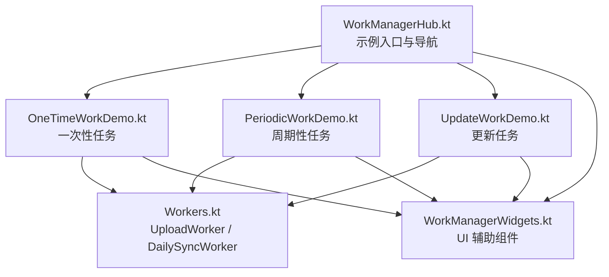
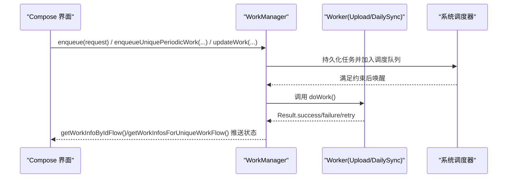
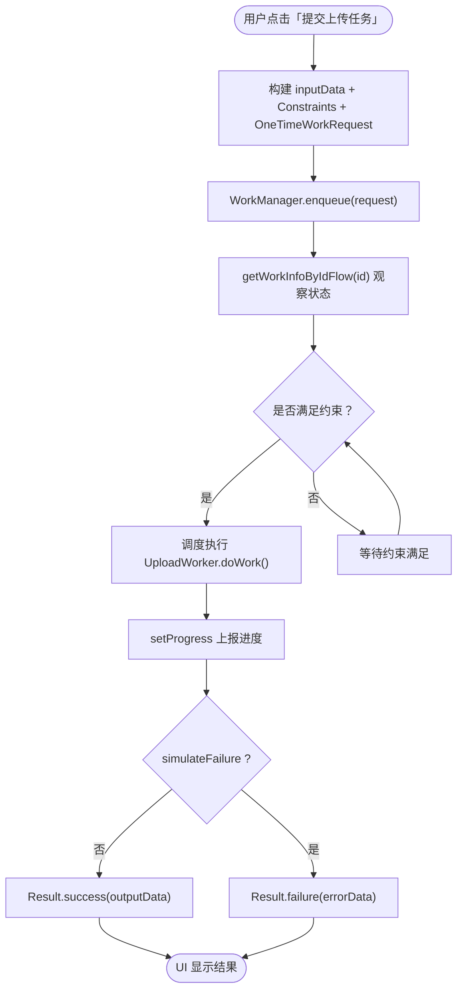
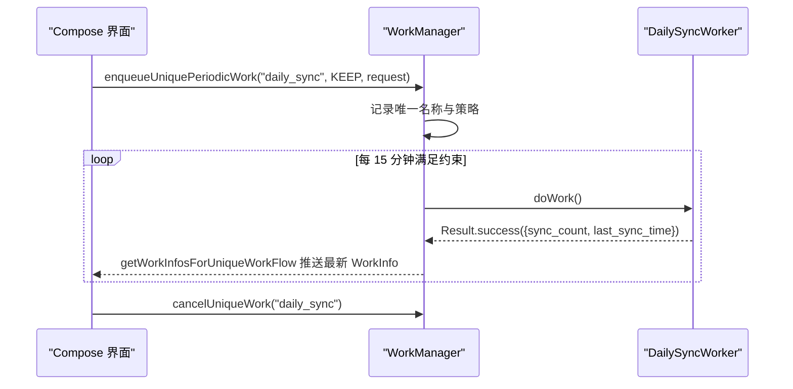
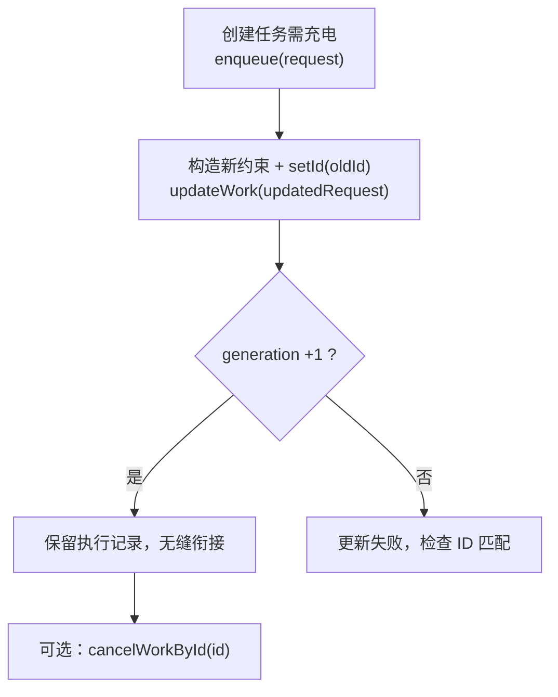
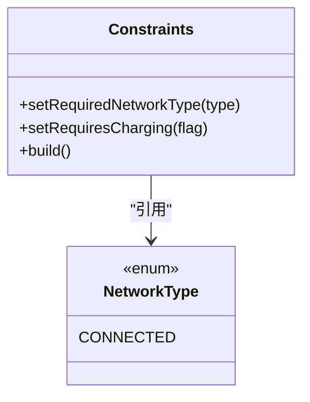
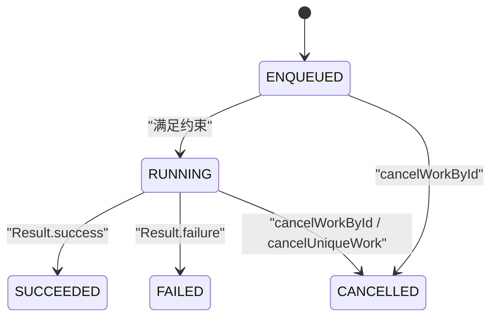
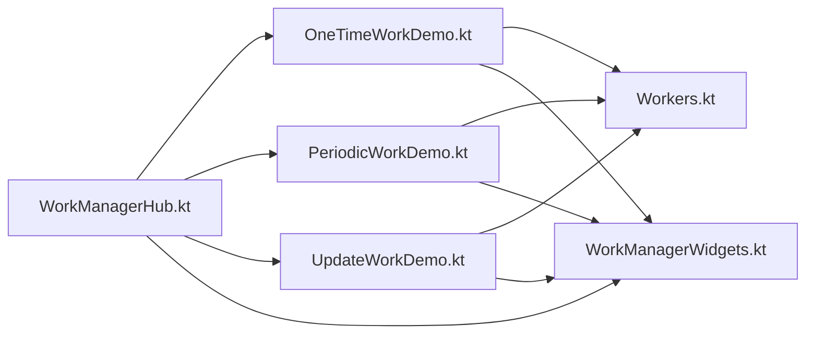

# WorkManager 后台任务

<cite>
**本文引用的文件**   
- [WorkManagerHub.kt](file://app/src/main/java/com/example/composeup/workmanager/WorkManagerHub.kt)
- [Workers.kt](file://app/src/main/java/com/example/composeup/workmanager/Workers.kt)
- [OneTimeWorkDemo.kt](file://app/src/main/java/com/example/composeup/workmanager/OneTimeWorkDemo.kt)
- [PeriodicWorkDemo.kt](file://app/src/main/java/com/example/composeup/workmanager/PeriodicWorkDemo.kt)
- [UpdateWorkDemo.kt](file://app/src/main/java/com/example/composeup/workmanager/UpdateWorkDemo.kt)
- [WorkManagerWidgets.kt](file://app/src/main/java/com/example/composeup/workmanager/WorkManagerWidgets.kt)
</cite>

## 目录
1. [引言](#引言)
2. [项目结构](#项目结构)
3. [核心组件](#核心组件)
4. [架构总览](#架构总览)
5. [详细组件分析](#详细组件分析)
6. [依赖关系分析](#依赖关系分析)
7. [性能与资源管理](#性能与资源管理)
8. [故障排查指南](#故障排查指南)
9. [结论](#结论)

## 引言
本仓库的 workmanager 示例以 Compose UI 为载体，系统演示了 Android 官方推荐的持久化后台任务调度器 WorkManager 的使用方式。示例覆盖一次性任务、周期性任务以及运行时更新任务三大主题，并通过可交互界面展示任务约束、进度上报、状态观察、取消与替换策略等关键能力。该文档将围绕这些示例，深入解释调度机制、约束条件、更新机制、监控回调、失败重试、状态管理、进度报告与取消机制，并给出后台任务的性能优化与资源管理最佳实践。

## 项目结构
workmanager 示例位于 app 模块的 main 源码目录下，采用“入口聚合 + 场景拆分”的组织方式：
- WorkManagerHub.kt：示例入口页面，汇总一次性任务、周期性任务、更新任务三个子场景。
- Workers.kt：定义 Worker 实现，承载具体后台逻辑。
- OneTimeWorkDemo.kt / PeriodicWorkDemo.kt / UpdateWorkDemo.kt：分别对应三种典型使用场景。
- WorkManagerWidgets.kt：提供示例界面所需的通用 UI 组件（按钮、日志框、代码块等）。

图表来源
- [WorkManagerHub.kt:30-66](file://app/src/main/java/com/example/composeup/workmanager/WorkManagerHub.kt#L30-L66)
- [OneTimeWorkDemo.kt:31-46](file://app/src/main/java/com/example/composeup/workmanager/OneTimeWorkDemo.kt#L31-L46)
- [PeriodicWorkDemo.kt:30-43](file://app/src/main/java/com/example/composeup/workmanager/PeriodicWorkDemo.kt#L30-L43)
- [UpdateWorkDemo.kt:28-45](file://app/src/main/java/com/example/composeup/workmanager/UpdateWorkDemo.kt#L28-L45)
- [Workers.kt:10-83](file://app/src/main/java/com/example/composeup/workmanager/Workers.kt#L10-L83)
- [WorkManagerWidgets.kt:34-229](file://app/src/main/java/com/example/composeup/workmanager/WorkManagerWidgets.kt#L34-L229)

章节来源
- [WorkManagerHub.kt:30-66](file://app/src/main/java/com/example/composeup/workmanager/WorkManagerHub.kt#L30-L66)

## 核心组件
- UploadWorker：模拟图片上传的一次性任务，演示输入数据、进度上报、成功/失败输出。
- DailySyncWorker：模拟每日同步的周期性任务，演示周期执行与计数累加。
- OneTimeWorkDemo：一次性任务的完整流程：构建请求、设置约束、提交、观察状态。
- PeriodicWorkDemo：周期性任务的完整流程：唯一名称、冲突策略、状态观察。
- UpdateWorkDemo：演示 updateWork 原地更新约束，避免 cancel + enqueue 的竞态问题。
- WorkManagerWidgets：示例界面的通用 UI 组件，用于展示按钮、日志、代码片段等。

章节来源
- [Workers.kt:10-83](file://app/src/main/java/com/example/composeup/workmanager/Workers.kt#L10-L83)
- [OneTimeWorkDemo.kt:31-46](file://app/src/main/java/com/example/composeup/workmanager/OneTimeWorkDemo.kt#L31-L46)
- [PeriodicWorkDemo.kt:30-43](file://app/src/main/java/com/example/composeup/workmanager/PeriodicWorkDemo.kt#L30-L43)
- [UpdateWorkDemo.kt:28-45](file://app/src/main/java/com/example/composeup/workmanager/UpdateWorkDemo.kt#L28-L45)
- [WorkManagerWidgets.kt:34-229](file://app/src/main/java/com/example/composeup/workmanager/WorkManagerWidgets.kt#L34-L229)

## 架构总览
WorkManager 作为系统级调度器，负责持久化保存任务、在满足约束时调度执行 Worker，并提供 Flow 接口供应用层观察任务状态。示例中通过 Compose UI 触发 enqueue/update/cancel 等操作，并在界面实时显示 WorkInfo 的状态、进度与输出数据。

图表来源
- [OneTimeWorkDemo.kt:88-121](file://app/src/main/java/com/example/composeup/workmanager/OneTimeWorkDemo.kt#L88-L121)
- [PeriodicWorkDemo.kt:80-124](file://app/src/main/java/com/example/composeup/workmanager/PeriodicWorkDemo.kt#L80-L124)
- [UpdateWorkDemo.kt:85-168](file://app/src/main/java/com/example/composeup/workmanager/UpdateWorkDemo.kt#L85-L168)
- [Workers.kt:21-46](file://app/src/main/java/com/example/composeup/workmanager/Workers.kt#L21-L46)
- [Workers.kt:68-76](file://app/src/main/java/com/example/composeup/workmanager/Workers.kt#L68-L76)

## 详细组件分析

### 一次性任务（OneTimeWorkRequest）
一次性任务适用于需要立即或延迟执行的单次操作，例如上传图片、清理缓存、发送统计等。示例展示了以下关键点：
- 构建 OneTimeWorkRequest：设置 inputData、Constraints、Tag。
- 提交任务：enqueue() 交由系统调度。
- 观察状态：getWorkInfoByIdFlow(id) 返回 Flow<WorkInfo?>，实时更新 ENQUEUED → RUNNING → SUCCEEDED/FAILED/CANCELLED。
- 进度上报：Worker 内部通过 setProgress(Data) 上报中间进度，UI 侧从 WorkInfo.progress 读取。
- 失败处理：Result.failure 表示不再重试；若需重试应返回 Result.retry() 并配合退避策略。

图表来源
- [OneTimeWorkDemo.kt:88-121](file://app/src/main/java/com/example/composeup/workmanager/OneTimeWorkDemo.kt#L88-L121)
- [Workers.kt:21-46](file://app/src/main/java/com/example/composeup/workmanager/Workers.kt#L21-L46)

章节来源
- [OneTimeWorkDemo.kt:31-46](file://app/src/main/java/com/example/composeup/workmanager/OneTimeWorkDemo.kt#L31-L46)
- [OneTimeWorkDemo.kt:88-121](file://app/src/main/java/com/example/composeup/workmanager/OneTimeWorkDemo.kt#L88-L121)
- [Workers.kt:10-56](file://app/src/main/java/com/example/composeup/workmanager/Workers.kt#L10-L56)

### 周期性任务（PeriodicWorkRequest）
周期性任务适合定期同步、清理缓存、上报统计等不需要精确定时的场景。示例展示了：
- 构建 PeriodicWorkRequest：repeatInterval 最短为 15 分钟。
- 唯一名称与冲突策略：enqueueUniquePeriodicWork(uniqueName, policy, request)，支持 KEEP / REPLACE / UPDATE。
- 状态观察：getWorkInfosForUniqueWorkFlow(uniqueName) 返回多个 WorkInfo，反映每次执行的结果。
- 取消：cancelUniqueWork(uniqueName) 停止后续调度。

图表来源
- [PeriodicWorkDemo.kt:80-124](file://app/src/main/java/com/example/composeup/workmanager/PeriodicWorkDemo.kt#L80-L124)
- [Workers.kt:58-83](file://app/src/main/java/com/example/composeup/workmanager/Workers.kt#L58-L83)

章节来源
- [PeriodicWorkDemo.kt:30-43](file://app/src/main/java/com/example/composeup/workmanager/PeriodicWorkDemo.kt#L30-L43)
- [PeriodicWorkDemo.kt:80-124](file://app/src/main/java/com/example/composeup/workmanager/PeriodicWorkDemo.kt#L80-L124)
- [Workers.kt:58-83](file://app/src/main/java/com/example/composeup/workmanager/Workers.kt#L58-L83)

### 更新任务（updateWork）
updateWork 允许在不 cancel 和重建的前提下，原地修改已有任务的约束或输入，避免竞态与中间状态丢失。示例展示了：
- 创建带充电约束的任务。
- 使用 setId(oldId) 匹配目标任务，调用 updateWork(newRequest) 更新约束。
- 通过 WorkInfo.generation 追踪更新次数。
- 对比 cancel + enqueue 的缺点：两步操作存在竞态窗口，且会丢失中间状态。

图表来源
- [UpdateWorkDemo.kt:85-168](file://app/src/main/java/com/example/composeup/workmanager/UpdateWorkDemo.kt#L85-L168)

章节来源
- [UpdateWorkDemo.kt:28-45](file://app/src/main/java/com/example/composeup/workmanager/UpdateWorkDemo.kt#L28-L45)
- [UpdateWorkDemo.kt:85-168](file://app/src/main/java/com/example/composeup/workmanager/UpdateWorkDemo.kt#L85-L168)

### 任务约束与网络状态集成
示例中使用 Constraints.Builder 声明运行条件，包括：
- 网络连接类型：NetworkType.CONNECTED。
- 设备充电状态：setRequiresCharging(true/false)。
- 其他常见约束（如存储可用、设备空闲）可在实际项目中按需添加。

图表来源
- [OneTimeWorkDemo.kt:95-97](file://app/src/main/java/com/example/composeup/workmanager/OneTimeWorkDemo.kt#L95-L97)
- [UpdateWorkDemo.kt:88-91](file://app/src/main/java/com/example/composeup/workmanager/UpdateWorkDemo.kt#L88-L91)

章节来源
- [OneTimeWorkDemo.kt:95-97](file://app/src/main/java/com/example/composeup/workmanager/OneTimeWorkDemo.kt#L95-L97)
- [PeriodicWorkDemo.kt:82-84](file://app/src/main/java/com/example/composeup/workmanager/PeriodicWorkDemo.kt#L82-L84)
- [UpdateWorkDemo.kt:88-91](file://app/src/main/java/com/example/composeup/workmanager/UpdateWorkDemo.kt#L88-L91)

### 任务状态管理与监控回调
- 一次性任务：getWorkInfoByIdFlow(id) 返回单个 WorkInfo 流，便于精确跟踪某次任务的生命周期。
- 周期性任务：getWorkInfosForUniqueWorkFlow(uniqueName) 返回多个 WorkInfo，反映每次执行的结果。
- 状态枚举：ENQUEUED、RUNNING、SUCCEEDED、FAILED、CANCELLED。
- 进度上报：Worker 内 setProgress(Data)，UI 侧从 WorkInfo.progress 读取百分比或自定义指标。

图表来源
- [OneTimeWorkDemo.kt:166-175](file://app/src/main/java/com/example/composeup/workmanager/OneTimeWorkDemo.kt#L166-L175)

章节来源
- [OneTimeWorkDemo.kt:57-63](file://app/src/main/java/com/example/composeup/workmanager/OneTimeWorkDemo.kt#L57-L63)
- [PeriodicWorkDemo.kt:51-53](file://app/src/main/java/com/example/composeup/workmanager/PeriodicWorkDemo.kt#L51-L53)
- [Workers.kt:25-32](file://app/src/main/java/com/example/composeup/workmanager/Workers.kt#L25-L32)

### 失败重试与退避策略
- Result.failure：任务失败，不再重试。
- Result.retry：任务暂时失败，按退避策略重新调度。
- 退避策略：可通过 BackoffPolicy 配置指数退避或线性退避，结合 retryDelay 控制重试间隔。
- 注意：示例未显式设置退避策略，实际项目中应根据业务需求配置。

章节来源
- [OneTimeWorkDemo.kt:156-164](file://app/src/main/java/com/example/composeup/workmanager/OneTimeWorkDemo.kt#L156-L164)

### 任务依赖、链式执行与失败重试策略
- 任务依赖：WorkManager 支持通过 setInputData 传递上游任务输出，或使用 WorkContinuation 构建任务链。
- 链式执行：使用 then() 将多个任务串联，确保顺序执行。
- 失败重试：对链中的任务可单独配置退避策略，或在 doWork 中根据业务逻辑决定 retry 或 failure。

说明：当前示例未直接展示链式依赖，但可通过 WorkContinuation 扩展。建议在复杂流水线场景中优先使用链式依赖，保证执行顺序与错误隔离。

[本节为概念性说明，不直接分析具体文件]

### 进度报告与取消机制
- 进度报告：Worker 内通过 setProgress(Data) 上报进度，UI 侧从 WorkInfo.progress 读取。
- 取消机制：
  - 一次性任务：cancelWorkById(id)。
  - 周期性任务：cancelUniqueWork(uniqueName)。
- 取消时机：应在用户主动取消或业务条件不再满足时调用，避免频繁取消导致资源浪费。

章节来源
- [Workers.kt:25-32](file://app/src/main/java/com/example/composeup/workmanager/Workers.kt#L25-L32)
- [OneTimeWorkDemo.kt:112-121](file://app/src/main/java/com/example/composeup/workmanager/OneTimeWorkDemo.kt#L112-L121)
- [PeriodicWorkDemo.kt:121-124](file://app/src/main/java/com/example/composeup/workmanager/PeriodicWorkDemo.kt#L121-L124)

## 依赖关系分析
- WorkManagerHub 作为入口，聚合三个场景，降低耦合度。
- 各 Demo 仅依赖 WorkManager API 与 Workers 实现，保持职责单一。
- WorkManagerWidgets 提供 UI 复用，减少重复代码。

图表来源
- [WorkManagerHub.kt:135-139](file://app/src/main/java/com/example/composeup/workmanager/WorkManagerHub.kt#L135-L139)
- [OneTimeWorkDemo.kt:48-63](file://app/src/main/java/com/example/composeup/workmanager/OneTimeWorkDemo.kt#L48-L63)
- [PeriodicWorkDemo.kt:44-53](file://app/src/main/java/com/example/composeup/workmanager/PeriodicWorkDemo.kt#L44-L53)
- [UpdateWorkDemo.kt:46-59](file://app/src/main/java/com/example/composeup/workmanager/UpdateWorkDemo.kt#L46-L59)

章节来源
- [WorkManagerHub.kt:135-139](file://app/src/main/java/com/example/composeup/workmanager/WorkManagerHub.kt#L135-L139)

## 性能与资源管理
- 合理设置约束：仅在必要时要求网络连接或充电，避免过度限制导致任务长期无法执行。
- 控制周期间隔：周期任务最短 15 分钟，避免过于频繁的调度造成电量消耗。
- 进度上报频率：避免在高频率下频繁 setProgress，建议批量上报或阈值触发。
- 失败重试策略：根据业务容忍度选择 retry 或 failure，避免无限重试导致资源耗尽。
- 内存与对象复用：Worker 中避免持有大对象或长时间引用 Context，防止内存泄漏。
- 与电池优化集成：WorkManager 已适配系统省电策略，但仍应避免在 Doze 模式下进行高开销操作。
- 与网络状态集成：使用 NetworkType.CONNECTED 确保在网络可用时执行，提升成功率与用户体验。

[本节为通用指导，不直接分析具体文件]

## 故障排查指南
- 任务未执行：
  - 检查约束是否满足（网络、充电等）。
  - 确认任务是否被 cancel。
  - 查看 WorkInfo.state 是否为 ENQUEUED 或 RUNNING。
- 进度未更新：
  - 确认 Worker 中是否调用了 setProgress。
  - 检查 UI 是否正确订阅 WorkInfo.progress。
- 周期任务未按预期触发：
  - 模拟器上可能不会精确按时触发，属系统优化行为。
  - 确认唯一名称与冲突策略是否符合预期。
- updateWork 无效：
  - 确认 newRequest 是否包含 setId(oldId)。
  - 检查 generation 是否递增。

章节来源
- [OneTimeWorkDemo.kt:179-192](file://app/src/main/java/com/example/composeup/workmanager/OneTimeWorkDemo.kt#L179-L192)
- [PeriodicWorkDemo.kt:177-189](file://app/src/main/java/com/example/composeup/workmanager/PeriodicWorkDemo.kt#L177-L189)
- [UpdateWorkDemo.kt:221-228](file://app/src/main/java/com/example/composeup/workmanager/UpdateWorkDemo.kt#L221-L228)

## 结论
本示例通过简洁的 Compose 界面，系统展示了 WorkManager 的核心能力：一次性任务、周期性任务与运行时更新。借助 Constraints、Data、WorkInfo 与 Flow，开发者可以可靠地调度后台任务、观察状态变化、上报进度并处理失败与取消。在实际项目中，应结合业务需求合理配置约束、退避策略与周期间隔，遵循性能与资源管理最佳实践，充分利用 WorkManager 的持久化与系统集成的优势，构建稳定高效的后台任务体系。