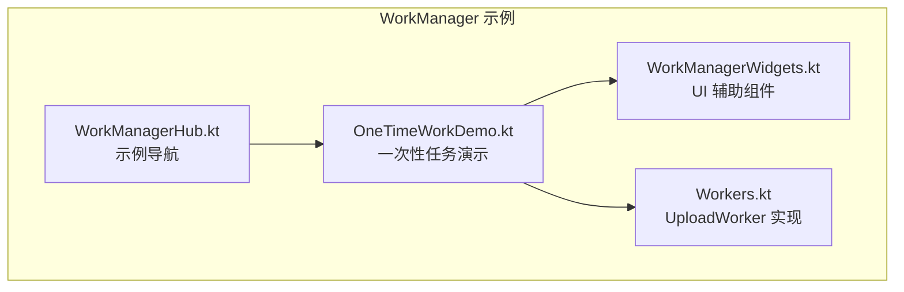
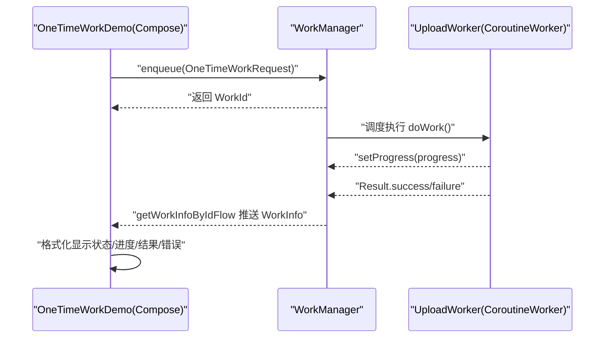
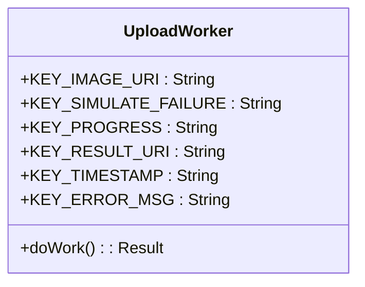
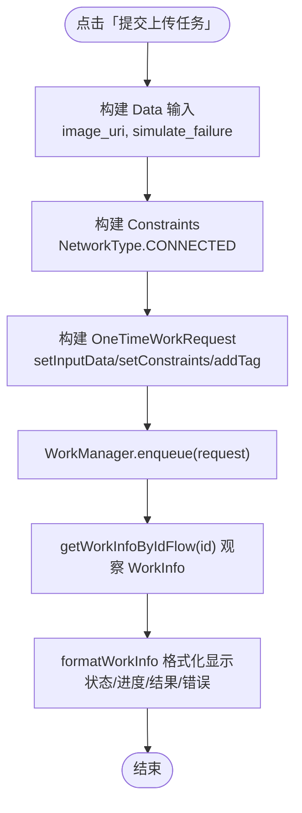
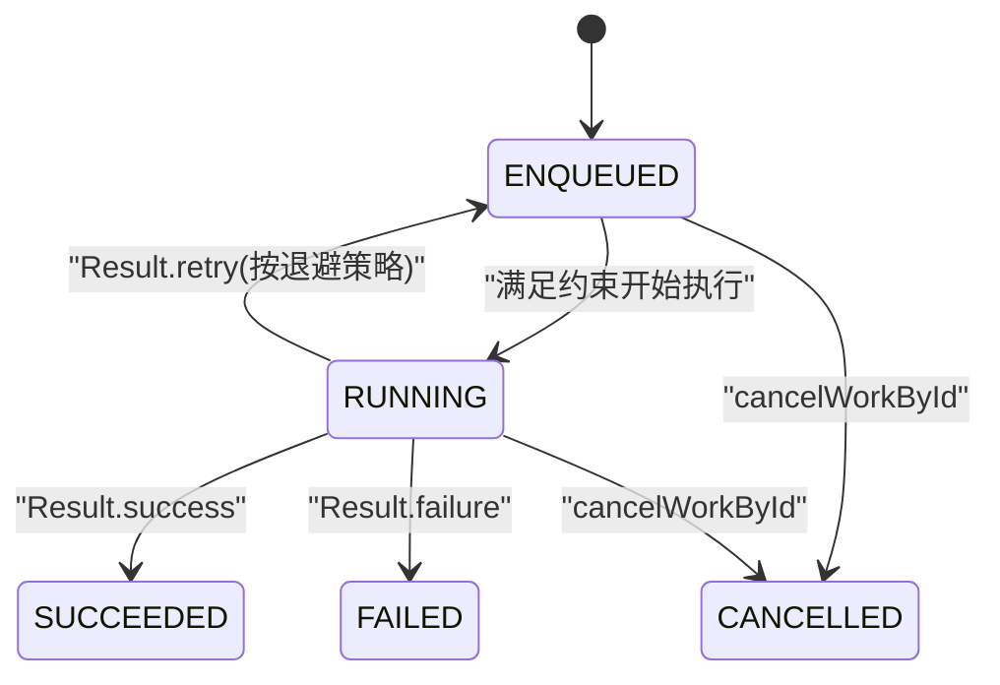
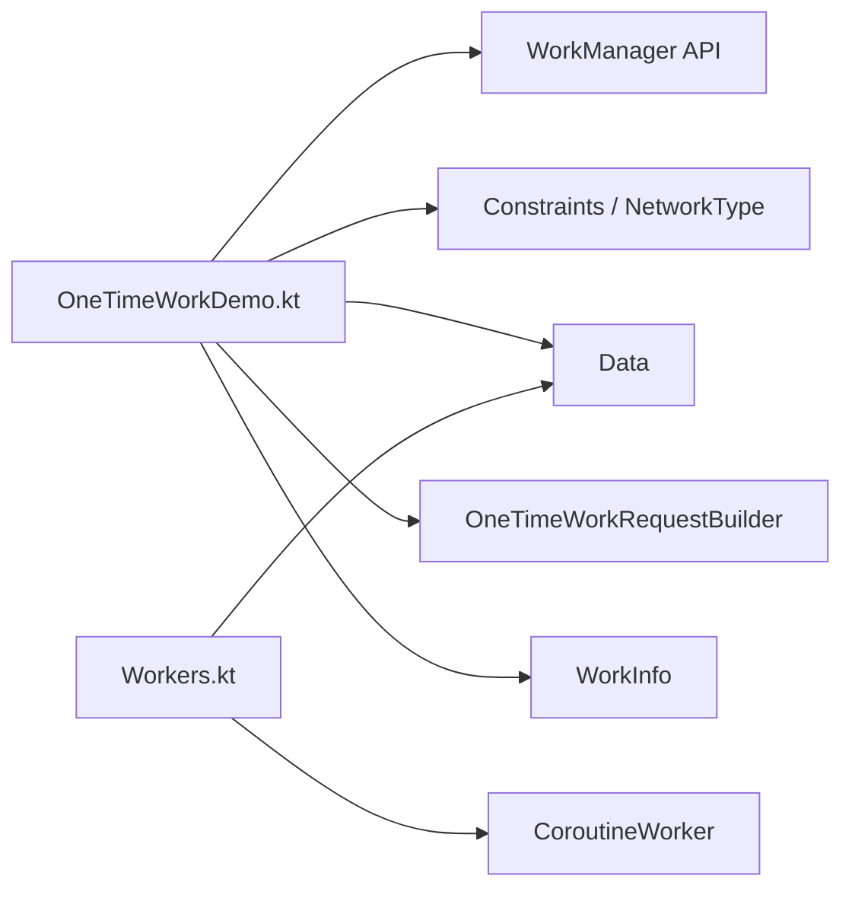

# 一次性任务

<cite>
**本文引用的文件**   
- [OneTimeWorkDemo.kt](file://app/src/main/java/com/example/composeup/workmanager/OneTimeWorkDemo.kt)
- [Workers.kt](file://app/src/main/java/com/example/composeup/workmanager/Workers.kt)
- [WorkManagerHub.kt](file://app/src/main/java/com/example/composeup/workmanager/WorkManagerHub.kt)
- [WorkManagerWidgets.kt](file://app/src/main/java/com/example/composeup/workmanager/WorkManagerWidgets.kt)
</cite>

## 目录
1. [简介](#简介)
2. [项目结构](#项目结构)
3. [核心组件](#核心组件)
4. [架构总览](#架构总览)
5. [详细组件分析](#详细组件分析)
6. [依赖关系分析](#依赖关系分析)
7. [性能与约束建议](#性能与约束建议)
8. [故障排查指南](#故障排查指南)
9. [结论](#结论)
10. [附录：完整示例路径索引](#附录完整示例路径索引)

## 简介
本技术文档聚焦于一次性任务的实现与使用，围绕以下关键点展开：
- 使用 CoroutineWorker 定义后台任务逻辑。
- 通过 OneTimeWorkRequestBuilder 创建一次性任务请求。
- 配置 Constraints（网络、充电、电池等）以控制任务执行时机。
- 使用 Data 在 UI 与 Worker 之间传递输入数据，并通过 outputData 返回结果。
- 观察 WorkInfo.State 的生命周期流转：ENQUEUED → RUNNING → SUCCEEDED / FAILED / CANCELLED。
- 处理 Result.success / Result.failure / Result.retry 三种返回值。
- 提供任务状态观察、进度报告与错误处理的完整示例路径。

该示例位于 WorkManager 模块的“一次性任务”演示中，配合 Compose UI 展示任务提交、取消、日志输出与状态读取。

## 项目结构
WorkManager 相关代码集中在 workmanager 包下，本次文档主要涉及以下文件：
- OneTimeWorkDemo.kt：一次性任务的 Compose 入口，负责构建请求、提交任务、观察 WorkInfo、展示日志与说明。
- Workers.kt：UploadWorker 实现，演示输入读取、进度上报、成功/失败返回。
- WorkManagerHub.kt：WorkManager 示例导航页，将一次性任务作为第一个主题入口。
- WorkManagerWidgets.kt：UI 辅助组件（按钮、日志框、代码块等），用于演示页面交互与展示。

图表来源
- [WorkManagerHub.kt:30-66](file://app/src/main/java/com/example/composeup/workmanager/WorkManagerHub.kt#L30-L66)
- [OneTimeWorkDemo.kt:31-46](file://app/src/main/java/com/example/composeup/workmanager/OneTimeWorkDemo.kt#L31-L46)
- [Workers.kt:10-15](file://app/src/main/java/com/example/composeup/workmanager/Workers.kt#L10-L15)
- [WorkManagerWidgets.kt:34-59](file://app/src/main/java/com/example/composeup/workmanager/WorkManagerWidgets.kt#L34-L59)

章节来源
- [WorkManagerHub.kt:30-66](file://app/src/main/java/com/example/composeup/workmanager/WorkManagerHub.kt#L30-L66)
- [OneTimeWorkDemo.kt:31-46](file://app/src/main/java/com/example/composeup/workmanager/OneTimeWorkDemo.kt#L31-L46)

## 核心组件
- UploadWorker：继承 CoroutineWorker，实现 doWork() 协程方法，负责从 inputData 读取键值对，模拟耗时操作，周期性 setProgress 上报进度，最终返回 Result.success 或 Result.failure。
- OneTimeWorkDemo：Compose 界面入口，负责：
  - 构建 Data 输入参数（如图片 URI、是否模拟失败）。
  - 构建 Constraints（例如要求网络连接）。
  - 使用 OneTimeWorkRequestBuilder 创建一次性任务请求并 enqueue。
  - 通过 getWorkInfoByIdFlow 观察 WorkInfo 状态变化，格式化显示进度、结果与错误信息。
  - 提供取消任务、日志记录与 API 速览说明。
- WorkManagerHub：示例导航，将“一次性任务”作为第一个主题，点击进入 OneTimeWorkDemo。
- WorkManagerWidgets：提供 UI 组件（按钮行、选项芯片、日志框、代码块、读条文本等），支撑演示页面的交互与展示。

章节来源
- [Workers.kt:16-56](file://app/src/main/java/com/example/composeup/workmanager/Workers.kt#L16-L56)
- [OneTimeWorkDemo.kt:48-177](file://app/src/main/java/com/example/composeup/workmanager/OneTimeWorkDemo.kt#L48-L177)
- [WorkManagerHub.kt:43-66](file://app/src/main/java/com/example/composeup/workmanager/WorkManagerHub.kt#L43-L66)
- [WorkManagerWidgets.kt:103-140](file://app/src/main/java/com/example/composeup/workmanager/WorkManagerWidgets.kt#L103-L140)

## 架构总览
一次性任务的整体流程如下：
- UI 层（OneTimeWorkDemo）收集用户选择（是否模拟失败）、构造输入数据与约束条件。
- 通过 OneTimeWorkRequestBuilder 创建一次性任务请求，设置标签、输入与约束后 enqueue。
- WorkManager 调度系统根据约束条件决定是否立即执行或等待满足条件。
- UploadWorker.doWork 在后台线程执行，循环上报进度，最终返回成功或失败。
- UI 通过 getWorkInfoByIdFlow 订阅 WorkInfo，实时展示状态、进度、结果与错误信息。

图表来源
- [OneTimeWorkDemo.kt:88-120](file://app/src/main/java/com/example/composeup/workmanager/OneTimeWorkDemo.kt#L88-L120)
- [Workers.kt:21-46](file://app/src/main/java/com/example/composeup/workmanager/Workers.kt#L21-L46)

## 详细组件分析

### UploadWorker 类分析
UploadWorker 是 CoroutineWorker 的具体实现，承担以下职责：
- 读取 inputData 中的 image_uri 与 simulate_failure。
- 循环三次，每次延迟 1 秒，并通过 setProgress 上报进度（百分比）。
- 若 simulate_failure 为真，返回 Result.failure，附带错误消息。
- 否则返回 Result.success，附带上传后的 URI 与时间戳。

图表来源
- [Workers.kt:16-56](file://app/src/main/java/com/example/composeup/workmanager/Workers.kt#L16-L56)

章节来源
- [Workers.kt:16-56](file://app/src/main/java/com/example/composeup/workmanager/Workers.kt#L16-L56)

### OneTimeWorkDemo 流程分析
OneTimeWorkDemo 负责一次性任务的创建、提交与观察：
- 构建 Data 输入：包含图片 URI 与是否模拟失败的布尔值。
- 构建 Constraints：要求设备处于网络连接状态。
- 构建 OneTimeWorkRequest：设置输入、约束与标签，然后 enqueue。
- 通过 getWorkInfoByIdFlow 观察 WorkInfo，格式化显示状态、进度、结果与错误信息。
- 提供取消当前任务的能力。

图表来源
- [OneTimeWorkDemo.kt:88-120](file://app/src/main/java/com/example/composeup/workmanager/OneTimeWorkDemo.kt#L88-L120)
- [OneTimeWorkDemo.kt:179-193](file://app/src/main/java/com/example/composeup/workmanager/OneTimeWorkDemo.kt#L179-L193)

章节来源
- [OneTimeWorkDemo.kt:88-120](file://app/src/main/java/com/example/composeup/workmanager/OneTimeWorkDemo.kt#L88-L120)
- [OneTimeWorkDemo.kt:179-193](file://app/src/main/java/com/example/composeup/workmanager/OneTimeWorkDemo.kt#L179-L193)

### WorkInfo.State 生命周期与 Result 返回值
- 生命周期流转：
  - ENQUEUED：任务已入队，等待满足约束。
  - RUNNING：任务正在执行。
  - SUCCEEDED：任务成功完成。
  - FAILED：任务失败（不再重试）。
  - CANCELLED：任务被取消。
- Result 返回值：
  - Result.success(data)：任务成功，可携带输出数据。
  - Result.failure(data)：任务失败，不再重试。
  - Result.retry()：任务暂时失败，按退避策略重新调度。

图表来源
- [OneTimeWorkDemo.kt:156-175](file://app/src/main/java/com/example/composeup/workmanager/OneTimeWorkDemo.kt#L156-L175)
- [Workers.kt:34-45](file://app/src/main/java/com/example/composeup/workmanager/Workers.kt#L34-L45)

章节来源
- [OneTimeWorkDemo.kt:156-175](file://app/src/main/java/com/example/composeup/workmanager/OneTimeWorkDemo.kt#L156-L175)
- [Workers.kt:34-45](file://app/src/main/java/com/example/composeup/workmanager/Workers.kt#L34-L45)

### 约束条件（Constraints）配置
- 网络状态：示例中使用 NetworkType.CONNECTED 表示需要网络连接。
- 其他常见约束（未在示例中直接启用，但可在 Constraints.Builder 中配置）：
  - 充电状态：setRequiresCharging(true)。
  - 电池电量：setRequiredBatteryNotLow(true)。
  - 存储可用：setRequiresExternalStoragePresent(true)。
  - 空闲模式：setRequiresDeviceIdle(true)。
- 组合约束：可同时设置多个条件，只有全部满足时任务才会执行。

章节来源
- [OneTimeWorkDemo.kt:95-97](file://app/src/main/java/com/example/composeup/workmanager/OneTimeWorkDemo.kt#L95-L97)

### 输入数据（Data）与输出结果（outputData）
- 输入数据：
  - KEY_IMAGE_URI：图片 URI 字符串。
  - KEY_SIMULATE_FAILURE：是否模拟失败的布尔值。
- 输出结果：
  - KEY_RESULT_URI：上传后的 URI。
  - KEY_TIMESTAMP：上传时间戳。
  - KEY_ERROR_MSG：错误消息（失败时使用）。
- 进度报告：
  - KEY_PROGRESS：整数百分比，通过 setProgress 周期性上报。

章节来源
- [Workers.kt:48-55](file://app/src/main/java/com/example/composeup/workmanager/Workers.kt#L48-L55)
- [OneTimeWorkDemo.kt:179-193](file://app/src/main/java/com/example/composeup/workmanager/OneTimeWorkDemo.kt#L179-L193)

## 依赖关系分析
- OneTimeWorkDemo 依赖：
  - WorkManager：enqueue、getWorkInfoByIdFlow、cancelWorkById。
  - Constraints、NetworkType：声明任务运行条件。
  - Data：传递输入与读取输出。
  - OneTimeWorkRequestBuilder：构建一次性任务请求。
  - WorkInfo：观察任务状态。
- UploadWorker 依赖：
  - CoroutineWorker：后台协程任务基类。
  - Data：读取输入与写入输出。
  - setProgress：上报进度。

图表来源
- [OneTimeWorkDemo.kt:22-28](file://app/src/main/java/com/example/composeup/workmanager/OneTimeWorkDemo.kt#L22-L28)
- [Workers.kt:4-8](file://app/src/main/java/com/example/composeup/workmanager/Workers.kt#L4-L8)

章节来源
- [OneTimeWorkDemo.kt:22-28](file://app/src/main/java/com/example/composeup/workmanager/OneTimeWorkDemo.kt#L22-L28)
- [Workers.kt:4-8](file://app/src/main/java/com/example/composeup/workmanager/Workers.kt#L4-L8)

## 性能与约束建议
- 合理设置约束：
  - 仅在必要时要求网络连接，避免频繁唤醒网络栈。
  - 结合充电与低电量约束，减少耗电影响。
- 进度上报频率：
  - 避免过于频繁的 setProgress，以免增加系统开销。
- 退避策略：
  - 对于可能短暂失败的任务，使用 Result.retry 并结合合理的退避策略，提高成功率。
- 任务唯一性与冲突：
  - 使用 addTag 或唯一名称管理任务，避免重复调度。

[本节为通用指导，不直接分析具体文件]

## 故障排查指南
- 任务未执行：
  - 检查 Constraints 是否过于严格（如网络不可用、未充电、低电量）。
  - 确认 WorkManager 是否正确 enqueue 且未被 cancel。
- 进度不更新：
  - 确保在 doWork 中调用 setProgress 并传入有效的 progress 数据。
- 结果未返回：
  - 检查 Result.success/failure/retry 的返回路径是否正确。
  - 确认 outputData 的 key 与 UI 侧读取一致。
- 日志与状态观察：
  - 使用 getWorkInfoByIdFlow 观察 WorkInfo，打印状态、进度、结果与错误信息。
  - 在 UI 中格式化显示，便于定位问题。

章节来源
- [OneTimeWorkDemo.kt:179-193](file://app/src/main/java/com/example/composeup/workmanager/OneTimeWorkDemo.kt#L179-L193)
- [Workers.kt:21-46](file://app/src/main/java/com/example/composeup/workmanager/Workers.kt#L21-L46)

## 结论
本示例展示了如何使用 WorkManager 创建与执行一次性任务：
- 通过 CoroutineWorker 定义后台逻辑，支持协程与进度上报。
- 使用 OneTimeWorkRequestBuilder 构建任务请求，并设置输入与约束。
- 借助 WorkInfo.State 的生命周期与 Result 返回值，实现完整的任务状态管理与错误处理。
- 配合 Compose UI，提供直观的状态观察、进度展示与日志输出。

该方案适用于需要可靠、持久化后台调度的场景，如图片上传、数据同步等。

[本节为总结性内容，不直接分析具体文件]

## 附录：完整示例路径索引
- 一次性任务演示入口与状态观察：
  - [OneTimeWorkDemo.kt:48-177](file://app/src/main/java/com/example/composeup/workmanager/OneTimeWorkDemo.kt#L48-L177)
- Worker 实现与进度/结果处理：
  - [Workers.kt:16-56](file://app/src/main/java/com/example/composeup/workmanager/Workers.kt#L16-L56)
- 示例导航与主题说明：
  - [WorkManagerHub.kt:43-66](file://app/src/main/java/com/example/composeup/workmanager/WorkManagerHub.kt#L43-L66)
- UI 辅助组件（日志框、代码块、按钮行等）：
  - [WorkManagerWidgets.kt:103-140](file://app/src/main/java/com/example/composeup/workmanager/WorkManagerWidgets.kt#L103-L140)
  - [WorkManagerWidgets.kt:167-192](file://app/src/main/java/com/example/composeup/workmanager/WorkManagerWidgets.kt#L167-L192)
  - [WorkManagerWidgets.kt:194-216](file://app/src/main/java/com/example/composeup/workmanager/WorkManagerWidgets.kt#L194-L216)
  - [WorkManagerWidgets.kt:218-229](file://app/src/main/java/com/example/composeup/workmanager/WorkManagerWidgets.kt#L218-L229)