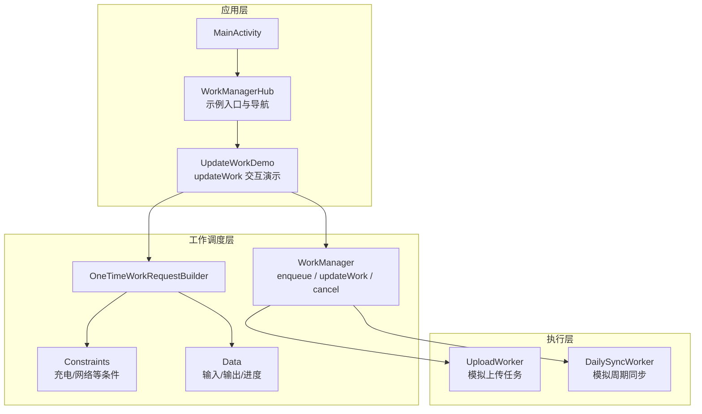
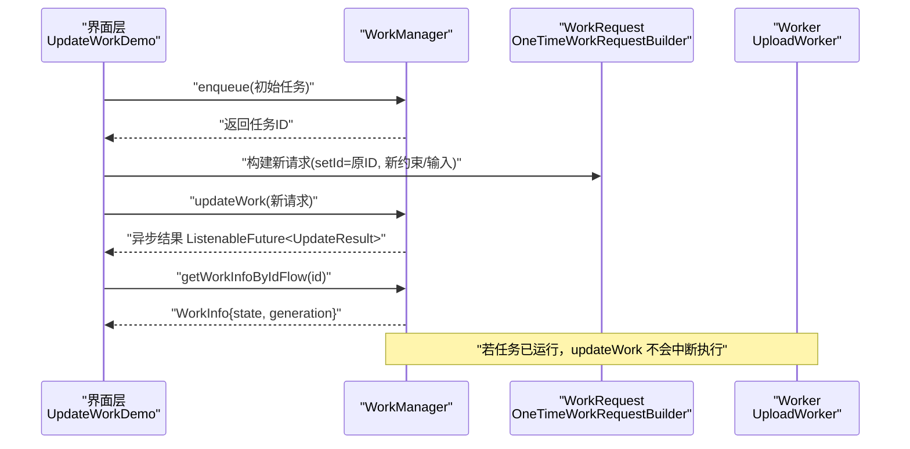
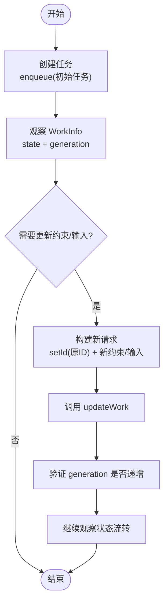
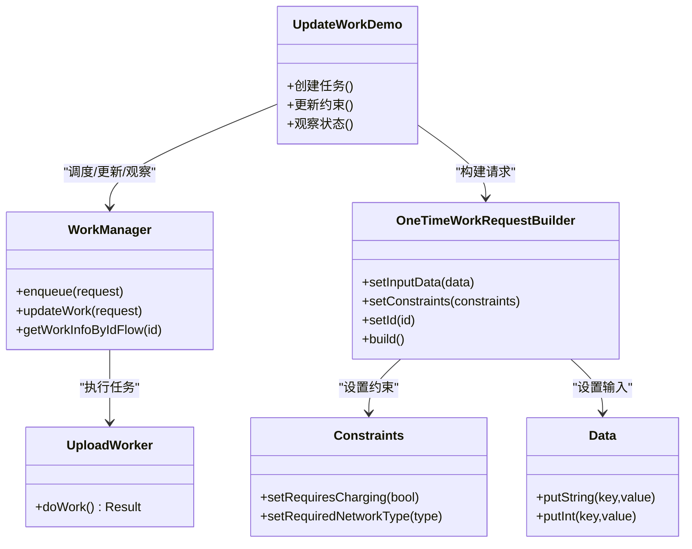

# 任务更新

<cite>
**本文引用的文件**   
- [UpdateWorkDemo.kt](file://app/src/main/java/com/example/composeup/workmanager/UpdateWorkDemo.kt)
- [WorkManagerHub.kt](file://app/src/main/java/com/example/composeup/workmanager/WorkManagerHub.kt)
- [Workers.kt](file://app/src/main/java/com/example/composeup/workmanager/Workers.kt)
- [README.md](file://app/src/main/java/com/example/composeup/workmanager/README.md)
</cite>

## 目录
1. [引言](#引言)
2. [项目结构](#项目结构)
3. [核心组件](#核心组件)
4. [架构总览](#架构总览)
5. [详细组件分析](#详细组件分析)
6. [依赖关系分析](#依赖关系分析)
7. [性能与可靠性考虑](#性能与可靠性考虑)
8. [故障排查指南](#故障排查指南)
9. [结论](#结论)
10. [附录：迁移指南](#附录迁移指南)

## 引言
本文围绕 WorkManager 的任务更新能力，聚焦 updateWork() API 的工作原理、使用场景与最佳实践。文档将解释 setId() 匹配机制、generation 追踪更新次数的方法，对比 cancel+enqueue 与 updateWork 的差异，并给出原地修改约束和输入数据而不丢失中间状态的方法。同时说明 UpdateResult 的返回值含义与处理逻辑，提供任务更新的完整生命周期与状态管理示例，最后给出从旧版本 API 升级到 updateWork 的迁移指南。

## 项目结构
本仓库是一个 Compose 示例工程，workmanager 包下包含多个后台任务演示：
- 一次性任务演示
- 周期性任务演示
- 任务更新演示（updateWork）
- Worker 实现类
- 入口导航与说明

图表来源
- [WorkManagerHub.kt:30-66](file://app/src/main/java/com/example/composeup/workmanager/WorkManagerHub.kt#L30-L66)
- [UpdateWorkDemo.kt:46-107](file://app/src/main/java/com/example/composeup/workmanager/UpdateWorkDemo.kt#L46-L107)
- [Workers.kt:16-56](file://app/src/main/java/com/example/composeup/workmanager/Workers.kt#L16-L56)

章节来源
- [WorkManagerHub.kt:30-66](file://app/src/main/java/com/example/composeup/workmanager/WorkManagerHub.kt#L30-L66)
- [UpdateWorkDemo.kt:28-45](file://app/src/main/java/com/example/composeup/workmanager/UpdateWorkDemo.kt#L28-L45)

## 核心组件
- WorkManager：任务调度中心，负责 enqueue、updateWork、cancel 等操作。
- OneTimeWorkRequestBuilder：构建一次性任务请求，可设置约束、输入数据和唯一 ID。
- Constraints：定义任务运行条件，如是否需要充电、网络类型等。
- Data：键值对容器，用于传递输入、输出和进度。
- UploadWorker：示例 Worker，演示 doWork 中读取 inputData、setProgress、返回 outputData 的流程。
- UpdateWorkDemo：展示如何创建任务、调用 updateWork 原地更新约束、观察 WorkInfo 状态与 generation。

章节来源
- [UpdateWorkDemo.kt:46-107](file://app/src/main/java/com/example/composeup/workmanager/UpdateWorkDemo.kt#L46-L107)
- [Workers.kt:16-56](file://app/src/main/java/com/example/composeup/workmanager/Workers.kt#L16-L56)

## 架构总览
updateWork 的整体流程如下：
- 先通过 enqueue 提交一个带约束的任务，得到任务 ID。
- 后续需要调整约束或输入时，构造新的 WorkRequest，并使用 setId 指向原任务 ID。
- 调用 updateWork 进行原子更新；系统不中断正在运行的任务，保留执行记录。
- 通过 getWorkInfoByIdFlow 观察 WorkInfo.state 与 WorkInfo.generation，确认更新生效。

图表来源
- [UpdateWorkDemo.kt:86-133](file://app/src/main/java/com/example/composeup/workmanager/UpdateWorkDemo.kt#L86-L133)
- [UpdateWorkDemo.kt:174-195](file://app/src/main/java/com/example/composeup/workmanager/UpdateWorkDemo.kt#L174-L195)

## 详细组件分析

### updateWork() API 工作原理
- 目的：在不取消、不重建的前提下，原地修改已有任务的约束或输入数据。
- 关键步骤：
  - 获取已有任务的 ID（例如通过唯一名称查询或直接保存）。
  - 构建新的 WorkRequest，必须调用 setId 设置为原任务 ID。
  - 调用 WorkManager.updateWork(updatedRequest)。
  - 通过 WorkInfo.generation 验证更新次数是否增加。
- 行为特性：
  - 原子操作，避免竞态条件。
  - 不中断正在进行的计算，保留执行记录。
  - 不能改变 Worker 类型（OneTime ↔ Periodic），只能改约束/输入。

章节来源
- [UpdateWorkDemo.kt:28-45](file://app/src/main/java/com/example/composeup/workmanager/UpdateWorkDemo.kt#L28-L45)
- [UpdateWorkDemo.kt:174-195](file://app/src/main/java/com/example/composeup/workmanager/UpdateWorkDemo.kt#L174-L195)

### setId() 匹配机制
- 作用：指定要更新的已有任务 ID。
- 规则：
  - 新请求必须携带 setId(existingId)，否则 WorkManager 无法匹配目标。
  - 通常结合唯一名称查询获取 existingId，或直接缓存首次 enqueue 返回的 id。
- 常见用法：
  - 在按钮点击事件中，用当前 workId 构建新请求并调用 updateWork。

章节来源
- [UpdateWorkDemo.kt:109-133](file://app/src/main/java/com/example/composeup/workmanager/UpdateWorkDemo.kt#L109-L133)
- [UpdateWorkDemo.kt:135-158](file://app/src/main/java/com/example/composeup/workmanager/UpdateWorkDemo.kt#L135-L158)

### generation 追踪更新次数
- 含义：每次成功 updateWork 后，WorkInfo.generation 递增。
- 用途：
  - 日志与测试中追踪任务被更新的次数。
  - 判断 UI 是否需要刷新显示最新约束或状态。
- 示例：
  - 界面展示 WorkInfo.state 与 generation，便于用户理解更新效果。

章节来源
- [UpdateWorkDemo.kt:221-228](file://app/src/main/java/com/example/composeup/workmanager/UpdateWorkDemo.kt#L221-L228)
- [UpdateWorkDemo.kt:191-194](file://app/src/main/java/com/example/composeup/workmanager/UpdateWorkDemo.kt#L191-L194)

### cancel+enqueue 与 updateWork 的对比
- updateWork：
  - 原子操作，保留执行记录，不中断正在进行的计算。
  - 周期任务计时不重置，无需手动对齐偏移。
  - 不支持变更 Worker 类型。
- cancel+enqueue：
  - 两步操作，存在竞态窗口。
  - 可能丢失中间状态（如正在计算的进度）。
  - 支持更换 Worker 类型，但需重新 enqueue 并处理时间偏移。

章节来源
- [UpdateWorkDemo.kt:197-206](file://app/src/main/java/com/example/composeup/workmanager/UpdateWorkDemo.kt#L197-L206)
- [README.md:239-250](file://app/src/main/java/com/example/composeup/workmanager/README.md#L239-L250)

### 原地修改约束与输入数据而不丢失中间状态
- 约束修改：
  - 通过 Constraints.Builder 设置新的 setRequiresCharging、setRequiredNetworkType 等。
  - 使用 updateWork 替换原有约束，不影响正在运行的任务。
- 输入数据修改：
  - 通过 Data.Builder 设置新的 inputData，例如 KEY_IMAGE_URI。
  - 注意：对于已运行的任务，输入数据的语义取决于 Worker 的实现；通常 updateWork 更适用于约束调整。
- 中间状态保护：
  - updateWork 不会中断正在执行的 Worker，因此进度与中间结果得以保留。
  - 如需显式报告进度，可在 Worker 中使用 setProgress。

章节来源
- [UpdateWorkDemo.kt:86-133](file://app/src/main/java/com/example/composeup/workmanager/UpdateWorkDemo.kt#L86-L133)
- [Workers.kt:21-46](file://app/src/main/java/com/example/composeup/workmanager/Workers.kt#L21-L46)

### UpdateResult 的不同返回值与处理逻辑
- 返回值类型：ListenableFuture<UpdateResult>。
- 典型分支：
  - 成功：表示 updateWork 已成功应用，可通过 WorkInfo.generation 确认。
  - 失败：可能由于任务不存在、ID 不匹配或内部错误导致。
- 处理建议：
  - 在回调中检查是否成功，必要时回滚 UI 或提示用户重试。
  - 结合 WorkInfo 的状态与 generation 做一致性校验。

章节来源
- [UpdateWorkDemo.kt:208-217](file://app/src/main/java/com/example/composeup/workmanager/UpdateWorkDemo.kt#L208-L217)

### 任务更新的完整生命周期与状态管理示例
- 生命周期阶段：
  - ENQUEUED：任务已入队等待执行。
  - RUNNING：任务正在执行。
  - SUCCEEDED/FAILED/CANCELLED/BLOCKED：任务结束或被阻塞。
- 状态管理要点：
  - 使用 getWorkInfoByIdFlow 观察状态变化。
  - 在 UI 中展示 state 与 generation，帮助用户理解更新效果。
  - 当需要切换约束（如关闭“仅 Wi-Fi”）时，优先选择 updateWork。

图表来源
- [UpdateWorkDemo.kt:55-59](file://app/src/main/java/com/example/composeup/workmanager/UpdateWorkDemo.kt#L55-L59)
- [UpdateWorkDemo.kt:86-133](file://app/src/main/java/com/example/composeup/workmanager/UpdateWorkDemo.kt#L86-L133)
- [UpdateWorkDemo.kt:221-228](file://app/src/main/java/com/example/composeup/workmanager/UpdateWorkDemo.kt#L221-L228)

章节来源
- [UpdateWorkDemo.kt:55-59](file://app/src/main/java/com/example/composeup/workmanager/UpdateWorkDemo.kt#L55-L59)
- [UpdateWorkDemo.kt:221-228](file://app/src/main/java/com/example/composeup/workmanager/UpdateWorkDemo.kt#L221-L228)

## 依赖关系分析
- UpdateWorkDemo 依赖：
  - WorkManager：调度任务、提供 updateWork 与状态查询。
  - OneTimeWorkRequestBuilder：构建一次性任务请求。
  - Constraints/Data：定义约束与输入数据。
  - UploadWorker：实际执行逻辑。
- WorkManagerHub 提供示例入口，按主题组织一次性、周期性与更新任务演示。
- Workers.kt 中的 UploadWorker 展示了 doWork 的标准模式：读取 inputData、setProgress、返回 outputData。

图表来源
- [UpdateWorkDemo.kt:46-133](file://app/src/main/java/com/example/composeup/workmanager/UpdateWorkDemo.kt#L46-L133)
- [Workers.kt:16-56](file://app/src/main/java/com/example/composeup/workmanager/Workers.kt#L16-L56)

章节来源
- [WorkManagerHub.kt:30-66](file://app/src/main/java/com/example/composeup/workmanager/WorkManagerHub.kt#L30-L66)
- [UpdateWorkDemo.kt:46-133](file://app/src/main/java/com/example/composeup/workmanager/UpdateWorkDemo.kt#L46-L133)
- [Workers.kt:16-56](file://app/src/main/java/com/example/composeup/workmanager/Workers.kt#L16-L56)

## 性能与可靠性考虑
- 原子性：updateWork 是原子操作，避免 cancel+enqueue 的竞态窗口。
- 执行连续性：不中断正在运行的任务，减少状态丢失风险。
- 周期任务：updateWork 不重置计时，避免手动对齐偏移的复杂度。
- 资源占用：频繁 updateWork 会增加调度开销，应仅在必要场景使用。
- 可观测性：通过 WorkInfo.generation 与 Flow 观察状态，确保 UI 与后端一致。

[本节为通用指导，不直接分析具体文件]

## 故障排查指南
- 问题：updateWork 未生效
  - 检查是否调用 setId(existingId)。
  - 确认 existingId 对应任务仍存在且未被取消。
- 问题：generation 未递增
  - 检查 updateWork 是否成功，查看 ListenableFuture<UpdateResult> 的结果。
  - 确认 WorkInfo 查询是否正确。
- 问题：任务仍在运行但约束未变化
  - updateWork 不会中断正在执行的任务；约束变化将在下一次调度或下次执行时体现。
- 问题：需要更换 Worker 类型
  - updateWork 不支持 OneTime ↔ Periodic 类型变更，需使用 cancel+enqueue。

章节来源
- [UpdateWorkDemo.kt:197-206](file://app/src/main/java/com/example/composeup/workmanager/UpdateWorkDemo.kt#L197-L206)
- [UpdateWorkDemo.kt:208-217](file://app/src/main/java/com/example/composeup/workmanager/UpdateWorkDemo.kt#L208-L217)

## 结论
updateWork 提供了安全、原子、连续的任务更新能力，特别适合动态调整约束与输入的场景。通过 setId 匹配目标任务、通过 generation 追踪更新次数，开发者可以在不中断执行的情况下保持任务状态的一致性。对于需要更换 Worker 类型的场景，仍应使用 cancel+enqueue。建议在 UI 中结合 WorkInfo 的状态与 generation 进行可视化反馈，提升用户体验与可观测性。

[本节为总结性内容，不直接分析具体文件]

## 附录：迁移指南
从旧版本 API 升级到 updateWork 的步骤：
- 识别现有使用 cancel+enqueue 的位置，评估是否适合改为 updateWork。
- 如果仅需调整约束或输入，优先采用 updateWork：
  - 保存或查询已有任务 ID。
  - 构建新 WorkRequest，调用 setId(existingId)。
  - 调用 updateWork，并通过 WorkInfo.generation 验证更新。
- 如果需要更换 Worker 类型或完全重建任务，继续使用 cancel+enqueue。
- 在 UI 层增加对 generation 的观察与展示，便于用户感知更新效果。
- 参考示例代码路径：
  - [UpdateWorkDemo.kt:86-133](file://app/src/main/java/com/example/composeup/workmanager/UpdateWorkDemo.kt#L86-L133)
  - [UpdateWorkDemo.kt:174-195](file://app/src/main/java/com/example/composeup/workmanager/UpdateWorkDemo.kt#L174-L195)
  - [README.md:213-250](file://app/src/main/java/com/example/composeup/workmanager/README.md#L213-L250)

章节来源
- [UpdateWorkDemo.kt:86-133](file://app/src/main/java/com/example/composeup/workmanager/UpdateWorkDemo.kt#L86-L133)
- [UpdateWorkDemo.kt:174-195](file://app/src/main/java/com/example/composeup/workmanager/UpdateWorkDemo.kt#L174-L195)
- [README.md:213-250](file://app/src/main/java/com/example/composeup/workmanager/README.md#L213-L250)