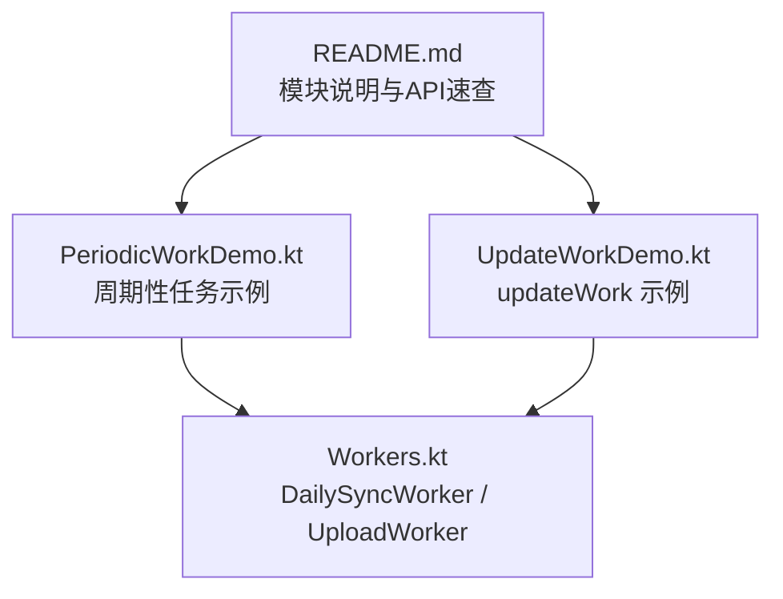
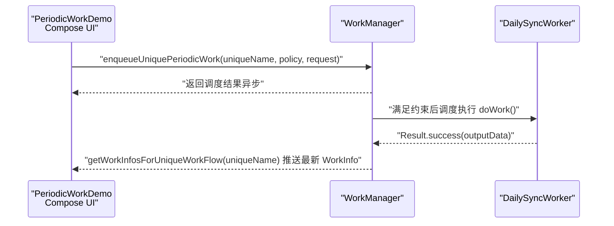
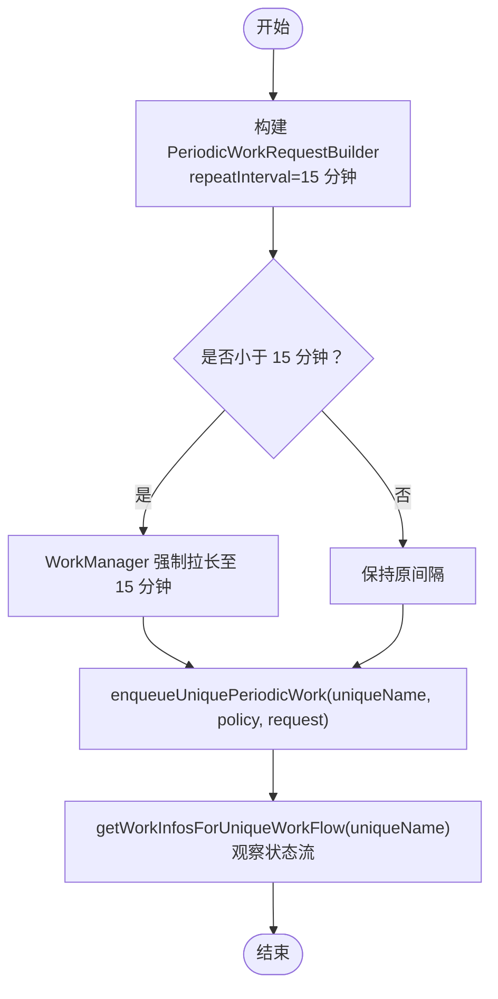
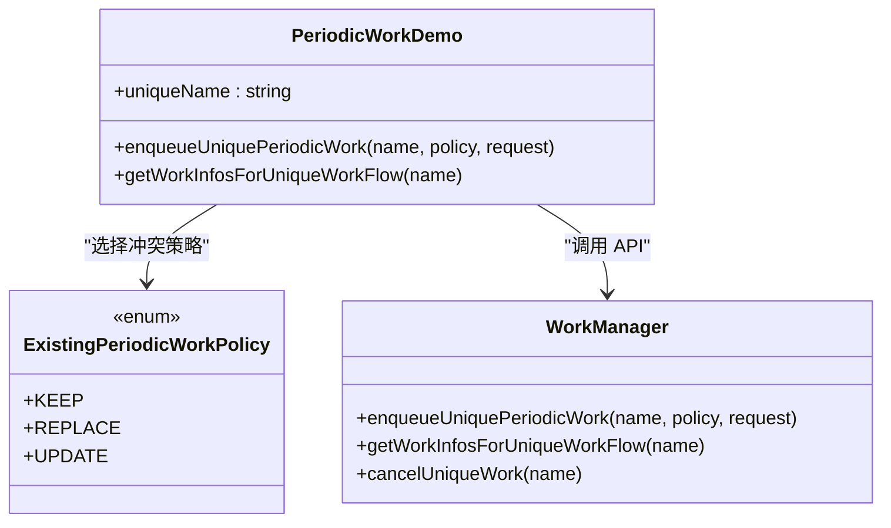
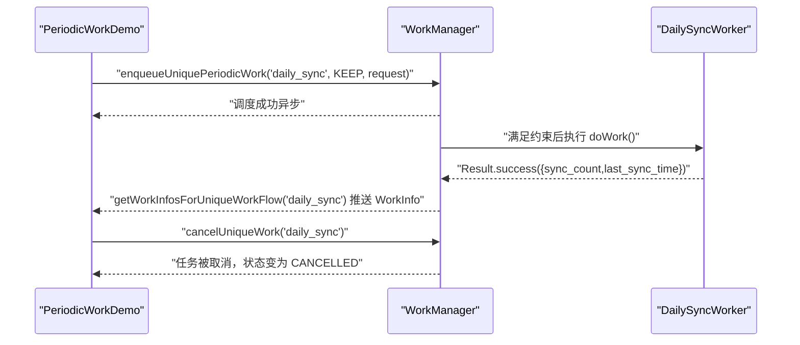
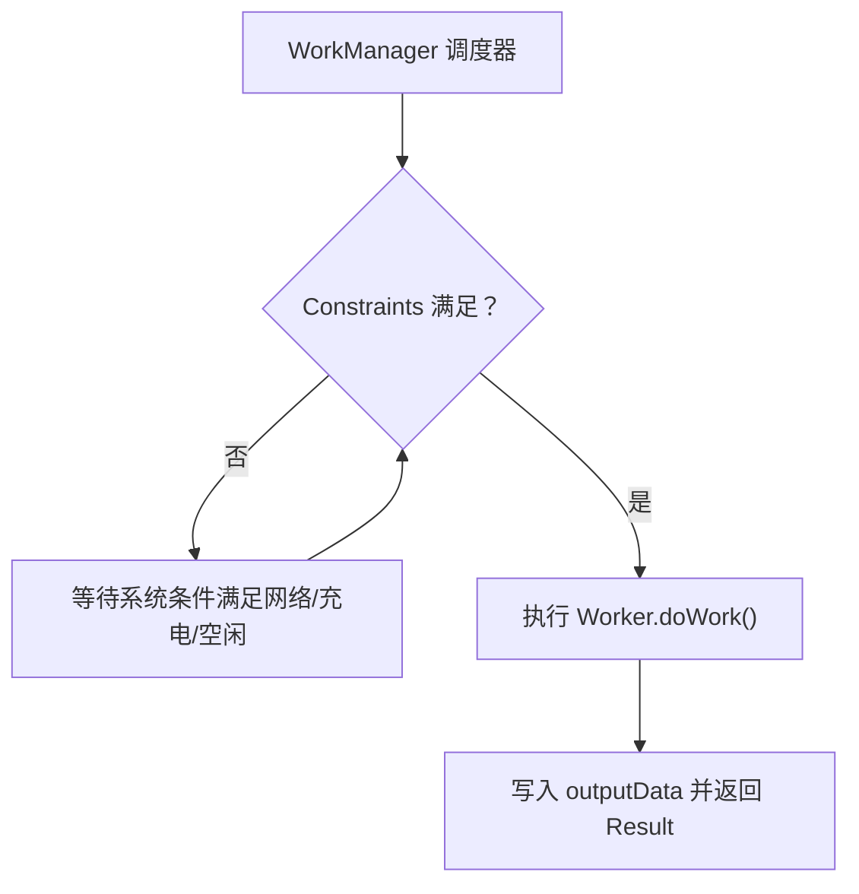
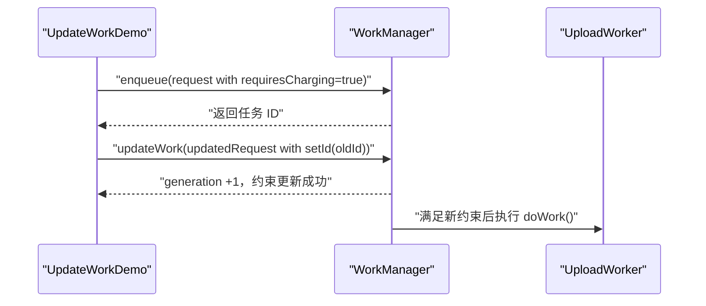
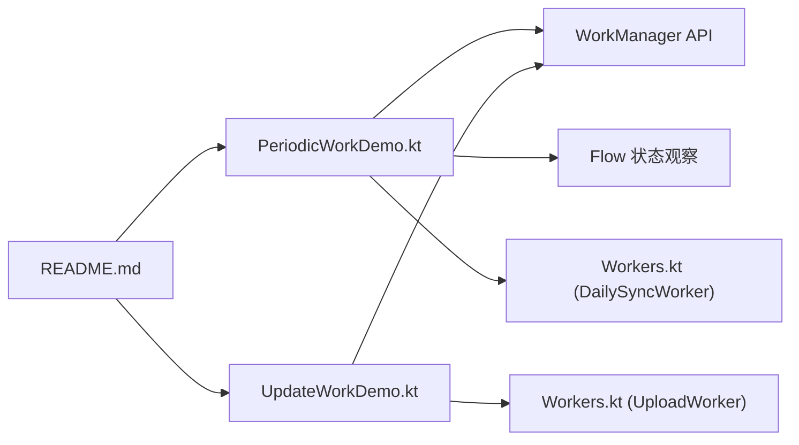

# 周期性任务

<cite>
**本文引用的文件**   
- [PeriodicWorkDemo.kt](file://app/src/main/java/com/example/composeup/workmanager/PeriodicWorkDemo.kt)
- [UpdateWorkDemo.kt](file://app/src/main/java/com/example/composeup/workmanager/UpdateWorkDemo.kt)
- [Workers.kt](file://app/src/main/java/com/example/composeup/workmanager/Workers.kt)
- [README.md](file://app/src/main/java/com/example/composeup/workmanager/README.md)
</cite>

## 目录
1. [引言](#引言)
2. [项目结构](#项目结构)
3. [核心组件](#核心组件)
4. [架构总览](#架构总览)
5. [详细组件分析](#详细组件分析)
6. [依赖关系分析](#依赖关系分析)
7. [性能与电池优化](#性能与电池优化)
8. [故障排查指南](#故障排查指南)
9. [结论](#结论)
10. [附录：代码示例路径索引](#附录代码示例路径索引)

## 引言
本技术文档围绕 Android 后台任务调度库 WorkManager 的“周期性任务”主题展开，重点讲解以下内容：
- 使用 PeriodicWorkRequestBuilder 创建周期任务，并明确 repeatInterval 的最小间隔限制（15 分钟）。
- 唯一名称 uniqueName 的作用与 ExistingPeriodicWorkPolicy 冲突策略 KEEP、REPLACE、UPDATE 的行为差异。
- 任务的启动、停止与状态监控方式。
- 与系统电池优化和 Doze 模式的集成行为。
- 周期性任务的最佳实践与性能优化建议。
- 通过仓库中的示例代码路径展示不同冲突策略的实际效果。

本仓库在 workmanager 模块提供了三个递进式示例：一次性任务、周期性任务、以及运行时更新任务。本文聚焦于周期性任务，并结合 UpdateWorkDemo 中 updateWork 的使用，帮助读者理解如何在不中断执行的前提下调整约束与输入。

## 项目结构
workmanager 模块采用“示例驱动”的组织方式，每个示例对应一个 Composable 页面，Worker 实现集中在 Workers.kt，README.md 提供整体说明与 API 速查。

图表来源
- [PeriodicWorkDemo.kt:30-43](file://app/src/main/java/com/example/composeup/workmanager/PeriodicWorkDemo.kt#L30-L43)
- [UpdateWorkDemo.kt:28-45](file://app/src/main/java/com/example/composeup/workmanager/UpdateWorkDemo.kt#L28-L45)
- [Workers.kt:10-15](file://app/src/main/java/com/example/composeup/workmanager/Workers.kt#L10-L15)
- [README.md:100-111](file://app/src/main/java/com/example/composeup/workmanager/README.md#L100-L111)

章节来源
- [README.md:100-111](file://app/src/main/java/com/example/composeup/workmanager/README.md#L100-L111)

## 核心组件
- PeriodicWorkRequestBuilder：用于构建周期性任务请求，指定 repeatInterval 与时间单位。WorkManager 会保证最短周期为 15 分钟，小于该值的间隔会被自动拉长。
- ExistingPeriodicWorkPolicy：定义当已存在同名周期任务时的冲突处理策略：
  - KEEP：保留已有任务，忽略新请求。
  - REPLACE：取消旧任务，用新请求替代（重置计时器）。
  - UPDATE：保留执行记录，仅更新约束或输入（不重置计时器）。
- Unique Name（唯一名称）：以字符串标识一组同名周期任务，配合 enqueueUniquePeriodicWork 避免重复创建，并通过 getWorkInfosForUniqueWorkFlow 观察其状态流。
- Worker 实现：
  - DailySyncWorker：模拟周期性数据同步，输出同步次数与上次同步时间戳。
  - UploadWorker：模拟一次性上传任务，演示进度与失败场景（与周期性任务示例配套）。

章节来源
- [PeriodicWorkDemo.kt:30-43](file://app/src/main/java/com/example/composeup/workmanager/PeriodicWorkDemo.kt#L30-L43)
- [PeriodicWorkDemo.kt:80-125](file://app/src/main/java/com/example/composeup/workmanager/PeriodicWorkDemo.kt#L80-L125)
- [Workers.kt:58-83](file://app/src/main/java/com/example/composeup/workmanager/Workers.kt#L58-L83)
- [Workers.kt:10-56](file://app/src/main/java/com/example/composeup/workmanager/Workers.kt#L10-L56)

## 架构总览
下图展示了周期性任务从 UI 到 WorkManager 调度的关键交互流程，包括构建请求、提交唯一周期任务、以及通过 Flow 观察状态。

图表来源
- [PeriodicWorkDemo.kt:80-125](file://app/src/main/java/com/example/composeup/workmanager/PeriodicWorkDemo.kt#L80-L125)
- [Workers.kt:63-77](file://app/src/main/java/com/example/composeup/workmanager/Workers.kt#L63-L77)

## 详细组件分析

### 周期性任务构建与最小间隔
- 使用 PeriodicWorkRequestBuilder 设置 repeatInterval 与 TimeUnit.MINUTES。
- WorkManager 对周期任务有最小间隔限制：15 分钟。若设置更短间隔，系统会自动拉长至 15 分钟。
- 可通过 Constraints 声明运行条件（如网络类型），并在 UI 中展示当前任务状态。

图表来源
- [PeriodicWorkDemo.kt:80-125](file://app/src/main/java/com/example/composeup/workmanager/PeriodicWorkDemo.kt#L80-L125)
- [README.md:202-211](file://app/src/main/java/com/example/composeup/workmanager/README.md#L202-L211)

章节来源
- [PeriodicWorkDemo.kt:80-125](file://app/src/main/java/com/example/composeup/workmanager/PeriodicWorkDemo.kt#L80-L125)
- [README.md:202-211](file://app/src/main/java/com/example/composeup/workmanager/README.md#L202-L211)

### 唯一名称与冲突策略（KEEP / REPLACE / UPDATE）
- uniqueName：用于唯一标识一组周期任务，避免重复创建；配合 getWorkInfosForUniqueWorkFlow 可集中观察同一组任务的状态。
- ExistingPeriodicWorkPolicy：
  - KEEP：已有同名任务则保留旧任务，忽略新请求。适用于首次初始化或防止重复创建。
  - REPLACE：取消旧任务并用新请求替代，重置计时器。适用于参数变更需要立即生效的场景。
  - UPDATE：保留执行记录，仅更新约束或输入，不重置计时器。适用于微调约束而不打断节奏。

图表来源
- [PeriodicWorkDemo.kt:80-125](file://app/src/main/java/com/example/composeup/workmanager/PeriodicWorkDemo.kt#L80-L125)
- [README.md:202-211](file://app/src/main/java/com/example/composeup/workmanager/README.md#L202-L211)

章节来源
- [PeriodicWorkDemo.kt:80-125](file://app/src/main/java/com/example/composeup/workmanager/PeriodicWorkDemo.kt#L80-L125)
- [README.md:202-211](file://app/src/main/java/com/example/composeup/workmanager/README.md#L202-L211)

### 任务的启动、停止与状态监控
- 启动：通过 enqueueUniquePeriodicWork 提交周期任务，传入 uniqueName、ExistingPeriodicWorkPolicy 与构建好的 request。
- 停止：通过 cancelUniqueWork(uniqueName) 取消同名周期任务。
- 状态监控：使用 getWorkInfosForUniqueWorkFlow(uniqueName) 获取 Flow<List<WorkInfo>>，实时观察 ENQUEUED/RUNNING/SUCCEEDED/FAILED/CANCELLED/BLOCKED 等状态变化，并可读取 outputData 中的业务字段（如同步次数、上次同步时间）。

图表来源
- [PeriodicWorkDemo.kt:80-125](file://app/src/main/java/com/example/composeup/workmanager/PeriodicWorkDemo.kt#L80-L125)
- [Workers.kt:63-77](file://app/src/main/java/com/example/composeup/workmanager/Workers.kt#L63-L77)

章节来源
- [PeriodicWorkDemo.kt:80-125](file://app/src/main/java/com/example/composeup/workmanager/PeriodicWorkDemo.kt#L80-L125)
- [Workers.kt:63-77](file://app/src/main/java/com/example/composeup/workmanager/Workers.kt#L63-L77)

### 与系统电池优化和 Doze 模式集成
- WorkManager 会在满足 Constraints 时调度任务，同时受系统电池优化与 Doze 模式影响。
- 典型约束包括网络类型、充电状态、设备空闲等。例如 setRequiredNetworkType(NetworkType.CONNECTED) 表示仅在联网条件下执行。
- 在模拟器上，周期任务可能不会精确按时触发，这是系统优化行为的一部分。

图表来源
- [PeriodicWorkDemo.kt:80-125](file://app/src/main/java/com/example/composeup/workmanager/PeriodicWorkDemo.kt#L80-L125)
- [README.md:274-280](file://app/src/main/java/com/example/composeup/workmanager/README.md#L274-L280)

章节来源
- [PeriodicWorkDemo.kt:80-125](file://app/src/main/java/com/example/composeup/workmanager/PeriodicWorkDemo.kt#L80-L125)
- [README.md:274-280](file://app/src/main/java/com/example/composeup/workmanager/README.md#L274-L280)

### 运行时更新任务（updateWork）与周期任务的关系
- updateWork 允许在不取消/重建的前提下原地修改已有 WorkRequest 的约束或输入，适合动态调整运行条件（如关闭 Wi-Fi Only）。
- 使用 updateWork 时需要通过 setId 匹配目标任务，并通过 generation 追踪更新次数。
- 虽然 updateWork 主要用于一次性任务示例，但其理念同样适用于周期任务：如需微调约束而不重置计时器，应优先选择 ExistingPeriodicWorkPolicy.UPDATE。

图表来源
- [UpdateWorkDemo.kt:85-133](file://app/src/main/java/com/example/composeup/workmanager/UpdateWorkDemo.kt#L85-L133)
- [README.md:213-250](file://app/src/main/java/com/example/composeup/workmanager/README.md#L213-L250)

章节来源
- [UpdateWorkDemo.kt:85-133](file://app/src/main/java/com/example/composeup/workmanager/UpdateWorkDemo.kt#L85-L133)
- [README.md:213-250](file://app/src/main/java/com/example/composeup/workmanager/README.md#L213-L250)

## 依赖关系分析
- PeriodicWorkDemo 依赖 WorkManager 的周期调度 API 与 Flow 状态观察。
- Workers.kt 提供 DailySyncWorker 与 UploadWorker 的具体实现，分别用于周期与一次性任务。
- README.md 提供 API 速查与实践清单，指导正确使用 WorkManager。

图表来源
- [PeriodicWorkDemo.kt:30-43](file://app/src/main/java/com/example/composeup/workmanager/PeriodicWorkDemo.kt#L30-L43)
- [UpdateWorkDemo.kt:28-45](file://app/src/main/java/com/example/composeup/workmanager/UpdateWorkDemo.kt#L28-L45)
- [Workers.kt:10-83](file://app/src/main/java/com/example/composeup/workmanager/Workers.kt#L10-L83)
- [README.md:254-299](file://app/src/main/java/com/example/composeup/workmanager/README.md#L254-L299)

章节来源
- [PeriodicWorkDemo.kt:30-43](file://app/src/main/java/com/example/composeup/workmanager/PeriodicWorkDemo.kt#L30-L43)
- [UpdateWorkDemo.kt:28-45](file://app/src/main/java/com/example/composeup/workmanager/UpdateWorkDemo.kt#L28-L45)
- [Workers.kt:10-83](file://app/src/main/java/com/example/composeup/workmanager/Workers.kt#L10-L83)
- [README.md:254-299](file://app/src/main/java/com/example/composeup/workmanager/README.md#L254-L299)

## 性能与电池优化
- 周期任务最短间隔为 15 分钟，避免过于频繁的调度导致电量消耗。
- 合理设置 Constraints（如 NetworkType.CONNECTED、setRequiresCharging(true)），让系统在合适时机执行任务，降低功耗。
- 在 Doze 模式下，系统会延迟非关键任务；WorkManager 会在满足约束后恢复执行，但不应假设精确定时。
- 大数据（>10KB）不要放入 inputData/outputData，改用 Room/DataStore 中转，减少序列化开销与存储压力。
- 使用 CoroutineWorker 的 suspend doWork()，避免阻塞线程；必要时检查 isStopped 或使用协程 ensureActive() 响应取消。

章节来源
- [README.md:303-323](file://app/src/main/java/com/example/composeup/workmanager/README.md#L303-L323)
- [PeriodicWorkDemo.kt:164-173](file://app/src/main/java/com/example/composeup/workmanager/PeriodicWorkDemo.kt#L164-L173)

## 故障排查指南
- 任务未按预期触发：
  - 检查 Constraints 是否过于严格（如必须联网且设备未连接）。
  - 确认是否在模拟器环境，周期任务可能不会精确触发。
- 任务重复创建：
  - 确保使用 enqueueUniquePeriodicWork 与唯一名称 uniqueName。
  - 选择合适的 ExistingPeriodicWorkPolicy（KEEP/REPLACE/UPDATE）。
- 任务无法更新约束：
  - 使用 updateWork 时必须通过 setId 匹配目标任务。
  - 注意 updateWork 不能改变 Worker 类型（OneTime ↔ Periodic）。
- 状态观察异常：
  - 使用 getWorkInfosForUniqueWorkFlow 或 getWorkInfoByIdFlow 观察状态，避免轮询。
  - 关注 WorkInfo.state 的单向流转（不会回退）。

章节来源
- [PeriodicWorkDemo.kt:80-125](file://app/src/main/java/com/example/composeup/workmanager/PeriodicWorkDemo.kt#L80-L125)
- [UpdateWorkDemo.kt:109-158](file://app/src/main/java/com/example/composeup/workmanager/UpdateWorkDemo.kt#L109-L158)
- [README.md:303-323](file://app/src/main/java/com/example/composeup/workmanager/README.md#L303-L323)

## 结论
- 使用 PeriodicWorkRequestBuilder 创建周期任务时，务必遵守 15 分钟最短间隔限制。
- 通过 uniqueName 与 ExistingPeriodicWorkPolicy 控制任务冲突行为，避免重复创建并灵活调整策略。
- 结合 Constraints 与系统电池优化，合理调度任务以降低能耗。
- 使用 Flow 观察任务状态，确保 UI 与后台任务生命周期一致。
- 在需要动态调整约束时，优先使用 updateWork 或 ExistingPeriodicWorkPolicy.UPDATE，避免 cancel + enqueue 带来的竞态与状态丢失。

## 附录：代码示例路径索引
- 周期性任务示例（构建、提交、取消、状态观察、冲突策略对比）：
  - [PeriodicWorkDemo.kt:80-125](file://app/src/main/java/com/example/composeup/workmanager/PeriodicWorkDemo.kt#L80-L125)
- 周期任务 Worker 实现（输出同步计数与时间戳）：
  - [Workers.kt:63-77](file://app/src/main/java/com/example/composeup/workmanager/Workers.kt#L63-L77)
- 运行时更新任务示例（updateWork 四步流程与 generation 追踪）：
  - [UpdateWorkDemo.kt:109-158](file://app/src/main/java/com/example/composeup/workmanager/UpdateWorkDemo.kt#L109-L158)
- 模块说明与 API 速查（约束、提交与管理、观察状态）：
  - [README.md:254-299](file://app/src/main/java/com/example/composeup/workmanager/README.md#L254-L299)