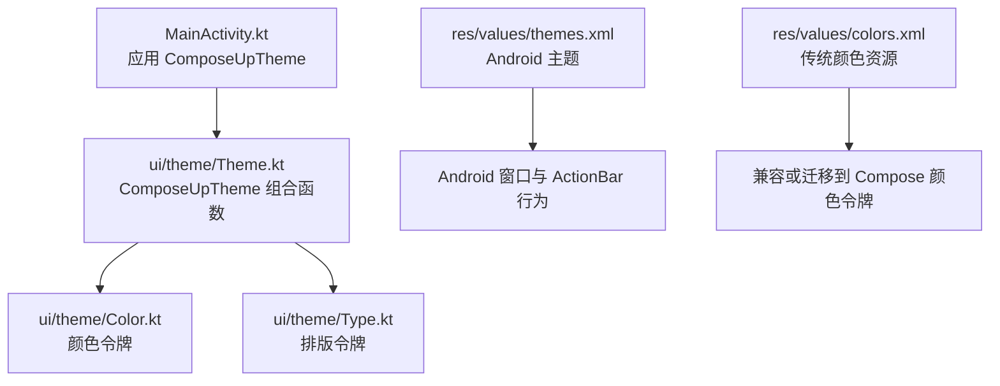
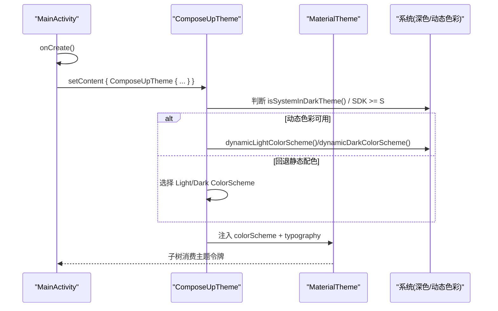
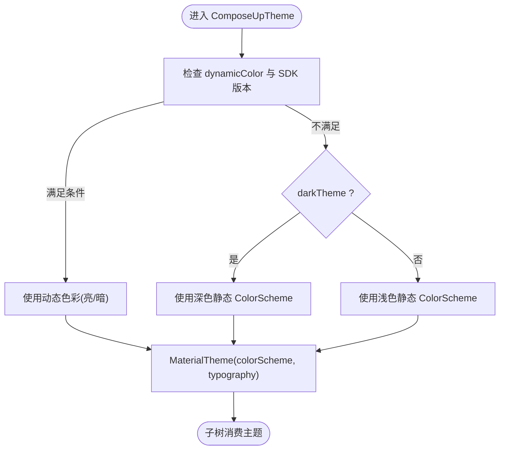
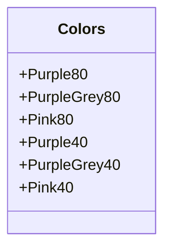
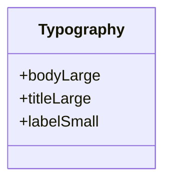
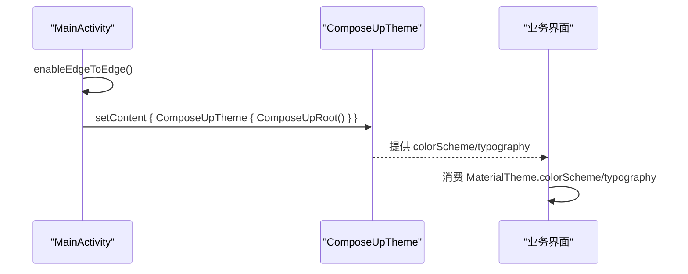
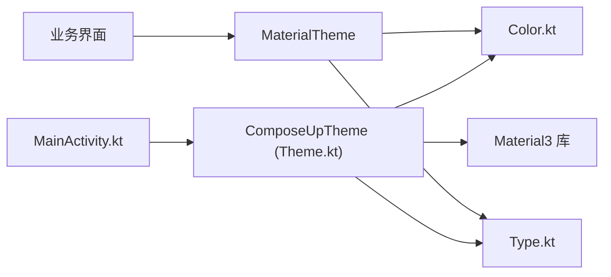

# 主题与设计系统

<cite>
**本文引用的文件**   
- [Theme.kt](file://app/src/main/java/com/example/composeup/ui/theme/Theme.kt)
- [Color.kt](file://app/src/main/java/com/example/composeup/ui/theme/Color.kt)
- [Type.kt](file://app/src/main/java/com/example/composeup/ui/theme/Type.kt)
- [MainActivity.kt](file://app/src/main/java/com/example/composeup/MainActivity.kt)
- [themes.xml](file://app/src/main/res/values/themes.xml)
- [colors.xml](file://app/src/main/res/values/colors.xml)
</cite>

## 目录
1. [简介](#简介)
2. [项目结构](#项目结构)
3. [核心组件](#核心组件)
4. [架构总览](#架构总览)
5. [详细组件分析](#详细组件分析)
6. [依赖关系分析](#依赖关系分析)
7. [性能与可访问性](#性能与可访问性)
8. [故障排查指南](#故障排查指南)
9. [结论](#结论)
10. [附录：扩展与品牌定制最佳实践](#附录扩展与品牌定制最佳实践)

## 简介
本文件面向 Material Design 3（Material You）主题系统的技术文档，聚焦以下方面：
- 主题配置、颜色系统与字体系统的实现
- 动态主题与深色模式支持
- 设计令牌、样式继承与组件主题覆盖
- 主题切换、多语言支持与无障碍访问的实现思路
- 设计系统扩展与品牌定制的最佳实践

本项目基于 Compose for Android，使用 Material3 的 ColorScheme、Typography 与 MaterialTheme 构建统一的主题体系，并在 Activity 入口应用主题。

## 项目结构
主题相关代码集中在 ui/theme 包中，Activity 在启动时包裹主题并渲染根界面。Android 原生资源提供基础 Theme 与颜色定义。

图示来源
- [MainActivity.kt:94-103](file://app/src/main/java/com/example/composeup/MainActivity.kt#L94-L103)
- [Theme.kt:35-57](file://app/src/main/java/com/example/composeup/ui/theme/Theme.kt#L35-L57)
- [themes.xml:1-5](file://app/src/main/res/values/themes.xml#L1-L5)
- [colors.xml:1-10](file://app/src/main/res/values/colors.xml#L1-L10)

章节来源
- [MainActivity.kt:94-103](file://app/src/main/java/com/example/composeup/MainActivity.kt#L94-L103)
- [Theme.kt:1-57](file://app/src/main/java/com/example/composeup/ui/theme/Theme.kt#L1-L57)
- [themes.xml:1-5](file://app/src/main/res/values/themes.xml#L1-L5)
- [colors.xml:1-10](file://app/src/main/res/values/colors.xml#L1-L10)

## 核心组件
- ComposeUpTheme：主题入口，负责选择颜色方案（动态/静态）、深浅色模式，并注入 Typography。
- Color.kt：定义明暗两套主色、次色、第三色的颜色令牌。
- Type.kt：定义默认排版样式（如 bodyLarge），可扩展标题、标签等。
- MainActivity：在 setContent 中包裹 ComposeUpTheme，使整个应用受主题控制。
- themes.xml：Android 层主题，决定窗口外观（如是否带 ActionBar）。
- colors.xml：传统颜色资源，可作为迁移或兼容参考。

章节来源
- [Theme.kt:13-57](file://app/src/main/java/com/example/composeup/ui/theme/Theme.kt#L13-L57)
- [Color.kt:1-11](file://app/src/main/java/com/example/composeup/ui/theme/Color.kt#L1-L11)
- [Type.kt:1-34](file://app/src/main/java/com/example/composeup/ui/theme/Type.kt#L1-L34)
- [MainActivity.kt:94-103](file://app/src/main/java/com/example/composeup/MainActivity.kt#L94-L103)
- [themes.xml:1-5](file://app/src/main/res/values/themes.xml#L1-L5)
- [colors.xml:1-10](file://app/src/main/res/values/colors.xml#L1-L10)

## 架构总览
主题架构遵循“入口组合函数 + 颜色/排版令牌 + MaterialTheme 注入”的模式。

图示来源
- [MainActivity.kt:94-103](file://app/src/main/java/com/example/composeup/MainActivity.kt#L94-L103)
- [Theme.kt:35-57](file://app/src/main/java/com/example/composeup/ui/theme/Theme.kt#L35-L57)

## 详细组件分析

### 主题入口：ComposeUpTheme
职责
- 根据系统深色模式与设备能力，选择动态或静态颜色方案。
- 将颜色方案与排版注入 MaterialTheme，供子树消费。

关键流程
- 当 dynamicColor 为 true 且 SDK ≥ S 时，调用动态色彩 API；否则回退到预定义的浅色/深色 ColorScheme。
- 通过 MaterialTheme 暴露 colorScheme 与 typography。

图示来源
- [Theme.kt:35-57](file://app/src/main/java/com/example/composeup/ui/theme/Theme.kt#L35-L57)

章节来源
- [Theme.kt:35-57](file://app/src/main/java/com/example/composeup/ui/theme/Theme.kt#L35-L57)

### 颜色系统：Color.kt
要点
- 定义明暗两套主色、次色、第三色令牌，供 ColorScheme 使用。
- 建议后续扩展背景、表面、内容色等令牌，以完善设计系统。

图示来源
- [Color.kt:1-11](file://app/src/main/java/com/example/composeup/ui/theme/Color.kt#L1-L11)

章节来源
- [Color.kt:1-11](file://app/src/main/java/com/example/composeup/ui/theme/Color.kt#L1-L11)

### 字体系统：Type.kt
要点
- 定义默认 Typography，包含 bodyLarge 等文本样式。
- 可继续扩展 titleLarge、labelSmall 等，形成完整的排版令牌集。

图示来源
- [Type.kt:1-34](file://app/src/main/java/com/example/composeup/ui/theme/Type.kt#L1-L34)

章节来源
- [Type.kt:1-34](file://app/src/main/java/com/example/composeup/ui/theme/Type.kt#L1-L34)

### Activity 与主题集成：MainActivity.kt
要点
- 在 onCreate 中启用 edge-to-edge，并通过 ComposeUpTheme 包裹根界面。
- 示例页面广泛使用 MaterialTheme.typography 与 colorScheme 进行样式消费。

图示来源
- [MainActivity.kt:94-103](file://app/src/main/java/com/example/composeup/MainActivity.kt#L94-L103)
- [MainActivity.kt:184-244](file://app/src/main/java/com/example/composeup/MainActivity.kt#L184-L244)

章节来源
- [MainActivity.kt:94-103](file://app/src/main/java/com/example/composeup/MainActivity.kt#L94-L103)
- [MainActivity.kt:184-244](file://app/src/main/java/com/example/composeup/MainActivity.kt#L184-L244)

### Android 原生主题与颜色：themes.xml 与 colors.xml
要点
- themes.xml 指定应用主题父类，影响窗口与 ActionBar 行为。
- colors.xml 提供传统颜色资源，便于逐步迁移至 Compose 颜色令牌。

章节来源
- [themes.xml:1-5](file://app/src/main/res/values/themes.xml#L1-L5)
- [colors.xml:1-10](file://app/src/main/res/values/colors.xml#L1-L10)

## 依赖关系分析
- MainActivity 依赖 ComposeUpTheme 作为主题入口。
- ComposeUpTheme 依赖系统 API（深色模式、动态色彩）与 Material3 组件库。
- Color.kt 与 Type.kt 被 Theme.kt 聚合，构成设计令牌集合。
- 业务界面通过 MaterialTheme 间接依赖 Color.kt 与 Type.kt。

图示来源
- [MainActivity.kt:94-103](file://app/src/main/java/com/example/composeup/MainActivity.kt#L94-L103)
- [Theme.kt:35-57](file://app/src/main/java/com/example/composeup/ui/theme/Theme.kt#L35-L57)
- [Color.kt:1-11](file://app/src/main/java/com/example/composeup/ui/theme/Color.kt#L1-L11)
- [Type.kt:1-34](file://app/src/main/java/com/example/composeup/ui/theme/Type.kt#L1-L34)

章节来源
- [MainActivity.kt:94-103](file://app/src/main/java/com/example/composeup/MainActivity.kt#L94-L103)
- [Theme.kt:35-57](file://app/src/main/java/com/example/composeup/ui/theme/Theme.kt#L35-L57)
- [Color.kt:1-11](file://app/src/main/java/com/example/composeup/ui/theme/Color.kt#L1-L11)
- [Type.kt:1-34](file://app/src/main/java/com/example/composeup/ui/theme/Type.kt#L1-L34)

## 性能与可访问性
- 动态色彩仅在 Android 12+ 可用，避免在不支持的设备上产生额外开销。
- 使用 MaterialTheme.typography 与 colorScheme 可减少硬编码样式，提升一致性。
- 建议在预览中使用夜间模式验证对比度与可读性。

[本节为通用指导，不直接分析具体文件]

## 故障排查指南
常见问题与建议
- 动态色彩未生效：确认设备 SDK ≥ S 且 dynamicColor 参数为 true。
- 深色模式异常：检查 isSystemInDarkTheme 与 ComposeUpTheme 的参数传递。
- 颜色不一致：确保业务界面通过 MaterialTheme.colorScheme 获取颜色，而非硬编码。
- 字体不一致：确保使用 MaterialTheme.typography，必要时扩展自定义 Typography。

章节来源
- [Theme.kt:35-57](file://app/src/main/java/com/example/composeup/ui/theme/Theme.kt#L35-L57)
- [MainActivity.kt:184-244](file://app/src/main/java/com/example/composeup/MainActivity.kt#L184-L244)

## 结论
本项目以 ComposeUpTheme 为核心，结合 Color.kt 与 Type.kt 构建了可扩展的 Material3 主题体系。通过动态色彩与深色模式支持，保证了在不同系统与用户偏好下的良好体验。业务界面通过 MaterialTheme 消费设计令牌，实现了样式一致性与可维护性。

[本节为总结性内容，不直接分析具体文件]

## 附录：扩展与品牌定制最佳实践
- 设计令牌分层
  - 语义化命名：primary、secondary、tertiary、background、surface、on* 系列。
  - 按用途拆分：功能色、状态色、中性色、强调色。
- 样式继承与覆盖
  - 在 ComposeUpTheme 中集中定义 ColorScheme 与 Typography，业务组件仅消费。
  - 对特定组件可通过 defaults.xxxColors 进行局部覆盖，保持整体一致性。
- 动态主题与深色模式
  - 优先使用动态色彩；在不支持设备上回退静态配色。
  - 提供手动切换开关时，注意持久化用户偏好并触发重组。
- 多语言支持
  - 使用 stringResource 管理文案；主题不直接承担本地化职责。
- 无障碍访问
  - 保证颜色对比度符合 WCAG 标准；提供 contentDescription。
  - 使用 Material3 组件的无障碍属性，避免自定义破坏语义。
- 品牌定制
  - 将品牌主色映射到 primary，辅助色映射到 secondary/tertiary。
  - 扩展 Typography 以匹配品牌字体与字号规范。
  - 建立设计令牌文档与可视化调色板，便于团队协作。

[本节为通用指导，不直接分析具体文件]