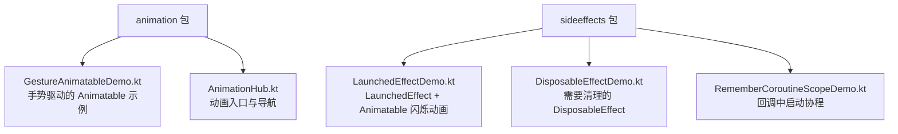
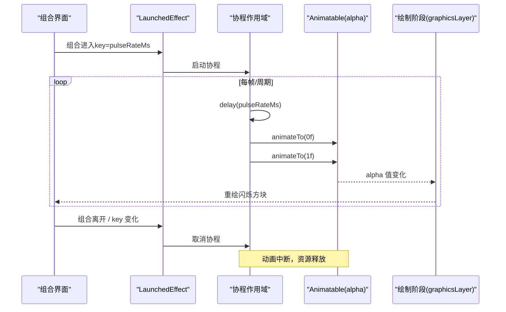
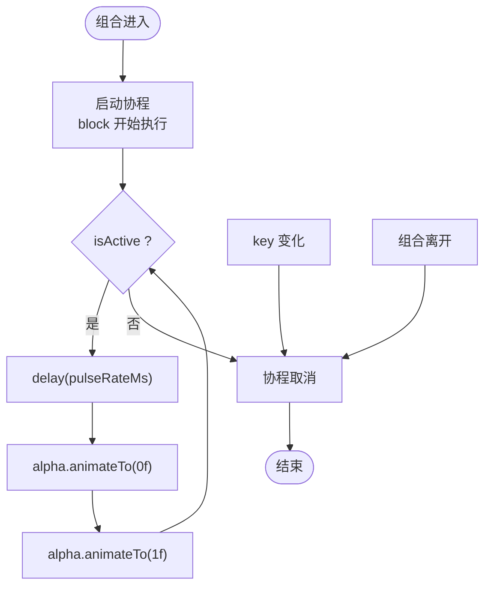
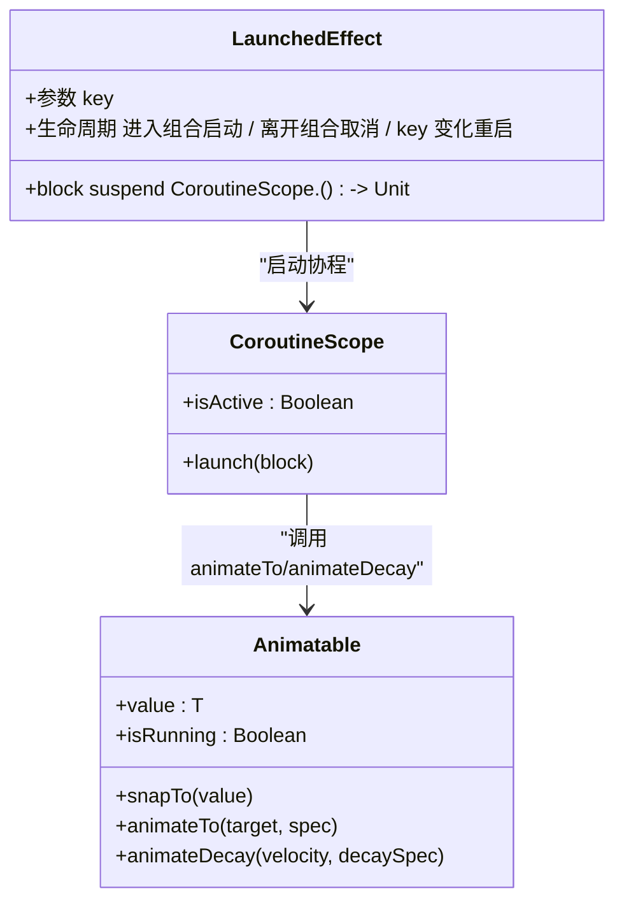
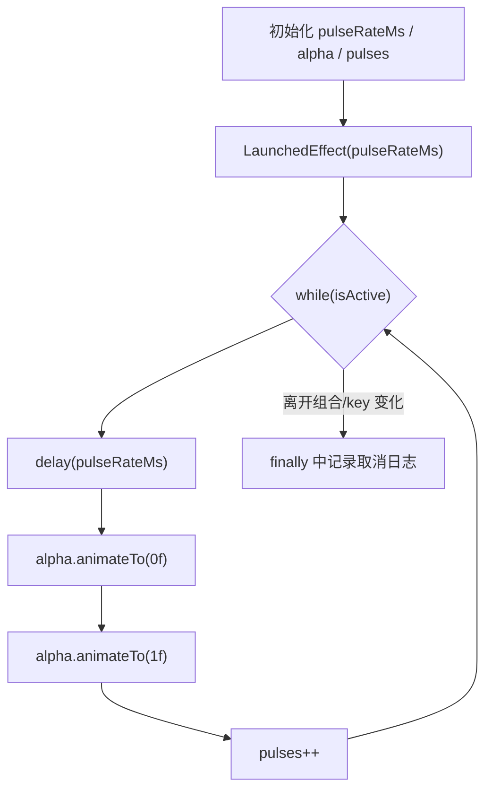
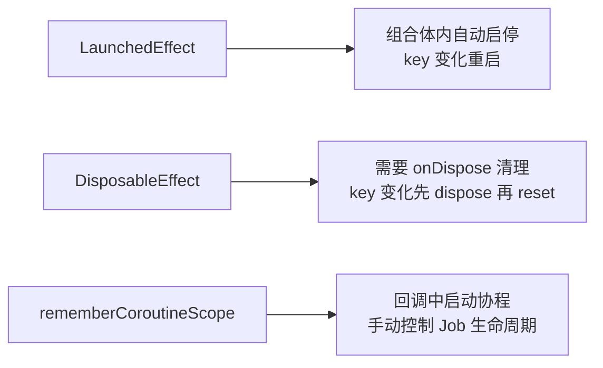
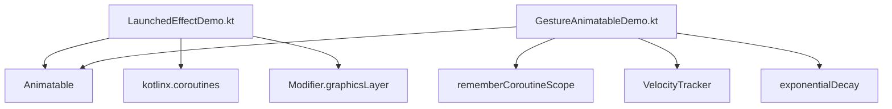

# LaunchedEffect 协程启动

<cite>
**本文引用的文件**   
- [LaunchedEffectDemo.kt](file://app/src/main/java/com/example/composeup/sideeffects/LaunchedEffectDemo.kt)
- [DisposableEffectDemo.kt](file://app/src/main/java/com/example/composeup/sideeffects/DisposableEffectDemo.kt)
- [RememberCoroutineScopeDemo.kt](file://app/src/main/java/com/example/composeup/sideeffects/RememberCoroutineScopeDemo.kt)
- [GestureAnimatableDemo.kt](file://app/src/main/java/com/example/composeup/animation/GestureAnimatableDemo.kt)
- [AnimationHub.kt](file://app/src/main/java/com/example/composeup/animation/AnimationHub.kt)
</cite>

## 目录
1. [引言](#引言)
2. [项目结构](#项目结构)
3. [核心组件](#核心组件)
4. [架构总览](#架构总览)
5. [详细组件分析](#详细组件分析)
6. [依赖关系分析](#依赖关系分析)
7. [性能与可取消性](#性能与可取消性)
8. [故障排查指南](#故障排查指南)
9. [结论](#结论)
10. [附录：与其他 Effect API 的选择原则](#附录与其他-effect-api-的选择原则)

## 引言
本文围绕 Compose 中的 `LaunchedEffect`，结合仓库中的示例代码，系统讲解其生命周期管理、key 变化时的重启机制、与 `Animatable` 和 `isActive` 的配合模式，并通过“闪烁动画”展示最佳实践。同时对比 `DisposableEffect` 与 `rememberCoroutineScope`，帮助你在不同场景下做出正确选择。

## 项目结构
本仓库将动画与副作用示例分门别类组织：
- 动画示例位于 `animation` 包，涵盖值动画、过渡、可见性、尺寸、规格与手势驱动动画等主题。
- 副作用示例位于 `sideeffects` 包，包含 `LaunchedEffect`、`DisposableEffect`、`rememberCoroutineScope` 等典型用法。

**图表来源**
- [AnimationHub.kt:30-72](file://app/src/main/java/com/example/composeup/animation/AnimationHub.kt#L30-L72)
- [LaunchedEffectDemo.kt:32-51](file://app/src/main/java/com/example/composeup/sideeffects/LaunchedEffectDemo.kt#L32-L51)
- [GestureAnimatableDemo.kt:43-65](file://app/src/main/java/com/example/composeup/animation/GestureAnimatableDemo.kt#L43-L65)

**章节来源**
- [AnimationHub.kt:30-72](file://app/src/main/java/com/example/composeup/animation/AnimationHub.kt#L30-L72)

## 核心组件
- `LaunchedEffect(key, block)`：在组合进入时启动协程；离开组合时自动取消；当 key 变化时，先取消旧协程，再用新 key 启动新协程。
- `Animatable<T>`：底层可变动画状态，支持 `snapTo`、`animateTo`、`animateDecay` 等操作，适合手势驱动与可打断动画。
- `isActive`：协程作用域内判断是否仍活跃，常用于 while 循环或长时间任务的中断条件。
- `rememberUpdatedState`：在不触发 effect 重启的前提下，始终引用最新值，避免陈旧闭包问题。

这些组件在仓库中的协作方式如下：
- `LaunchedEffectDemo` 使用 `LaunchedEffect(pulseRateMs)` 控制闪烁频率，并在 `while(isActive)` 中调用 `delay` 与 `alpha.animateTo` 实现闪烁。
- `GestureAnimatableDemo` 演示 `Animatable` 的手势交互，并用 `LaunchedEffect(travelPx)` 更新边界。

**章节来源**
- [LaunchedEffectDemo.kt:32-75](file://app/src/main/java/com/example/composeup/sideeffects/LaunchedEffectDemo.kt#L32-L75)
- [GestureAnimatableDemo.kt:128-136](file://app/src/main/java/com/example/composeup/animation/GestureAnimatableDemo.kt#L128-L136)

## 架构总览
下图展示了 `LaunchedEffect` 在组合生命周期中的行为，以及与 `Animatable` 的联动关系。

**图表来源**
- [LaunchedEffectDemo.kt:60-75](file://app/src/main/java/com/example/composeup/sideeffects/LaunchedEffectDemo.kt#L60-L75)
- [LaunchedEffectDemo.kt:92-100](file://app/src/main/java/com/example/composeup/sideeffects/LaunchedEffectDemo.kt#L92-L100)

## 详细组件分析

### LaunchedEffect 的生命周期与 key 机制
- 进入组合：`LaunchedEffect` 用传入的 block 启动一个协程。
- 离开组合：协程被取消，确保不会泄漏。
- key 变化：取消旧协程，用新 key 重启新协程，称为“Restarting effects”。
- 在闪烁动画中，`pulseRateMs` 作为 key；切换频率会触发旧协程取消与新协程启动。

**图表来源**
- [LaunchedEffectDemo.kt:60-75](file://app/src/main/java/com/example/composeup/sideeffects/LaunchedEffectDemo.kt#L60-L75)

**章节来源**
- [LaunchedEffectDemo.kt:32-75](file://app/src/main/java/com/example/composeup/sideeffects/LaunchedEffectDemo.kt#L32-L75)

### Animatable 与 isActive 的配合模式
- `Animatable` 提供可变动画状态，适合需要精确控制与可打断的场景。
- `isActive` 用于协程内部判断是否仍可继续执行，避免在取消后继续操作。
- 在闪烁动画中，`while(isActive)` 包裹 `delay` 与 `animateTo`，保证每次脉冲都安全地响应取消。

**图表来源**
- [LaunchedEffectDemo.kt:60-75](file://app/src/main/java/com/example/composeup/sideeffects/LaunchedEffectDemo.kt#L60-L75)
- [GestureAnimatableDemo.kt:128-136](file://app/src/main/java/com/example/composeup/animation/GestureAnimatableDemo.kt#L128-L136)

**章节来源**
- [LaunchedEffectDemo.kt:60-75](file://app/src/main/java/com/example/composeup/sideeffects/LaunchedEffectDemo.kt#L60-L75)
- [GestureAnimatableDemo.kt:128-136](file://app/src/main/java/com/example/composeup/animation/GestureAnimatableDemo.kt#L128-L136)

### 闪烁动画的实现原理与最佳实践
- 目标：按可配置频率让方块透明度在 0 到 1 之间交替变化。
- 关键点：
  - 使用 `rememberSaveable` 保存 `pulseRateMs`，以便旋转屏幕后恢复。
  - 使用 `remember` 创建 `Animatable(1f)`，复用动画实例。
  - `LaunchedEffect(pulseRateMs)` 以频率为 key，改变频率即重启 effect。
  - 在 `graphicsLayer` 中读取 `alpha.value`，只走绘制阶段，不触发重组。
- 日志输出：打印 effect 启动、取消与每次脉冲完成，便于观察生命周期。

**图表来源**
- [LaunchedEffectDemo.kt:54-75](file://app/src/main/java/com/example/composeup/sideeffects/LaunchedEffectDemo.kt#L54-L75)
- [LaunchedEffectDemo.kt:92-100](file://app/src/main/java/com/example/composeup/sideeffects/LaunchedEffectDemo.kt#L92-L100)

**章节来源**
- [LaunchedEffectDemo.kt:54-100](file://app/src/main/java/com/example/composeup/sideeffects/LaunchedEffectDemo.kt#L54-L100)

### 与其他 Effect API 的区别与选择原则
- `LaunchedEffect`：适合在组合体内运行 suspend 函数，自动随组合生命周期启停，key 变化时重启。
- `DisposableEffect`：适合需要显式清理的副作用（如注册监听器），要求 `onDispose` 作为 block 最后一句；key 变化时先 dispose 再 reset。
- `rememberCoroutineScope`：适合在回调（如 `onClick`）中启动协程，拿到绑定组合生命周期的 scope；也可手动 cancel 已启动的 Job。

**图表来源**
- [LaunchedEffectDemo.kt:32-51](file://app/src/main/java/com/example/composeup/sideeffects/LaunchedEffectDemo.kt#L32-L51)
- [DisposableEffectDemo.kt:26-49](file://app/src/main/java/com/example/composeup/sideeffects/DisposableEffectDemo.kt#L26-L49)
- [RememberCoroutineScopeDemo.kt:28-39](file://app/src/main/java/com/example/composeup/sideeffects/RememberCoroutineScopeDemo.kt#L28-L39)

**章节来源**
- [DisposableEffectDemo.kt:26-49](file://app/src/main/java/com/example/composeup/sideeffects/DisposableEffectDemo.kt#L26-L49)
- [RememberCoroutineScopeDemo.kt:28-39](file://app/src/main/java/com/example/composeup/sideeffects/RememberCoroutineScopeDemo.kt#L28-L39)

## 依赖关系分析
- `LaunchedEffectDemo` 依赖：
  - `Animatable`：用于透明度动画。
  - `kotlinx.coroutines.delay`：挂起等待。
  - `kotlinx.coroutines.isActive`：协程活跃判断。
  - `Modifier.graphicsLayer`：仅绘制阶段读取 alpha，避免重组。
- `GestureAnimatableDemo` 依赖：
  - `Animatable`：偏移量动画。
  - `rememberCoroutineScope`：在手势回调中启动协程。
  - `VelocityTracker`：计算手指速度，用于惯性滑动。
  - `exponentialDecay`：惯性衰减规格。

**图表来源**
- [LaunchedEffectDemo.kt:3-30](file://app/src/main/java/com/example/composeup/sideeffects/LaunchedEffectDemo.kt#L3-L30)
- [GestureAnimatableDemo.kt:3-41](file://app/src/main/java/com/example/composeup/animation/GestureAnimatableDemo.kt#L3-L41)

**章节来源**
- [LaunchedEffectDemo.kt:3-30](file://app/src/main/java/com/example/composeup/sideeffects/LaunchedEffectDemo.kt#L3-L30)
- [GestureAnimatableDemo.kt:3-41](file://app/src/main/java/com/example/composeup/animation/GestureAnimatableDemo.kt#L3-L41)

## 性能与可取消性
- 可取消性：
  - `LaunchedEffect` 在组合离开或 key 变化时自动取消协程，避免后台任务泄漏。
  - `while(isActive)` 确保长时间循环能立即响应取消。
- 性能优化：
  - 使用 `graphicsLayer` 读取 `alpha.value`，只在绘制阶段更新，不触发重组。
  - `remember` 复用 `Animatable` 实例，避免重复创建开销。
  - `rememberSaveable` 持久化用户配置（如闪烁频率），减少不必要的重建。
- 手势动画：
  - `Animatable` 的 `snapTo`、`animateTo`、`animateDecay` 共享互斥锁，后发起的调用会打断前一个动画，保证跟手与可打断体验。

**章节来源**
- [LaunchedEffectDemo.kt:92-100](file://app/src/main/java/com/example/composeup/sideeffects/LaunchedEffectDemo.kt#L92-L100)
- [GestureAnimatableDemo.kt:154-177](file://app/src/main/java/com/example/composeup/animation/GestureAnimatableDemo.kt#L154-L177)

## 故障排查指南
- 现象：切换频率后闪烁未重启或出现卡顿。
  - 检查 `pulseRateMs` 是否正确作为 key 传入 `LaunchedEffect`。
  - 确认 `while(isActive)` 包裹了所有 suspend 调用。
- 现象：回调中无法调用 suspend 函数。
  - 使用 `rememberCoroutineScope()` 获取 scope，在回调中 `scope.launch`。
- 现象：需要清理监听器但忘记注销。
  - 使用 `DisposableEffect`，并确保 `onDispose` 是 block 最后一句。
- 现象：effect 内引用了变化的回调却未更新。
  - 使用 `rememberUpdatedState` 包装回调，避免陈旧闭包。

**章节来源**
- [LaunchedEffectDemo.kt:60-75](file://app/src/main/java/com/example/composeup/sideeffects/LaunchedEffectDemo.kt#L60-L75)
- [RememberCoroutineScopeDemo.kt:107-128](file://app/src/main/java/com/example/composeup/sideeffects/RememberCoroutineScopeDemo.kt#L107-L128)
- [DisposableEffectDemo.kt:102-110](file://app/src/main/java/com/example/composeup/sideeffects/DisposableEffectDemo.kt#L102-L110)

## 结论
`LaunchedEffect` 是 Compose 中管理协程生命周期的核心 API，配合 `Animatable` 与 `isActive` 可实现灵活且安全的动画逻辑。通过合理设计 key，你可以精确控制 effect 的重启时机；通过 `graphicsLayer` 与 `remember`，你可以优化渲染性能并复用动画状态。在不同场景下，选择 `LaunchedEffect`、`DisposableEffect` 或 `rememberCoroutineScope`，能够覆盖从自动启停到手动控制的完整需求。

## 附录：与其他 Effect API 的选择原则
- 使用 `LaunchedEffect`：
  - 在组合体内运行 suspend 函数。
  - 希望自动随组合生命周期启停。
  - 需要根据 key 变化重启 effect。
- 使用 `DisposableEffect`：
  - 需要显式清理资源（如注册监听器）。
  - 必须提供 `onDispose` 作为 block 最后一句。
  - key 变化时需要先 dispose 再 reset。
- 使用 `rememberCoroutineScope`：
  - 在回调（如 `onClick`）中启动协程。
  - 需要手动控制协程生命周期（如用户交互取消动画）。
  - 需要与组合生命周期绑定的 scope。

**章节来源**
- [LaunchedEffectDemo.kt:32-51](file://app/src/main/java/com/example/composeup/sideeffects/LaunchedEffectDemo.kt#L32-L51)
- [DisposableEffectDemo.kt:26-49](file://app/src/main/java/com/example/composeup/sideeffects/DisposableEffectDemo.kt#L26-L49)
- [RememberCoroutineScopeDemo.kt:28-39](file://app/src/main/java/com/example/composeup/sideeffects/RememberCoroutineScopeDemo.kt#L28-L39)