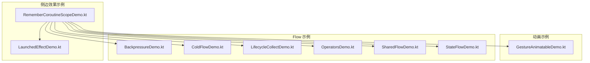
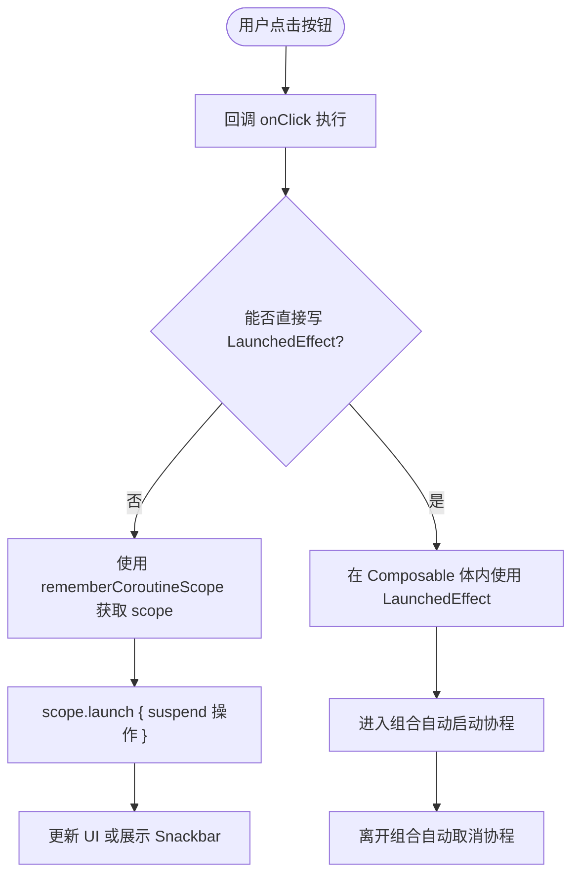
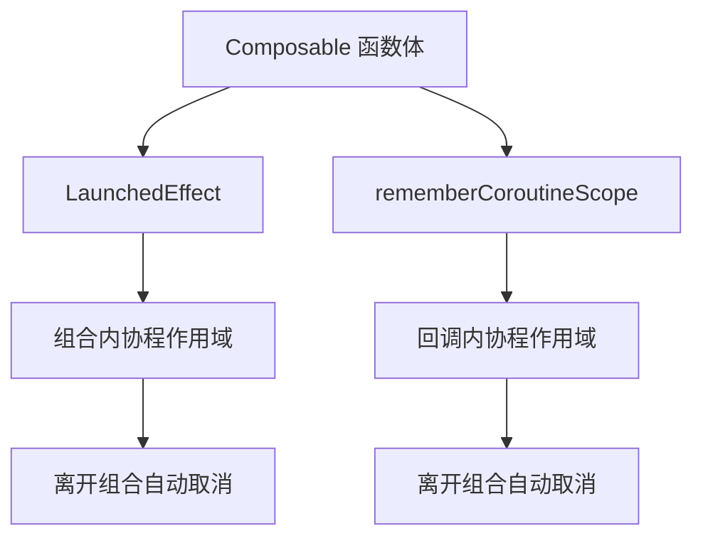
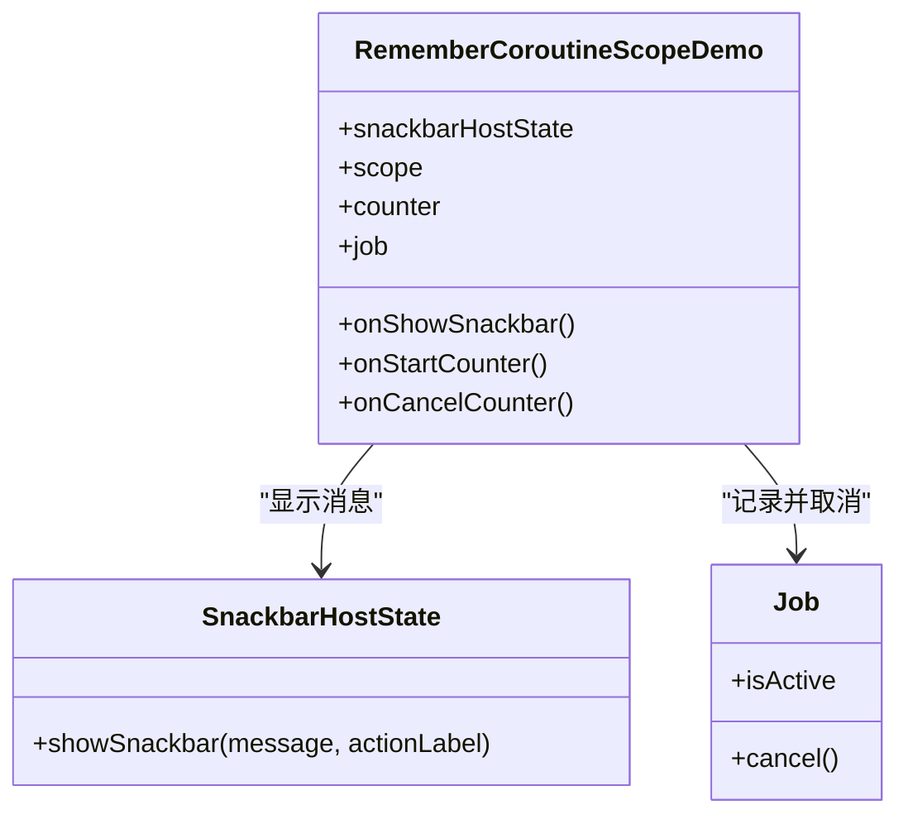
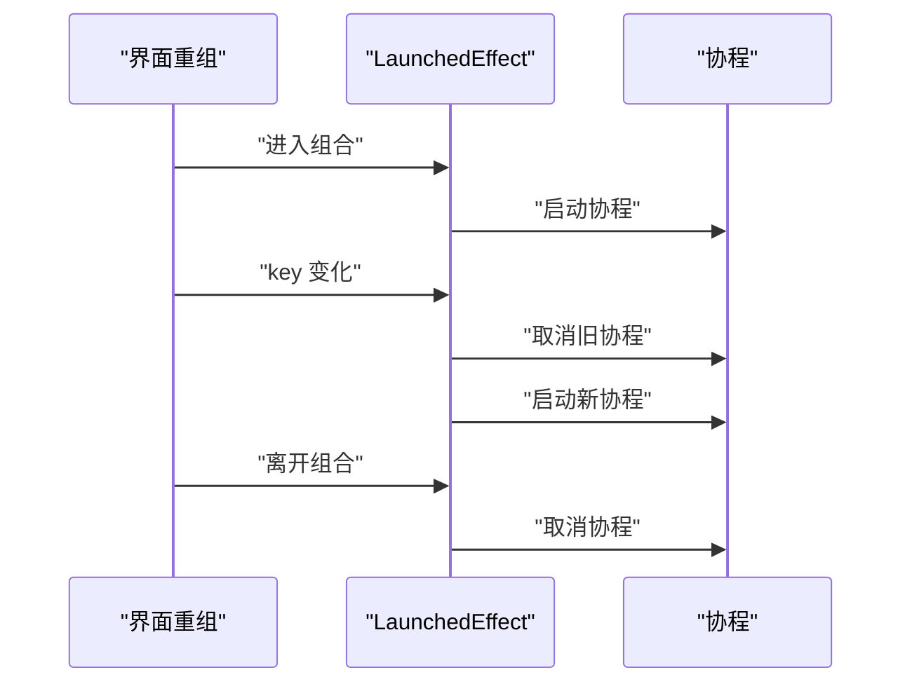
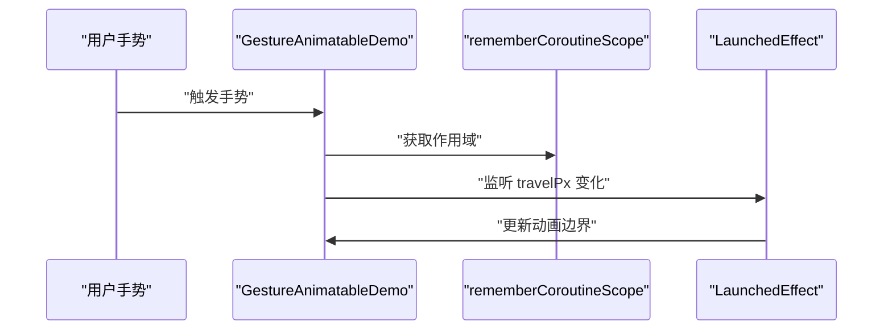
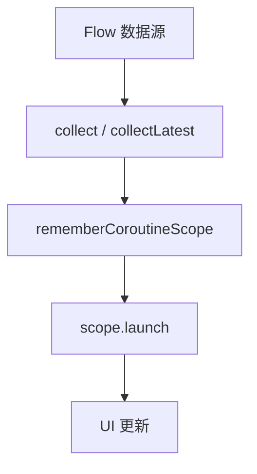
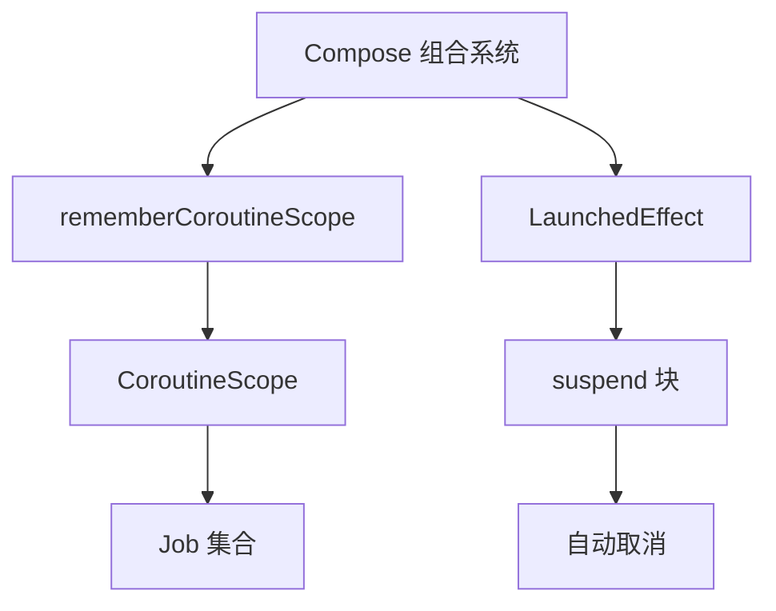
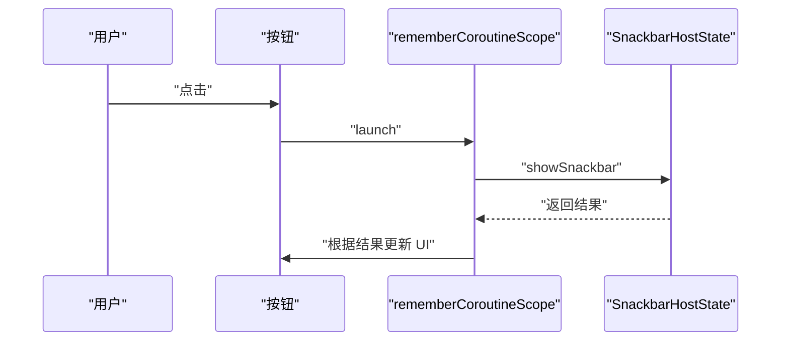

# RememberCoroutineScope 回调协程

<cite>
**本文引用的文件**   
- [RememberCoroutineScopeDemo.kt](file://app/src/main/java/com/example/composeup/sideeffects/RememberCoroutineScopeDemo.kt)
- [LaunchedEffectDemo.kt](file://app/src/main/java/com/example/composeup/sideeffects/LaunchedEffectDemo.kt)
- [GestureAnimatableDemo.kt](file://app/src/main/java/com/example/composeup/animation/GestureAnimatableDemo.kt)
- [BackpressureDemo.kt](file://app/src/main/java/com/example/composeup/flow/BackpressureDemo.kt)
- [ColdFlowDemo.kt](file://app/src/main/java/com/example/composeup/flow/ColdFlowDemo.kt)
- [LifecycleCollectDemo.kt](file://app/src/main/java/com/example/composeup/flow/LifecycleCollectDemo.kt)
- [OperatorsDemo.kt](file://app/src/main/java/com/example/composeup/flow/OperatorsDemo.kt)
- [SharedFlowDemo.kt](file://app/src/main/java/com/example/composeup/flow/SharedFlowDemo.kt)
- [StateFlowDemo.kt](file://app/src/main/java/com/example/composeup/flow/StateFlowDemo.kt)
</cite>

## 目录
1. [引言](#引言)
2. [项目结构定位](#项目结构定位)
3. [核心概念与问题背景](#核心概念与问题背景)
4. [架构总览](#架构总览)
5. [详细组件分析](#详细组件分析)
6. [依赖关系分析](#依赖关系分析)
7. [性能与生命周期特性](#性能与生命周期特性)
8. [Snackbar 等 UI 交互场景实践](#snackbar-等-ui-交互场景实践)
9. [内存泄漏防护与常见陷阱](#内存泄漏防护与常见陷阱)
10. [LaunchedEffect 与 rememberCoroutineScope 对比](#launchedeffect-与-remembercoroutinescope-对比)
11. [故障排查指南](#故障排查指南)
12. [结论](#结论)

## 引言
本文围绕 `rememberCoroutineScope` 在 Compose 回调中的使用展开，重点解释：
- 为什么普通回调（如 `onClick`）中不能直接使用 `LaunchedEffect`。
- 如何通过 `rememberCoroutineScope` 获取一个感知组合生命周期的作用域，并在回调中使用 `scope.launch` 启动协程。
- 如何确保协程在组合离开时自动取消，避免内存泄漏。
- 在 Snackbar、手势动画、Flow 收集等实际场景中的应用方式。
- 最佳实践、常见陷阱，以及与 `LaunchedEffect` 的使用差异。

## 项目结构定位
本主题的核心示例位于侧边效果模块中，同时其他模块也展示了 `rememberCoroutineScope` 的多种用法。

**图表来源**
- [RememberCoroutineScopeDemo.kt:28-131](file://app/src/main/java/com/example/composeup/sideeffects/RememberCoroutineScopeDemo.kt#L28-L131)
- [LaunchedEffectDemo.kt:32-117](file://app/src/main/java/com/example/composeup/sideeffects/LaunchedEffectDemo.kt#L32-L117)
- [GestureAnimatableDemo.kt:25-135](file://app/src/main/java/com/example/composeup/animation/GestureAnimatableDemo.kt#L25-L135)
- [BackpressureDemo.kt:15-67](file://app/src/main/java/com/example/composeup/flow/BackpressureDemo.kt#L15-L67)
- [ColdFlowDemo.kt:14-50](file://app/src/main/java/com/example/composeup/flow/ColdFlowDemo.kt#L14-L50)
- [LifecycleCollectDemo.kt:12-72](file://app/src/main/java/com/example/composeup/flow/LifecycleCollectDemo.kt#L12-L72)
- [OperatorsDemo.kt:13-76](file://app/src/main/java/com/example/composeup/flow/OperatorsDemo.kt#L13-L76)
- [SharedFlowDemo.kt:11-85](file://app/src/main/java/com/example/composeup/flow/SharedFlowDemo.kt#L11-L85)
- [StateFlowDemo.kt:16-51](file://app/src/main/java/com/example/composeup/flow/StateFlowDemo.kt#L16-L51)

**章节来源**
- [RememberCoroutineScopeDemo.kt:28-131](file://app/src/main/java/com/example/composeup/sideeffects/RememberCoroutineScopeDemo.kt#L28-L131)
- [LaunchedEffectDemo.kt:32-117](file://app/src/main/java/com/example/composeup/sideeffects/LaunchedEffectDemo.kt#L32-L117)

## 核心概念与问题背景
- `LaunchedEffect` 是一个 Composable，只能写在 Composable 函数体内；它会在进入组合时启动协程，离开组合时取消协程，key 变化时会重启 effect。
- 按钮的 `onClick` 是普通回调，不是 Composable，因此不能在回调内部直接写 `LaunchedEffect`。
- `rememberCoroutineScope` 返回一个绑定到当前组合位置的 `CoroutineScope`，可以在回调中通过 `scope.launch` 启动协程，并在组合离开时自动取消。

**图表来源**
- [RememberCoroutineScopeDemo.kt:28-44](file://app/src/main/java/com/example/composeup/sideeffects/RememberCoroutineScopeDemo.kt#L28-L44)
- [LaunchedEffectDemo.kt:32-75](file://app/src/main/java/com/example/composeup/sideeffects/LaunchedEffectDemo.kt#L32-L75)

**章节来源**
- [RememberCoroutineScopeDemo.kt:28-44](file://app/src/main/java/com/example/composeup/sideeffects/RememberCoroutineScopeDemo.kt#L28-L44)
- [LaunchedEffectDemo.kt:32-75](file://app/src/main/java/com/example/composeup/sideeffects/LaunchedEffectDemo.kt#L32-L75)

## 架构总览
从整体看，Compose 侧边效果和协程作用域的关系如下：
- `LaunchedEffect` 用于“随组合生命周期自动运行”的协程。
- `rememberCoroutineScope` 用于“在回调中手动启动协程”，并继承组合生命周期。
- 两者都依赖 Compose 的组合状态和生命周期管理，避免内存泄漏。

**图表来源**
- [RememberCoroutineScopeDemo.kt:41-44](file://app/src/main/java/com/example/composeup/sideeffects/RememberCoroutineScopeDemo.kt#L41-L44)
- [LaunchedEffectDemo.kt:61-75](file://app/src/main/java/com/example/composeup/sideeffects/LaunchedEffectDemo.kt#L61-L75)

**章节来源**
- [RememberCoroutineScopeDemo.kt:41-44](file://app/src/main/java/com/example/composeup/sideeffects/RememberCoroutineScopeDemo.kt#L41-L44)
- [LaunchedEffectDemo.kt:61-75](file://app/src/main/java/com/example/composeup/sideeffects/LaunchedEffectDemo.kt#L61-L75)

## 详细组件分析

### RememberCoroutineScopeDemo 组件
该组件演示了以下关键点：
- 在 Composable 中调用 `rememberCoroutineScope()` 获取作用域。
- 在 `onClick` 回调中使用 `scope.launch` 调用 suspend 函数（如 `showSnackbar`）。
- 保存 `Job` 以支持手动取消，体现对协程生命周期的手动控制能力。
- 通过文本说明对比 `LaunchedEffect` 与 `rememberCoroutineScope` 的使用差异。

**图表来源**
- [RememberCoroutineScopeDemo.kt:41-105](file://app/src/main/java/com/example/composeup/sideeffects/RememberCoroutineScopeDemo.kt#L41-L105)

**章节来源**
- [RememberCoroutineScopeDemo.kt:41-105](file://app/src/main/java/com/example/composeup/sideeffects/RememberCoroutineScopeDemo.kt#L41-L105)

### LaunchedEffectDemo 组件
该组件演示了 `LaunchedEffect` 的生命周期行为：
- 进入组合时启动协程。
- key 变化时取消旧协程并重启新协程。
- 离开组合时自动取消协程。

**图表来源**
- [LaunchedEffectDemo.kt:61-75](file://app/src/main/java/com/example/composeup/sideeffects/LaunchedEffectDemo.kt#L61-L75)

**章节来源**
- [LaunchedEffectDemo.kt:61-75](file://app/src/main/java/com/example/composeup/sideeffects/LaunchedEffectDemo.kt#L61-L75)

### GestureAnimatableDemo 组件
该组件展示了在手势动画场景中结合 `rememberCoroutineScope` 与 `LaunchedEffect` 的方式：
- 使用 `rememberCoroutineScope` 获取作用域。
- 使用 `LaunchedEffect` 监听可配置参数变化并更新动画边界。

**图表来源**
- [GestureAnimatableDemo.kt:131-135](file://app/src/main/java/com/example/composeup/animation/GestureAnimatableDemo.kt#L131-L135)

**章节来源**
- [GestureAnimatableDemo.kt:131-135](file://app/src/main/java/com/example/composeup/animation/GestureAnimatableDemo.kt#L131-L135)

### Flow 相关组件
多个 Flow 示例展示了 `rememberCoroutineScope` 在不同场景下的使用：
- BackpressureDemo：背压处理中获取作用域。
- ColdFlowDemo：冷流收集前获取作用域。
- LifecycleCollectDemo：结合生命周期收集 Flow。
- OperatorsDemo：搜索管线中启动协程。
- SharedFlowDemo：共享流收集与作用域管理。
- StateFlowDemo：状态流收集与作用域管理。

**图表来源**
- [BackpressureDemo.kt:15-67](file://app/src/main/java/com/example/composeup/flow/BackpressureDemo.kt#L15-L67)
- [ColdFlowDemo.kt:14-50](file://app/src/main/java/com/example/composeup/flow/ColdFlowDemo.kt#L14-L50)
- [LifecycleCollectDemo.kt:12-72](file://app/src/main/java/com/example/composeup/flow/LifecycleCollectDemo.kt#L12-L72)
- [OperatorsDemo.kt:13-76](file://app/src/main/java/com/example/composeup/flow/OperatorsDemo.kt#L13-L76)
- [SharedFlowDemo.kt:11-85](file://app/src/main/java/com/example/composeup/flow/SharedFlowDemo.kt#L11-L85)
- [StateFlowDemo.kt:16-51](file://app/src/main/java/com/example/composeup/flow/StateFlowDemo.kt#L16-L51)

**章节来源**
- [BackpressureDemo.kt:15-67](file://app/src/main/java/com/example/composeup/flow/BackpressureDemo.kt#L15-L67)
- [ColdFlowDemo.kt:14-50](file://app/src/main/java/com/example/composeup/flow/ColdFlowDemo.kt#L14-L50)
- [LifecycleCollectDemo.kt:12-72](file://app/src/main/java/com/example/composeup/flow/LifecycleCollectDemo.kt#L12-L72)
- [OperatorsDemo.kt:13-76](file://app/src/main/java/com/example/composeup/flow/OperatorsDemo.kt#L13-L76)
- [SharedFlowDemo.kt:11-85](file://app/src/main/java/com/example/composeup/flow/SharedFlowDemo.kt#L11-L85)
- [StateFlowDemo.kt:16-51](file://app/src/main/java/com/example/composeup/flow/StateFlowDemo.kt#L16-L51)

## 依赖关系分析
- `rememberCoroutineScope` 依赖 Compose 的组合状态，确保作用域与组合生命周期同步。
- `LaunchedEffect` 依赖 key 的变化来触发协程重启。
- 两者都避免在回调中直接创建全局作用域，从而防止内存泄漏。

**图表来源**
- [RememberCoroutineScopeDemo.kt:41-44](file://app/src/main/java/com/example/composeup/sideeffects/RememberCoroutineScopeDemo.kt#L41-L44)
- [LaunchedEffectDemo.kt:61-75](file://app/src/main/java/com/example/composeup/sideeffects/LaunchedEffectDemo.kt#L61-L75)

**章节来源**
- [RememberCoroutineScopeDemo.kt:41-44](file://app/src/main/java/com/example/composeup/sideeffects/RememberCoroutineScopeDemo.kt#L41-L44)
- [LaunchedEffectDemo.kt:61-75](file://app/src/main/java/com/example/composeup/sideeffects/LaunchedEffectDemo.kt#L61-L75)

## 性能与生命周期特性
- `LaunchedEffect` 适合“进入组合即启动、离开组合即取消”的场景，无需手动管理协程。
- `rememberCoroutineScope` 适合“回调中启动协程”的场景，需手动管理协程生命周期（如保存 `Job` 以便取消）。
- 两者都利用 Compose 的组合生命周期，避免不必要的资源占用。

**章节来源**
- [RememberCoroutineScopeDemo.kt:107-128](file://app/src/main/java/com/example/composeup/sideeffects/RememberCoroutineScopeDemo.kt#L107-L128)
- [LaunchedEffectDemo.kt:107-115](file://app/src/main/java/com/example/composeup/sideeffects/LaunchedEffectDemo.kt#L107-L115)

## Snackbar 等 UI 交互场景实践
在 Snackbar 场景中：
- 使用 `rememberCoroutineScope` 获取作用域。
- 在 `onClick` 回调中调用 `scope.launch` 执行 `showSnackbar`。
- 支持带操作的 Snackbar，并根据用户选择进行后续处理。

**图表来源**
- [RememberCoroutineScopeDemo.kt:63-83](file://app/src/main/java/com/example/composeup/sideeffects/RememberCoroutineScopeDemo.kt#L63-L83)

**章节来源**
- [RememberCoroutineScopeDemo.kt:63-83](file://app/src/main/java/com/example/composeup/sideeffects/RememberCoroutineScopeDemo.kt#L63-L83)

## 内存泄漏防护与常见陷阱
- **不要**在回调中直接创建全局协程作用域，应使用 `rememberCoroutineScope`。
- **不要**忽略协程取消，必要时保存 `Job` 并手动取消。
- **注意** `LaunchedEffect` 的 key 变化会重启协程，避免不必要的频繁重启。
- **避免**在长时间运行的协程中持有 UI 引用，防止内存泄漏。

**章节来源**
- [RememberCoroutineScopeDemo.kt:121-128](file://app/src/main/java/com/example/composeup/sideeffects/RememberCoroutineScopeDemo.kt#L121-L128)
- [LaunchedEffectDemo.kt:107-115](file://app/src/main/java/com/example/composeup/sideeffects/LaunchedEffectDemo.kt#L107-L115)

## LaunchedEffect 与 rememberCoroutineScope 对比
| 特性 | LaunchedEffect | rememberCoroutineScope |
|------|----------------|------------------------|
| 使用位置 | Composable 函数体内 | 任意位置（包括回调） |
| 生命周期 | 进入组合启动，离开组合取消 | 绑定到组合位置，自动取消 |
| 手动控制 | 不支持 | 支持（通过 Job） |
| 适用场景 | 自动运行的副作用 | 回调中启动协程 |
| Key 变化 | 重启协程 | 不适用 |

**章节来源**
- [RememberCoroutineScopeDemo.kt:107-128](file://app/src/main/java/com/example/composeup/sideeffects/RememberCoroutineScopeDemo.kt#L107-L128)
- [LaunchedEffectDemo.kt:107-115](file://app/src/main/java/com/example/composeup/sideeffects/LaunchedEffectDemo.kt#L107-L115)

## 故障排查指南
- **问题**：协程未取消导致内存泄漏。  
  **解决**：确保使用 `rememberCoroutineScope`，或在需要时手动取消 `Job`。
- **问题**：`LaunchedEffect` 频繁重启。  
  **解决**：检查 key 是否过于频繁变化，或使用 `rememberUpdatedState` 避免重启。
- **问题**：回调中无法调用 suspend 函数。  
  **解决**：使用 `scope.launch` 包裹 suspend 函数调用。

**章节来源**
- [RememberCoroutineScopeDemo.kt:121-128](file://app/src/main/java/com/example/composeup/sideeffects/RememberCoroutineScopeDemo.kt#L121-L128)
- [LaunchedEffectDemo.kt:107-115](file://app/src/main/java/com/example/composeup/sideeffects/LaunchedEffectDemo.kt#L107-L115)

## 结论
- `rememberCoroutineScope` 是 Compose 回调中启动协程的标准方式，确保协程生命周期与组合同步。
- `LaunchedEffect` 更适合“自动运行”的副作用，而 `rememberCoroutineScope` 更适合“手动控制”的协程。
- 在实际开发中，应根据场景选择合适的方案，并注意内存泄漏防护和常见陷阱。