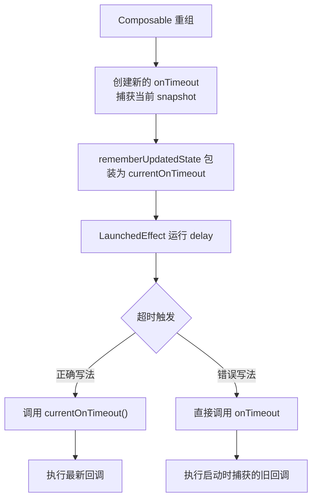
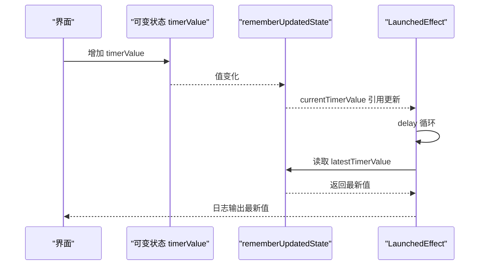
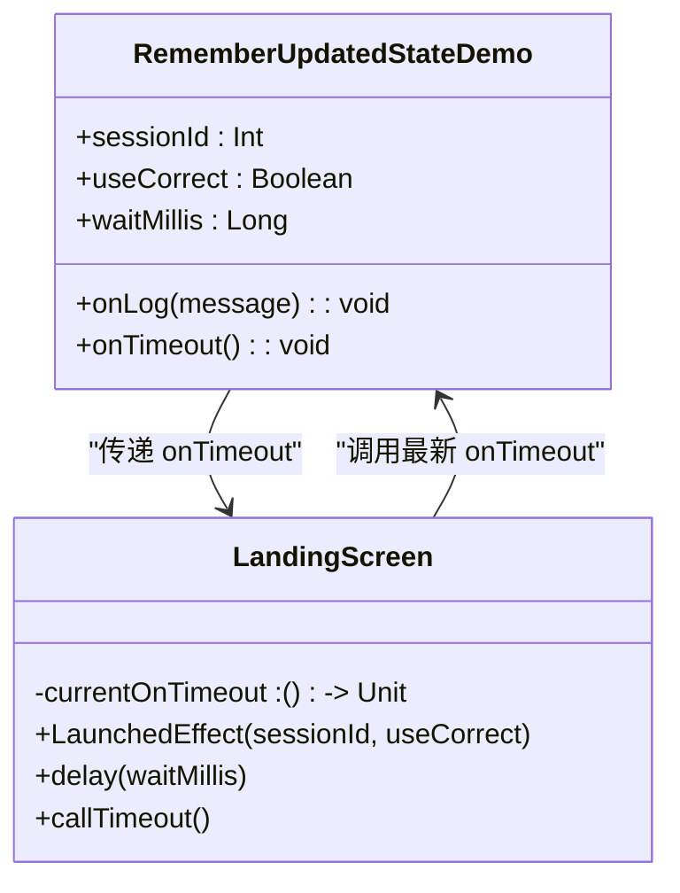
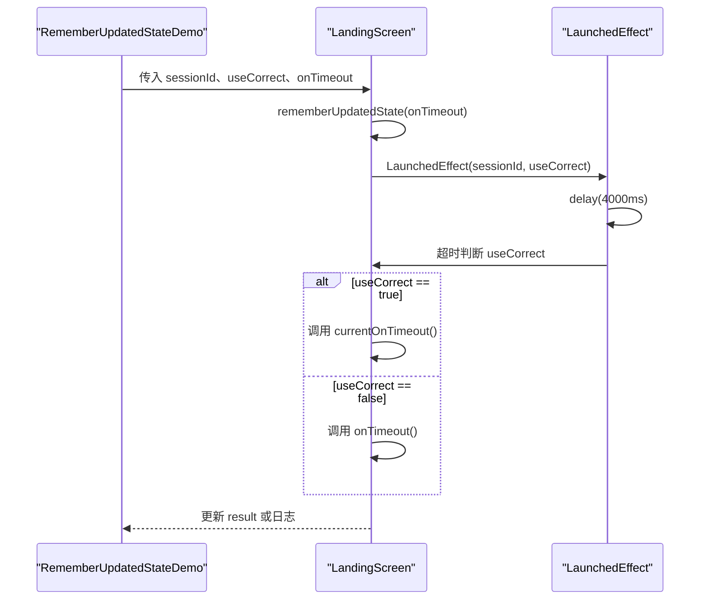
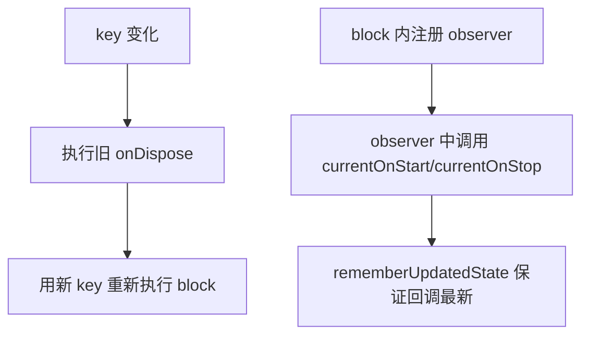

# RememberUpdatedState 状态更新

<cite>
**本文引用的文件**   
- [RememberUpdatedStateDemo.kt](file://app/src/main/java/com/example/composeup/sideeffects/RememberUpdatedStateDemo.kt)
- [LaunchedEffectDemo.kt](file://app/src/main/java/com/example/composeup/sideeffects/LaunchedEffectDemo.kt)
- [DisposableEffectDemo.kt](file://app/src/main/java/com/example/composeup/sideeffects/DisposableEffectDemo.kt)
- [RememberDemo.kt](file://app/src/main/java/com/example/composeup/remember/RememberDemo.kt)
</cite>

## 目录
1. [引言](#引言)
2. [闭包捕获问题与解决方案](#闭包捕获问题与解决方案)
3. [核心用法：用 rememberUpdatedState 包裹可变值](#核心用法用-rememberupdatedstate-包裹可变值)
4. [LandingScreen 典型场景分析](#landingscreen-典型场景分析)
5. [与其他副作用 API 的配合模式](#与其他副作用-api-的配合模式)
6. [性能优化与内存管理最佳实践](#性能优化与内存管理最佳实践)
7. [常见问题排查](#常见问题排查)
8. [总结](#总结)

## 引言
`rememberUpdatedState` 是 Compose 中解决「长生命周期副作用需要访问最新状态，但不想因该状态变化而重启 effect」的核心工具。它不创建新的对象实例，而是维护一个可变的引用，让 effect 内部始终读到最新的值或回调，从而避免「闭包捕获旧值」的问题。

在示例仓库中，`RememberUpdatedStateDemo.kt` 通过 `LandingScreen` 演示了计时超时后调用最新 `onTimeout` 的完整流程；`LaunchedEffectDemo.kt`、`DisposableEffectDemo.kt` 和 `RememberDemo.kt` 则从不同侧面展示了该 API 的使用语境、常见错误以及与其他副作用 API 的组合方式。

## 闭包捕获问题与解决方案
### 问题来源
Compose 重组时，如果某个 lambda 被传入 effect 内部，并且该 lambda 引用了外部可变状态，那么 effect 会在启动时「捕获」这些变量的当前快照。若后续状态发生变化，但 effect 没有重启，effect 内部读到的仍然是启动时的旧值。这就是所谓的 stale closure（陈旧闭包）。

在示例中，`onTimeout` 是一个每次重组都会重新创建的 lambda，它会捕获当前的 `snapshot`。如果 `LandingScreen` 中的 effect 直接调用这个 `onTimeout`，而 effect 又因为 key 不变而没有重启，那么超时触发时调用的就是启动那一刻的旧回调。

### 解决方案
使用 `rememberUpdatedState(onTimeout)` 把回调包装成 `currentOnTimeout`。这样：
- effect 只根据显式传入的 key 决定是否重启；
- `currentOnTimeout` 始终指向最新的 `onTimeout`；
- 即使 `onTimeout` 携带的内容变了，只要 effect 的 key 没变，effect 就不会重启，但超时调用的是最新回调。

**图示来源** 
- [RememberUpdatedStateDemo.kt:119-144](file://app/src/main/java/com/example/composeup/sideeffects/RememberUpdatedStateDemo.kt#L119-L144)

**章节来源**
- [RememberUpdatedStateDemo.kt:24-43](file://app/src/main/java/com/example/composeup/sideeffects/RememberUpdatedStateDemo.kt#L24-L43)
- [RememberUpdatedStateDemo.kt:119-144](file://app/src/main/java/com/example/composeup/sideeffects/RememberUpdatedStateDemo.kt#L119-L144)

## 核心用法：用 rememberUpdatedState 包裹可变值
### 基本模式
1. 在 Composable 中声明可变状态，例如计数、会话标识、用户输入等。
2. 将可能频繁变化的值或回调传给 `rememberUpdatedState`。
3. 在 effect 内部读取包装后的值，而不是直接读取原始可变状态。
4. 对 effect 的 key 做合理设计：希望值变化时重启 effect，就把值作为 key；不希望重启，就用 `rememberUpdatedState`。

### 示例说明
在 `RememberDemo.kt` 中，`timerValue` 会不断递增，而 `LaunchedEffect(Unit)` 使用常量 key，因此不会因 `timerValue` 变化而重启。此时直接使用 `timerValue` 会得到初始值，而使用 `latestTimerValue = rememberUpdatedState(timerValue)` 则能拿到最新值。

**图示来源** 
- [RememberDemo.kt:84-98](file://app/src/main/java/com/example/composeup/remember/RememberDemo.kt#L84-L98)

**章节来源**
- [RememberDemo.kt:30-39](file://app/src/main/java/com/example/composeup/remember/RememberDemo.kt#L30-L39)
- [RememberDemo.kt:81-98](file://app/src/main/java/com/example/composeup/remember/RememberDemo.kt#L81-L98)

## LandingScreen 典型场景分析
### 场景目标
`LandingScreen` 模拟官方示例中的启动页逻辑：进入页面后开始一段固定时长的计时，超时后调用 `onTimeout`。关键约束是：
- `onTimeout` 可能随重组变化；
- 计时过程不应因 `onTimeout` 变化而重启；
- 超时触发时必须调用最新的 `onTimeout`。

### 实现要点
- 使用 `rememberUpdatedState(onTimeout)` 得到 `currentOnTimeout`。
- `LaunchedEffect(sessionId, useCorrect)` 的 key 不包含 `onTimeout`，因此 `onTimeout` 变化不会重启 effect。
- 超时分支中，正确路径调用 `currentOnTimeout()`，错误路径直接调用 `onTimeout()`，用于对比 stale closure 的行为。

**图示来源** 
- [RememberUpdatedStateDemo.kt:45-63](file://app/src/main/java/com/example/composeup/sideeffects/RememberUpdatedStateDemo.kt#L45-L63)
- [RememberUpdatedStateDemo.kt:119-144](file://app/src/main/java/com/example/composeup/sideeffects/RememberUpdatedStateDemo.kt#L119-L144)

### 时序流程

**图示来源** 
- [RememberUpdatedStateDemo.kt:128-141](file://app/src/main/java/com/example/composeup/sideeffects/RememberUpdatedStateDemo.kt#L128-L141)

**章节来源**
- [RememberUpdatedStateDemo.kt:115-144](file://app/src/main/java/com/example/composeup/sideeffects/RememberUpdatedStateDemo.kt#L115-L144)

## 与其他副作用 API 的配合模式
### LaunchedEffect
`LaunchedEffect` 适合协程式异步任务。当业务希望某个值变化时重启 effect，应将该值作为 key；当不希望重启，却又要读取最新值，应使用 `rememberUpdatedState`。

在 `LaunchedEffectDemo.kt` 中，`pulseRateMs` 作为 key，改变频率会取消旧协程并重启新协程。文档注释也明确指出：block 里用到的可变值原则上应作为 key；若不希望触发重启，改用 `rememberUpdatedState`。

**章节来源**
- [LaunchedEffectDemo.kt:32-50](file://app/src/main/java/com/example/composeup/sideeffects/LaunchedEffectDemo.kt#L32-L50)
- [LaunchedEffectDemo.kt:107-112](file://app/src/main/java/com/example/composeup/sideeffects/LaunchedEffectDemo.kt#L107-L112)

### DisposableEffect
`DisposableEffect` 适合需要清理资源的副作用，例如注册监听器、订阅事件、打开文件等。其 key 变化时会先执行旧的 `onDispose`，再重新执行 block。

在 `DisposableEffectDemo.kt` 中，`LifecycleAnalyticsEffect` 使用 `rememberUpdatedState` 包装 `onStart` 和 `onStop`，使回调变化不触发重新注册；真正决定重新注册的 key 是 `lifecycleOwner`。这体现了「资源相关值作为 key，回调值用 `rememberUpdatedState`」的典型模式。

**图示来源** 
- [DisposableEffectDemo.kt:114-138](file://app/src/main/java/com/example/composeup/sideeffects/DisposableEffectDemo.kt#L114-L138)

**章节来源**
- [DisposableEffectDemo.kt:26-49](file://app/src/main/java/com/example/composeup/sideeffects/DisposableEffectDemo.kt#L26-L49)
- [DisposableEffectDemo.kt:102-107](file://app/src/main/java/com/example/composeup/sideeffects/DisposableEffectDemo.kt#L102-L107)
- [DisposableEffectDemo.kt:114-138](file://app/src/main/java/com/example/composeup/sideeffects/DisposableEffectDemo.kt#L114-L138)

## 性能优化与内存管理最佳实践
### 避免不必要的重启
- 如果某个值变化会导致昂贵操作重启，优先考虑是否真的需要重启。
- 不需要重启时，不要把它放进 effect 的 key；改用 `rememberUpdatedState` 在 effect 内部读取最新值。
- 使用常量 key（如 `true` 或 `Unit`）时要谨慎，因为它会让 effect 只在调用点生命周期内存在，类似 `while(true)`，容易隐藏长时间运行的副作用。

### 减少对象创建
- `rememberUpdatedState` 本身维护的是一个引用，不会像普通 `remember` 那样每次都创建新对象。
- 对于频繁重组但内容稳定的数据，仍可使用 `remember` 缓存计算结果；对于需要在 effect 中读取的最新值，使用 `rememberUpdatedState`。

### 防止内存泄漏
- 长生命周期 effect 中持有外部对象引用时，要确保 effect 生命周期可控。
- 使用 `DisposableEffect` 时，必须在 `onDispose` 中释放资源，例如移除监听器、取消订阅、关闭流。
- 不要在 effect 中持有过大的对象引用，除非确实需要；必要时通过 `rememberUpdatedState` 仅持有轻量引用。

### 组合策略
- 资源型 key：如 `lifecycleOwner`、数据库连接、网络客户端，变化时需要重新初始化。
- 行为型回调：如 `onStart`、`onStop`、`onTimeout`，通常用 `rememberUpdatedState` 包裹，不作为 key。
- 展示型状态：如 UI 文本、动画参数，通常作为重组依赖，不一定进入 effect key。

**章节来源**
- [RememberUpdatedStateDemo.kt:102-110](file://app/src/main/java/com/example/composeup/sideeffects/RememberUpdatedStateDemo.kt#L102-L110)
- [LaunchedEffectDemo.kt:107-112](file://app/src/main/java/com/example/composeup/sideeffects/LaunchedEffectDemo.kt#L107-L112)
- [DisposableEffectDemo.kt:102-107](file://app/src/main/java/com/example/composeup/sideeffects/DisposableEffectDemo.kt#L102-L107)

## 常见问题排查
### 现象：超时触发的不是最新回调
**原因**：effect 直接使用了被启动时捕获的 `onTimeout`，而不是 `rememberUpdatedState` 包装后的引用。  
**排查方法**：检查 effect 内部是否直接调用原始回调，是否误把回调作为 key。  
**修复方式**：使用 `val currentOnTimeout by rememberUpdatedState(onTimeout)`，并在超时处调用 `currentOnTimeout()`。

**章节来源**
- [RememberUpdatedStateDemo.kt:128-141](file://app/src/main/java/com/example/composeup/sideeffects/RememberUpdatedStateDemo.kt#L128-L141)

### 现象：effect 频繁重启导致重复计时或重复订阅
**原因**：把本应用作 `rememberUpdatedState` 的值放进了 effect 的 key。  
**排查方法**：查看 effect 的 key 列表，确认是否包含频繁变化的回调或 lambda。  
**修复方式**：将回调改为 `rememberUpdatedState`，key 只保留真正需要重启的资源或配置。

**章节来源**
- [DisposableEffectDemo.kt:121-123](file://app/src/main/java/com/example/composeup/sideeffects/DisposableEffectDemo.kt#L121-L123)

### 现象：日志显示 effect 一直读取旧值
**原因**：在 effect 内部直接读取可变状态，而不是通过 `rememberUpdatedState`。  
**排查方法**：定位 effect 中读取状态的代码，确认是否使用了包装后的引用。  
**修复方式**：将状态包装为 `val latestValue by rememberUpdatedState(value)`，并在 effect 中读取 `latestValue`。

**章节来源**
- [RememberDemo.kt:84-98](file://app/src/main/java/com/example/composeup/remember/RememberDemo.kt#L84-L98)

### 现象：切后台或离开页面后仍有残留行为
**原因**：使用了需要清理的副作用，但没有在 `onDispose` 中释放资源。  
**排查方法**：检查是否使用 `DisposableEffect`，以及 `onDispose` 是否为 block 最后一句。  
**修复方式**：在 `onDispose` 中移除监听器、取消订阅、关闭资源。

**章节来源**
- [DisposableEffectDemo.kt:26-31](file://app/src/main/java/com/example/composeup/sideeffects/DisposableEffectDemo.kt#L26-L31)
- [DisposableEffectDemo.kt:134-137](file://app/src/main/java/com/example/composeup/sideeffects/DisposableEffectDemo.kt#L134-L137)

## 总结
`rememberUpdatedState` 的核心价值在于解耦「值的变化」和「effect 的重启」。它让长生命周期的副作用能够安全地访问最新状态或回调，同时保持 effect 的生命周期由显式 key 控制。

在实际工程中，建议遵循以下原则：
- 明确区分「需要重启的资源」和「只需要最新值的回调」。
- 资源类值作为 effect key，回调类值用 `rememberUpdatedState` 包裹。
- 对常量 key 的 long-running effect 保持警惕，避免隐藏的性能问题和内存泄漏。
- 结合 `LaunchedEffect`、`DisposableEffect` 等 API，形成清晰的状态、副作用和资源管理边界。

通过这些模式，可以在保证 UI 行为正确的同时，获得更稳定、更易维护的 Compose 架构。