# 副作用处理

<cite>
**本文引用的文件**   
- [SideEffectsHub.kt](file://app/src/main/java/com/example/composeup/sideeffects/SideEffectsHub.kt)
- [LaunchedEffectDemo.kt](file://app/src/main/java/com/example/composeup/sideeffects/LaunchedEffectDemo.kt)
- [RememberCoroutineScopeDemo.kt](file://app/src/main/java/com/example/composeup/sideeffects/RememberCoroutineScopeDemo.kt)
- [RememberUpdatedStateDemo.kt](file://app/src/main/java/com/example/composeup/sideeffects/RememberUpdatedStateDemo.kt)
- [DisposableEffectDemo.kt](file://app/src/main/java/com/example/composeup/sideeffects/DisposableEffectDemo.kt)
- [SideEffectDemo.kt](file://app/src/main/java/com/example/composeup/sideeffects/SideEffectDemo.kt)
- [ProduceStateDemo.kt](file://app/src/main/java/com/example/composeup/sideeffects/ProduceStateDemo.kt)
- [DerivedStateOfDemo.kt](file://app/src/main/java/com/example/composeup/sideeffects/DerivedStateOfDemo.kt)
- [SnapshotFlowDemo.kt](file://app/src/main/java/com/example/composeup/sideeffects/SnapshotFlowDemo.kt)
</cite>

## 目录
1. [引言](#引言)
2. [项目结构](#项目结构)
3. [核心组件](#核心组件)
4. [架构总览](#架构总览)
5. [详细组件分析](#详细组件分析)
6. [依赖关系分析](#依赖关系分析)
7. [性能与内存优化](#性能与内存优化)
8. [故障排查指南](#故障排查指南)
9. [结论](#结论)
10. [附录：常见模式与反模式](#附录常见模式与反模式)

## 引言
本技术文档围绕 Compose 的副作用处理机制展开，聚焦以下主题：
- LaunchedEffect、DisposableEffect、SideEffect 的使用场景与生命周期。
- produceState、derivedStateOf 的状态管理与重组优化。
- RememberCoroutineScope 与 SnapshotFlow 的高级用法。
- 副作用清理、内存泄漏防护与性能优化最佳实践。
- 常见副作用模式的实现示例与反模式避免。

该仓库在 sideeffects 包中提供了完整的可交互示例，覆盖官方文章《Side-effects in Compose》列出的全部 API，并配有日志、状态展示和对比演示，便于理解与调试。

## 项目结构
sideeffects 包采用“按 API 分文件”的组织方式，每个文件对应一个 Effect 或状态管理工具的可交互示例；SideEffectsHub 作为统一入口，提供导航与说明。

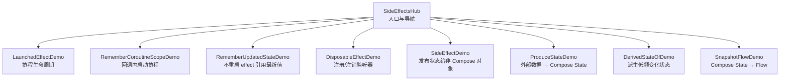

图表来源
- [SideEffectsHub.kt:102-186](file://app/src/main/java/com/example/composeup/sideeffects/SideEffectsHub.kt#L102-L186)

章节来源
- [SideEffectsHub.kt:30-95](file://app/src/main/java/com/example/composeup/sideeffects/SideEffectsHub.kt#L30-L95)
- [SideEffectsHub.kt:102-186](file://app/src/main/java/com/example/composeup/sideeffects/SideEffectsHub.kt#L102-L186)

## 核心组件
本节概述各 Effect 的职责与适用场景：
- LaunchedEffect：在组合时启动 suspend 协程，离开组合取消；key 变化则重启。适合需要自动生命周期管理的异步任务。
- rememberCoroutineScope：在普通回调（如 onClick）中获取绑定组合位置的 CoroutineScope，用于手动 launch 协程。
- rememberUpdatedState：让长生命周期 effect 在不重启的情况下引用最新值，避免陈旧闭包。
- DisposableEffect：需要清理的副作用（注册/注销监听器、释放资源），key 变化或离开组合时执行 onDispose。
- SideEffect：每次成功重组后执行，将 Compose 状态同步给非 Compose 对象（如埋点 SDK）。
- produceState：把外部数据源（Flow、LiveData、回调、suspend 结果）桥接为 Compose State，支持 awaitDispose 清理。
- derivedStateOf：从高频变化的输入派生出低频变化的状态，减少不必要的重组。
- snapshotFlow：把 Compose State 转为冷 Flow，结合 Flow 操作符进行事件过滤与上报。

章节来源
- [SideEffectsHub.kt:42-95](file://app/src/main/java/com/example/composeup/sideeffects/SideEffectsHub.kt#L42-L95)

## 架构总览
下图展示了侧边栏入口与各示例之间的调用关系，以及关键组件间的职责分工。

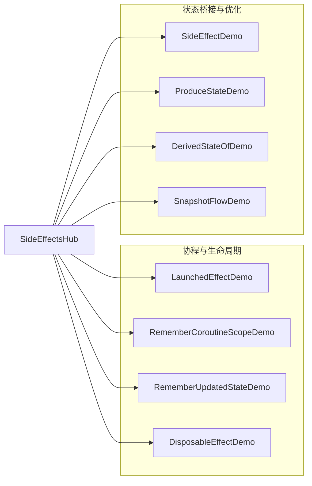

图表来源
- [SideEffectsHub.kt:175-184](file://app/src/main/java/com/example/composeup/sideeffects/SideEffectsHub.kt#L175-L184)

## 详细组件分析

### LaunchedEffect：协程生命周期与 key 重启
- 进入组合启动协程，离开组合取消；key 变化时取消旧协程并用新 block 重启。
- 适合需要自动生命周期管理的 suspend 任务，例如动画、定时轮询等。
- 常量 key（如 true 或 Unit）表示只随调用点生命周期，不随参数变化重启，需谨慎使用以避免无限循环。

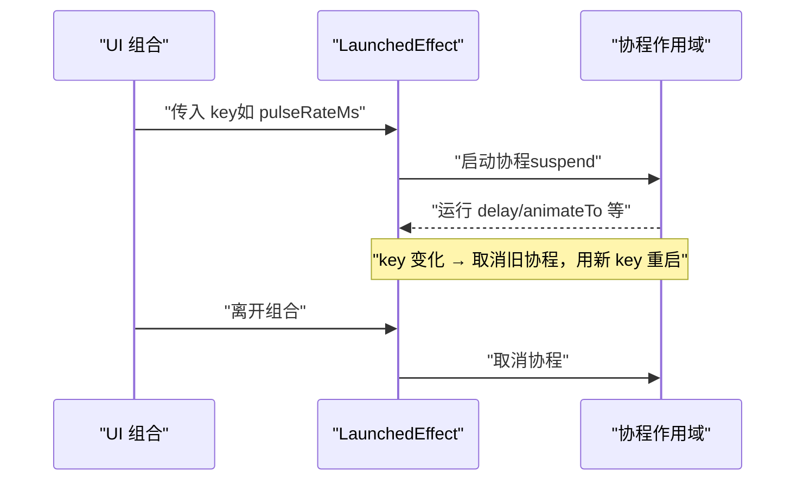

图表来源
- [LaunchedEffectDemo.kt:60-75](file://app/src/main/java/com/example/composeup/sideeffects/LaunchedEffectDemo.kt#L60-L75)

章节来源
- [LaunchedEffectDemo.kt:32-51](file://app/src/main/java/com/example/composeup/sideeffects/LaunchedEffectDemo.kt#L32-L51)
- [LaunchedEffectDemo.kt:60-75](file://app/src/main/java/com/example/composeup/sideeffects/LaunchedEffectDemo.kt#L60-L75)
- [LaunchedEffectDemo.kt:107-116](file://app/src/main/java/com/example/composeup/sideeffects/LaunchedEffectDemo.kt#L107-L116)

### rememberCoroutineScope：在回调中启动协程
- 在 onClick 等普通回调中无法直接写 LaunchedEffect，需通过 rememberCoroutineScope 获取绑定组合位置的 scope。
- scope 在组合离开时自动取消，避免泄漏；也可保存 Job 以手动控制启停。

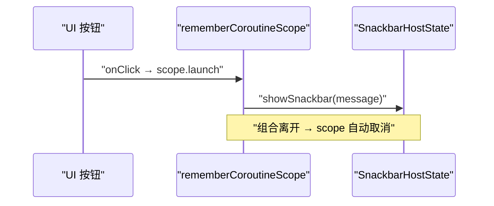

图表来源
- [RememberCoroutineScopeDemo.kt:41-45](file://app/src/main/java/com/example/composeup/sideeffects/RememberCoroutineScopeDemo.kt#L41-L45)
- [RememberCoroutineScopeDemo.kt:63-84](file://app/src/main/java/com/example/composeup/sideeffects/RememberCoroutineScopeDemo.kt#L63-L84)

章节来源
- [RememberCoroutineScopeDemo.kt:28-39](file://app/src/main/java/com/example/composeup/sideeffects/RememberCoroutineScopeDemo.kt#L28-L39)
- [RememberCoroutineScopeDemo.kt:41-45](file://app/src/main/java/com/example/composeup/sideeffects/RememberCoroutineScopeDemo.kt#L41-L45)
- [RememberCoroutineScopeDemo.kt:121-128](file://app/src/main/java/com/example/composeup/sideeffects/RememberCoroutineScopeDemo.kt#L121-L128)

### rememberUpdatedState：不重启 effect 引用最新值
- 当 effect 是长生命周期且不希望因某个值变化而重启时，用 rememberUpdatedState 包裹该值。
- 避免 stale closure：effect 始终读取最新引用，而非启动时捕获的旧值。

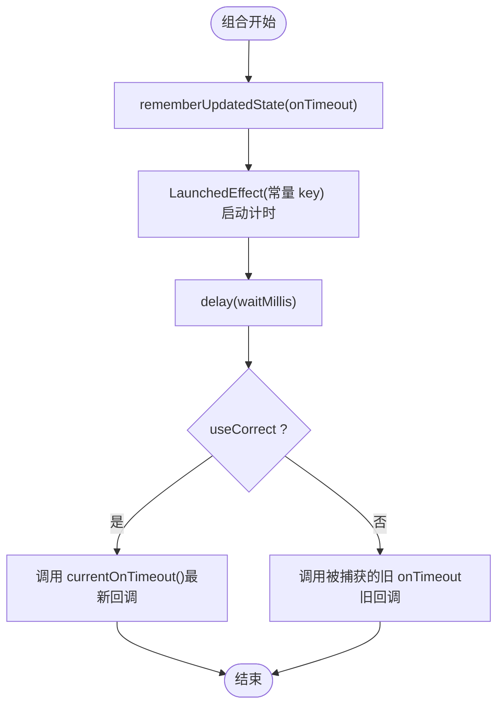

图表来源
- [RememberUpdatedStateDemo.kt:128-141](file://app/src/main/java/com/example/composeup/sideeffects/RememberUpdatedStateDemo.kt#L128-L141)

章节来源
- [RememberUpdatedStateDemo.kt:24-43](file://app/src/main/java/com/example/composeup/sideeffects/RememberUpdatedStateDemo.kt#L24-L43)
- [RememberUpdatedStateDemo.kt:119-141](file://app/src/main/java/com/example/composeup/sideeffects/RememberUpdatedStateDemo.kt#L119-L141)

### DisposableEffect：需要清理的副作用
- 适用于注册/注销监听器、释放资源等需要善后的副作用。
- key 变化或离开组合时先执行旧的 onDispose，再重新执行 block（dispose → reset）。
- onDispose 必须是 block 最后一句，否则编译报错。

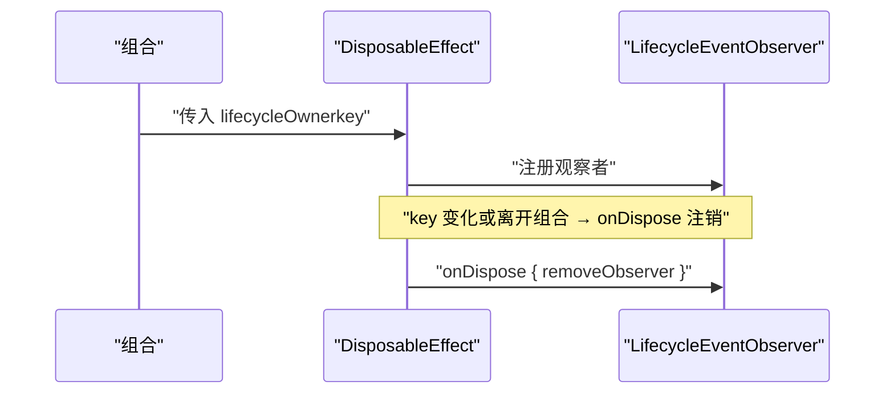

图表来源
- [DisposableEffectDemo.kt:125-137](file://app/src/main/java/com/example/composeup/sideeffects/DisposableEffectDemo.kt#L125-L137)

章节来源
- [DisposableEffectDemo.kt:26-49](file://app/src/main/java/com/example/composeup/sideeffects/DisposableEffectDemo.kt#L26-L49)
- [DisposableEffectDemo.kt:102-108](file://app/src/main/java/com/example/composeup/sideeffects/DisposableEffectDemo.kt#L102-L108)
- [DisposableEffectDemo.kt:114-138](file://app/src/main/java/com/example/composeup/sideeffects/DisposableEffectDemo.kt#L114-L138)

### SideEffect：发布状态给非 Compose 对象
- 每次成功重组后执行，用于把 Compose 状态同步给不受 Compose 管理的对象（如分析 SDK）。
- 无 key、无清理；若需要按 key 变化才跑或需要清理，应改用 LaunchedEffect / DisposableEffect。

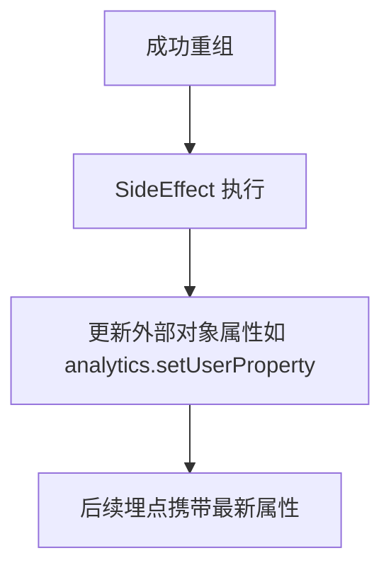

图表来源
- [SideEffectDemo.kt:112-120](file://app/src/main/java/com/example/composeup/sideeffects/SideEffectDemo.kt#L112-L120)

章节来源
- [SideEffectDemo.kt:24-45](file://app/src/main/java/com/example/composeup/sideeffects/SideEffectDemo.kt#L24-L45)
- [SideEffectDemo.kt:98-106](file://app/src/main/java/com/example/composeup/sideeffects/SideEffectDemo.kt#L98-L106)
- [SideEffectDemo.kt:112-120](file://app/src/main/java/com/example/composeup/sideeffects/SideEffectDemo.kt#L112-L120)

### produceState：外部数据 → Compose State
- 启动绑定组合生命周期的协程，将外部数据（Flow、LiveData、回调、suspend 结果）写入返回的 State。
- 进入组合启动、离开组合取消；key 变化时取消旧 producer 并重启。
- 对非挂起数据源可用 awaitDispose 在离开时清理订阅。

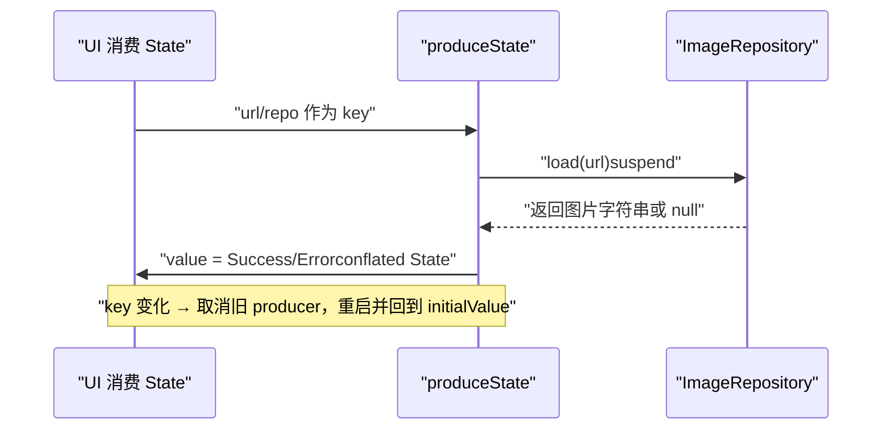

图表来源
- [ProduceStateDemo.kt:145-150](file://app/src/main/java/com/example/composeup/sideeffects/ProduceStateDemo.kt#L145-L150)

章节来源
- [ProduceStateDemo.kt:40-62](file://app/src/main/java/com/example/composeup/sideeffects/ProduceStateDemo.kt#L40-L62)
- [ProduceStateDemo.kt:63-79](file://app/src/main/java/com/example/composeup/sideeffects/ProduceStateDemo.kt#L63-L79)
- [ProduceStateDemo.kt:131-139](file://app/src/main/java/com/example/composeup/sideeffects/ProduceStateDemo.kt#L131-L139)
- [ProduceStateDemo.kt:145-150](file://app/src/main/java/com/example/composeup/sideeffects/ProduceStateDemo.kt#L145-L150)

### derivedStateOf：派生低频变化状态
- 当输入变化频率远高于 UI 真正需要的更新频率时，用 derivedStateOf 只在结果跨越阈值时才重组。
- 类似 distinctUntilChanged：结果不变就不通知重组。
- 注意：本身有开销，仅在“输入变化远多于所需重组”时使用；简单拼接等直接计算即可。

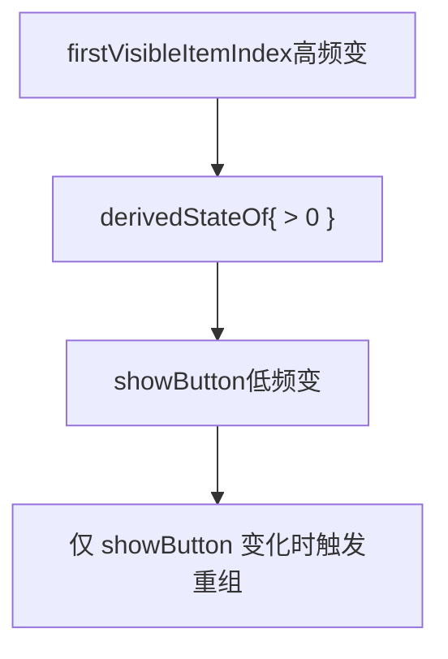

图表来源
- [DerivedStateOfDemo.kt:52-55](file://app/src/main/java/com/example/composeup/sideeffects/DerivedStateOfDemo.kt#L52-L55)

章节来源
- [DerivedStateOfDemo.kt:28-45](file://app/src/main/java/com/example/composeup/sideeffects/DerivedStateOfDemo.kt#L28-L45)
- [DerivedStateOfDemo.kt:47-75](file://app/src/main/java/com/example/composeup/sideeffects/DerivedStateOfDemo.kt#L47-L75)
- [DerivedStateOfDemo.kt:77-97](file://app/src/main/java/com/example/composeup/sideeffects/DerivedStateOfDemo.kt#L77-L97)

### SnapshotFlow：Compose State → Flow
- 把 Compose State 转成冷 Flow，在被 collect 时运行 block，并将其中读到的 State 发出。
- 行为类似 distinctUntilChanged：仅当读到的 State 变化且新值≠旧值时才发。
- 可在 LaunchedEffect 中安全收集，随组合生命周期自动取消。

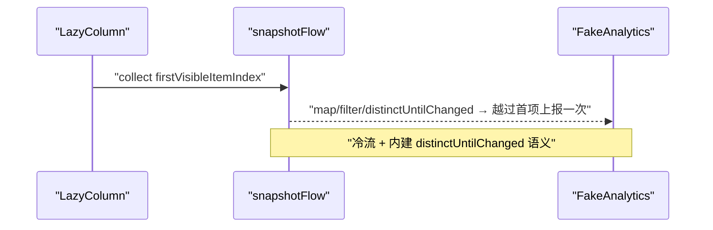

图表来源
- [SnapshotFlowDemo.kt:53-61](file://app/src/main/java/com/example/composeup/sideeffects/SnapshotFlowDemo.kt#L53-L61)

章节来源
- [SnapshotFlowDemo.kt:25-45](file://app/src/main/java/com/example/composeup/sideeffects/SnapshotFlowDemo.kt#L25-L45)
- [SnapshotFlowDemo.kt:47-74](file://app/src/main/java/com/example/composeup/sideeffects/SnapshotFlowDemo.kt#L47-L74)
- [SnapshotFlowDemo.kt:113-119](file://app/src/main/java/com/example/composeup/sideeffects/SnapshotFlowDemo.kt#L113-L119)

## 依赖关系分析
- SideEffectsHub 作为入口，根据当前选中的话题渲染对应的 Demo 组件。
- 各 Demo 组件之间相对独立，主要依赖 Compose Runtime、Material3、Kotlin Coroutines 与 Flow。
- DisposableEffectDemo 与 RememberUpdatedStateDemo 复用 rememberUpdatedState 模式以避免陈旧闭包。
- ProduceStateDemo 封装了外部数据源（ImageRepository）并通过 produceState 暴露 State。
- SnapshotFlowDemo 与 DerivedStateOfDemo 都围绕 LazyListState 的高频变化进行优化与事件处理。

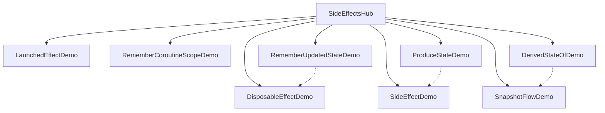

图表来源
- [SideEffectsHub.kt:175-184](file://app/src/main/java/com/example/composeup/sideeffects/SideEffectsHub.kt#L175-L184)
- [DisposableEffectDemo.kt:121-123](file://app/src/main/java/com/example/composeup/sideeffects/DisposableEffectDemo.kt#L121-L123)
- [ProduceStateDemo.kt:145-150](file://app/src/main/java/com/example/composeup/sideeffects/ProduceStateDemo.kt#L145-L150)
- [SnapshotFlowDemo.kt:53-61](file://app/src/main/java/com/example/composeup/sideeffects/SnapshotFlowDemo.kt#L53-L61)

章节来源
- [SideEffectsHub.kt:175-184](file://app/src/main/java/com/example/composeup/sideeffects/SideEffectsHub.kt#L175-L184)

## 性能与内存优化
- 合理使用 key：LaunchedEffect 的 key 决定重启时机；常量 key 需谨慎，避免意外长生命周期。
- 避免陈旧闭包：长生命周期 effect 中使用 rememberUpdatedState 包裹可变值，确保读取最新引用。
- 减少重组：derivedStateOf 仅在结果变化时触发重组；snapshotFlow 内建 distinctUntilChanged 语义，避免重复事件。
- 正确清理：DisposableEffect 的 onDispose 必须存在且为最后一句；produceState 的非挂起数据源使用 awaitDispose 清理订阅。
- 轻量 SideEffect：SideEffect 每次成功重组后执行，内部操作应保持轻量；复杂逻辑应移至 LaunchedEffect 或 DisposableEffect。
- 避免在 composable 体内直接执行副作用：应使用 SideEffect 保证“成功重组后”执行，防止重组丢弃导致的不确定性。

章节来源
- [LaunchedEffectDemo.kt:107-116](file://app/src/main/java/com/example/composeup/sideeffects/LaunchedEffectDemo.kt#L107-L116)
- [RememberUpdatedStateDemo.kt:102-108](file://app/src/main/java/com/example/composeup/sideeffects/RememberUpdatedStateDemo.kt#L102-L108)
- [DerivedStateOfDemo.kt:77-97](file://app/src/main/java/com/example/composeup/sideeffects/DerivedStateOfDemo.kt#L77-L97)
- [SnapshotFlowDemo.kt:113-119](file://app/src/main/java/com/example/composeup/sideeffects/SnapshotFlowDemo.kt#L113-L119)
- [DisposableEffectDemo.kt:102-108](file://app/src/main/java/com/example/composeup/sideeffects/DisposableEffectDemo.kt#L102-L108)
- [ProduceStateDemo.kt:131-139](file://app/src/main/java/com/example/composeup/sideeffects/ProduceStateDemo.kt#L131-L139)
- [SideEffectDemo.kt:98-106](file://app/src/main/java/com/example/composeup/sideeffects/SideEffectDemo.kt#L98-L106)

## 故障排查指南
- 现象：协程未取消导致内存泄漏
  - 检查是否使用 rememberCoroutineScope 并在组合离开时自动取消；如需手动控制，保存 Job 并 cancel。
  - 参考：[RememberCoroutineScopeDemo.kt:41-45](file://app/src/main/java/com/example/composeup/sideeffects/RememberCoroutineScopeDemo.kt#L41-L45)、[RememberCoroutineScopeDemo.kt:91-104](file://app/src/main/java/com/example/composeup/sideeffects/RememberCoroutineScopeDemo.kt#L91-L104)
- 现象：effect 内读取到旧值（stale closure）
  - 使用 rememberUpdatedState 包裹可变值，确保读取最新引用。
  - 参考：[RememberUpdatedStateDemo.kt:128-141](file://app/src/main/java/com/example/composeup/sideeffects/RememberUpdatedStateDemo.kt#L128-L141)
- 现象：监听器未注销导致重复上报或泄漏
  - 使用 DisposableEffect 并确保 onDispose 为最后一句；key 变化时先 dispose 再 reset。
  - 参考：[DisposableEffectDemo.kt:125-137](file://app/src/main/java/com/example/composeup/sideeffects/DisposableEffectDemo.kt#L125-L137)
- 现象：SideEffect 执行时机不确定
  - 不要在 composable 体内直接执行副作用；使用 SideEffect 保证“成功重组后”执行。
  - 参考：[SideEffectDemo.kt:98-106](file://app/src/main/java/com/example/composeup/sideeffects/SideEffectDemo.kt#L98-L106)
- 现象：produceState 未清理非挂起数据源订阅
  - 使用 awaitDispose 在离开组合时清理订阅。
  - 参考：[ProduceStateDemo.kt:131-139](file://app/src/main/java/com/example/composeup/sideeffects/ProduceStateDemo.kt#L131-L139)
- 现象：过度重组导致性能问题
  - 使用 derivedStateOf 仅在结果变化时重组；使用 snapshotFlow 的 distinctUntilChanged 语义避免重复事件。
  - 参考：[DerivedStateOfDemo.kt:77-97](file://app/src/main/java/com/example/composeup/sideeffects/DerivedStateOfDemo.kt#L77-L97)、[SnapshotFlowDemo.kt:113-119](file://app/src/main/java/com/example/composeup/sideeffects/SnapshotFlowDemo.kt#L113-L119)

章节来源
- [RememberCoroutineScopeDemo.kt:41-45](file://app/src/main/java/com/example/composeup/sideeffects/RememberCoroutineScopeDemo.kt#L41-L45)
- [RememberCoroutineScopeDemo.kt:91-104](file://app/src/main/java/com/example/composeup/sideeffects/RememberCoroutineScopeDemo.kt#L91-L104)
- [RememberUpdatedStateDemo.kt:128-141](file://app/src/main/java/com/example/composeup/sideeffects/RememberUpdatedStateDemo.kt#L128-L141)
- [DisposableEffectDemo.kt:125-137](file://app/src/main/java/com/example/composeup/sideeffects/DisposableEffectDemo.kt#L125-L137)
- [SideEffectDemo.kt:98-106](file://app/src/main/java/com/example/composeup/sideeffects/SideEffectDemo.kt#L98-L106)
- [ProduceStateDemo.kt:131-139](file://app/src/main/java/com/example/composeup/sideeffects/ProduceStateDemo.kt#L131-L139)
- [DerivedStateOfDemo.kt:77-97](file://app/src/main/java/com/example/composeup/sideeffects/DerivedStateOfDemo.kt#L77-L97)
- [SnapshotFlowDemo.kt:113-119](file://app/src/main/java/com/example/composeup/sideeffects/SnapshotFlowDemo.kt#L113-L119)

## 结论
本仓库的 sideeffects 模块系统性地演示了 Compose 副作用处理的八种核心 API，覆盖了协程生命周期、状态桥接、重组优化与事件处理等关键主题。通过可交互示例与日志输出，开发者可以直观理解各 API 的生命周期、适用场景与最佳实践。在实际项目中，建议遵循以下原则：
- 明确区分“组合内自动生命周期”（LaunchedEffect）与“回调内手动生命周期”（rememberCoroutineScope）。
- 长生命周期 effect 使用 rememberUpdatedState 避免陈旧闭包。
- 需要清理的副作用一律使用 DisposableEffect，并确保 onDispose 为最后一句。
- 将 Compose 状态发布给非 Compose 对象时使用 SideEffect，保持内部逻辑轻量。
- 使用 produceState 桥接外部数据源，必要时用 awaitDispose 清理订阅。
- 使用 derivedStateOf 与 snapshotFlow 优化高频输入场景，减少不必要重组与重复事件。

## 附录：常见模式与反模式
- 模式：在组合内启动协程
  - 使用 LaunchedEffect，传入合适的 key 控制重启。
  - 参考：[LaunchedEffectDemo.kt:60-75](file://app/src/main/java/com/example/composeup/sideeffects/LaunchedEffectDemo.kt#L60-L75)
- 模式：在回调中启动协程
  - 使用 rememberCoroutineScope 获取 scope，并在 onClick 中 launch。
  - 参考：[RememberCoroutineScopeDemo.kt:63-84](file://app/src/main/java/com/example/composeup/sideeffects/RememberCoroutineScopeDemo.kt#L63-L84)
- 模式：长生命周期 effect 引用最新值
  - 使用 rememberUpdatedState 包裹可变值。
  - 参考：[RememberUpdatedStateDemo.kt:128-141](file://app/src/main/java/com/example/composeup/sideeffects/RememberUpdatedStateDemo.kt#L128-L141)
- 模式：注册/注销监听器
  - 使用 DisposableEffect，并在 onDispose 中清理。
  - 参考：[DisposableEffectDemo.kt:125-137](file://app/src/main/java/com/example/composeup/sideeffects/DisposableEffectDemo.kt#L125-L137)
- 模式：发布状态给非 Compose 对象
  - 使用 SideEffect 在成功重组后更新外部对象。
  - 参考：[SideEffectDemo.kt:112-120](file://app/src/main/java/com/example/composeup/sideeffects/SideEffectDemo.kt#L112-L120)
- 模式：外部数据 → Compose State
  - 使用 produceState，必要时用 awaitDispose 清理。
  - 参考：[ProduceStateDemo.kt:145-150](file://app/src/main/java/com/example/composeup/sideeffects/ProduceStateDemo.kt#L145-L150)
- 模式：派生低频变化状态
  - 使用 derivedStateOf 仅在结果变化时重组。
  - 参考：[DerivedStateOfDemo.kt:52-55](file://app/src/main/java/com/example/composeup/sideeffects/DerivedStateOfDemo.kt#L52-L55)
- 模式：Compose State → Flow
  - 使用 snapshotFlow 并结合 Flow 操作符进行事件处理。
  - 参考：[SnapshotFlowDemo.kt:53-61](file://app/src/main/java/com/example/composeup/sideeffects/SnapshotFlowDemo.kt#L53-L61)

- 反模式：在 composable 体内直接执行副作用
  - 应使用 SideEffect 保证“成功重组后”执行。
  - 参考：[SideEffectDemo.kt:98-106](file://app/src/main/java/com/example/composeup/sideeffects/SideEffectDemo.kt#L98-L106)
- 反模式：长生命周期 effect 捕获旧值
  - 使用 rememberUpdatedState 避免陈旧闭包。
  - 参考：[RememberUpdatedStateDemo.kt:102-108](file://app/src/main/java/com/example/composeup/sideeffects/RememberUpdatedStateDemo.kt#L102-L108)
- 反模式：未清理监听器或订阅
  - 使用 DisposableEffect 的 onDispose 或 produceState 的 awaitDispose。
  - 参考：[DisposableEffectDemo.kt:102-108](file://app/src/main/java/com/example/composeup/sideeffects/DisposableEffectDemo.kt#L102-L108)、[ProduceStateDemo.kt:131-139](file://app/src/main/java/com/example/composeup/sideeffects/ProduceStateDemo.kt#L131-L139)
- 反模式：过度使用 derivedStateOf
  - 仅在“输入变化远多于所需重组”时使用；简单拼接直接计算即可。
  - 参考：[DerivedStateOfDemo.kt:77-97](file://app/src/main/java/com/example/composeup/sideeffects/DerivedStateOfDemo.kt#L77-L97)