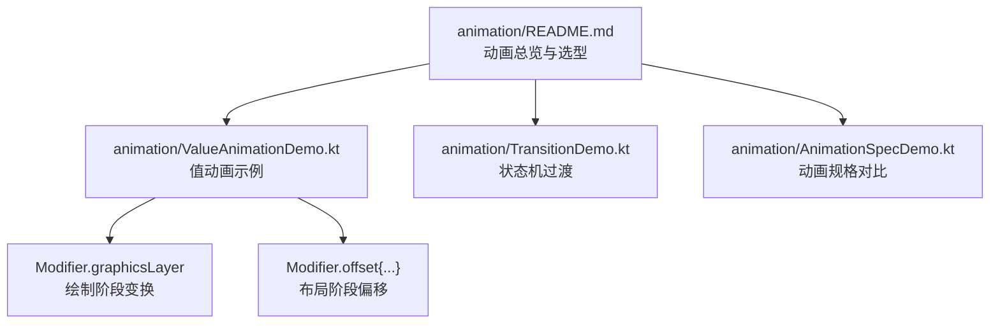
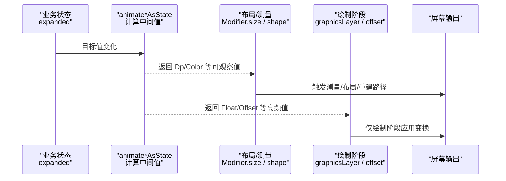
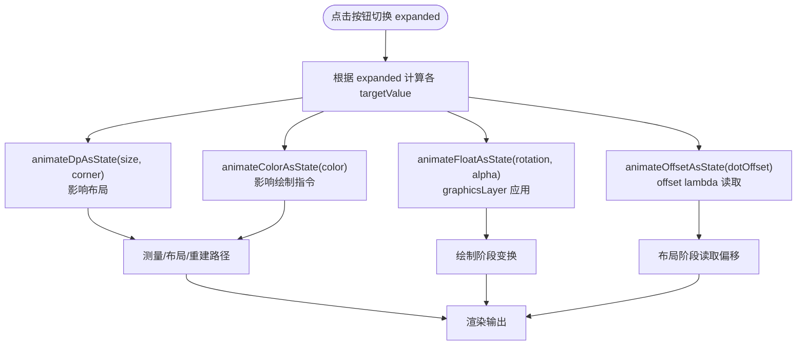
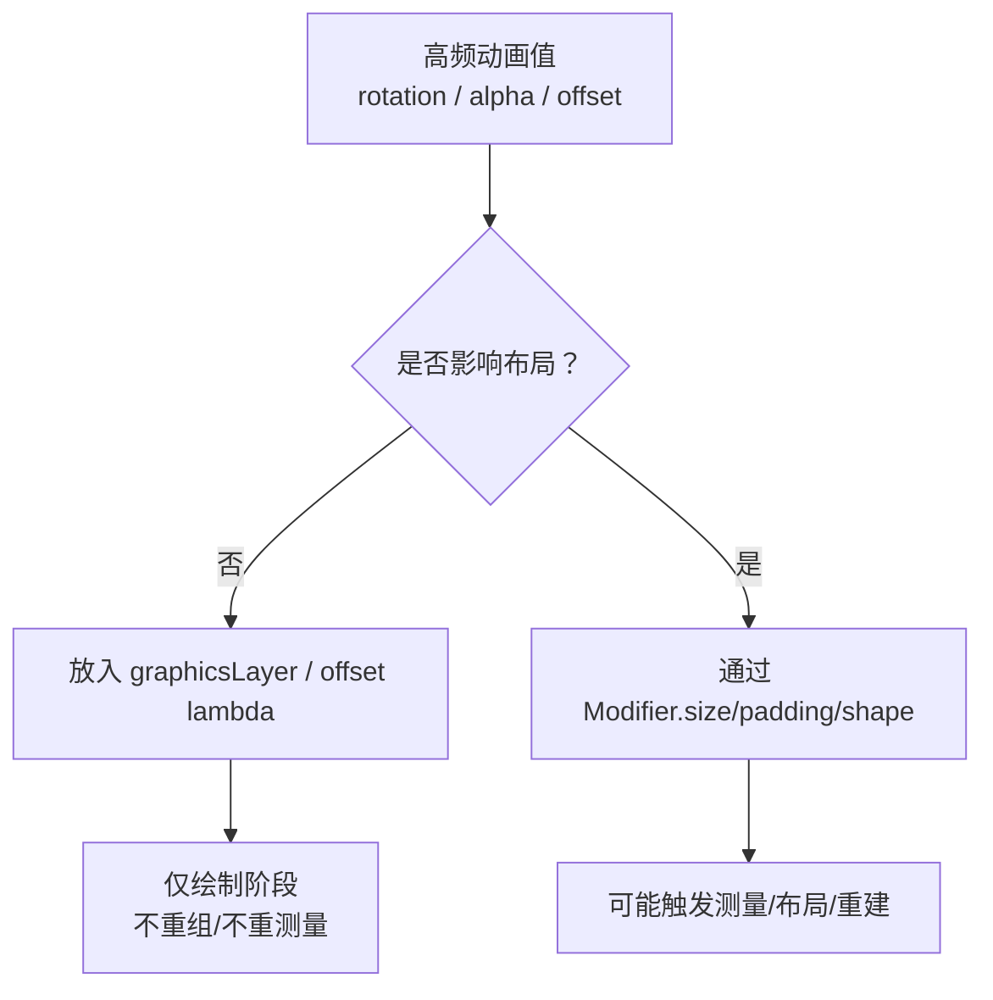
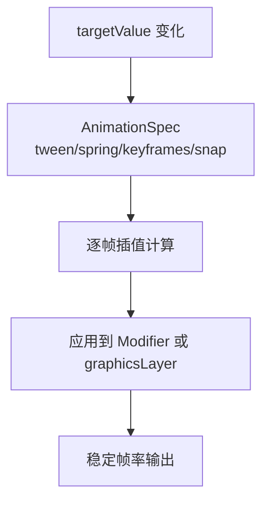
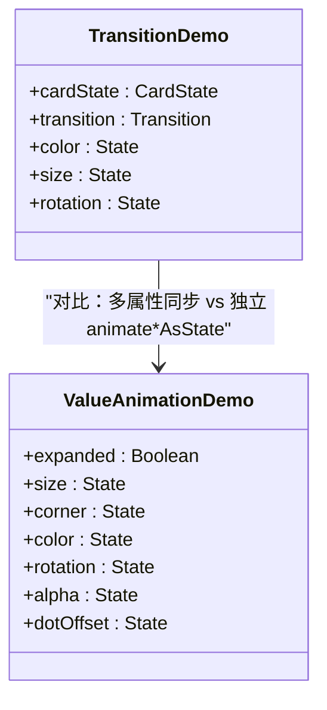
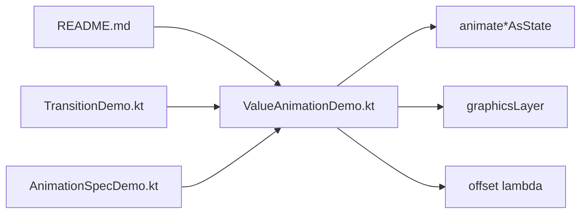

# 值动画 animate*AsState

<cite>
**本文引用的文件**   
- [ValueAnimationDemo.kt](file://app/src/main/java/com/example/composeup/animation/ValueAnimationDemo.kt)
- [README.md](file://app/src/main/java/com/example/composeup/animation/README.md)
- [TransitionDemo.kt](file://app/src/main/java/com/example/composeup/animation/TransitionDemo.kt)
- [AnimationSpecDemo.kt](file://app/src/main/java/com/example/composeup/animation/AnimationSpecDemo.kt)
</cite>

## 目录
1. [引言](#引言)
2. [项目结构](#项目结构)
3. [核心组件](#核心组件)
4. [架构总览](#架构总览)
5. [详细组件分析](#详细组件分析)
6. [依赖关系分析](#依赖关系分析)
7. [性能考量](#性能考量)
8. [故障排查指南](#故障排查指南)
9. [结论](#结论)
10. [附录：参数与最佳实践速查](#附录参数与最佳实践速查)

## 引言
本文聚焦 Compose 的「值动画」体系，围绕 `animateFloatAsState`、`animateColorAsState`、`animateDpAsState`、`animateOffsetAsState` 等 API，解释其使用方式、内部原理、性能要点与常见陷阱。你将学会：
- 如何用一个布尔状态驱动多个属性（尺寸、圆角、颜色、旋转、透明度、位移）同步补间；
- 为什么高频变化的旋转、透明度、位移要放在 `graphicsLayer` 或 `offset { }` 的 lambda 中；
- 如何通过 `durationMillis`、`easing`、`targetValue` 等参数控制动画节奏；
- 在复杂 UI 中避免不必要的重组与重测量，保持高帧率。

## 项目结构
本仓库的动画示例集中在 `animation` 包下，其中「值动画」由 `ValueAnimationDemo.kt` 集中演示，配套 README 提供心智模型与实践清单。

**图表来源**
- [README.md:73-86](file://app/src/main/java/com/example/composeup/animation/README.md#L73-L86)
- [ValueAnimationDemo.kt:35-57](file://app/src/main/java/com/example/composeup/animation/ValueAnimationDemo.kt#L35-L57)

**章节来源**
- [README.md:73-86](file://app/src/main/java/com/example/composeup/animation/README.md#L73-L86)

## 核心组件
本节梳理「值动画」家族及其职责边界：

| API | 动画类型 | 典型用途 | 关键特性 |
| --- | --- | --- | --- |
| `animateFloatAsState` | `Float` | 透明度、旋转角度、缩放比例、进度条 | 内置可见性阈值，微小变化提前结束 |
| `animateColorAsState` | `Color` | 背景色、文字色、图标着色 | 自动插值颜色空间 |
| `animateDpAsState` | `Dp` | 尺寸、圆角、内外边距 | 影响布局时走 Modifier 链 |
| `animateOffsetAsState` | `Offset` | 平面位移（x + y） | 返回像素单位，常配合 `offset { IntOffset(...) }` |

这些 API 的共同模式是：你提供一个「目标值」，框架返回一个「当前正在补间的值」；当目标值改变，返回值会平滑过渡到新值。它们只负责计算数值，不关心如何绘制——因此你需要自己决定把值应用到哪里。

**章节来源**
- [ValueAnimationDemo.kt:35-57](file://app/src/main/java/com/example/composeup/animation/ValueAnimationDemo.kt#L35-L57)

## 架构总览
下图展示「值动画」从状态到绘制的整体流程：

**图表来源**
- [ValueAnimationDemo.kt:63-99](file://app/src/main/java/com/example/composeup/animation/ValueAnimationDemo.kt#L63-L99)
- [ValueAnimationDemo.kt:123-134](file://app/src/main/java/com/example/composeup/animation/ValueAnimationDemo.kt#L123-L134)

## 详细组件分析

### 值动画示例：一个开关驱动多种属性
该示例用一个布尔状态 `expanded` 同时驱动尺寸、圆角、颜色、旋转、透明度与位移。关键点在于：
- 尺寸、圆角、颜色直接影响布局或绘制指令，直接通过 `Modifier` 链应用；
- 旋转、透明度属于图形层变换，放入 `graphicsLayer { }`，仅在绘制阶段生效；
- 位移通过 `animateOffsetAsState` 得到像素级 `Offset`，再配合 `Modifier.offset { IntOffset(...) }` 在布局阶段读取，避免每帧重组。

**图表来源**
- [ValueAnimationDemo.kt:63-99](file://app/src/main/java/com/example/composeup/animation/ValueAnimationDemo.kt#L63-L99)
- [ValueAnimationDemo.kt:114-143](file://app/src/main/java/com/example/composeup/animation/ValueAnimationDemo.kt#L114-L143)

**章节来源**
- [ValueAnimationDemo.kt:63-99](file://app/src/main/java/com/example/composeup/animation/ValueAnimationDemo.kt#L63-L99)
- [ValueAnimationDemo.kt:114-143](file://app/src/main/java/com/example/composeup/animation/ValueAnimationDemo.kt#L114-L143)

### 为什么用 graphicsLayer 优化性能
- 改 `size` / `padding` / `shape` → 可能触发重新测量与布局，甚至重组，代价较高；
- 改 `graphicsLayer` / `offset` 的 lambda → 只在绘制阶段读取插值，不重组、不重测量，帧率更稳；
- 经验法则：能用 `graphicsLayer` / `offset` lambda 表达的位移与变换，就不要去改布局尺寸。

**图表来源**
- [README.md:61-69](file://app/src/main/java/com/example/composeup/animation/README.md#L61-L69)
- [ValueAnimationDemo.kt:123-134](file://app/src/main/java/com/example/composeup/animation/ValueAnimationDemo.kt#L123-L134)

**章节来源**
- [README.md:61-69](file://app/src/main/java/com/example/composeup/animation/README.md#L61-L69)
- [ValueAnimationDemo.kt:123-134](file://app/src/main/java/com/example/composeup/animation/ValueAnimationDemo.kt#L123-L134)

### 动画配置参数：durationMillis、easing、targetValue
- `targetValue`：动画的目标值。每次变化都会触发从旧值到新值的补间；
- `animationSpec`：决定「怎么动」。常用 `tween(durationMillis, delayMillis, easing)`；
- `durationMillis`：动画时长（毫秒），短促交互建议 200–300ms，强调动效可用 400–500ms；
- `easing`：缓动曲线，如 `FastOutSlowInEasing`（两头慢中间快）、`LinearEasing`（匀速）；
- `label`：用于调试与 Android Studio 动画检查器区分不同动画实例。

**图表来源**
- [README.md:218-235](file://app/src/main/java/com/example/composeup/animation/README.md#L218-L235)
- [ValueAnimationDemo.kt:63-99](file://app/src/main/java/com/example/composeup/animation/ValueAnimationDemo.kt#L63-L99)

**章节来源**
- [README.md:218-235](file://app/src/main/java/com/example/composeup/animation/README.md#L218-L235)
- [ValueAnimationDemo.kt:63-99](file://app/src/main/java/com/example/composeup/animation/ValueAnimationDemo.kt#L63-L99)

### 与 Transition 的关系：何时用 updateTransition
当「同一个状态切换」牵动多个属性时，可用 `updateTransition` 统一驱动，获得：
- 同步生命周期（所有子动画共享运行/结束）；
- 分段定制（不同状态段使用不同 spec）；
- 可观测（currentState/targetState/isRunning）。

**图表来源**
- [TransitionDemo.kt:58-92](file://app/src/main/java/com/example/composeup/animation/TransitionDemo.kt#L58-L92)
- [ValueAnimationDemo.kt:63-99](file://app/src/main/java/com/example/composeup/animation/ValueAnimationDemo.kt#L63-L99)

**章节来源**
- [TransitionDemo.kt:58-92](file://app/src/main/java/com/example/composeup/animation/TransitionDemo.kt#L58-L92)

## 依赖关系分析
- `ValueAnimationDemo.kt` 依赖 Compose Animation 与 Foundation 提供的 `animate*AsState`、`Modifier.graphicsLayer`、`Modifier.offset`；
- `README.md` 提供动画分类、选型与性能主线；
- `TransitionDemo.kt` 展示多属性同步过渡；
- `AnimationSpecDemo.kt` 展示不同 `AnimationSpec` 的行为差异。

**图表来源**
- [ValueAnimationDemo.kt:3-7](file://app/src/main/java/com/example/composeup/animation/ValueAnimationDemo.kt#L3-L7)
- [README.md:73-86](file://app/src/main/java/com/example/composeup/animation/README.md#L73-L86)

**章节来源**
- [ValueAnimationDemo.kt:3-7](file://app/src/main/java/com/example/composeup/animation/ValueAnimationDemo.kt#L3-L7)
- [README.md:73-86](file://app/src/main/java/com/example/composeup/animation/README.md#L73-L86)

## 性能考量
- 高频动画（手势跟手、惯性 fling）优先使用 `Animatable`，而非 `animate*AsState`；
- 将旋转、透明度、位移等高频值放入 `graphicsLayer` 或 `offset { }` 的 lambda，避免重组与重测量；
- 对列表项增删/重排使用 `LazyItemScope.Modifier.animateItem()`，并确保每个 item 有稳定且唯一的 `key`；
- 无限循环动画使用 `rememberInfiniteTransition`，并传入 `label`；
- 合理设置 `durationMillis` 与 `easing`，避免过长导致卡顿感或过短导致视觉抖动。

**章节来源**
- [README.md:61-69](file://app/src/main/java/com/example/composeup/animation/README.md#L61-L69)
- [README.md:218-251](file://app/src/main/java/com/example/composeup/animation/README.md#L218-L251)
- [README.md:318-335](file://app/src/main/java/com/example/composeup/animation/README.md#L318-L335)

## 故障排查指南
- 现象：动画“追不上手指”或无法无缝打断  
  原因：误用 `animate*AsState` 做手势跟手  
  解决：改用 `Animatable`，结合 `snapTo`（跟手）、`animateDecay`（惯性）、`animateTo`（归位）

- 现象：频繁重组导致掉帧  
  原因：每帧修改 `size` / `padding` 做位移  
  解决：改用 `graphicsLayer` / `offset { }` 的 lambda

- 现象：列表项动画失效  
  原因：未给 `LazyColumn` 的 items 提供稳定 `key`  
  解决：为每个 item 提供唯一稳定的 key

- 现象：编译报错提示无参重载不可见  
  原因：使用了已隐藏的旧版 `rememberInfiniteTransition()` 或 `animateItemPlacement`  
  解决：传入 `label`，并使用新版 `animateItem`

**章节来源**
- [README.md:318-335](file://app/src/main/java/com/example/composeup/animation/README.md#L318-L335)

## 结论
- `animate*AsState` 适合「值动画」：你持有目标值，框架返回当前补间值；
- 高频变换（旋转、透明度、位移）应走 `graphicsLayer` / `offset` lambda，避免重组与重测量；
- 通过 `durationMillis`、`easing`、`targetValue` 精细控制动画节奏；
- 多属性同步过渡可使用 `updateTransition`；手势跟手与惯性则使用 `Animatable`；
- 遵循 README 的实践清单，能显著提升动画流畅度与可维护性。

## 附录：参数与最佳实践速查
- `targetValue`：目标值，变化即触发补间；
- `animationSpec`：
  - `tween(durationMillis, delayMillis, easing)`：固定时长 + 缓动；
  - `spring(dampingRatio, stiffness, visibilityThreshold)`：物理弹簧，可回弹；
  - `keyframes { ... }`：关键帧编排；
  - `snap(delayMillis)`：瞬切；
- `label`：调试标识，便于动画检查器定位；
- 最佳实践：
  - 高频变换走 `graphicsLayer` / `offset` lambda；
  - 列表项动画务必提供稳定 `key`；
  - 无限动画传 `label`；
  - 手势动画用 `Animatable`。

**章节来源**
- [README.md:218-251](file://app/src/main/java/com/example/composeup/animation/README.md#L218-L251)
- [README.md:318-335](file://app/src/main/java/com/example/composeup/animation/README.md#L318-L335)