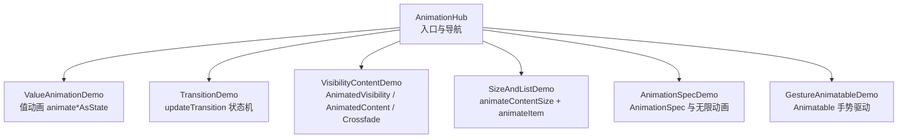
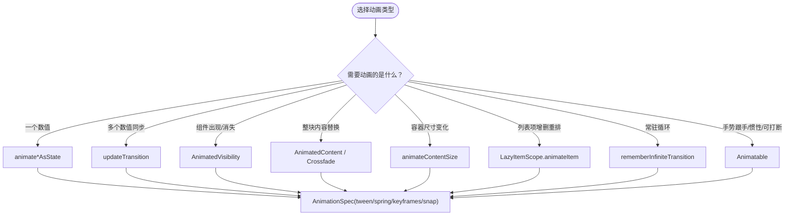
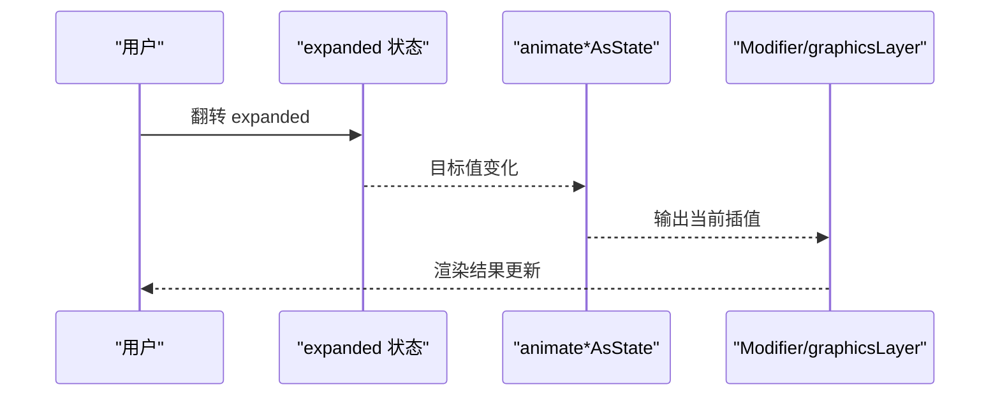
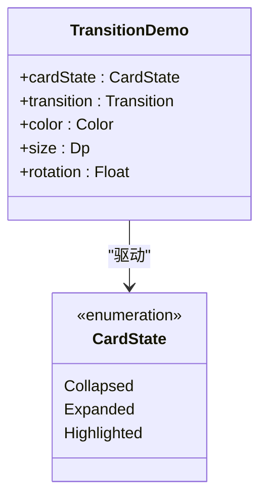
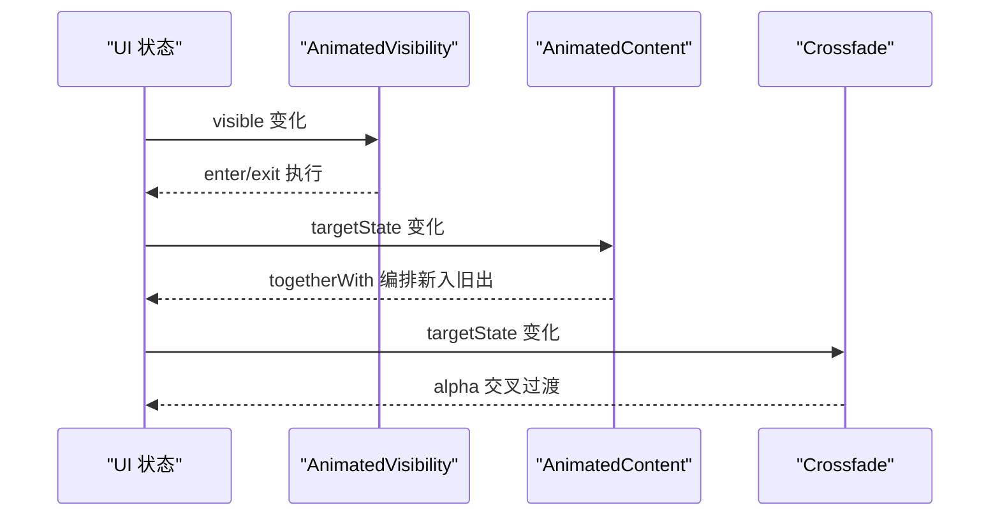
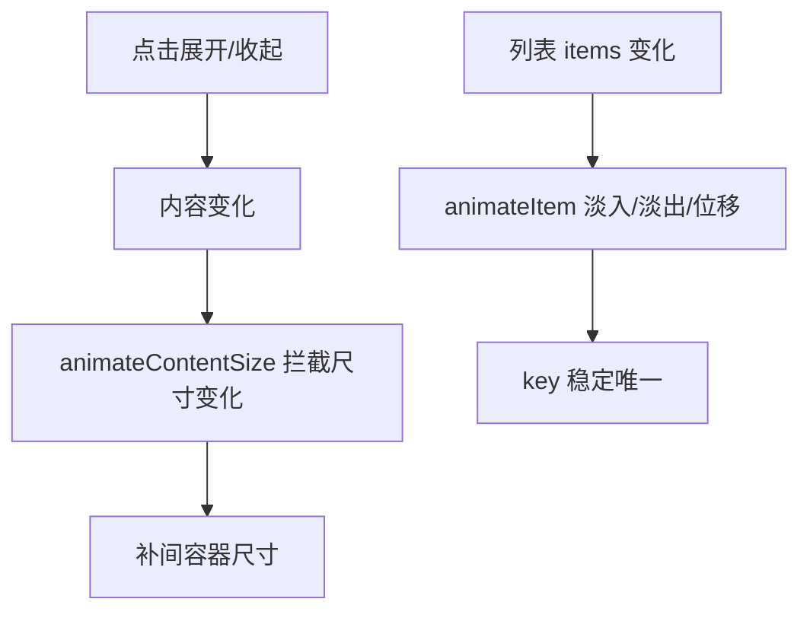
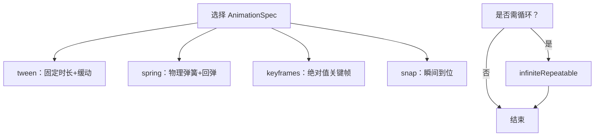
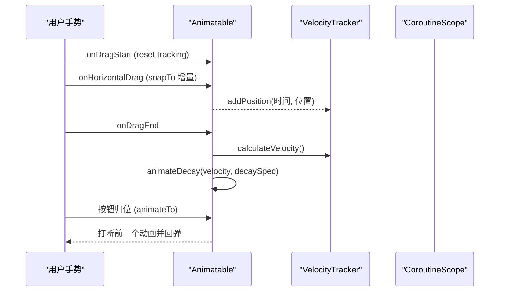
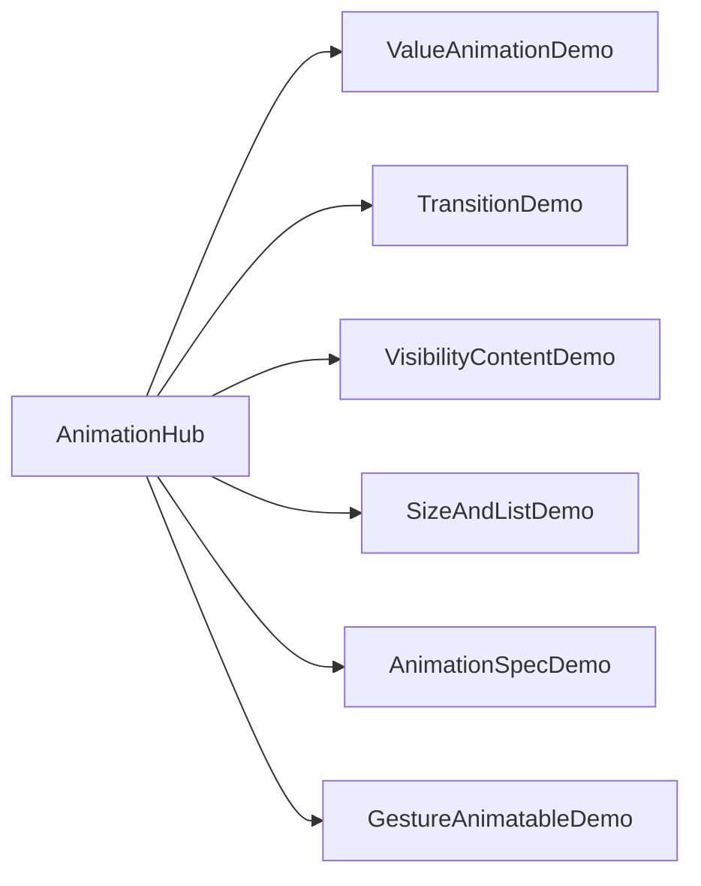

# 动画系统

<cite>
**本文引用的文件**   
- [README.md](file://app/src/main/java/com/example/composeup/animation/README.md)
- [AnimationHub.kt](file://app/src/main/java/com/example/composeup/animation/AnimationHub.kt)
- [ValueAnimationDemo.kt](file://app/src/main/java/com/example/composeup/animation/ValueAnimationDemo.kt)
- [TransitionDemo.kt](file://app/src/main/java/com/example/composeup/animation/TransitionDemo.kt)
- [VisibilityContentDemo.kt](file://app/src/main/java/com/example/composeup/animation/VisibilityContentDemo.kt)
- [SizeAndListDemo.kt](file://app/src/main/java/com/example/composeup/animation/SizeAndListDemo.kt)
- [AnimationSpecDemo.kt](file://app/src/main/java/com/example/composeup/animation/AnimationSpecDemo.kt)
- [GestureAnimatableDemo.kt](file://app/src/main/java/com/example/composeup/animation/GestureAnimatableDemo.kt)
</cite>

## 目录
1. [引言](#引言)
2. [项目结构](#项目结构)
3. [核心组件](#核心组件)
4. [架构总览](#架构总览)
5. [详细组件分析](#详细组件分析)
6. [依赖关系分析](#依赖关系分析)
7. [性能与内存优化](#性能与内存优化)
8. [故障排查指南](#故障排查指南)
9. [结论](#结论)

## 引言
本技术文档围绕 Compose 动画系统，系统化讲解属性动画、过渡动画与手势驱动动画的实现原理与实践方法。文档以仓库中的动画示例为蓝本，覆盖 AnimationSpec 自定义配置、列表项与尺寸变化动画模式、生命周期管理、内存优化与常见问题排查，帮助读者从“心智模型”到“代码落地”完整掌握 Compose 动画。

## 项目结构
动画模块采用“入口导航 + 分场景示例”的组织方式：
- 入口页提供主题列表与二级页面切换，并处理返回逻辑。
- 每个示例聚焦一类动画能力，配合可交互 UI 与说明文本。

图示来源
- [AnimationHub.kt:80-153](file://app/src/main/java/com/example/composeup/animation/AnimationHub.kt#L80-L153)

章节来源
- [AnimationHub.kt:30-153](file://app/src/main/java/com/example/composeup/animation/AnimationHub.kt#L30-L153)
- [README.md:73-86](file://app/src/main/java/com/example/composeup/animation/README.md#L73-L86)

## 核心组件
- 值动画（属性动画）：通过 `animate*AsState` 将目标值的变化平滑补间为当前值，由你负责渲染。
- 过渡动画（组件级）：框架托管组件的进出场与内容替换，你描述“怎么进、怎么出”。
- 手势驱动动画：使用 `Animatable` 实现跟手、惯性、可打断的底层动画控制。
- 规格（AnimationSpec）：决定“怎么动”，包括 tween/spring/keyframes/snap 以及 repeatable/infiniteRepeatable。
- 尺寸与列表动画：`animateContentSize` 自动补间容器尺寸；`LazyItemScope.animateItem` 为列表项增删重排提供淡入淡出与位移过渡。

章节来源
- [README.md:42-60](file://app/src/main/java/com/example/composeup/animation/README.md#L42-L60)
- [README.md:218-296](file://app/src/main/java/com/example/composeup/animation/README.md#L218-L296)

## 架构总览
Compose 动画可按“谁持有动画状态”分为三层，叠加 AnimationSpec 决定节奏：
- 值动画层：暴露 State 供读取，适合颜色/尺寸/透明度/旋转等。
- 组件级 API 层：托管 Composable 的进出场/尺寸/增删，适合显示隐藏、换页、列表增删、展开收起。
- 底层手势动画层：手动接管手势、速度与边界，适合拖拽、惯性 fling、滑动关闭、可打断动画。

图示来源
- [README.md:299-314](file://app/src/main/java/com/example/composeup/animation/README.md#L299-L314)

## 详细组件分析

### 值动画：animate*AsState 家族
- 设计要点
  - 用一个布尔状态同时驱动多个属性动画，各自独立补间。
  - 尺寸/圆角/颜色直接改 Modifier；旋转/透明度/位移走 graphicsLayer 或 offset lambda，避免重组与重测量。
  - 针对数据类型选择专用 API，内置可见性阈值，提升性能。
- 关键流程
  - 目标值变化 → 插值计算 → 在绘制阶段应用变换 → 稳定帧率。

图示来源
- [ValueAnimationDemo.kt:59-163](file://app/src/main/java/com/example/composeup/animation/ValueAnimationDemo.kt#L59-L163)

章节来源
- [ValueAnimationDemo.kt:35-163](file://app/src/main/java/com/example/composeup/animation/ValueAnimationDemo.kt#L35-L163)
- [README.md:92-113](file://app/src/main/java/com/example/composeup/animation/README.md#L92-L113)

### 过渡动画：updateTransition 状态机
- 设计要点
  - 一次状态切换驱动一组同步动画，保证节奏一致。
  - transitionSpec 支持分段定制（不同状态间用不同 spec）。
  - 可观测 currentState/targetState/isRunning，用于禁用交互或显示加载。
- 典型用法
  - 枚举状态机 → updateTransition → 子动画映射 state→value。

图示来源
- [TransitionDemo.kt:32-157](file://app/src/main/java/com/example/composeup/animation/TransitionDemo.kt#L32-L157)

章节来源
- [TransitionDemo.kt:32-157](file://app/src/main/java/com/example/composeup/animation/TransitionDemo.kt#L32-L157)
- [README.md:114-141](file://app/src/main/java/com/example/composeup/animation/README.md#L114-L141)

### 组件级过渡：AnimatedVisibility / AnimatedContent / Crossfade
- 设计要点
  - AnimatedVisibility：单个组件的显示/隐藏带过渡，enter/exit 组合原子过渡。
  - AnimatedContent：状态变化时整块内容替换，transitionSpec 用 togetherWith 编排新旧内容。
  - Crossfade：多屏之间交叉淡入淡出，仅 alpha 过渡。
- 重要区分
  - slide/scale 只影响绘制，不改变布局尺寸；expand/shrink 会改变布局尺寸并顶开邻居。

图示来源
- [VisibilityContentDemo.kt:87-240](file://app/src/main/java/com/example/composeup/animation/VisibilityContentDemo.kt#L87-L240)

章节来源
- [VisibilityContentDemo.kt:71-240](file://app/src/main/java/com/example/composeup/animation/VisibilityContentDemo.kt#L71-L240)
- [README.md:142-180](file://app/src/main/java/com/example/composeup/animation/README.md#L142-L180)

### 尺寸与列表动画：animateContentSize + LazyItemScope.animateItem
- 设计要点
  - animateContentSize：内容变多/变少时自动补间容器尺寸，适合展开卡片。
  - animateItem：列表项新增淡入、删除淡出、位置移动补间，必须提供稳定且唯一的 key。
- 注意事项
  - 不要把 LazyColumn 放进纵向 verticalScroll 的 Column（无限高度约束会抛异常）。
  - 使用 weight(1f) 给列表确定高度，避免嵌套滚动问题。

图示来源
- [SizeAndListDemo.kt:49-162](file://app/src/main/java/com/example/composeup/animation/SizeAndListDemo.kt#L49-L162)

章节来源
- [SizeAndListDemo.kt:34-162](file://app/src/main/java/com/example/composeup/animation/SizeAndListDemo.kt#L34-L162)
- [README.md:181-217](file://app/src/main/java/com/example/composeup/animation/README.md#L181-L217)

### AnimationSpec 自定义动画与最佳实践
- 四种有限规格
  - tween：固定时长 + 缓动曲线，最直观。
  - spring：物理弹簧，无固定时长，可回弹，适合跟手与可打断。
  - keyframes：绝对值关键帧编排，适合精确时序。
  - snap：瞬间到位，等同于“没有动画”。
- 缓动曲线
  - LinearEasing、FastOutSlowInEasing、LinearOutSlowInEasing、FastOutLinearInEasing。
- 无限动画
  - rememberInfiniteTransition + infiniteRepeatable，常驻循环，离开组合自动停止。
  - RepeatMode.Restart 每轮从头开始；Reverse 每轮反向播放。

图示来源
- [AnimationSpecDemo.kt:51-245](file://app/src/main/java/com/example/composeup/animation/AnimationSpecDemo.kt#L51-L245)

章节来源
- [AnimationSpecDemo.kt:51-245](file://app/src/main/java/com/example/composeup/animation/AnimationSpecDemo.kt#L51-L245)
- [README.md:218-252](file://app/src/main/java/com/example/composeup/animation/README.md#L218-L252)

### 手势驱动动画：Animatable
- 设计要点
  - 跟手：拖动中逐帧调用 snapTo，值等于手指位移增量。
  - 惯性：onDragEnd 用 VelocityTracker 获取速度，animateDecay 做衰减滑动。
  - 可打断：后发起的 animateTo/animateDecay 自动取消前一个动画（互斥锁机制）。
  - 边界：updateBounds 让值、目标、惯性都限制在区间内。
- 渲染建议
  - 使用 offset 的 lambda 版本，每帧只在布局阶段读取，不触发重组。

图示来源
- [GestureAnimatableDemo.kt:66-209](file://app/src/main/java/com/example/composeup/animation/GestureAnimatableDemo.kt#L66-L209)

章节来源
- [GestureAnimatableDemo.kt:43-209](file://app/src/main/java/com/example/composeup/animation/GestureAnimatableDemo.kt#L43-L209)
- [README.md:253-296](file://app/src/main/java/com/example/composeup/animation/README.md#L253-L296)

## 依赖关系分析
- 入口依赖各示例 Composable，按主题分发到具体演示页面。
- 示例之间相对独立，复用包内小组件（如 DemoNote/DemoButtonRow），降低耦合。
- 动画相关依赖集中在 animation-core 与 animation 库，示例遵循最新 API 约定（如 label 必填、animateItemPlacement 改名等）。

图示来源
- [AnimationHub.kt:80-153](file://app/src/main/java/com/example/composeup/animation/AnimationHub.kt#L80-L153)

章节来源
- [AnimationHub.kt:30-153](file://app/src/main/java/com/example/composeup/animation/AnimationHub.kt#L30-L153)
- [README.md:4-18](file://app/src/main/java/com/example/composeup/animation/README.md#L4-L18)

## 性能与内存优化
- 高频动画尽量走 graphicsLayer 或 offset lambda，避免重组与重测量。
- 使用 animate*AsState 的可见性阈值提前收尾，减少无效计算。
- Animatable、VelocityTracker、connection/dispatcher 等有状态对象务必 remember 复用。
- 列表项动画必须提供稳定且唯一的 key，否则动画失效。
- 无限动画仅在可见时运行，离开组合自动取消，无需手动管理生命周期。
- 避免用 size/padding 做每帧位移，改用 graphicsLayer/offset。

章节来源
- [README.md:61-70](file://app/src/main/java/com/example/composeup/animation/README.md#L61-L70)
- [README.md:318-335](file://app/src/main/java/com/example/composeup/animation/README.md#L318-L335)

## 故障排查指南
- 编译期问题
  - rememberInfiniteTransition / InfiniteTransition.animate* 必须传 label，旧无参重载已隐藏。
  - 列表项动画使用 LazyItemScope.Modifier.animateItem，旧的 animateItemPlacement 已改名。
- 运行时问题
  - 把 LazyColumn 放进纵向 verticalScroll 的 Column 会因无限高度约束抛异常。
  - 未提供稳定 key 导致列表项动画无法识别对应项。
  - 用 animate*AsState 做手势跟手会出现“追不上手指”、无速度、不可无缝打断的问题。
- 解决方案
  - 为所有无限动画 API 传入 label。
  - 使用 animateItem 并为每项提供稳定 key。
  - 手势动画统一使用 Animatable：snapTo 跟手、animateDecay 惯性、animateTo 归位、updateBounds 限幅。
  - 高频位移/缩放/旋转/透明度走 graphicsLayer/offset lambda。

章节来源
- [README.md:14-18](file://app/src/main/java/com/example/composeup/animation/README.md#L14-L18)
- [README.md:214-217](file://app/src/main/java/com/example/composeup/animation/README.md#L214-L217)
- [README.md:318-335](file://app/src/main/java/com/example/composeup/animation/README.md#L318-L335)

## 结论
本仓库的动画示例以清晰的心智模型和分层 API 为主线，覆盖了从值动画、组件级过渡到手势驱动动画的全景。通过 AnimationSpec 的灵活配置与正确的渲染路径（graphicsLayer/offset），可以在保证流畅体验的同时兼顾性能与内存效率。遵循本文的实践清单与排查建议，可在实际项目中快速构建高质量、可维护的 Compose 动画。