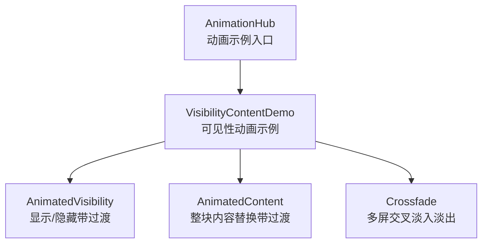
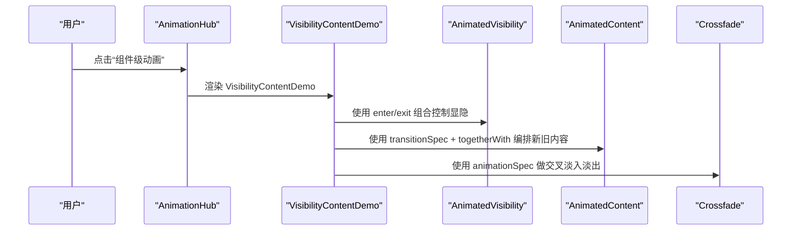
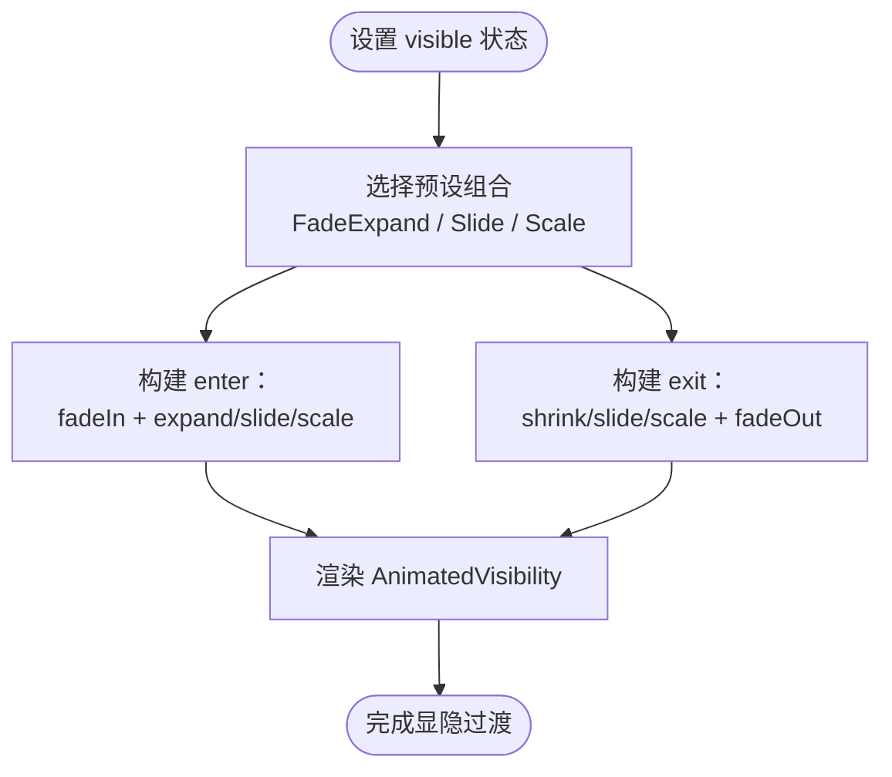
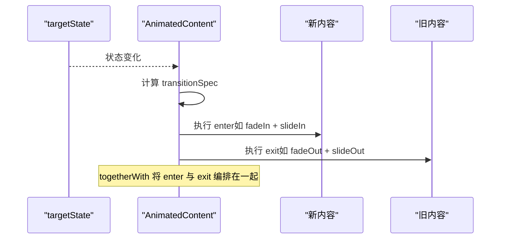
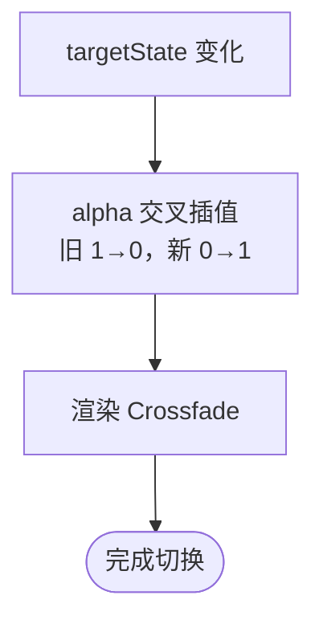
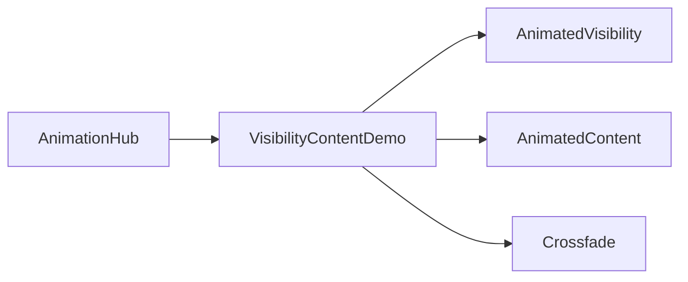

# 可见性动画 AnimatedVisibility

<cite>
**本文引用的文件**   
- [VisibilityContentDemo.kt](file://app/src/main/java/com/example/composeup/animation/VisibilityContentDemo.kt)
- [AnimationHub.kt](file://app/src/main/java/com/example/composeup/animation/AnimationHub.kt)
- [README.md](file://app/src/main/java/com/example/composeup/animation/README.md)
</cite>

## 目录
1. [引言](#引言)
2. [项目结构](#项目结构)
3. [核心组件](#核心组件)
4. [架构总览](#架构总览)
5. [详细组件分析](#详细组件分析)
6. [依赖关系分析](#依赖关系分析)
7. [性能与优化建议](#性能与优化建议)
8. [故障排查指南](#故障排查指南)
9. [结论](#结论)
10. [附录：参数速查与示例路径](#附录参数速查与示例路径)

## 引言
本技术文档聚焦 Compose 可见性动画能力，围绕以下三个关键组件展开：AnimatedVisibility、AnimatedContent、Crossfade。我们将解释它们的适用场景与差异，梳理 enter 与 exit 动画的组合方式（fadeIn、slideIn、expandIn 等），并重点说明 AnimatedContent 中 togetherWith 的过渡编排语义。同时提供可运行的示例定位与配置参数说明，以及面向实际项目的性能优化建议。

## 项目结构
动画示例位于 animation 包下，入口为 AnimationHub，具体可见性动画演示在 VisibilityContentDemo 中实现；README 提供了整体心智模型与选型指引。

**图表来源**
- [AnimationHub.kt:30-72](file://app/src/main/java/com/example/composeup/animation/AnimationHub.kt#L30-L72)
- [AnimationHub.kt:144-151](file://app/src/main/java/com/example/composeup/animation/AnimationHub.kt#L144-L151)
- [VisibilityContentDemo.kt:87-98](file://app/src/main/java/com/example/composeup/animation/VisibilityContentDemo.kt#L87-L98)

**章节来源**
- [AnimationHub.kt:30-72](file://app/src/main/java/com/example/composeup/animation/AnimationHub.kt#L30-L72)
- [AnimationHub.kt:144-151](file://app/src/main/java/com/example/composeup/animation/AnimationHub.kt#L144-L151)
- [VisibilityContentDemo.kt:87-98](file://app/src/main/java/com/example/composeup/animation/VisibilityContentDemo.kt#L87-L98)

## 核心组件
- AnimatedVisibility：用于单个组件的“出现/消失”带过渡。通过 enter 与 exit 组合原子过渡（如 fadeIn + expandVertically）控制进出场。
- AnimatedContent：当 targetState 变化时，用 transitionSpec 描述新旧内容的过渡编排，常用 togetherWith 将“新内容进”和“旧内容出”组合在一起。
- Crossfade：AnimatedContent 的简化版，仅做 alpha 交叉淡入淡出，适合底部导航切换等不需要位移的场景。

三者的共同点是：进出场由若干“原子过渡”通过 + 组合而成，包括 fadeIn/fadeOut、slideIn/slideOut*、expand/shrink*、scaleIn/scaleOut。其中 slide/scale 只影响绘制阶段，不改变布局尺寸；expand/shrink 会真正改变布局尺寸并推动邻居。

**章节来源**
- [VisibilityContentDemo.kt:71-86](file://app/src/main/java/com/example/composeup/animation/VisibilityContentDemo.kt#L71-L86)
- [README.md:142-179](file://app/src/main/java/com/example/composeup/animation/README.md#L142-L179)

## 架构总览
从调用链看，AnimationHub 作为入口，根据用户选择渲染对应示例页面；VisibilityContentDemo 内部再分别展示 AnimatedVisibility、AnimatedContent、Crossfade 的典型用法。

**图表来源**
- [AnimationHub.kt:144-151](file://app/src/main/java/com/example/composeup/animation/AnimationHub.kt#L144-L151)
- [VisibilityContentDemo.kt:87-98](file://app/src/main/java/com/example/composeup/animation/VisibilityContentDemo.kt#L87-L98)

## 详细组件分析

### AnimatedVisibility：显示/隐藏带过渡
- 适用场景：一个 UI 块的显示或隐藏需要平滑过渡，例如展开一段说明文字、弹出提示条等。
- 关键参数：
  - visible：布尔状态，决定是否显示。
  - enter：EnterTransition，描述进入动画，可由多个原子过渡通过 + 组合。
  - exit：ExitTransition，描述退出动画，同样支持组合。
- 常见组合：
  - 淡入 + 垂直展开：fadeIn + expandVertically；退出时用 shrinkVertically + fadeOut。
  - 横向滑入/滑出：slideInHorizontally + fadeIn；slideOutHorizontally + fadeOut。
  - 缩放淡入：scaleIn(initialScale = ...) + fadeIn；scaleOut + fadeOut。
- 行为差异：
  - expand/shrink 会改变布局尺寸，推动下方内容。
  - slide/scale 只影响绘制，不改变父容器尺寸，适合工具条、Snackbar、抽屉等。

**图表来源**
- [VisibilityContentDemo.kt:102-151](file://app/src/main/java/com/example/composeup/animation/VisibilityContentDemo.kt#L102-L151)

**章节来源**
- [VisibilityContentDemo.kt:43-60](file://app/src/main/java/com/example/composeup/animation/VisibilityContentDemo.kt#L43-L60)
- [VisibilityContentDemo.kt:102-151](file://app/src/main/java/com/example/composeup/animation/VisibilityContentDemo.kt#L102-L151)

### AnimatedContent：整块内容替换与过渡编排
- 适用场景：当某个状态变化导致整块内容需要替换时，使用 AnimatedContent 进行过渡，比如 Tab 页切换、不同数据视图切换。
- 关键参数：
  - targetState：驱动内容变化的目标状态。
  - transitionSpec：返回 ContentTransform，描述新旧内容的过渡编排。
  - label：调试标识。
- togetherWith 的作用：
  - 将“新内容怎么进”与“旧内容怎么出”组合成一个完整的过渡策略。
  - 典型模式：新内容 fadeIn + slideInVertically，旧内容 fadeOut + slideOutVertically，形成连贯翻页感。
- 注意：
  - 如果只需要简单的交叉淡入淡出，优先考虑 Crossfade，避免不必要的位移开销。

**图表来源**
- [VisibilityContentDemo.kt:155-198](file://app/src/main/java/com/example/composeup/animation/VisibilityContentDemo.kt#L155-L198)

**章节来源**
- [VisibilityContentDemo.kt:155-198](file://app/src/main/java/com/example/composeup/animation/VisibilityContentDemo.kt#L155-L198)
- [README.md:167-179](file://app/src/main/java/com/example/composeup/animation/README.md#L167-L179)

### Crossfade：多屏之间交叉淡入淡出
- 适用场景：底部导航切页、简单视图切换，不需要位移或复杂过渡。
- 关键参数：
  - targetState：驱动切换的状态。
  - animationSpec：Alpha 动画规格（默认 tween）。
  - label：调试标识。
- 特点：
  - 同一时刻新旧两屏叠加，旧的 alpha 从 1→0，新的从 0→1。
  - 相比 AnimatedContent，更轻量，适合只做淡入淡出的场景。

**图表来源**
- [VisibilityContentDemo.kt:202-239](file://app/src/main/java/com/example/composeup/animation/VisibilityContentDemo.kt#L202-L239)

**章节来源**
- [VisibilityContentDemo.kt:202-239](file://app/src/main/java/com/example/composeup/animation/VisibilityContentDemo.kt#L202-L239)
- [README.md:146-150](file://app/src/main/java/com/example/composeup/animation/README.md#L146-L150)

## 依赖关系分析
- AnimationHub 负责导航到具体示例页面，VisibilityContentDemo 是可见性动画的具体实现。
- VisibilityContentDemo 内部依赖 Compose Animation API（AnimatedVisibility、AnimatedContent、Crossfade）以及基础布局与 Material3 组件。

**图表来源**
- [AnimationHub.kt:144-151](file://app/src/main/java/com/example/composeup/animation/AnimationHub.kt#L144-L151)
- [VisibilityContentDemo.kt:87-98](file://app/src/main/java/com/example/composeup/animation/VisibilityContentDemo.kt#L87-L98)

**章节来源**
- [AnimationHub.kt:144-151](file://app/src/main/java/com/example/composeup/animation/AnimationHub.kt#L144-L151)
- [VisibilityContentDemo.kt:87-98](file://app/src/main/java/com/example/composeup/animation/VisibilityContentDemo.kt#L87-L98)

## 性能与优化建议
- 优先使用绘制阶段属性：
  - slide/scale 只影响绘制，不改变布局尺寸，适合频繁出现的过渡效果。
  - expand/shrink 会改变布局尺寸并推动邻居，谨慎使用以避免重排。
- 高频变化的位移/缩放/旋转/透明度尽量走 graphicsLayer 或 offset lambda，避免触发重新测量与布局。
- 合理选择组件：
  - 仅需淡入淡出 → Crossfade。
  - 需要复杂过渡编排 → AnimatedContent + togetherWith。
  - 单组件显隐 → AnimatedVisibility。
- 动画时长与延迟：
  - 短促反馈（如按钮）使用较短 duration 与较小 delay。
  - 页面级切换可使用稍长 duration，配合延迟让视觉层次更清晰。
- 列表项动画：
  - 使用 LazyItemScope.Modifier.animateItem，并确保每个 item 提供稳定且唯一的 key，否则动画可能失效。

**章节来源**
- [README.md:61-70](file://app/src/main/java/com/example/composeup/animation/README.md#L61-L70)
- [README.md:179-180](file://app/src/main/java/com/example/composeup/animation/README.md#L179-L180)
- [README.md:199-216](file://app/src/main/java/com/example/composeup/animation/README.md#L199-L216)

## 故障排查指南
- 动画不生效：
  - 检查是否给 rememberInfiniteTransition 或 InfiniteTransition.animate* 传了 label（新版本要求 label）。
  - 确保 LazyColumn 的 items 提供了稳定的 key，否则 animateItem 无法正确匹配移动后的项。
- 动画卡顿：
  - 避免每帧修改 size/padding/shape，改用 graphicsLayer/offset lambda。
  - 减少不必要的重组与重测量，必要时拆分组件或使用 remember 缓存有状态对象。
- 手势相关：
  - 高频跟手动画应使用 Animatable（snapTo/animateTo/animateDecay），不要用 animate*AsState 做跟手。
  - 使用 VelocityTracker 记录拖动速度，并在 onDragEnd 时进行惯性滑动。

**章节来源**
- [README.md:318-335](file://app/src/main/java/com/example/composeup/animation/README.md#L318-L335)

## 结论
- AnimatedVisibility 适用于单组件的显隐过渡，enter/exit 可通过多种原子过渡组合实现丰富效果。
- AnimatedContent 适用于整块内容替换，togetherWith 能精准编排新旧内容的过渡节奏。
- Crossfade 是最简化的交叉淡入淡出方案，适合不需要位移的场景。
- 在实际项目中，应根据交互需求选择合适的组件与动画规格，遵循绘制阶段优化的原则，保证流畅的用户体验。

## 附录：参数速查与示例路径
- AnimatedVisibility
  - 关键参数：visible、enter、exit
  - 示例路径：[VisibilityContentDemo.kt:102-151](file://app/src/main/java/com/example/composeup/animation/VisibilityContentDemo.kt#L102-L151)
- AnimatedContent
  - 关键参数：targetState、transitionSpec、label
  - togetherWith 用法：将“新内容进”与“旧内容出”组合编排
  - 示例路径：[VisibilityContentDemo.kt:155-198](file://app/src/main/java/com/example/composeup/animation/VisibilityContentDemo.kt#L155-L198)
- Crossfade
  - 关键参数：targetState、animationSpec、label
  - 示例路径：[VisibilityContentDemo.kt:202-239](file://app/src/main/java/com/example/composeup/animation/VisibilityContentDemo.kt#L202-L239)
- 原子过渡与行为差异
  - fadeIn/fadeOut、slideIn/slideOut*、expand/shrink*、scaleIn/scaleOut
  - slide/scale 不影响布局尺寸；expand/shrink 改变布局尺寸
  - 参考说明：[README.md:142-179](file://app/src/main/java/com/example/composeup/animation/README.md#L142-L179)