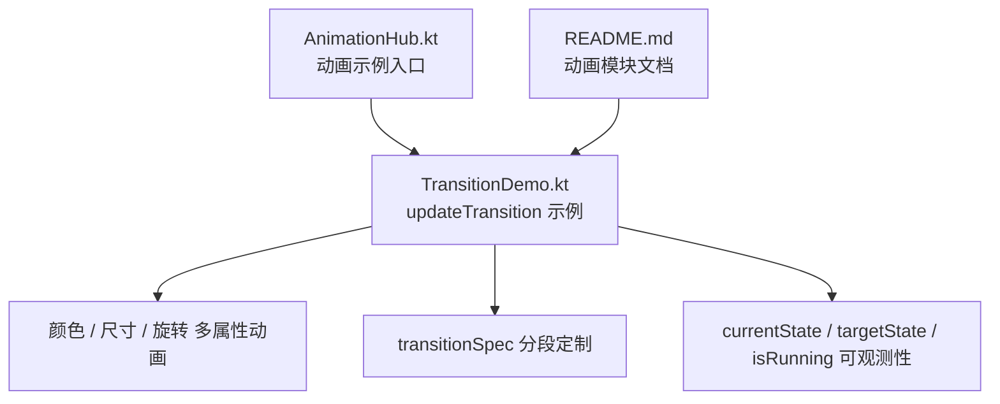
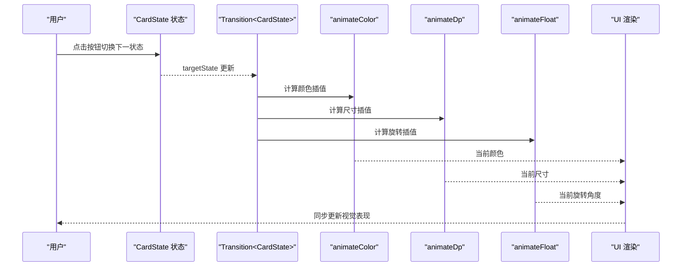
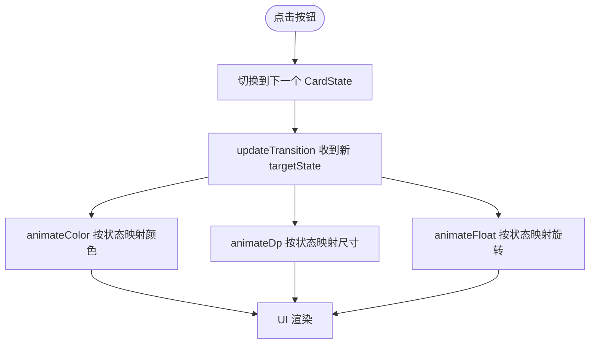
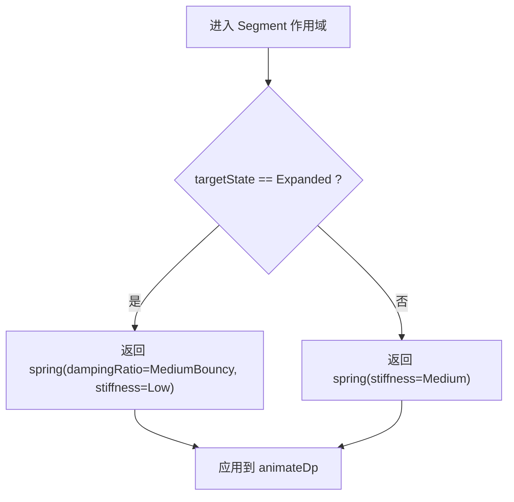
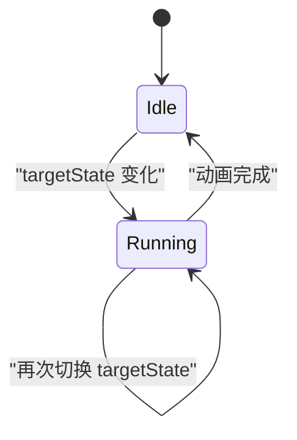
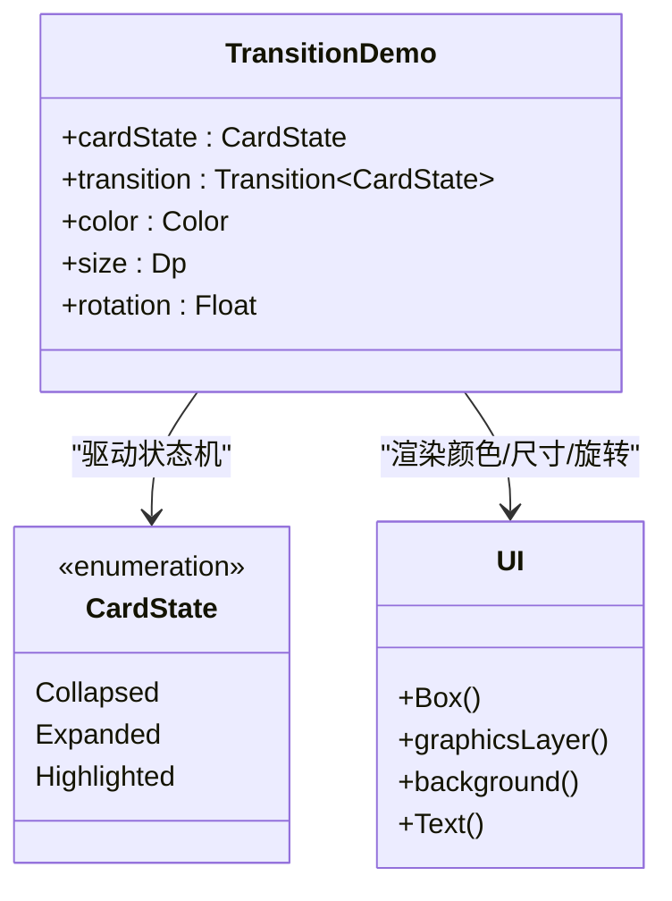
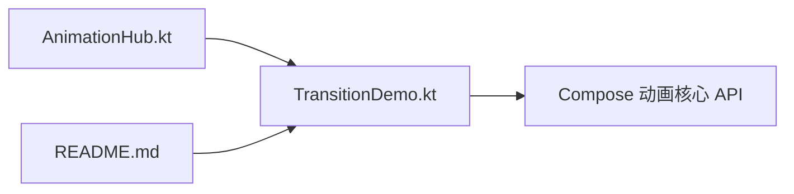

# 过渡动画 updateTransition

<cite>
**本文引用的文件**   
- [TransitionDemo.kt](file://app/src/main/java/com/example/composeup/animation/TransitionDemo.kt)
- [README.md](file://app/src/main/java/com/example/composeup/animation/README.md)
- [AnimationHub.kt](file://app/src/main/java/com/example/composeup/animation/AnimationHub.kt)
</cite>

## 目录
1. [引言](#引言)
2. [项目结构](#项目结构)
3. [核心组件](#核心组件)
4. [架构总览](#架构总览)
5. [详细组件分析](#详细组件分析)
6. [依赖关系分析](#依赖关系分析)
7. [性能与优化](#性能与优化)
8. [故障排查](#故障排查)
9. [结论](#结论)
10. [附录：API 速查](#附录api-速查)

## 引言
本文围绕 Compose 过渡动画系统中的 `updateTransition` API，结合仓库中的示例代码，系统讲解如何用状态机（枚举）统一驱动多个动画值，保证颜色、尺寸、旋转等多属性动画的同步性与一致性；并深入说明 `transitionSpec` 的配置与自定义方法，以及 `currentState`、`targetState`、`isRunning` 等状态属性的使用方式。文末提供编排与性能优化的最佳实践，帮助你在复杂 UI 中稳定地实现高质量动画体验。

## 项目结构
本项目的动画模块位于 `app/src/main/java/com/example/composeup/animation`，其中与 `updateTransition` 直接相关的核心文件如下：
- `TransitionDemo.kt`：演示用 `updateTransition` 建立状态机，驱动颜色、尺寸、旋转等多个子动画，并展示 `transitionSpec` 分段定制与可观测性。
- `README.md`：动画模块的整体心智模型、选型指南与实践清单，包含对 `updateTransition` 的对比与定位。
- `AnimationHub.kt`：动画示例入口，将 `TransitionDemo` 作为“一次状态变化驱动多个值”的专题示例呈现。

**图表来源**
- [AnimationHub.kt:42-47](file://app/src/main/java/com/example/composeup/animation/AnimationHub.kt#L42-L47)
- [TransitionDemo.kt:32-53](file://app/src/main/java/com/example/composeup/animation/TransitionDemo.kt#L32-L53)

**章节来源**
- [AnimationHub.kt:30-72](file://app/src/main/java/com/example/composeup/animation/AnimationHub.kt#L30-L72)
- [README.md:73-86](file://app/src/main/java/com/example/composeup/animation/README.md#L73-L86)

## 核心组件
本节聚焦 `updateTransition` 在示例中的关键用法与能力：
- 状态机定义：通过枚举 `CardState` 描述卡片的状态集合（收起、展开、高亮）。
- 创建 Transition：调用 `updateTransition(targetState = cardState, label = "cardTransition")` 建立状态机实例。
- 子动画挂载：在 Transition 上分别挂接 `animateColor`、`animateDp`、`animateFloat`，每个子动画只需声明「某个状态 → 某个值」的映射。
- 分段定制：通过 `transitionSpec` 针对不同目标状态或方向配置不同的补间规格（如进入 Expanded 使用回弹 spring，其余使用 tween）。
- 可观测性：读取 `transition.currentState`、`transition.targetState`、`transition.isRunning`，用于禁用交互、显示加载态等。

这些能力共同构成“一次状态切换，驱动一组同步动画”的心智模型，避免多个独立 `animate*AsState` 各自为政导致的节奏不一致问题。

**章节来源**
- [TransitionDemo.kt:32-53](file://app/src/main/java/com/example/composeup/animation/TransitionDemo.kt#L32-L53)
- [TransitionDemo.kt:55-104](file://app/src/main/java/com/example/composeup/animation/TransitionDemo.kt#L55-L104)
- [TransitionDemo.kt:139-144](file://app/src/main/java/com/example/composeup/animation/TransitionDemo.kt#L139-L144)

## 架构总览
下图展示了 `updateTransition` 在示例中的整体流程：用户操作改变状态 → Transition 驱动所有子动画 → UI 根据插值结果渲染。

**图表来源**
- [TransitionDemo.kt:55-104](file://app/src/main/java/com/example/composeup/animation/TransitionDemo.kt#L55-L104)
- [TransitionDemo.kt:122-137](file://app/src/main/java/com/example/composeup/animation/TransitionDemo.kt#L122-L137)

## 详细组件分析

### 状态机与多属性动画
- 状态机类型：`CardState` 枚举定义了三个状态（Collapsed、Expanded、Highlighted），作为 Transition 的目标状态空间。
- 状态驱动：每次点击按钮循环切换下一个状态，从而触发 Transition 重新计算所有子动画。
- 多属性映射：
  - 颜色：在不同状态下映射到不同的主题色。
  - 尺寸：在不同状态下映射到不同的 dp 值。
  - 旋转：在不同状态下映射到不同的角度（Float）。

这种设计确保一个状态切换同时影响多个属性，且由同一个 Transition 统一管理生命周期与节奏。

**图表来源**
- [TransitionDemo.kt:55-104](file://app/src/main/java/com/example/composeup/animation/TransitionDemo.kt#L55-L104)
- [TransitionDemo.kt:115-120](file://app/src/main/java/com/example/composeup/animation/TransitionDemo.kt#L115-L120)

**章节来源**
- [TransitionDemo.kt:32-53](file://app/src/main/java/com/example/composeup/animation/TransitionDemo.kt#L32-L53)
- [TransitionDemo.kt:55-104](file://app/src/main/java/com/example/composeup/animation/TransitionDemo.kt#L55-L104)

### transitionSpec 的配置与自定义
`transitionSpec` 允许你针对「从哪个状态到哪个状态」选择不同 AnimationSpec，从而实现分段定制：
- 颜色：当目标状态是 Highlighted 时使用更快的 tween，其他情况使用默认 tween。
- 尺寸：当目标状态是 Expanded 时使用带回弹的 spring，其他情况使用普通 spring。
- 旋转：统一使用 tween。

这体现了 Transition 的优势之一：不仅同步，还能针对不同目标状态进行差异化节奏控制。

**图表来源**
- [TransitionDemo.kt:76-92](file://app/src/main/java/com/example/composeup/animation/TransitionDemo.kt#L76-L92)

**章节来源**
- [TransitionDemo.kt:61-74](file://app/src/main/java/com/example/composeup/animation/TransitionDemo.kt#L61-L74)
- [TransitionDemo.kt:76-92](file://app/src/main/java/com/example/composeup/animation/TransitionDemo.kt#L76-L92)
- [TransitionDemo.kt:94-104](file://app/src/main/java/com/example/composeup/animation/TransitionDemo.kt#L94-L104)

### currentState、targetState、isRunning 的可观测性
Transition 暴露以下状态属性：
- `currentState`：当前动画所处的状态。
- `targetState`：动画的目标状态。
- `isRunning`：动画是否正在运行。

这些属性可用于：
- 在动画进行中禁用交互（例如按钮）。
- 显示加载指示器或遮罩。
- 调试与日志输出，辅助定位动画时序问题。

**图表来源**
- [TransitionDemo.kt:139-144](file://app/src/main/java/com/example/composeup/animation/TransitionDemo.kt#L139-L144)

**章节来源**
- [TransitionDemo.kt:139-144](file://app/src/main/java/com/example/composeup/animation/TransitionDemo.kt#L139-L144)

### 多属性动画示例（颜色、尺寸、旋转）
示例展示了如何在一个 Transition 下同时驱动：
- 颜色：基于主题色的三态映射。
- 尺寸：基于 dp 的三态映射，并在进入 Expanded 时采用回弹弹簧。
- 旋转：基于 Float 的三态映射，统一使用 tween。

这些属性最终被应用到 UI 元素上，形成统一的视觉过渡效果。

**图表来源**
- [TransitionDemo.kt:32-53](file://app/src/main/java/com/example/composeup/animation/TransitionDemo.kt#L32-L53)
- [TransitionDemo.kt:122-137](file://app/src/main/java/com/example/composeup/animation/TransitionDemo.kt#L122-L137)

**章节来源**
- [TransitionDemo.kt:55-104](file://app/src/main/java/com/example/composeup/animation/TransitionDemo.kt#L55-L104)
- [TransitionDemo.kt:122-137](file://app/src/main/java/com/example/composeup/animation/TransitionDemo.kt#L122-L137)

## 依赖关系分析
- `TransitionDemo.kt` 依赖 Compose 动画核心 API（`updateTransition`、`animateColor`、`animateDp`、`animateFloat`、`spring`、`tween`）。
- `AnimationHub.kt` 作为入口，将 `TransitionDemo` 作为专题示例展示，强调其“一次状态变化驱动多个值”的能力。
- `README.md` 提供动画模块的心智模型与选型建议，指出 `updateTransition` 适用于“一个状态切换牵动 3+ 个属性且要求节奏一致/分段/观测”的场景。

**图表来源**
- [AnimationHub.kt:42-47](file://app/src/main/java/com/example/composeup/animation/AnimationHub.kt#L42-L47)
- [README.md:114-141](file://app/src/main/java/com/example/composeup/animation/README.md#L114-L141)

**章节来源**
- [AnimationHub.kt:42-47](file://app/src/main/java/com/example/composeup/animation/AnimationHub.kt#L42-L47)
- [README.md:114-141](file://app/src/main/java/com/example/composeup/animation/README.md#L114-L141)

## 性能与优化
- 高频变化的位移/缩放/旋转/透明度尽量走 `Modifier.graphicsLayer { }` 或 `Modifier.offset { }` 的 lambda 版本，避免触发重测量与重组。
- 对于布局尺寸变化（如 size/padding/shape），应谨慎使用，因为它们会触发测量与布局阶段的重算。
- 在 Transition 中，优先使用 `transitionSpec` 选择合适的 AnimationSpec（如 spring 用于跟手与弹性，tween 用于固定时长动画）。
- 合理使用 `label` 参数，便于在 Android Studio 动画检查器中区分不同 Transition 与子动画，提升调试效率。
- 列表项动画使用 `LazyItemScope.Modifier.animateItem()`，并确保提供稳定唯一的 `key`，以保证增删重排动画的正确性。

**章节来源**
- [README.md:61-70](file://app/src/main/java/com/example/composeup/animation/README.md#L61-L70)
- [README.md:199-216](file://app/src/main/java/com/example/composeup/animation/README.md#L199-L216)
- [README.md:318-335](file://app/src/main/java/com/example/composeup/animation/README.md#L318-L335)

## 故障排查
- 动画不生效：确认是否为 `rememberInfiniteTransition` 或 `InfiniteTransition.animate*` 缺少 `label` 参数（新版本必须带 label）。
- 列表动画异常：检查是否在 `LazyColumn` 中为每个 item 提供了稳定且唯一的 `key`。
- 手势动画卡顿：避免用 `animate*AsState` 做手势跟手；应使用 `Animatable` 的 `snapTo`/`animateDecay`/`animateTo`。
- 布局抖动：避免每帧修改 `size`/`padding`/`shape` 去做位移，改用 `graphicsLayer`/`offset`。
- 嵌套滚动异常：不要把 `LazyColumn` 放进纵向 `verticalScroll` 的 `Column`，会导致无限高度约束异常。

**章节来源**
- [README.md:14-18](file://app/src/main/java/com/example/composeup/animation/README.md#L14-L18)
- [README.md:214-216](file://app/src/main/java/com/example/composeup/animation/README.md#L214-L216)
- [README.md:253-295](file://app/src/main/java/com/example/composeup/animation/README.md#L253-L295)
- [README.md:318-335](file://app/src/main/java/com/example/composeup/animation/README.md#L318-L335)

## 结论
`updateTransition` 通过状态机统一驱动多个子动画，解决了多属性动画的同步性与一致性难题。借助 `transitionSpec` 的分段定制能力，你可以针对不同目标状态选择最合适的 AnimationSpec；通过 `currentState`、`targetState`、`isRunning` 的可观测性，可以精确控制 UI 行为与交互反馈。在实际项目中，建议遵循 README 中的选型指南与实践清单，结合性能优化策略，构建高质量、可维护的 Compose 动画系统。

## 附录：API 速查
- `updateTransition(targetState, label)`：创建 Transition 实例，驱动多个子动画。
- `Transition.animateColor(label, transitionSpec, targetValueByState)`：颜色动画。
- `Transition.animateDp(label, transitionSpec, targetValueByState)`：尺寸动画。
- `Transition.animateFloat(label, transitionSpec, targetValueByState)`：数值动画（如旋转角度）。
- `transitionSpec`：在 Segment 作用域内访问 `initial`/`target`，返回 FiniteAnimationSpec。
- `currentState`/`targetState`/`isRunning`：Transition 的可观测状态属性。

**章节来源**
- [TransitionDemo.kt:55-104](file://app/src/main/java/com/example/composeup/animation/TransitionDemo.kt#L55-L104)
- [README.md:114-141](file://app/src/main/java/com/example/composeup/animation/README.md#L114-L141)