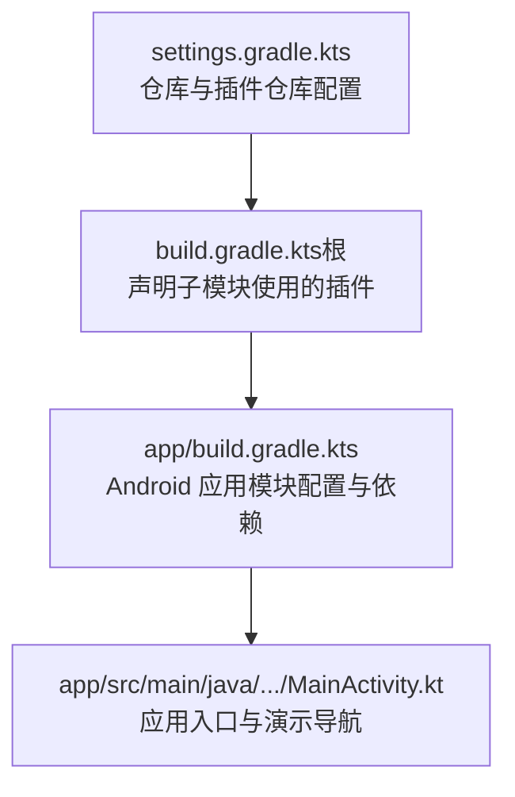
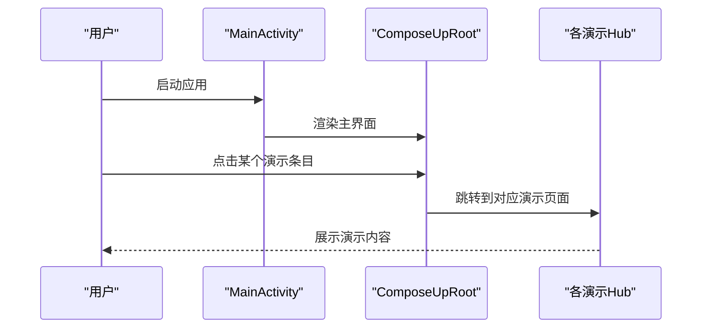

# 快速开始

<cite>
**本文引用的文件**   
- [settings.gradle.kts](file://settings.gradle.kts)
- [gradle.properties](file://gradle.properties)
- [gradle/libs.versions.toml](file://gradle/libs.versions.toml)
- [build.gradle.kts（项目根）](file://build.gradle.kts)
- [app/build.gradle.kts](file://app/build.gradle.kts)
- [MainActivity.kt](file://app/src/main/java/com/example/composeup/MainActivity.kt)
</cite>

## 目录
1. [简介](#简介)
2. [环境要求](#环境要求)
3. [安装与克隆](#安装与克隆)
4. [构建与运行](#构建与运行)
5. [项目结构概览](#项目结构概览)
6. [第一个示例运行](#第一个示例运行)
7. [常见配置问题与解决方案](#常见配置问题与解决方案)
8. [依赖项与版本兼容性说明](#依赖项与版本兼容性说明)
9. [故障排查清单](#故障排查清单)
10. [结语](#结语)

## 简介
ComposeUp 是一个面向 Android 的 Compose 学习示例集合，涵盖动画、Flow、架构分层、DataStore、Room、Navigation 3、WorkManager、CompositionLocal、Remember 等主题。本指南帮助你从零开始准备环境、克隆仓库、构建运行，并快速跑通第一个示例页面。

## 环境要求
- Android Studio：建议使用最新稳定版（内置 Gradle 和 JDK 管理）。
- JDK：Gradle 通过工具链解析器自动获取兼容 JDK；若手动配置，请使用 JDK 11 或更高版本。
- Android SDK：
  - compileSdk/targetSdk：37
  - minSdk：24
- Gradle：由 Gradle Wrapper 管理，无需本地安装特定版本。
- 网络：首次构建需下载依赖，请确保能访问 Google Maven 与 Maven Central。

关键依据：
- 应用模块使用 Android Application 插件与 Kotlin Compose 插件。
- 编译选项指定 Java 11 源与目标版本。
- 模块声明了 compileSdk 与 targetSdk 为 37，minSdk 为 24。

**章节来源**
- [app/build.gradle.kts:1-41](file://app/build.gradle.kts#L1-L41)
- [gradle/libs.versions.toml:1-22](file://gradle/libs.versions.toml#L1-L22)

## 安装与克隆
1. 安装 Android Studio（推荐最新版）。
2. 打开终端，执行以下命令克隆仓库：
   - git clone https://github.com/<你的账号>/ComposeUp.git
   - cd ComposeUp
3. 首次打开项目时，Android Studio 会自动同步 Gradle 并下载依赖。

提示：
- 如果网络较慢，可在 Android Studio 中配置代理或使用国内镜像源。
- 本项目已启用 Gradle 配置缓存以提升后续构建速度。

**章节来源**
- [gradle.properties:14-17](file://gradle.properties#L14-L17)
- [settings.gradle.kts:1-27](file://settings.gradle.kts#L1-L27)

## 构建与运行
- 在 Android Studio 中点击 Run（或按 Shift+F10），选择已连接的模拟器或真机即可运行。
- 命令行方式：
  - ./gradlew :app:assembleDebug
  - ./gradlew :app:installDebug
  - ./gradlew :app:run （需要设备连接）

注意：
- 首次构建会下载依赖，请耐心等待。
- 如需离线构建，请先在有网环境下完成一次完整构建。

**章节来源**
- [settings.gradle.kts:17-23](file://settings.gradle.kts#L17-L23)
- [gradle.properties:7-9](file://gradle.properties#L7-L9)

## 项目结构概览
- 根目录包含 Gradle 配置与多模块入口设置。
- app 模块是唯一的 Android 应用模块，包含所有演示功能。
- MainActivity 作为应用入口，提供主界面与各演示主题的导航入口。

**图表来源**
- [settings.gradle.kts:1-27](file://settings.gradle.kts#L1-L27)
- [build.gradle.kts:1-8](file://build.gradle.kts#L1-L8)
- [app/build.gradle.kts:1-41](file://app/build.gradle.kts#L1-L41)
- [MainActivity.kt:94-104](file://app/src/main/java/com/example/composeup/MainActivity.kt#L94-L104)

**章节来源**
- [settings.gradle.kts:25-27](file://settings.gradle.kts#L25-L27)
- [build.gradle.kts:1-8](file://build.gradle.kts#L1-L8)
- [app/build.gradle.kts:1-41](file://app/build.gradle.kts#L1-L41)
- [MainActivity.kt:94-104](file://app/src/main/java/com/example/composeup/MainActivity.kt#L94-L104)

## 第一个示例运行
启动后你将看到“ComposeUp”主列表页，其中包含多个演示主题。你可以直接点击任意一项进入对应演示页面，例如：
- “原示例 App”：展示基础卡片列表与展开动画。
- “Animation 动画进阶”、“Flow 全家桶”、“Architecture 新闻架构实战”等。

流程示意：

**图表来源**
- [MainActivity.kt:94-104](file://app/src/main/java/com/example/composeup/MainActivity.kt#L94-L104)
- [MainActivity.kt:132-169](file://app/src/main/java/com/example/composeup/MainActivity.kt#L132-L169)

**章节来源**
- [MainActivity.kt:94-104](file://app/src/main/java/com/example/composeup/MainActivity.kt#L94-L104)
- [MainActivity.kt:132-169](file://app/src/main/java/com/example/composeup/MainActivity.kt#L132-L169)

## 常见配置问题与解决方案
- Gradle 配置缓存未生效
  - 检查 gradle.properties 是否开启 org.gradle.configuration-cache=true。
  - 清理缓存后重试：./gradlew --stop && ./gradlew clean assembleDebug。
- JDK 不匹配或无法自动解析
  - 确认 Android Studio 使用 JDK 11+；必要时在 Settings > Build, Execution, Deployment > Build Tools > Gradle 中指定 JDK 路径。
- 依赖下载失败或超时
  - 检查网络与代理设置；确保 settings.gradle.kts 中的 google() 与 mavenCentral() 可访问。
- 编译 SDK 版本不一致
  - 确保 Android SDK Manager 安装了 compileSdk 37 与 targetSdk 37，以及 minSdk 24。
- KSP/Protobuf 相关报错
  - 确保 libs.versions.toml 中 ksp 与 protobuf 插件版本与 Kotlin 版本兼容；必要时升级 AGP/Kotlin 到一致版本族。

**章节来源**
- [gradle.properties:14-17](file://gradle.properties#L14-L17)
- [settings.gradle.kts:17-23](file://settings.gradle.kts#L17-L23)
- [app/build.gradle.kts:1-41](file://app/build.gradle.kts#L1-L41)
- [gradle/libs.versions.toml:1-22](file://gradle/libs.versions.toml#L1-L22)

## 依赖项与版本兼容性说明
- 核心平台与语言
  - Kotlin：2.4.21
  - Android Gradle Plugin：9.3.3
  - Compose BOM：2026.09.00
- UI 与框架
  - androidx.activity.compose：1.13.0
  - androidx.lifecycle.runtime.ktx：2.11.0
  - androidx.compose.material3：随 BOM 管理
- 数据与存储
  - androidx.datastore.preferences：1.2.1
  - Room：2.8.5（runtime/ktx/compiler）
  - Gson：2.14.0
  - Moshi：1.15.2（含 KSP 代码生成）
  - Protobuf Kotlin Lite：4.36.2
- 导航与工作
  - Navigation 3：1.2.0（runtime/ui/adaptive-navigation3）
  - WorkManager：2.12.0
- 测试
  - JUnit：4.13.2
  - Espresso：3.7.0
  - AndroidX Test JUnit：1.3.0

说明：
- 所有库版本集中在 gradle/libs.versions.toml 中统一管理，便于升级与维护。
- 应用模块通过 platform(libs.androidx.compose.bom) 引入 Compose 依赖，避免版本冲突。

**章节来源**
- [gradle/libs.versions.toml:1-65](file://gradle/libs.versions.toml#L1-L65)
- [app/build.gradle.kts:61-95](file://app/build.gradle.kts#L61-L95)

## 故障排查清单
- 构建阶段失败
  - 查看 Gradle 控制台错误日志，优先关注 JDK 版本、AGP 与 Kotlin 版本冲突。
  - 尝试 ./gradlew clean build --info 获取更详细输出。
- 运行时崩溃
  - 检查 AndroidManifest 权限（如录屏、后台任务等）是否正确声明。
  - 确认目标设备系统版本满足 minSdk 24。
- 预览无法显示
  - 确保 Compose 预览支持当前 Compose 版本；必要时重启 Android Studio。
- 依赖下载缓慢
  - 配置代理或镜像源；或在 Android Studio 中启用 Gradle 离线模式前先在线同步一次。

[本节为通用指导，不直接分析具体文件]

## 结语
按照本指南准备环境、克隆仓库并运行后，你可以在主界面中选择任意演示主题进行学习与实验。建议从“原示例 App”入手，逐步探索动画、Flow、架构、数据存储与导航等高级主题。遇到问题时，优先对照“常见配置问题与解决方案”与“故障排查清单”定位原因。

[本节为总结性内容，不直接分析具体文件]