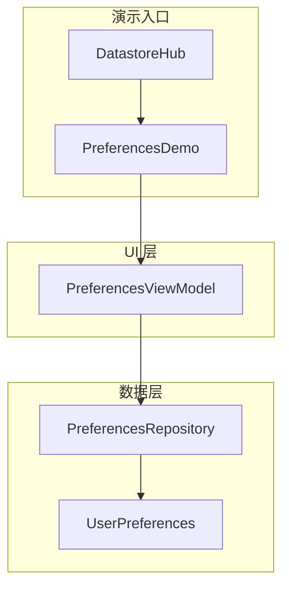
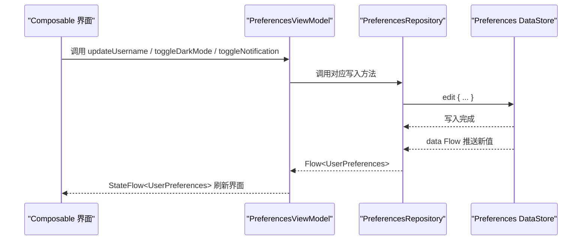
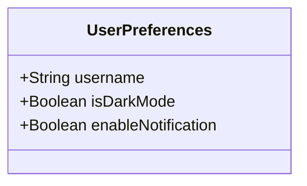
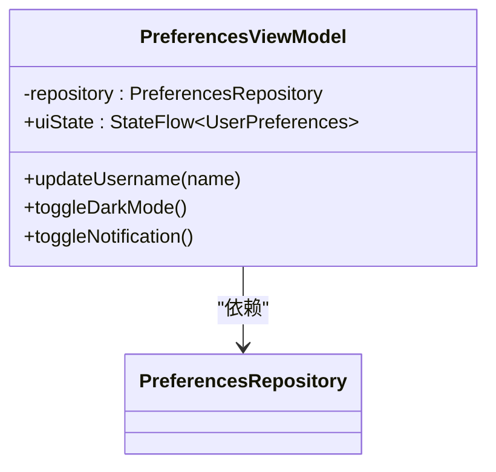
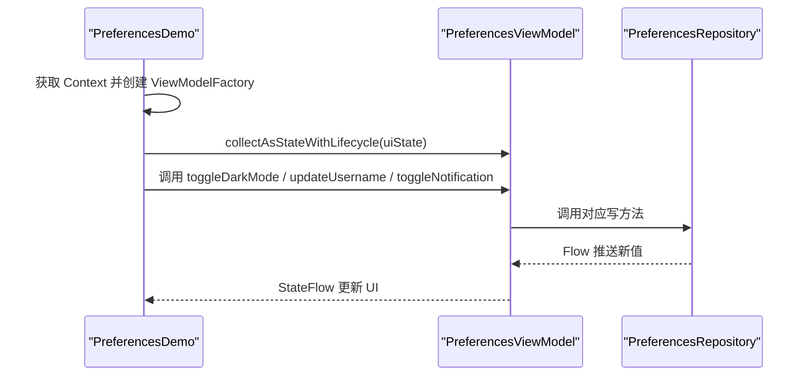
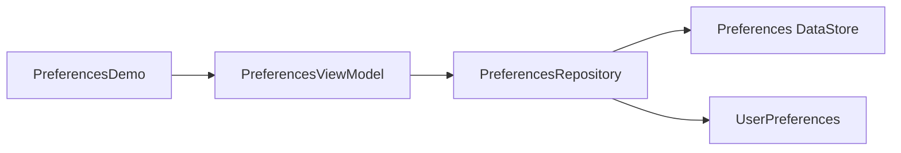

# Preferences DataStore

<cite>
**本文引用的文件**   
- [UserPreferences.kt](file://app/src/main/java/com/example/composeup/datastore/data/model/UserPreferences.kt)
- [PreferencesRepository.kt](file://app/src/main/java/com/example/composeup/datastore/data/repository/PreferencesRepository.kt)
- [PreferencesViewModel.kt](file://app/src/main/java/com/example/composeup/datastore/ui/viewmodel/PreferencesViewModel.kt)
- [PreferencesDemo.kt](file://app/src/main/java/com/example/composeup/datastore/PreferencesDemo.kt)
- [DatastoreHub.kt](file://app/src/main/java/com/example/composeup/datastore/DatastoreHub.kt)
</cite>

## 目录
1. [简介](#简介)
2. [项目结构](#项目结构)
3. [核心组件](#核心组件)
4. [架构总览](#架构总览)
5. [详细组件分析](#详细组件分析)
6. [依赖关系分析](#依赖关系分析)
7. [性能与序列化机制](#性能与序列化机制)
8. [从 SharedPreferences 迁移](#从-sharedpreferences-迁移)
9. [最佳实践与常见场景](#最佳实践与常见场景)
10. [故障排查指南](#故障排查指南)
11. [结论](#结论)

## 简介
本文件面向 Android Compose 应用中的 Preferences DataStore，围绕以下目标展开：
- 说明 Preferences DataStore 的配置方式、数据类型支持与序列化机制。
- 解释 UserPreferences 数据模型的定义与使用方式。
- 展示 PreferencesRepository 的实现模式与数据访问模式。
- 给出 ViewModel 状态管理与 UI 层集成示例。
- 说明与 SharedPreferences 的迁移思路与性能优势。
- 提供常见使用场景的最佳实践与错误处理策略。

## 项目结构
本仓库采用分层组织：
- data/model：领域数据模型（如 UserPreferences）。
- data/repository：数据访问层（如 PreferencesRepository）。
- ui/viewmodel：UI 状态与业务编排（如 PreferencesViewModel）。
- datastore：演示入口与页面（如 PreferencesDemo、DatastoreHub）。



图表来源
- [DatastoreHub.kt:30-60](file://app/src/main/java/com/example/composeup/datastore/DatastoreHub.kt#L30-L60)
- [PreferencesDemo.kt:25-45](file://app/src/main/java/com/example/composeup/datastore/PreferencesDemo.kt#L25-L45)
- [PreferencesViewModel.kt:12-32](file://app/src/main/java/com/example/composeup/datastore/ui/viewmodel/PreferencesViewModel.kt#L12-L32)
- [PreferencesRepository.kt:15-45](file://app/src/main/java/com/example/composeup/datastore/data/repository/PreferencesRepository.kt#L15-L45)
- [UserPreferences.kt:1-9](file://app/src/main/java/com/example/composeup/datastore/data/model/UserPreferences.kt#L1-L9)

章节来源
- [DatastoreHub.kt:30-60](file://app/src/main/java/com/example/composeup/datastore/DatastoreHub.kt#L30-L60)
- [PreferencesDemo.kt:25-45](file://app/src/main/java/com/example/composeup/datastore/PreferencesDemo.kt#L25-L45)

## 核心组件
- UserPreferences：用户偏好数据模型，包含用户名、夜间模式开关、通知开关等字段，并提供默认值。
- PreferencesRepository：封装 Preferences DataStore 的读写操作，暴露 Flow 供上层订阅，并提供协程方法执行写操作。
- PreferencesViewModel：将 Repository 的 Flow 转换为 StateFlow，对外暴露 UI 状态，并处理用户交互动作。
- PreferencesDemo：Compose 演示页面，通过 ViewModel 驱动 UI，展示读取与更新流程。
- DatastoreHub：本地存储选型中心，对 Preferences DataStore 的定位进行说明。

章节来源
- [UserPreferences.kt:1-9](file://app/src/main/java/com/example/composeup/datastore/data/model/UserPreferences.kt#L1-L9)
- [PreferencesRepository.kt:15-45](file://app/src/main/java/com/example/composeup/datastore/data/repository/PreferencesRepository.kt#L15-L45)
- [PreferencesViewModel.kt:12-32](file://app/src/main/java/com/example/composeup/datastore/ui/viewmodel/PreferencesViewModel.kt#L12-L32)
- [PreferencesDemo.kt:25-122](file://app/src/main/java/com/example/composeup/datastore/PreferencesDemo.kt#L25-L122)
- [DatastoreHub.kt:30-60](file://app/src/main/java/com/example/composeup/datastore/DatastoreHub.kt#L30-L60)

## 架构总览
整体采用“UI → ViewModel → Repository → DataStore”的分层架构：
- UI 仅负责展示与触发行为，不直接访问持久化层。
- ViewModel 持有 UI 状态，协调业务逻辑。
- Repository 封装 DataStore 的读写与错误处理。
- DataStore 基于 Flow 提供响应式数据流。



图表来源
- [PreferencesDemo.kt:77-90](file://app/src/main/java/com/example/composeup/datastore/PreferencesDemo.kt#L77-L90)
- [PreferencesViewModel.kt:21-31](file://app/src/main/java/com/example/composeup/datastore/ui/viewmodel/PreferencesViewModel.kt#L21-L31)
- [PreferencesRepository.kt:34-44](file://app/src/main/java/com/example/composeup/datastore/data/repository/PreferencesRepository.kt#L34-L44)

## 详细组件分析

### UserPreferences 数据模型
- 定义三个字段：用户名、夜间模式开关、通知开关，均提供合理默认值。
- 作为 Repository 到 UI 的领域模型，避免 UI 直接感知 DataStore 键名与类型。



图表来源
- [UserPreferences.kt:1-9](file://app/src/main/java/com/example/composeup/datastore/data/model/UserPreferences.kt#L1-L9)

章节来源
- [UserPreferences.kt:1-9](file://app/src/main/java/com/example/composeup/datastore/data/model/UserPreferences.kt#L1-L9)

### PreferencesRepository 实现模式
- 使用 preferencesDataStore 扩展属性创建 DataStore 实例，文件名为 user_preferences。
- 定义强类型 Key：stringPreferencesKey 与 booleanPreferencesKey。
- 暴露 Flow<UserPreferences>，内部通过 catch 处理 IOException，返回空配置；map 将 Preferences 映射为 UserPreferences。
- 提供 suspend 函数执行写操作：updateUsername、toggleDarkMode、toggleNotification。

```mermaid
flowchart TD
Start(["进入 Repository"]) --> CreateDS["创建 DataStore<br/>preferencesDataStore(name = \"user_preferences\")"]
CreateDS --> DefineKeys["定义强类型 Key<br/>stringPreferencesKey / booleanPreferencesKey"]
DefineKeys --> BuildFlow["构建 Flow<UserPreferences><br/>catch(IOException) -> emptyPreferences()<br/>map(Preferences -> UserPreferences)"]
BuildFlow --> WriteOps["提供写操作<br/>updateUsername / toggleDarkMode / toggleNotification"]
WriteOps --> End(["完成"])
```

图表来源
- [PreferencesRepository.kt:13-44](file://app/src/main/java/com/example/composeup/datastore/data/repository/PreferencesRepository.kt#L13-L44)

章节来源
- [PreferencesRepository.kt:13-44](file://app/src/main/java/com/example/composeup/datastore/data/repository/PreferencesRepository.kt#L13-L44)

### PreferencesViewModel 状态管理
- 将 Repository 的 Flow<UserPreferences> 通过 stateIn 转为 StateFlow，设置初始值为 UserPreferences()。
- 使用 SharingStarted.WhileSubscribed(5000) 控制订阅生命周期，减少不必要的资源消耗。
- 暴露 updateUsername、toggleDarkMode、toggleNotification 等方法，内部使用 viewModelScope.launch 调用 Repository。



图表来源
- [PreferencesViewModel.kt:12-32](file://app/src/main/java/com/example/composeup/datastore/ui/viewmodel/PreferencesViewModel.kt#L12-L32)

章节来源
- [PreferencesViewModel.kt:12-32](file://app/src/main/java/com/example/composeup/datastore/ui/viewmodel/PreferencesViewModel.kt#L12-L32)

### UI 层集成示例（PreferencesDemo）
- 在 Composable 中通过 remember + ViewModelProvider.Factory 手动注入 Repository。
- 使用 collectAsStateWithLifecycle 收集 ViewModel 的 StateFlow，驱动界面显示。
- 按钮点击调用 ViewModel 的方法，触发写操作，随后 UI 自动刷新。



图表来源
- [PreferencesDemo.kt:29-45](file://app/src/main/java/com/example/composeup/datastore/PreferencesDemo.kt#L29-L45)
- [PreferencesDemo.kt:77-90](file://app/src/main/java/com/example/composeup/datastore/PreferencesDemo.kt#L77-L90)
- [PreferencesViewModel.kt:21-31](file://app/src/main/java/com/example/composeup/datastore/ui/viewmodel/PreferencesViewModel.kt#L21-L31)

章节来源
- [PreferencesDemo.kt:29-122](file://app/src/main/java/com/example/composeup/datastore/PreferencesDemo.kt#L29-L122)

## 依赖关系分析
- PreferencesDemo 依赖 PreferencesViewModel 与 PreferencesRepository。
- PreferencesViewModel 依赖 PreferencesRepository。
- PreferencesRepository 依赖 Android Context 与 androidx.datastore.preferences.*。
- UserPreferences 被 Repository 与 ViewModel 共同使用，作为领域模型。



图表来源
- [PreferencesDemo.kt:22-42](file://app/src/main/java/com/example/composeup/datastore/PreferencesDemo.kt#L22-L42)
- [PreferencesViewModel.kt:5-10](file://app/src/main/java/com/example/composeup/datastore/ui/viewmodel/PreferencesViewModel.kt#L5-L10)
- [PreferencesRepository.kt:3-11](file://app/src/main/java/com/example/composeup/datastore/data/repository/PreferencesRepository.kt#L3-L11)
- [UserPreferences.kt:1-9](file://app/src/main/java/com/example/composeup/datastore/data/model/UserPreferences.kt#L1-L9)

章节来源
- [PreferencesDemo.kt:22-42](file://app/src/main/java/com/example/composeup/datastore/PreferencesDemo.kt#L22-L42)
- [PreferencesViewModel.kt:5-10](file://app/src/main/java/com/example/composeup/datastore/ui/viewmodel/PreferencesViewModel.kt#L5-L10)
- [PreferencesRepository.kt:3-11](file://app/src/main/java/com/example/composeup/datastore/data/repository/PreferencesRepository.kt#L3-L11)

## 性能与序列化机制
- Preferences DataStore 基于 Flow 与协程，所有 I/O 均在后台线程执行，避免主线程阻塞导致的 ANR。
- 使用强类型 Key（stringPreferencesKey、booleanPreferencesKey），编译期类型安全，减少运行时类型转换错误。
- 读路径通过 Flow 实时推送变更，UI 可自动刷新，无需手动轮询。
- 写路径使用 edit { } 原子性更新，保证一致性。
- 对于更复杂或嵌套的对象，建议使用 Proto DataStore 或 Gson/Moshi Serializer，以获得更高的序列化效率与类型安全。

章节来源
- [DatastoreHub.kt:42-47](file://app/src/main/java/com/example/composeup/datastore/DatastoreHub.kt#L42-L47)
- [PreferencesRepository.kt:13-44](file://app/src/main/java/com/example/composeup/datastore/data/repository/PreferencesRepository.kt#L13-L44)

## 从 SharedPreferences 迁移
- 定位：Preferences DataStore 是 SharedPreferences 的现代替代方案，具备 Flow 与协程支持，避免主线程 I/O 阻塞。
- 迁移要点：
  - 将 SharedPreferences 的 key 字符串替换为 stringPreferencesKey / booleanPreferencesKey。
  - 将 get/set 操作改为 DataStore.edit { } 与 Flow 订阅。
  - 将同步读取改为异步 Flow 订阅，并在 UI 层使用 collectAsStateWithLifecycle。
- 本项目在 DatastoreHub 中对 Preferences DataStore 的定位进行了说明，强调其替代 SharedPreferences 的能力与优势。

章节来源
- [DatastoreHub.kt:42-47](file://app/src/main/java/com/example/composeup/datastore/DatastoreHub.kt#L42-L47)
- [PreferencesRepository.kt:13-44](file://app/src/main/java/com/example/composeup/datastore/data/repository/PreferencesRepository.kt#L13-L44)

## 最佳实践与常见场景
- 使用强类型 Key：集中管理 Key，避免硬编码字符串导致拼写错误。
- 默认值策略：在 map 阶段提供默认值，确保首次启动或数据缺失时 UI 正常渲染。
- 错误处理：捕获 IOException 并返回空配置，防止异常中断 Flow。
- 生命周期管理：使用 SharingStarted.WhileSubscribed 控制 Flow 订阅，减少内存与计算开销。
- 典型场景：
  - 轻量设置项：主题切换、字体大小、语言选择。
  - 开关配置：通知开关、隐私选项、实验功能开关。
  - 非结构化标识：临时标记、调试开关、A/B 测试分组。

章节来源
- [PreferencesRepository.kt:16-32](file://app/src/main/java/com/example/composeup/datastore/data/repository/PreferencesRepository.kt#L16-L32)
- [PreferencesViewModel.kt:14-19](file://app/src/main/java/com/example/composeup/datastore/ui/viewmodel/PreferencesViewModel.kt#L14-L19)

## 故障排查指南
- 问题：首次启动或数据损坏导致 Flow 抛出异常。
  - 现象：UI 未更新或崩溃。
  - 处理：Repository 已捕获 IOException 并返回空配置，检查是否出现其他异常类型。
- 问题：UI 未刷新。
  - 现象：修改后界面仍显示旧值。
  - 处理：确认 UI 层使用 collectAsStateWithLifecycle 收集 StateFlow，且 ViewModel 正确转发 Repository 的 Flow。
- 问题：Key 冲突或类型不匹配。
  - 现象：读取到的值不符合预期。
  - 处理：检查 Key 名称与类型是否与写入一致，避免混用 stringPreferencesKey 与 booleanPreferencesKey。

章节来源
- [PreferencesRepository.kt:22-32](file://app/src/main/java/com/example/composeup/datastore/data/repository/PreferencesRepository.kt#L22-L32)
- [PreferencesDemo.kt:44-45](file://app/src/main/java/com/example/composeup/datastore/PreferencesDemo.kt#L44-L45)

## 结论
本仓库展示了 Preferences DataStore 在 Compose 应用中的完整落地方式：
- 以 UserPreferences 为领域模型，统一数据表达。
- 通过 PreferencesRepository 封装 DataStore 的读写与错误处理。
- 借助 ViewModel 将 Flow 转换为 StateFlow，驱动 UI 状态。
- 在 UI 层通过 collectAsStateWithLifecycle 实现响应式更新。
- 相比 SharedPreferences，Preferences DataStore 提供更强的类型安全、更好的性能与更简洁的异步 API。