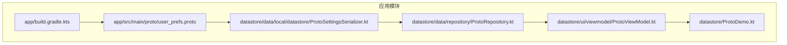
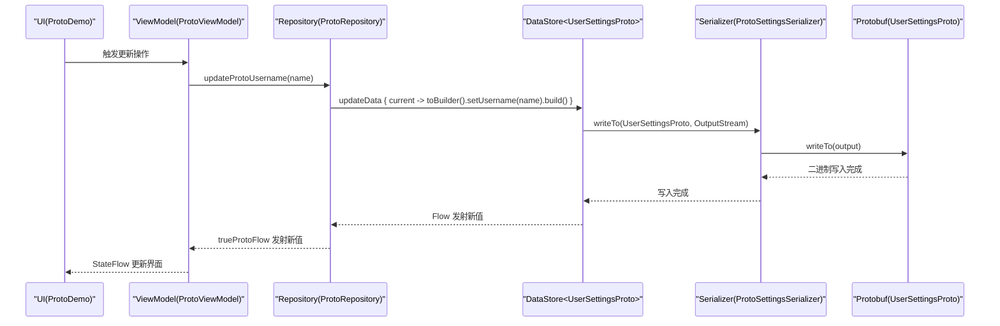
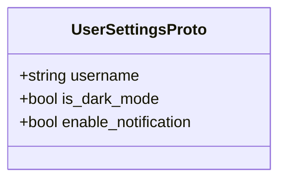
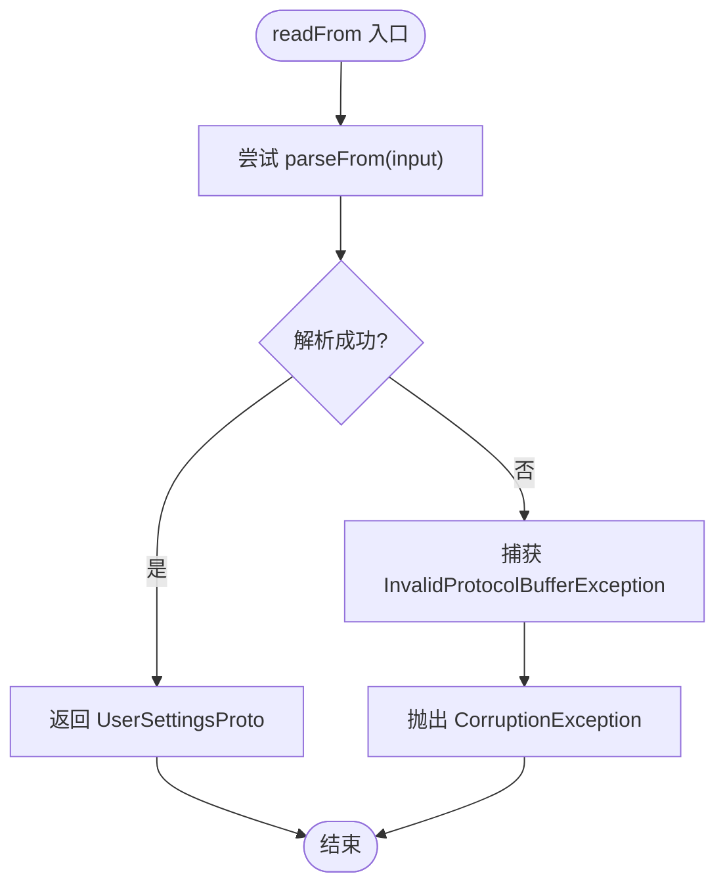
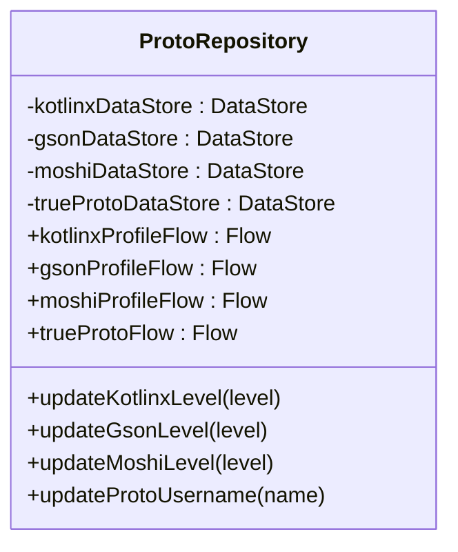
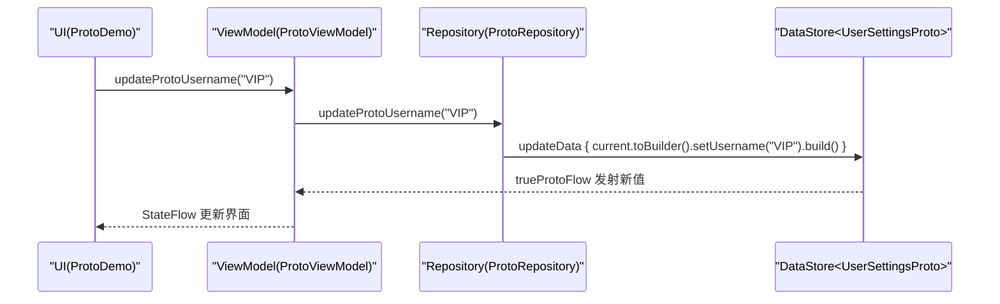
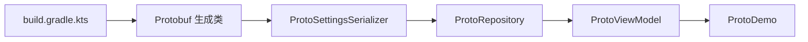

# Proto DataStore

<cite>
**本文引用的文件**   
- [user_prefs.proto](file://app/src/main/proto/user_prefs.proto)
- [ProtoSettingsSerializer.kt](file://app/src/main/java/com/example/composeup/datastore/data/local/datastore/ProtoSettingsSerializer.kt)
- [ProtoRepository.kt](file://app/src/main/java/com/example/composeup/datastore/data/repository/ProtoRepository.kt)
- [ProtoViewModel.kt](file://app/src/main/java/com/example/composeup/datastore/ui/viewmodel/ProtoViewModel.kt)
- [ProtoDemo.kt](file://app/src/main/java/com/example/composeup/datastore/ProtoDemo.kt)
- [UserProfileSerializer.kt](file://app/src/main/java/com/example/composeup/datastore/data/local/datastore/UserProfileSerializer.kt)
- [UserProfile.kt](file://app/src/main/java/com/example/composeup/datastore/data/model/UserProfile.kt)
- [build.gradle.kts](file://app/build.gradle.kts)
</cite>

## 目录
1. [简介](#简介)
2. [项目结构](#项目结构)
3. [核心组件](#核心组件)
4. [架构总览](#架构总览)
5. [详细组件分析](#详细组件分析)
6. [依赖关系分析](#依赖关系分析)
7. [性能与类型安全](#性能与类型安全)
8. [.proto 版本管理与向后兼容](#proto-版本管理与向后兼容)
9. [最佳实践与常见问题](#最佳实践与常见问题)
10. [结论](#结论)

## 简介
本技术文档围绕 Proto DataStore 在 ComposeUp 项目中的落地实现，系统性说明 Protocol Buffers 的配置、.proto 定义、自定义序列化器、仓库层类型安全访问、ViewModel 中的复杂对象存储与更新流程，并总结性能优势、类型安全保障、版本管理与兼容性策略以及实际工程最佳实践。

## 项目结构
Proto DataStore 相关代码主要分布在以下位置：
- .proto 定义位于 proto 目录
- 自定义 Serializer 位于 datastore/data/local/datastore
- 仓库层位于 datastore/data/repository
- ViewModel 位于 datastore/ui/viewmodel
- UI 演示入口位于 datastore/ProtoDemo.kt
- 构建配置位于 app/build.gradle.kts

图表来源
- [build.gradle.kts:43-59](file://app/build.gradle.kts#L43-L59)
- [user_prefs.proto:1-11](file://app/src/main/proto/user_prefs.proto#L1-L11)
- [ProtoSettingsSerializer.kt:12-28](file://app/src/main/java/com/example/composeup/datastore/data/local/datastore/ProtoSettingsSerializer.kt#L12-L28)
- [ProtoRepository.kt:40-49](file://app/src/main/java/com/example/composeup/datastore/data/repository/ProtoRepository.kt#L40-L49)
- [ProtoViewModel.kt:27-29](file://app/src/main/java/com/example/composeup/datastore/ui/viewmodel/ProtoViewModel.kt#L27-L29)
- [ProtoDemo.kt:32-45](file://app/src/main/java/com/example/composeup/datastore/ProtoDemo.kt#L32-L45)

章节来源
- [build.gradle.kts:43-59](file://app/build.gradle.kts#L43-L59)
- [user_prefs.proto:1-11](file://app/src/main/proto/user_prefs.proto#L1-L11)

## 核心组件
- .proto 数据模型：UserSettingsProto，包含用户名、夜间模式开关、通知开关等字段
- 自定义序列化器：ProtoSettingsSerializer，实现 DataStore 的 Serializer<UserSettingsProto>
- 仓库层：ProtoRepository，封装 DataStore 实例与 Flow 暴露，提供 updateData 方法
- ViewModel：ProtoViewModel，将 Repository 的 Flow 转为 StateFlow，并提供更新方法
- UI 演示：ProtoDemo，展示多序列化方案对比与交互

章节来源
- [user_prefs.proto:6-10](file://app/src/main/proto/user_prefs.proto#L6-L10)
- [ProtoSettingsSerializer.kt:12-28](file://app/src/main/java/com/example/composeup/datastore/data/local/datastore/ProtoSettingsSerializer.kt#L12-L28)
- [ProtoRepository.kt:40-71](file://app/src/main/java/com/example/composeup/datastore/data/repository/ProtoRepository.kt#L40-L71)
- [ProtoViewModel.kt:13-45](file://app/src/main/java/com/example/composeup/datastore/ui/viewmodel/ProtoViewModel.kt#L13-L45)
- [ProtoDemo.kt:32-109](file://app/src/main/java/com/example/composeup/datastore/ProtoDemo.kt#L32-L109)

## 架构总览
Proto DataStore 在本项目中采用分层架构：UI 层通过 ViewModel 暴露状态；ViewModel 调用 Repository；Repository 持有 DataStore 实例并使用自定义 Serializer 进行读写；底层由 Protobuf 生成类完成二进制编解码。

图表来源
- [ProtoDemo.kt:92-109](file://app/src/main/java/com/example/composeup/datastore/ProtoDemo.kt#L92-L109)
- [ProtoViewModel.kt:43-45](file://app/src/main/java/com/example/composeup/datastore/ui/viewmodel/ProtoViewModel.kt#L43-L45)
- [ProtoRepository.kt:67-71](file://app/src/main/java/com/example/composeup/datastore/data/repository/ProtoRepository.kt#L67-L71)
- [ProtoSettingsSerializer.kt:23-27](file://app/src/main/java/com/example/composeup/datastore/data/local/datastore/ProtoSettingsSerializer.kt#L23-L27)

## 详细组件分析

### Protocol Buffers 配置与 .proto 定义
- 构建脚本启用 protobuf 插件，并为 java/kotlin 目标生成 lite 版本类，减少体积与提升性能
- user_prefs.proto 定义了 UserSettingsProto 消息体，包含字符串与布尔字段，便于后续扩展

图表来源
- [user_prefs.proto:6-10](file://app/src/main/proto/user_prefs.proto#L6-L10)
- [build.gradle.kts:43-59](file://app/build.gradle.kts#L43-L59)

章节来源
- [build.gradle.kts:43-59](file://app/build.gradle.kts#L43-L59)
- [user_prefs.proto:1-11](file://app/src/main/proto/user_prefs.proto#L1-L11)

### 自定义序列化器 ProtoSettingsSerializer
- 实现 androidx.datastore.core.Serializer<UserSettingsProto>
- defaultValue 使用 Protobuf 默认实例
- readFrom 中捕获 InvalidProtocolBufferException 并转换为 CorruptionException，保证 DataStore 可感知损坏数据
- writeTo 使用 withContext(Dispatchers.IO) 确保 IO 操作不在主线程执行

图表来源
- [ProtoSettingsSerializer.kt:15-21](file://app/src/main/java/com/example/composeup/datastore/data/local/datastore/ProtoSettingsSerializer.kt#L15-L21)

章节来源
- [ProtoSettingsSerializer.kt:12-28](file://app/src/main/java/com/example/composeup/datastore/data/local/datastore/ProtoSettingsSerializer.kt#L12-L28)

### 仓库层 ProtoRepository 的类型安全数据访问
- 同时展示了多种序列化方案（Kotlinx、Gson、Moshi）与原生 Protobuf 的 DataStore 实例
- 暴露 Flow 供上层消费，updateData 以不可变方式更新对象
- 对于 Protobuf，使用 Builder 模式构造新实例，保证类型安全与原子性

图表来源
- [ProtoRepository.kt:17-71](file://app/src/main/java/com/example/composeup/datastore/data/repository/ProtoRepository.kt#L17-L71)

章节来源
- [ProtoRepository.kt:17-73](file://app/src/main/java/com/example/composeup/datastore/data/repository/ProtoRepository.kt#L17-L73)

### ViewModel 中的复杂对象存储与更新
- 将 Repository 的 Flow 通过 stateIn 转为 StateFlow，配合 WhileSubscribed 策略控制订阅生命周期
- 提供更新方法委托给 Repository，使用 viewModelScope.launch 启动协程
- 对 Protobuf 类型，初始状态使用 getDefaultInstance()，避免空引用

图表来源
- [ProtoViewModel.kt:27-45](file://app/src/main/java/com/example/composeup/datastore/ui/viewmodel/ProtoViewModel.kt#L27-L45)
- [ProtoRepository.kt:67-71](file://app/src/main/java/com/example/composeup/datastore/data/repository/ProtoRepository.kt#L67-L71)

章节来源
- [ProtoViewModel.kt:13-45](file://app/src/main/java/com/example/composeup/datastore/ui/viewmodel/ProtoViewModel.kt#L13-L45)

### JSON 序列化器对比（Kotlinx/Gson/Moshi）
- UserProfileSerializer 作为 kotlinx.serialization 的实现示例，负责对象与 JSON 字符串之间的转换
- 与 ProtoSettingsSerializer 不同，后者直接处理 Protobuf 二进制流
- 该对比有助于理解 DataStore 的 Serializer 抽象在不同序列化库下的统一接口

章节来源
- [UserProfileSerializer.kt:33-51](file://app/src/main/java/com/example/composeup/datastore/data/local/datastore/UserProfileSerializer.kt#L33-L51)
- [UserProfile.kt:6-13](file://app/src/main/java/com/example/composeup/datastore/data/model/UserProfile.kt#L6-L13)

## 依赖关系分析
- build.gradle.kts 引入 protobuf 插件与 kotlin.lite 依赖，生成轻量级 Protobuf 类
- ProtoRepository 组合多个 DataStore 实例，分别对应不同序列化器
- ProtoViewModel 依赖 ProtoRepository，并通过 Flow/StateFlow 管理状态
- ProtoDemo 通过 Compose 收集 StateFlow 并驱动 UI 更新

图表来源
- [build.gradle.kts:43-59](file://app/build.gradle.kts#L43-L59)
- [ProtoSettingsSerializer.kt:12-28](file://app/src/main/java/com/example/composeup/datastore/data/local/datastore/ProtoSettingsSerializer.kt#L12-L28)
- [ProtoRepository.kt:40-49](file://app/src/main/java/com/example/composeup/datastore/data/repository/ProtoRepository.kt#L40-L49)
- [ProtoViewModel.kt:27-29](file://app/src/main/java/com/example/composeup/datastore/ui/viewmodel/ProtoViewModel.kt#L27-L29)
- [ProtoDemo.kt:32-45](file://app/src/main/java/com/example/composeup/datastore/ProtoDemo.kt#L32-L45)

章节来源
- [build.gradle.kts:61-81](file://app/build.gradle.kts#L61-L81)
- [ProtoRepository.kt:17-49](file://app/src/main/java/com/example/composeup/datastore/data/repository/ProtoRepository.kt#L17-L49)

## 性能与类型安全
- 性能优势
  - Protobuf 二进制格式体积小、解析快，lite 模式进一步降低内存占用
  - DataStore 基于协程与 Flow，避免阻塞 IO，结合 Dispatchers.IO 提升吞吐
- 类型安全
  - 通过强类型模型（UserSettingsProto）与 Builder 模式，编译期保障字段存在与类型正确
  - Serializer 泛型约束确保 DataStore 读写一致的类型契约

[本节为通用指导，不直接分析具体文件]

## .proto 版本管理与向后兼容
- 字段编号稳定：新增字段时分配新的唯一编号，避免破坏已有数据
- 可选字段优先：使用 optional/默认值语义，旧客户端忽略未知字段
- 废弃字段标记：使用 deprecated 注解标记不再使用的字段，保留兼容但提示迁移
- 增量演进：小步迭代，逐步替换字段或结构，避免一次性大改
- 校验与降级：在 Serializer 中增加校验逻辑，遇到异常数据回退到默认值或迁移策略

章节来源
- [user_prefs.proto:6-10](file://app/src/main/proto/user_prefs.proto#L6-L10)
- [ProtoSettingsSerializer.kt:15-21](file://app/src/main/java/com/example/composeup/datastore/data/local/datastore/ProtoSettingsSerializer.kt#L15-L21)

## 最佳实践与常见问题
- 最佳实践
  - 使用 lite 模式生成 Protobuf 类，平衡功能与体积
  - 在 Serializer 中统一处理 IO 调度与异常，保证 DataStore 行为一致
  - 通过 Repository 暴露 Flow，ViewModel 仅做状态桥接，保持职责清晰
  - 使用 Builder 模式更新 Protobuf 对象，确保不可变性与原子性
- 常见问题
  - 数据损坏：捕获 InvalidProtocolBufferException 并转换为 CorruptionException，使 DataStore 能识别并恢复
  - 主线程 IO：writeTo/readFrom 中使用 Dispatchers.IO 避免阻塞 UI
  - 初始状态：StateFlow 初始值使用 getDefaultInstance()，避免空引用导致崩溃

章节来源
- [ProtoSettingsSerializer.kt:15-27](file://app/src/main/java/com/example/composeup/datastore/data/local/datastore/ProtoSettingsSerializer.kt#L15-L27)
- [ProtoRepository.kt:67-71](file://app/src/main/java/com/example/composeup/datastore/data/repository/ProtoRepository.kt#L67-L71)
- [ProtoViewModel.kt:27-29](file://app/src/main/java/com/example/composeup/datastore/ui/viewmodel/ProtoViewModel.kt#L27-L29)

## 结论
本项目通过 Proto DataStore 实现了高性能、类型安全的本地数据存储方案。结合 .proto 定义、自定义 Serializer、Repository 与 ViewModel 的分层设计，既保证了运行时性能，又提供了编译期类型保障。配合良好的版本管理与兼容性策略，可在长期演进中维持数据结构的稳定性与可读性。