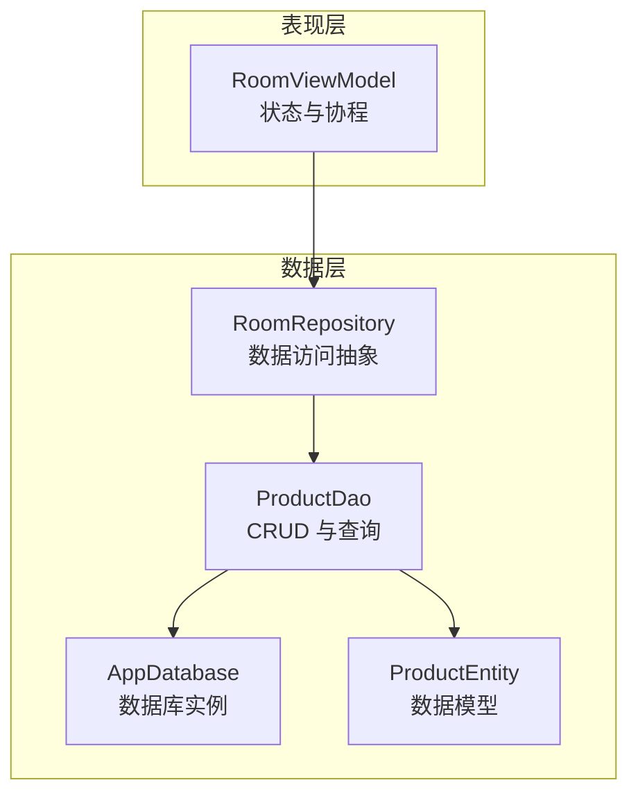
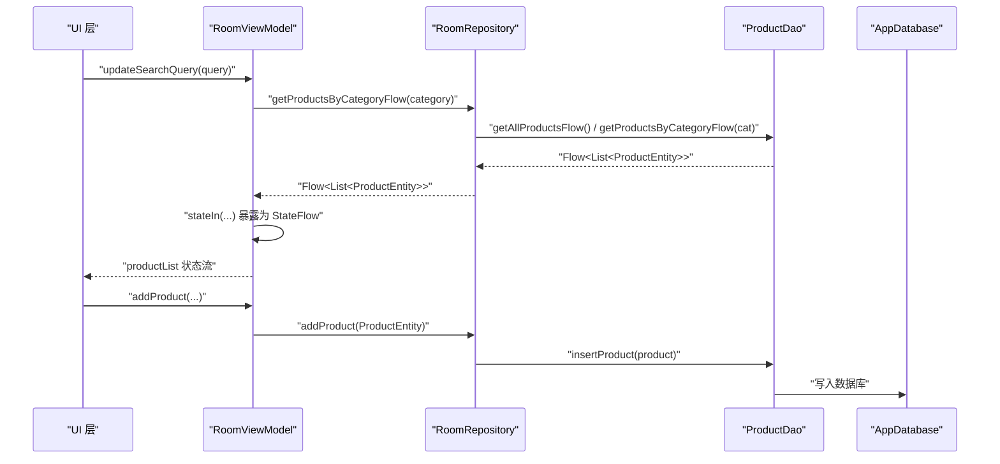
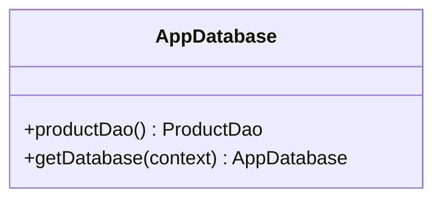
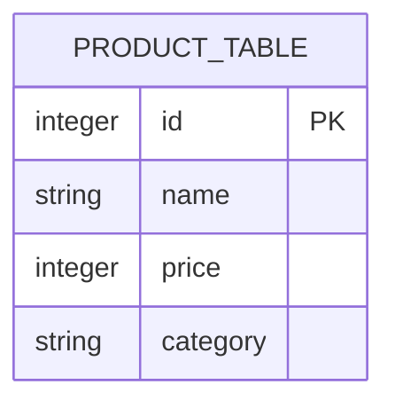
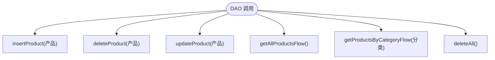
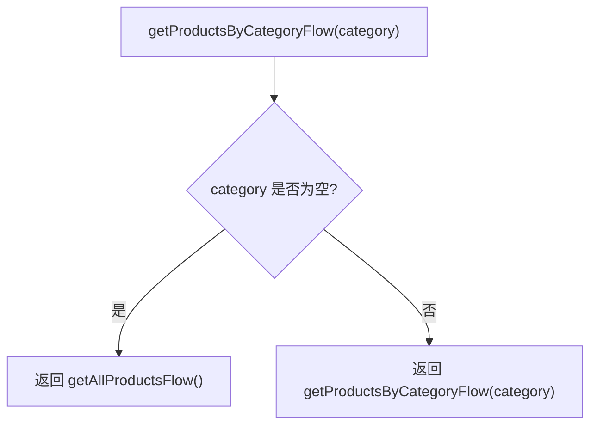
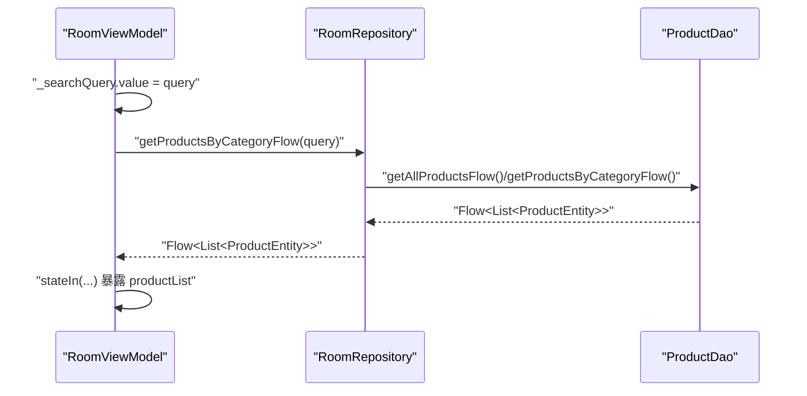
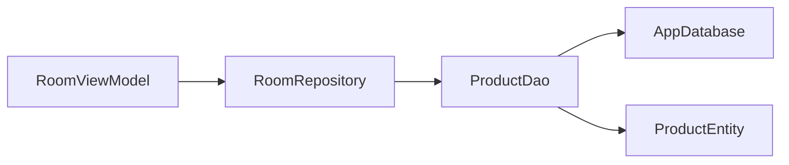

# Room Database

<cite>
**本文引用的文件**   
- [AppDatabase.kt](file://app/src/main/java/com/example/composeup/datastore/data/local/room/AppDatabase.kt)
- [ProductDao.kt](file://app/src/main/java/com/example/composeup/datastore/data/local/room/ProductDao.kt)
- [ProductEntity.kt](file://app/src/main/java/com/example/composeup/datastore/data/model/ProductEntity.kt)
- [RoomRepository.kt](file://app/src/main/java/com/example/composeup/datastore/data/repository/RoomRepository.kt)
- [RoomViewModel.kt](file://app/src/main/java/com/example/composeup/datastore/ui/viewmodel/RoomViewModel.kt)
</cite>

## 目录
1. [简介](#简介)
2. [项目结构](#项目结构)
3. [核心组件](#核心组件)
4. [架构总览](#架构总览)
5. [详细组件分析](#详细组件分析)
6. [依赖关系分析](#依赖关系分析)
7. [性能与优化](#性能与优化)
8. [故障排查指南](#故障排查指南)
9. [结论](#结论)

## 简介
本技术文档围绕 ComposeUp 项目中基于 Room 的本地数据层实现，系统性说明数据库配置、实体模型设计、DAO 接口定义、仓库抽象以及 ViewModel 中的状态管理与异步操作。同时给出版本迁移策略、复杂查询、事务处理与索引优化的最佳实践建议，帮助读者在现有代码基础上进行扩展与优化。

## 项目结构
Room 相关代码位于 data 层的 local/room 子包中，包含数据库定义、DAO 接口与实体模型；repository 层提供统一的数据访问抽象；ui.viewmodel 层负责将数据流暴露给 UI。

图表来源
- [AppDatabase.kt:9-24](file://app/src/main/java/com/example/composeup/datastore/data/local/room/AppDatabase.kt#L9-L24)
- [ProductDao.kt:12-30](file://app/src/main/java/com/example/composeup/datastore/data/local/room/ProductDao.kt#L12-L30)
- [ProductEntity.kt:8-14](file://app/src/main/java/com/example/composeup/datastore/data/model/ProductEntity.kt#L8-L14)
- [RoomRepository.kt:8-28](file://app/src/main/java/com/example/composeup/datastore/data/repository/RoomRepository.kt#L8-L28)
- [RoomViewModel.kt:12-39](file://app/src/main/java/com/example/composeup/datastore/ui/viewmodel/RoomViewModel.kt#L12-L39)

章节来源
- [AppDatabase.kt:1-27](file://app/src/main/java/com/example/composeup/datastore/data/local/room/AppDatabase.kt#L1-L27)
- [ProductDao.kt:1-32](file://app/src/main/java/com/example/composeup/datastore/data/local/room/ProductDao.kt#L1-L32)
- [ProductEntity.kt:1-15](file://app/src/main/java/com/example/composeup/datastore/data/model/ProductEntity.kt#L1-L15)
- [RoomRepository.kt:1-30](file://app/src/main/java/com/example/composeup/datastore/data/repository/RoomRepository.kt#L1-L30)
- [RoomViewModel.kt:1-41](file://app/src/main/java/com/example/composeup/datastore/ui/viewmodel/RoomViewModel.kt#L1-L41)

## 核心组件
- AppDatabase：Room 数据库入口，声明实体、版本与构建策略。
- ProductEntity：商品数据模型，使用 Room 注解映射到表结构。
- ProductDao：数据访问对象，定义插入、删除、更新、查询等 API。
- RoomRepository：对 DAO 的封装，提供分类过滤、新增、清空等能力。
- RoomViewModel：在 ViewModel 中管理搜索状态，组合 Flow 并调用 Repository 执行异步操作。

章节来源
- [AppDatabase.kt:9-24](file://app/src/main/java/com/example/composeup/datastore/data/local/room/AppDatabase.kt#L9-L24)
- [ProductEntity.kt:8-14](file://app/src/main/java/com/example/composeup/datastore/data/model/ProductEntity.kt#L8-L14)
- [ProductDao.kt:12-30](file://app/src/main/java/com/example/composeup/datastore/data/local/room/ProductDao.kt#L12-L30)
- [RoomRepository.kt:8-28](file://app/src/main/java/com/example/composeup/datastore/data/repository/RoomRepository.kt#L8-L28)
- [RoomViewModel.kt:12-39](file://app/src/main/java/com/example/composeup/datastore/ui/viewmodel/RoomViewModel.kt#L12-L39)

## 架构总览
下图展示从 ViewModel 到数据库的完整调用链，体现数据流与异步处理。

图表来源
- [RoomViewModel.kt:17-34](file://app/src/main/java/com/example/composeup/datastore/ui/viewmodel/RoomViewModel.kt#L17-L34)
- [RoomRepository.kt:14-24](file://app/src/main/java/com/example/composeup/datastore/data/repository/RoomRepository.kt#L14-L24)
- [ProductDao.kt:14-27](file://app/src/main/java/com/example/composeup/datastore/data/local/room/ProductDao.kt#L14-L27)
- [AppDatabase.kt:17-24](file://app/src/main/java/com/example/composeup/datastore/data/local/room/AppDatabase.kt#L17-L24)

## 详细组件分析

### AppDatabase 数据库配置
- 使用 @Database 注解声明实体集合、版本号与 schema 导出开关。
- 通过单例模式 + synchronized 保证线程安全的数据库实例获取。
- 使用 fallbackToDestructiveMigration(true) 以简化开发期迁移（生产环境应替换为正式迁移）。
- 对外暴露 productDao() 方法供上层获取 DAO。

图表来源
- [AppDatabase.kt:9-24](file://app/src/main/java/com/example/composeup/datastore/data/local/room/AppDatabase.kt#L9-L24)

章节来源
- [AppDatabase.kt:9-24](file://app/src/main/java/com/example/composeup/datastore/data/local/room/AppDatabase.kt#L9-L24)

### ProductEntity 数据模型设计与注解
- 使用 @Entity(tableName = "product_table") 指定表名。
- 使用 @PrimaryKey 标注主键 id。
- 使用 @ColumnInfo(name = "...") 显式映射列名，便于后续演进与可读性。
- 字段类型与 SQL 类型对应：Int -> INTEGER, Long -> INTEGER, String -> TEXT。

图表来源
- [ProductEntity.kt:8-14](file://app/src/main/java/com/example/composeup/datastore/data/model/ProductEntity.kt#L8-L14)

章节来源
- [ProductEntity.kt:8-14](file://app/src/main/java/com/example/composeup/datastore/data/model/ProductEntity.kt#L8-L14)

### ProductDao CRUD 与查询
- 插入：@Insert(onConflict = REPLACE)，用于覆盖冲突记录。
- 删除：@Delete 按实体删除。
- 更新：@Update 按主键更新。
- 查询：
  - getAllProductsFlow(): 返回全量列表并按 id 降序。
  - getProductsByCategoryFlow(cat): 按分类过滤并返回 Flow。
  - deleteAll(): 清空表。

图表来源
- [ProductDao.kt:14-30](file://app/src/main/java/com/example/composeup/datastore/data/local/room/ProductDao.kt#L14-L30)

章节来源
- [ProductDao.kt:14-30](file://app/src/main/java/com/example/composeup/datastore/data/local/room/ProductDao.kt#L14-L30)

### RoomRepository 数据访问抽象与异步处理
- 持有 AppDatabase 实例与 ProductDao 引用。
- getProductsByCategoryFlow(category)：当分类为空时返回全量 Flow，否则返回按分类过滤的 Flow。
- addProduct/product.clearAll：封装 suspend 函数，直接委托 DAO。

图表来源
- [RoomRepository.kt:14-20](file://app/src/main/java/com/example/composeup/datastore/data/repository/RoomRepository.kt#L14-L20)

章节来源
- [RoomRepository.kt:8-28](file://app/src/main/java/com/example/composeup/datastore/data/repository/RoomRepository.kt#L8-L28)

### ViewModel 集成与状态管理
- 使用 MutableStateFlow 维护搜索关键词 searchQuery。
- 通过 flatMapLatest 将搜索词变化映射到 repository 的分类查询 Flow。
- 使用 stateIn(viewModelScope, WhileSubscribed(5000), emptyList()) 将 Flow 转为可观察的 StateFlow，减少订阅开销。
- 提供 addProduct 与 clearAll 协程作用域下的数据库操作。

图表来源
- [RoomViewModel.kt:14-25](file://app/src/main/java/com/example/composeup/datastore/ui/viewmodel/RoomViewModel.kt#L14-L25)
- [RoomRepository.kt:14-20](file://app/src/main/java/com/example/composeup/datastore/data/repository/RoomRepository.kt#L14-L20)
- [ProductDao.kt:23-27](file://app/src/main/java/com/example/composeup/datastore/data/local/room/ProductDao.kt#L23-L27)

章节来源
- [RoomViewModel.kt:14-39](file://app/src/main/java/com/example/composeup/datastore/ui/viewmodel/RoomViewModel.kt#L14-L39)

## 依赖关系分析
- ViewModel 依赖 Repository，不直接感知 DAO 或数据库。
- Repository 依赖 DAO，DAO 依赖 AppDatabase 与 ProductEntity。
- 单向依赖，耦合清晰，利于测试与替换数据源。

图表来源
- [RoomViewModel.kt:5-6](file://app/src/main/java/com/example/composeup/datastore/ui/viewmodel/RoomViewModel.kt#L5-L6)
- [RoomRepository.kt:4-5](file://app/src/main/java/com/example/composeup/datastore/data/repository/RoomRepository.kt#L4-L5)
- [ProductDao.kt:3-9](file://app/src/main/java/com/example/composeup/datastore/data/local/room/ProductDao.kt#L3-L9)
- [AppDatabase.kt:3-7](file://app/src/main/java/com/example/composeup/datastore/data/local/room/AppDatabase.kt#L3-L7)
- [ProductEntity.kt:3-5](file://app/src/main/java/com/example/composeup/datastore/data/model/ProductEntity.kt#L3-L5)

章节来源
- [RoomViewModel.kt:1-41](file://app/src/main/java/com/example/composeup/datastore/ui/viewmodel/RoomViewModel.kt#L1-L41)
- [RoomRepository.kt:1-30](file://app/src/main/java/com/example/composeup/datastore/data/repository/RoomRepository.kt#L1-L30)
- [ProductDao.kt:1-32](file://app/src/main/java/com/example/composeup/datastore/data/local/room/ProductDao.kt#L1-L32)
- [AppDatabase.kt:1-27](file://app/src/main/java/com/example/composeup/datastore/data/local/room/AppDatabase.kt#L1-L27)
- [ProductEntity.kt:1-15](file://app/src/main/java/com/example/composeup/datastore/data/model/ProductEntity.kt#L1-L15)

## 性能与优化

### 数据库版本迁移策略
- 当前使用 fallbackToDestructiveMigration(true)，适用于开发阶段快速迭代。
- 生产环境建议：
  - 开启 exportSchema = true，生成 schema 文件。
  - 使用 Migration 类精确描述表结构变更（增删列、重命名列、新建表等）。
  - 在 AppDatabase 中注册多个 Migration 以支持多版本升级路径。
  - 针对大表迁移考虑后台任务与用户提示，避免阻塞主流程。

章节来源
- [AppDatabase.kt:9-24](file://app/src/main/java/com/example/composeup/datastore/data/local/room/AppDatabase.kt#L9-L24)

### 复杂查询与索引优化
- 当前查询已按 id 降序排序，适合“最新优先”的场景。
- 若频繁按 category 过滤，建议添加复合索引或单独索引：
  - 在 ProductEntity 中使用 @Index 或 @PrimaryKey(autoGenerate = true) 结合自定义索引提升查询性能。
  - 对高频过滤字段（如 category）建立索引，减少全表扫描。
- 分页场景建议使用 PagedData/Paging 3.x，避免一次性加载大量数据。

章节来源
- [ProductDao.kt:23-27](file://app/src/main/java/com/example/composeup/datastore/data/local/room/ProductDao.kt#L23-L27)
- [ProductEntity.kt:8-14](file://app/src/main/java/com/example/composeup/datastore/data/model/ProductEntity.kt#L8-L14)

### 事务处理最佳实践
- 批量插入/更新/删除应包裹在事务中，确保原子性与一致性。
- 可在 Repository 层封装事务方法，内部使用 withTransaction 或 DAO 层使用 @Transaction 注解。
- 长事务需评估锁竞争与 I/O 影响，尽量缩短事务范围。

[本节为通用指导，不直接分析具体文件]

### 异步与背压
- DAO 返回 Flow 配合 ViewModel 的 stateIn 与 WhileSubscribed，有效降低未订阅时的资源消耗。
- 使用 flatMapLatest 确保仅响应最新的搜索条件，避免中间结果造成 UI 抖动。

章节来源
- [RoomViewModel.kt:17-25](file://app/src/main/java/com/example/composeup/datastore/ui/viewmodel/RoomViewModel.kt#L17-L25)

## 故障排查指南
- 数据库损坏或版本不一致：
  - 检查是否误用 destructive migration，生产环境务必配置正确的 Migration。
  - 清理应用数据或卸载重装以恢复（开发阶段）。
- 查询性能问题：
  - 确认是否存在缺失索引，尤其是高频过滤字段。
  - 避免在 Flow 链中进行重型计算，必要时在 Repository 层预处理。
- 状态流未更新：
  - 检查 StateFlow 的收集是否在合适的生命周期范围内。
  - 确认 flatMapLatest 上游是否被正确触发。

章节来源
- [AppDatabase.kt:17-24](file://app/src/main/java/com/example/composeup/datastore/data/local/room/AppDatabase.kt#L17-L24)
- [RoomViewModel.kt:17-25](file://app/src/main/java/com/example/composeup/datastore/ui/viewmodel/RoomViewModel.kt#L17-L25)

## 结论
本项目基于 Room 构建了清晰的本地数据层：AppDatabase 负责数据库实例化与版本管理，ProductEntity 定义数据模型，ProductDao 提供标准 CRUD 与 Flow 查询，RoomRepository 抽象数据访问逻辑，RoomViewModel 整合状态与协程。在此基础上，建议在生产环境完善迁移策略、引入索引与分页、规范事务边界，以获得更稳定与高性能的本地数据体验。