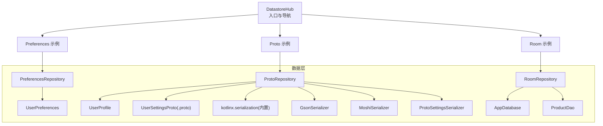
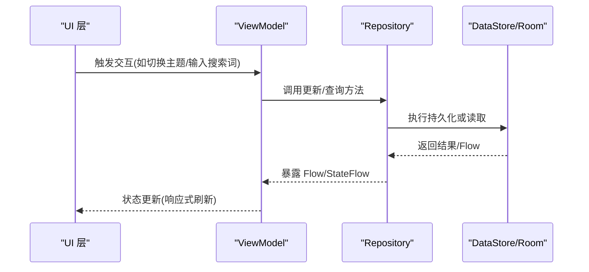
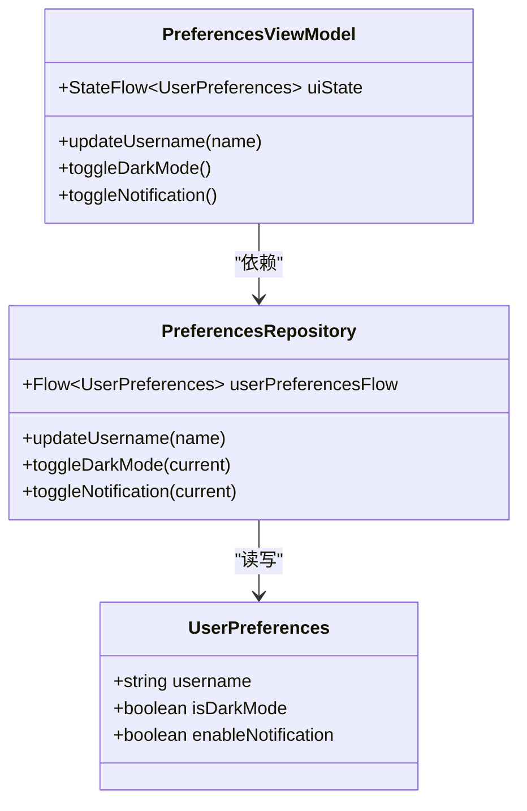
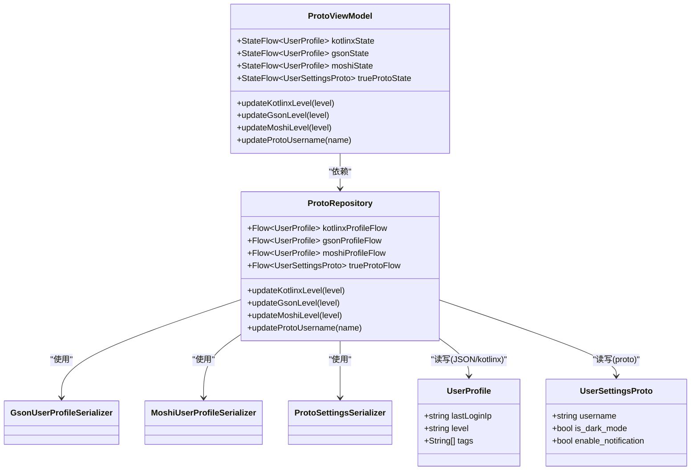
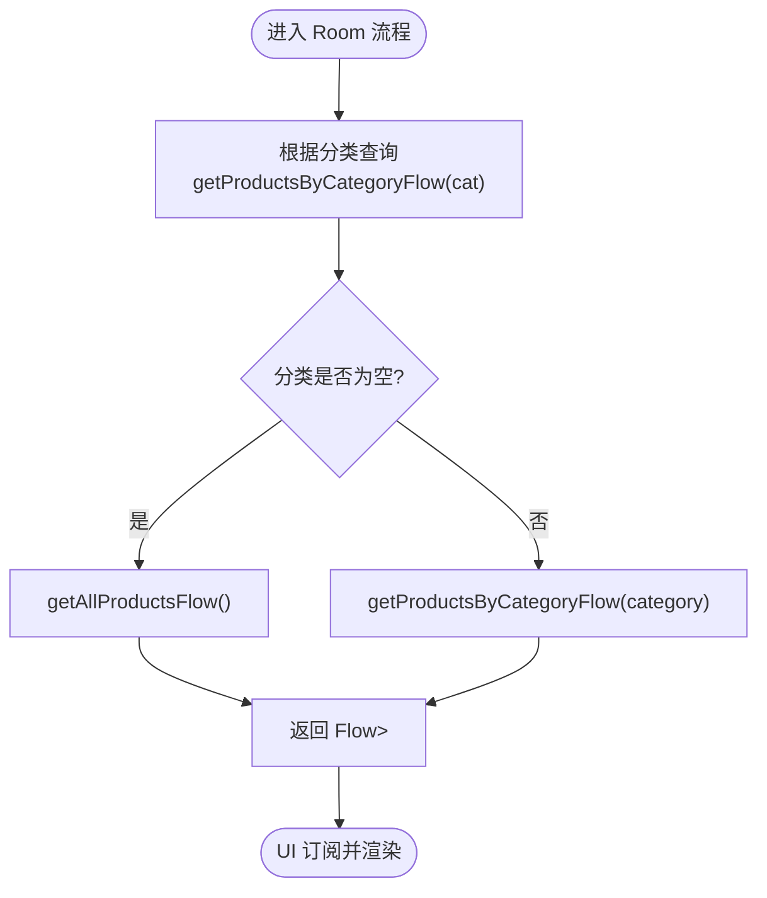
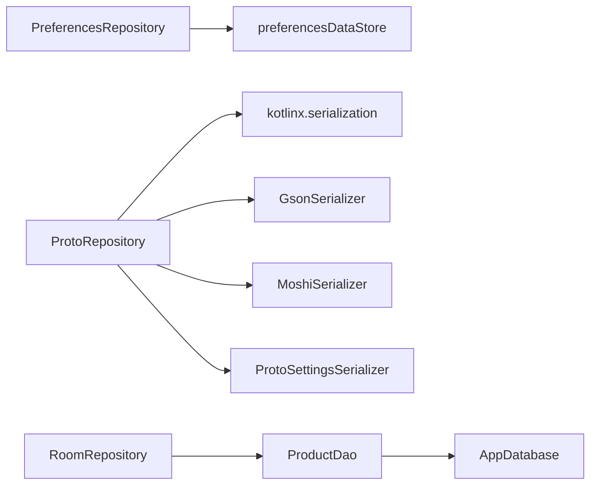

# 数据存储方案

<cite>
**本文引用的文件**   
- [DatastoreHub.kt](file://app/src/main/java/com/example/composeup/datastore/DatastoreHub.kt)
- [PreferencesRepository.kt](file://app/src/main/java/com/example/composeup/datastore/data/repository/PreferencesRepository.kt)
- [ProtoRepository.kt](file://app/src/main/java/com/example/composeup/datastore/data/repository/ProtoRepository.kt)
- [RoomRepository.kt](file://app/src/main/java/com/example/composeup/datastore/data/repository/RoomRepository.kt)
- [PreferencesViewModel.kt](file://app/src/main/java/com/example/composeup/ui/viewmodel/PreferencesViewModel.kt)
- [ProtoViewModel.kt](file://app/src/main/java/com/example/composeup/ui/viewmodel/ProtoViewModel.kt)
- [RoomViewModel.kt](file://app/src/main/java/com/example/composeup/ui/viewmodel/RoomViewModel.kt)
- [UserPreferences.kt](file://app/src/main/java/com/example/composeup/datastore/data/model/UserPreferences.kt)
- [UserProfile.kt](file://app/src/main/java/com/example/composeup/datastore/data/model/UserProfile.kt)
- [ProtoSettingsSerializer.kt](file://app/src/main/java/com/example/composeup/datastore/data/local/datastore/ProtoSettingsSerializer.kt)
- [GsonUserProfileSerializer.kt](file://app/src/main/java/com/example/composeup/datastore/data/local/datastore/GsonUserProfileSerializer.kt)
- [MoshiUserProfileSerializer.kt](file://app/src/main/java/com/example/composeup/datastore/data/local/datastore/MoshiUserProfileSerializer.kt)
- [AppDatabase.kt](file://app/src/main/java/com/example/composeup/data/local/room/AppDatabase.kt)
- [ProductDao.kt](file://app/src/main/java/com/example/composeup/data/local/room/ProductDao.kt)
- [user_prefs.proto](file://app/src/main/proto/user_prefs.proto)
</cite>

## 目录
1. [简介](#简介)
2. [项目结构](#项目结构)
3. [核心组件](#核心组件)
4. [架构总览](#架构总览)
5. [详细组件分析](#详细组件分析)
6. [依赖关系分析](#依赖关系分析)
7. [性能与缓存策略](#性能与缓存策略)
8. [选型指南与迁移策略](#选型指南与迁移策略)
9. [故障排查](#故障排查)
10. [结论](#结论)

## 简介
本仓库在 data 层集中演示了三种 Android 本地持久化方案：Preferences DataStore、Proto DataStore 与 Room Database。通过 Repository 层封装数据访问，ViewModel 暴露 StateFlow 给 UI 消费，形成清晰的分层与响应式数据流。该文档从架构、实现、配置、性能、选型与迁移等维度进行系统化说明，帮助开发者在不同业务场景下做出合适的技术决策。

## 项目结构
本项目围绕“本地存储全家桶”组织代码，入口为 DatastoreHub，分别路由到 Preferences、Proto、Room 三类 Demo；数据模型位于 datastore/data/model；序列化器位于 datastore/data/local/datastore；数据库定义与 DAO 位于 datastore/data/local/room；Repository 与 ViewModel 分别位于 datastore/data/repository 与 datastore/ui/viewmodel。

图表来源
- [DatastoreHub.kt:30-60](file://app/src/main/java/com/example/composeup/datastore/DatastoreHub.kt#L30-L60)
- [PreferencesRepository.kt:13-45](file://app/src/main/java/com/example/composeup/datastore/data/repository/PreferencesRepository.kt#L13-L45)
- [ProtoRepository.kt:17-72](file://app/src/main/java/com/example/composeup/datastore/data/repository/ProtoRepository.kt#L17-L72)
- [RoomRepository.kt:8-29](file://app/src/main/java/com/example/composeup/datastore/data/repository/RoomRepository.kt#L8-L29)
- [AppDatabase.kt:9-26](file://app/src/main/java/com/example/composeup/data/local/room/AppDatabase.kt#L9-L26)
- [ProductDao.kt:12-31](file://app/src/main/java/com/example/composeup/data/local/room/ProductDao.kt#L12-L31)

章节来源
- [DatastoreHub.kt:30-141](file://app/src/main/java/com/example/composeup/datastore/DatastoreHub.kt#L30-L141)

## 核心组件
- Preferences DataStore
  - 数据模型：UserPreferences（轻量键值对映射）
  - Repository：PreferencesRepository（基于 preferencesDataStore，提供 Flow 与更新方法）
  - ViewModel：PreferencesViewModel（StateFlow 暴露 UI 状态）
- Proto DataStore
  - 数据模型：UserProfile（kotlinx.serialization 与 JSON 适配）、UserSettingsProto（protobuf 生成）
  - 序列化器：GsonUserProfileSerializer、MoshiUserProfileSerializer、ProtoSettingsSerializer
  - Repository：ProtoRepository（同时演示 kotlinx.serialization、Gson、Moshi、Protobuf 四种实现）
  - ViewModel：ProtoViewModel（多 StateFlow 对应不同序列化实现）
- Room Database
  - 数据模型：ProductEntity（由 Room 管理）
  - DAO：ProductDao（CRUD 与 Flow 查询）
  - 数据库：AppDatabase（单例、迁移策略 fallbackToDestructiveMigration(true)）
  - Repository：RoomRepository（封装 DAO 调用）
  - ViewModel：RoomViewModel（组合搜索条件与列表 Flow）

章节来源
- [UserPreferences.kt:1-9](file://app/src/main/java/com/example/composeup/datastore/data/model/UserPreferences.kt#L1-L9)
- [PreferencesRepository.kt:13-45](file://app/src/main/java/com/example/composeup/datastore/data/repository/PreferencesRepository.kt#L13-L45)
- [PreferencesViewModel.kt:12-32](file://app/src/main/java/com/example/composeup/ui/viewmodel/PreferencesViewModel.kt#L12-L32)
- [UserProfile.kt:1-14](file://app/src/main/java/com/example/composeup/datastore/data/model/UserProfile.kt#L1-L14)
- [ProtoRepository.kt:17-72](file://app/src/main/java/com/example/composeup/datastore/data/repository/ProtoRepository.kt#L17-L72)
- [ProtoViewModel.kt:13-46](file://app/src/main/java/com/example/composeup/ui/viewmodel/ProtoViewModel.kt#L13-L46)
- [AppDatabase.kt:9-26](file://app/src/main/java/com/example/composeup/data/local/room/AppDatabase.kt#L9-L26)
- [ProductDao.kt:12-31](file://app/src/main/java/com/example/composeup/data/local/room/ProductDao.kt#L12-L31)
- [RoomRepository.kt:8-29](file://app/src/main/java/com/example/composeup/datastore/data/repository/RoomRepository.kt#L8-L29)
- [RoomViewModel.kt:12-40](file://app/src/main/java/com/example/composeup/ui/viewmodel/RoomViewModel.kt#L12-L40)

## 架构总览
整体采用 MVVM + Repository 分层：UI 层通过 ViewModel 订阅 StateFlow，ViewModel 调用 Repository，Repository 再访问 DataStore 或 Room。所有 I/O 操作均在协程中执行，避免主线程阻塞。

图表来源
- [PreferencesViewModel.kt:12-32](file://app/src/main/java/com/example/composeup/ui/viewmodel/PreferencesViewModel.kt#L12-L32)
- [ProtoViewModel.kt:13-46](file://app/src/main/java/com/example/composeup/ui/viewmodel/ProtoViewModel.kt#L13-L46)
- [RoomViewModel.kt:12-40](file://app/src/main/java/com/example/composeup/ui/viewmodel/RoomViewModel.kt#L12-L40)
- [PreferencesRepository.kt:13-45](file://app/src/main/java/com/example/composeup/datastore/data/repository/PreferencesRepository.kt#L13-L45)
- [ProtoRepository.kt:17-72](file://app/src/main/java/com/example/composeup/datastore/data/repository/ProtoRepository.kt#L17-L72)
- [RoomRepository.kt:8-29](file://app/src/main/java/com/example/composeup/datastore/data/repository/RoomRepository.kt#L8-L29)

## 详细组件分析

### Preferences DataStore
- 数据模型
  - UserPreferences：包含用户名、深色模式开关、通知开关等基础设置。
- Repository
  - 使用 preferencesDataStore 创建 DataStore，定义强类型 Key。
  - 通过 Flow 暴露当前配置，并在 IO 异常时回退到空配置。
  - 提供 updateUsername、toggleDarkMode、toggleNotification 等写操作。
- ViewModel
  - 将 repository.userPreferencesFlow 转为 StateFlow，默认初始值为 UserPreferences()。
  - 封装变更方法，委托给 Repository。

图表来源
- [UserPreferences.kt:1-9](file://app/src/main/java/com/example/composeup/datastore/data/model/UserPreferences.kt#L1-L9)
- [PreferencesRepository.kt:13-45](file://app/src/main/java/com/example/composeup/datastore/data/repository/PreferencesRepository.kt#L13-L45)
- [PreferencesViewModel.kt:12-32](file://app/src/main/java/com/example/composeup/ui/viewmodel/PreferencesViewModel.kt#L12-L32)

章节来源
- [UserPreferences.kt:1-9](file://app/src/main/java/com/example/composeup/datastore/data/model/UserPreferences.kt#L1-L9)
- [PreferencesRepository.kt:13-45](file://app/src/main/java/com/example/composeup/datastore/data/repository/PreferencesRepository.kt#L13-L45)
- [PreferencesViewModel.kt:12-32](file://app/src/main/java/com/example/composeup/ui/viewmodel/PreferencesViewModel.kt#L12-L32)

### Proto DataStore
- 数据模型
  - UserProfile：用于 kotlinx.serialization、Gson、Moshi 的强类型对象。
  - UserSettingsProto：由 .proto 定义的 Protobuf 消息。
- 序列化器
  - GsonUserProfileSerializer：基于 Gson 的 Serializer 实现。
  - MoshiUserProfileSerializer：基于 Moshi 的 Serializer 实现。
  - ProtoSettingsSerializer：基于 protobuf 的 Serializer 实现，处理解析异常并抛出 CorruptionException。
- Repository
  - 同时维护四个 DataStore 实例：kotlinx.serialization、Gson、Moshi、true proto。
  - 暴露对应的 Flow，并提供更新方法。
- ViewModel
  - 为每种序列化实现暴露独立的 StateFlow，便于对比与演示。

图表来源
- [UserProfile.kt:1-14](file://app/src/main/java/com/example/composeup/datastore/data/model/UserProfile.kt#L1-L14)
- [user_prefs.proto:1-11](file://app/src/main/proto/user_prefs.proto#L1-L11)
- [GsonUserProfileSerializer.kt:11-27](file://app/src/main/java/com/example/composeup/datastore/data/local/datastore/GsonUserProfileSerializer.kt#L11-L27)
- [MoshiUserProfileSerializer.kt:11-29](file://app/src/main/java/com/example/composeup/datastore/data/local/datastore/MoshiUserProfileSerializer.kt#L11-L29)
- [ProtoSettingsSerializer.kt:12-28](file://app/src/main/java/com/example/composeup/datastore/data/local/datastore/ProtoSettingsSerializer.kt#L12-L28)
- [ProtoRepository.kt:17-72](file://app/src/main/java/com/example/composeup/datastore/data/repository/ProtoRepository.kt#L17-L72)
- [ProtoViewModel.kt:13-46](file://app/src/main/java/com/example/composeup/ui/viewmodel/ProtoViewModel.kt#L13-L46)

章节来源
- [UserProfile.kt:1-14](file://app/src/main/java/com/example/composeup/datastore/data/model/UserProfile.kt#L1-L14)
- [user_prefs.proto:1-11](file://app/src/main/proto/user_prefs.proto#L1-L11)
- [GsonUserProfileSerializer.kt:11-27](file://app/src/main/java/com/example/composeup/datastore/data/local/datastore/GsonUserProfileSerializer.kt#L11-L27)
- [MoshiUserProfileSerializer.kt:11-29](file://app/src/main/java/com/example/composeup/datastore/data/local/datastore/MoshiUserProfileSerializer.kt#L11-L29)
- [ProtoSettingsSerializer.kt:12-28](file://app/src/main/java/com/example/composeup/datastore/data/local/datastore/ProtoSettingsSerializer.kt#L12-L28)
- [ProtoRepository.kt:17-72](file://app/src/main/java/com/example/composeup/datastore/data/repository/ProtoRepository.kt#L17-L72)
- [ProtoViewModel.kt:13-46](file://app/src/main/java/com/example/composeup/ui/viewmodel/ProtoViewModel.kt#L13-L46)

### Room Database
- 数据模型
  - ProductEntity：产品实体（由 Room 管理）。
- DAO
  - ProductDao：提供 insert/delete/update 与 Flow 查询（全部/按分类）。
- 数据库
  - AppDatabase：单例，使用 fallbackToDestructiveMigration(true) 简化迁移。
- Repository
  - RoomRepository：封装 DAO 调用，根据分类参数选择查询 Flow。
- ViewModel
  - RoomViewModel：组合搜索词 Flow 与产品列表 Flow，支持添加与清空。

图表来源
- [RoomRepository.kt:14-20](file://app/src/main/java/com/example/composeup/datastore/data/repository/RoomRepository.kt#L14-L20)
- [ProductDao.kt:23-27](file://app/src/main/java/com/example/composeup/data/local/room/ProductDao.kt#L23-L27)

章节来源
- [AppDatabase.kt:9-26](file://app/src/main/java/com/example/composeup/data/local/room/AppDatabase.kt#L9-L26)
- [ProductDao.kt:12-31](file://app/src/main/java/com/example/composeup/data/local/room/ProductDao.kt#L12-L31)
- [RoomRepository.kt:8-29](file://app/src/main/java/com/example/composeup/datastore/data/repository/RoomRepository.kt#L8-L29)
- [RoomViewModel.kt:12-40](file://app/src/main/java/com/example/composeup/ui/viewmodel/RoomViewModel.kt#L12-L40)

## 依赖关系分析
- Preferences DataStore
  - 依赖 androidx.datastore.preferences.*，Key 使用 stringPreferencesKey/booleanPreferencesKey。
  - 通过 Flow.catch 处理 IOException，回退到 emptyPreferences。
- Proto DataStore
  - 依赖 kotlinx.serialization、Gson、Moshi、protobuf。
  - 每个序列化器实现 Serializer<T>，统一读写接口。
- Room
  - 依赖 androidx.room.*，DAO 返回 Flow 以支持响应式查询。
  - 数据库单例通过 synchronized 保证线程安全。

图表来源
- [PreferencesRepository.kt:13-45](file://app/src/main/java/com/example/composeup/datastore/data/repository/PreferencesRepository.kt#L13-L45)
- [ProtoRepository.kt:17-72](file://app/src/main/java/com/example/composeup/datastore/data/repository/ProtoRepository.kt#L17-L72)
- [RoomRepository.kt:8-29](file://app/src/main/java/com/example/composeup/datastore/data/repository/RoomRepository.kt#L8-L29)
- [AppDatabase.kt:9-26](file://app/src/main/java/com/example/composeup/data/local/room/AppDatabase.kt#L9-L26)
- [ProductDao.kt:12-31](file://app/src/main/java/com/example/composeup/data/local/room/ProductDao.kt#L12-L31)

章节来源
- [PreferencesRepository.kt:13-45](file://app/src/main/java/com/example/composeup/datastore/data/repository/PreferencesRepository.kt#L13-L45)
- [ProtoRepository.kt:17-72](file://app/src/main/java/com/example/composeup/datastore/data/repository/ProtoRepository.kt#L17-L72)
- [RoomRepository.kt:8-29](file://app/src/main/java/com/example/composeup/datastore/data/repository/RoomRepository.kt#L8-L29)

## 性能与缓存策略
- 通用原则
  - 所有 I/O 在协程中执行，避免主线程阻塞。
  - ViewModel 使用 stateIn + SharingStarted.WhileSubscribed(5000) 控制 Flow 生命周期，减少不必要的订阅开销。
- Preferences DataStore
  - 优点：轻量、API 简单、适合键值对配置。
  - 注意：大量字段时 Key 管理复杂，不适合复杂嵌套结构。
- Proto DataStore
  - 优点：编译期类型安全、二进制序列化效率高（Protobuf），JSON 序列化器便于对比。
  - 注意：Protobuf 需要 .proto 定义与代码生成；JSON 序列化器需处理异常回退。
- Room Database
  - 优点：SQL 编译期校验、支持 JOIN/过滤/分页/全文检索，适合海量结构化数据。
  - 注意：迁移需显式管理（示例中使用 destructive migration 简化）。

章节来源
- [PreferencesViewModel.kt:12-32](file://app/src/main/java/com/example/composeup/ui/viewmodel/PreferencesViewModel.kt#L12-L32)
- [ProtoViewModel.kt:13-46](file://app/src/main/java/com/example/composeup/ui/viewmodel/ProtoViewModel.kt#L13-L46)
- [RoomViewModel.kt:12-40](file://app/src/main/java/com/example/composeup/ui/viewmodel/RoomViewModel.kt#L12-L40)
- [ProtoSettingsSerializer.kt:12-28](file://app/src/main/java/com/example/composeup/datastore/data/local/datastore/ProtoSettingsSerializer.kt#L12-L28)
- [AppDatabase.kt:17-24](file://app/src/main/java/com/example/composeup/data/local/room/AppDatabase.kt#L17-L24)

## 选型指南与迁移策略
- 选型建议
  - 简单配置/独立开关项：选 Preferences DataStore（极其轻量快捷）。
  - 复杂多维、有层级嵌套的配置模型：选 Proto DataStore（安全、对象化）。
  - 海量、有关联、频繁精确查询/局部修改的数据：选 Room Database。
- 迁移策略
  - Preferences → Proto DataStore：将分散的 Key 聚合为强类型对象，逐步替换读写逻辑。
  - Proto DataStore → Room：当数据结构具备关联性与复杂查询需求时，引入 Entity/DAO，保留旧 DataStore 作为过渡。
  - Room 版本升级：使用 @Database(version, exportSchema) 配合 Migration 类；若无法编写稳定迁移，可临时使用 fallbackToDestructiveMigration(true)（仅开发/测试环境推荐）。

章节来源
- [DatastoreHub.kt:30-60](file://app/src/main/java/com/example/composeup/datastore/DatastoreHub.kt#L30-L60)
- [AppDatabase.kt:9-26](file://app/src/main/java/com/example/composeup/data/local/room/AppDatabase.kt#L9-L26)

## 故障排查
- DataStore IO 异常
  - Preferences DataStore：捕获 IOException 并回退到空配置，确保 UI 不崩溃。
  - Proto DataStore：Protobuf 解析失败抛出 CorruptionException，需检查文件完整性与 schema 一致性。
- 序列化兼容
  - Gson/Moshi：反序列化失败时返回默认值，避免应用崩溃；建议增加日志定位字段缺失问题。
- Room 迁移
  - 若出现版本不一致错误，检查 @Database(version) 与 Migration 实现；必要时启用 destructive migration 快速恢复（谨慎使用）。

章节来源
- [PreferencesRepository.kt:22-25](file://app/src/main/java/com/example/composeup/datastore/data/repository/PreferencesRepository.kt#L22-L25)
- [ProtoSettingsSerializer.kt:15-20](file://app/src/main/java/com/example/composeup/datastore/data/local/datastore/ProtoSettingsSerializer.kt#L15-L20)
- [GsonUserProfileSerializer.kt:14-20](file://app/src/main/java/com/example/composeup/datastore/data/local/datastore/GsonUserProfileSerializer.kt#L14-L20)
- [MoshiUserProfileSerializer.kt:16-21](file://app/src/main/java/com/example/composeup/datastore/data/local/datastore/MoshiUserProfileSerializer.kt#L16-L21)
- [AppDatabase.kt:17-24](file://app/src/main/java/com/example/composeup/data/local/room/AppDatabase.kt#L17-L24)

## 结论
- Preferences DataStore 适合轻量配置；Proto DataStore 适合强类型、嵌套结构的配置；Room 适合复杂关系型数据的离线存储。
- 通过 Repository 抽象与 ViewModel 暴露 StateFlow，可实现清晰的响应式数据流与良好的可测试性。
- 在生产环境中应谨慎使用 destructive migration，优先编写稳定的 Migration 类；对于序列化器，建议统一异常处理与默认值策略，提升鲁棒性。