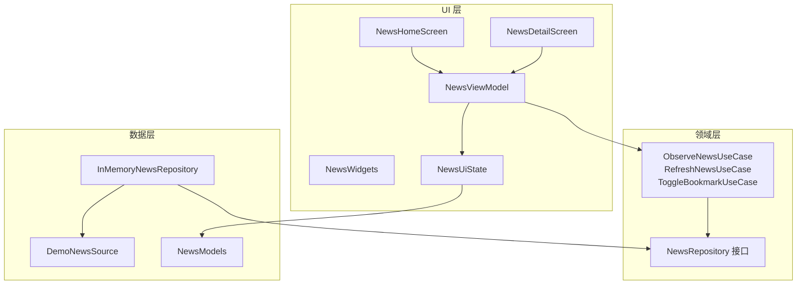
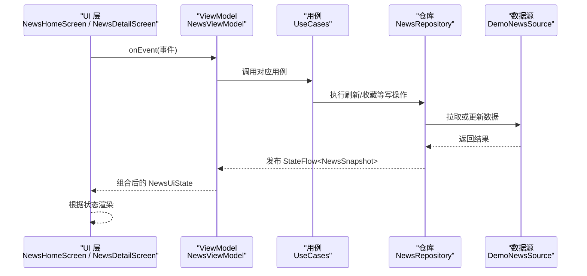
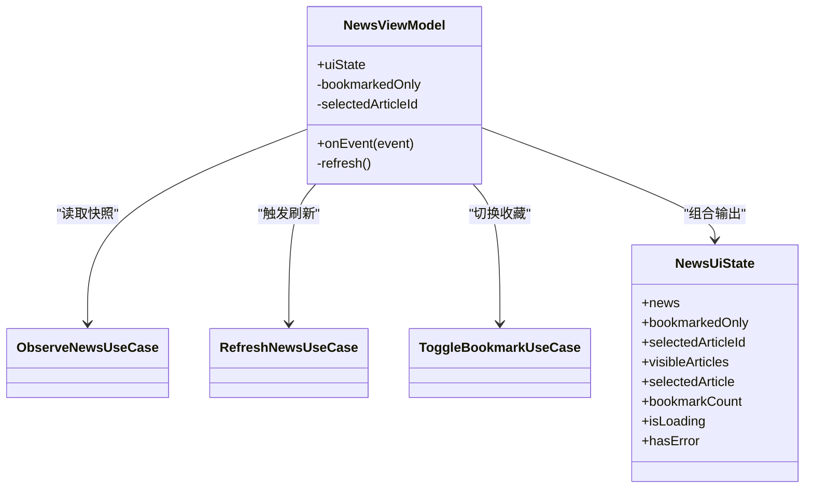
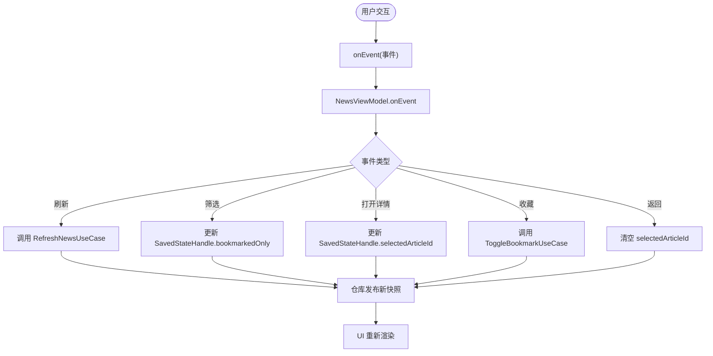
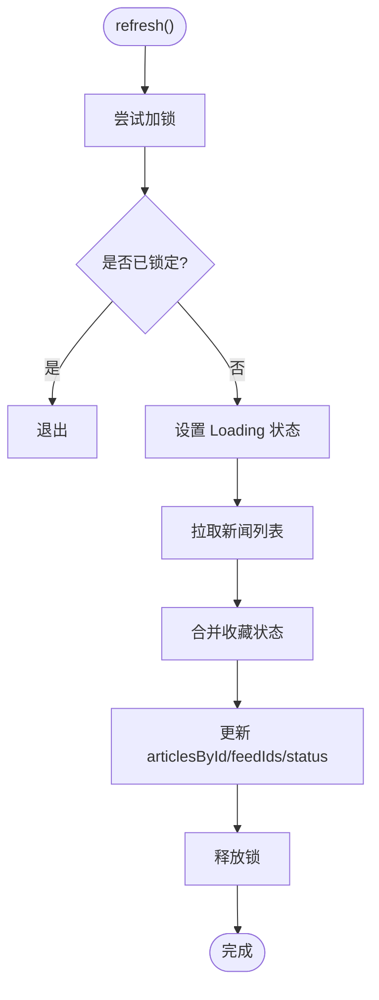
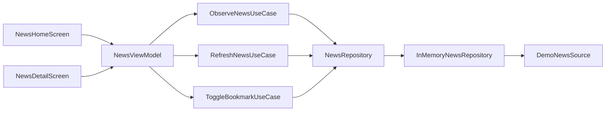

# MVVM 分层架构

<cite>
**本文引用的文件**   
- [NewsViewModel.kt](file://app/src/main/java/com/example/composeup/architecture/ui/NewsViewModel.kt)
- [NewsUiState.kt](file://app/src/main/java/com/example/composeup/architecture/ui/NewsUiState.kt)
- [NewsHomeScreen.kt](file://app/src/main/java/com/example/composeup/architecture/ui/NewsHomeScreen.kt)
- [NewsDetailScreen.kt](file://app/src/main/java/com/example/composeup/architecture/ui/NewsDetailScreen.kt)
- [NewsWidgets.kt](file://app/src/main/java/com/example/composeup/architecture/ui/NewsWidgets.kt)
- [NewsRepository.kt](file://app/src/main/java/com/example/composeup/architecture/domain/NewsRepository.kt)
- [InMemoryNewsRepository.kt](file://app/src/main/java/com/example/composeup/architecture/data/InMemoryNewsRepository.kt)
- [NewsUseCases.kt](file://app/src/main/java/com/example/composeup/architecture/domain/NewsUseCases.kt)
- [NewsModels.kt](file://app/src/main/java/com/example/composeup/architecture/domain/NewsModels.kt)
- [DemoNewsSource.kt](file://app/src/main/java/com/example/composeup/architecture/data/DemoNewsSource.kt)
</cite>

## 目录
1. [简介](#简介)
2. [项目结构](#项目结构)
3. [核心组件](#核心组件)
4. [架构总览](#架构总览)
5. [详细组件分析](#详细组件分析)
6. [依赖关系分析](#依赖关系分析)
7. [性能与可维护性](#性能与可维护性)
8. [故障排查指南](#故障排查指南)
9. [结论](#结论)

## 简介
本文件围绕 Compose 中的 MVVM 分层实现，系统说明 Model-View-ViewModel 模式在新闻示例中的应用。重点包括：
- ViewModel 的职责边界与事件处理机制
- 状态管理策略、单向数据流和状态提升
- NewsViewModel 如何协调 UI 层与业务逻辑层
- 组合函数（Composable）的最佳实践与数据同步方式

该示例通过领域模型、用例、仓库和演示数据源，展示了从界面交互到数据更新的完整链路，并强调“事件向上、状态向下”的单向数据流原则。

## 项目结构
MVVM 相关代码集中在 architecture 包下，按职责划分为三层：
- UI 层：Compose 屏幕与组件，负责渲染状态与上报事件
- 领域层：用例与仓库接口，表达用户目标与数据契约
- 数据层：内存仓库与演示数据源，提供唯一事实来源

图表来源
- [NewsHomeScreen.kt:24-97](file://app/src/main/java/com/example/composeup/architecture/ui/NewsHomeScreen.kt#L24-L97)
- [NewsDetailScreen.kt:20-66](file://app/src/main/java/com/example/composeup/architecture/ui/NewsDetailScreen.kt#L20-L66)
- [NewsViewModel.kt:14-50](file://app/src/main/java/com/example/composeup/architecture/ui/NewsViewModel.kt#L14-L50)
- [NewsUiState.kt:7-28](file://app/src/main/java/com/example/composeup/architecture/ui/NewsUiState.kt#L7-L28)
- [NewsRepository.kt:5-11](file://app/src/main/java/com/example/composeup/architecture/domain/NewsRepository.kt#L5-L11)
- [InMemoryNewsRepository.kt:13-52](file://app/src/main/java/com/example/composeup/architecture/data/InMemoryNewsRepository.kt#L13-L52)
- [NewsUseCases.kt:5-15](file://app/src/main/java/com/example/composeup/architecture/domain/NewsUseCases.kt#L5-L15)
- [NewsModels.kt:3-20](file://app/src/main/java/com/example/composeup/architecture/domain/NewsModels.kt#L3-L20)
- [DemoNewsSource.kt:6-8](file://app/src/main/java/com/example/composeup/architecture/data/DemoNewsSource.kt#L6-L8)

章节来源
- [NewsHomeScreen.kt:24-97](file://app/src/main/java/com/example/composeup/architecture/ui/NewsHomeScreen.kt#L24-L97)
- [NewsDetailScreen.kt:20-66](file://app/src/main/java/com/example/composeup/architecture/ui/NewsDetailScreen.kt#L20-L66)
- [NewsViewModel.kt:14-50](file://app/src/main/java/com/example/composeup/architecture/ui/NewsViewModel.kt#L14-L50)
- [NewsUiState.kt:7-28](file://app/src/main/java/com/example/composeup/architecture/ui/NewsUiState.kt#L7-L28)
- [NewsRepository.kt:5-11](file://app/src/main/java/com/example/composeup/architecture/domain/NewsRepository.kt#L5-L11)
- [InMemoryNewsRepository.kt:13-52](file://app/src/main/java/com/example/composeup/architecture/data/InMemoryNewsRepository.kt#L13-L52)
- [NewsUseCases.kt:5-15](file://app/src/main/java/com/example/composeup/architecture/domain/NewsUseCases.kt#L5-L15)
- [NewsModels.kt:3-20](file://app/src/main/java/com/example/composeup/architecture/domain/NewsModels.kt#L3-L20)
- [DemoNewsSource.kt:6-8](file://app/src/main/java/com/example/composeup/architecture/data/DemoNewsSource.kt#L6-L8)

## 核心组件
- NewsViewModel：协调 UI 与领域层，组合屏幕状态，处理事件，持久化导航选择
- NewsUiState：UI 层的状态载体，包含派生视图状态与事件定义
- NewsRepository：领域层的数据契约，暴露只读快照与写操作
- InMemoryNewsRepository：内存实现，维护归一化数据与刷新状态
- UseCases：以用户目标命名的用例，封装对仓库的调用
- NewsModels：领域模型与刷新状态枚举
- DemoNewsSource：演示数据源，模拟异步获取新闻

章节来源
- [NewsViewModel.kt:14-50](file://app/src/main/java/com/example/composeup/architecture/ui/NewsViewModel.kt#L14-L50)
- [NewsUiState.kt:7-36](file://app/src/main/java/com/example/composeup/architecture/ui/NewsUiState.kt#L7-L36)
- [NewsRepository.kt:5-11](file://app/src/main/java/com/example/composeup/architecture/domain/NewsRepository.kt#L5-L11)
- [InMemoryNewsRepository.kt:13-52](file://app/src/main/java/com/example/composeup/architecture/data/InMemoryNewsRepository.kt#L13-L52)
- [NewsUseCases.kt:5-15](file://app/src/main/java/com/example/composeup/architecture/domain/NewsUseCases.kt#L5-L15)
- [NewsModels.kt:3-20](file://app/src/main/java/com/example/composeup/architecture/domain/NewsModels.kt#L3-L20)
- [DemoNewsSource.kt:6-8](file://app/src/main/java/com/example/composeup/architecture/data/DemoNewsSource.kt#L6-L8)

## 架构总览
MVVM 在本示例中体现为：
- View（Compose 屏幕）仅消费状态并触发事件
- ViewModel 将事件转换为用例调用，并组合出 UI 状态
- 领域层用例统一入口，仓库提供唯一数据源
- 数据通过 StateFlow 单向流动，避免双向绑定导致的状态不一致

图表来源
- [NewsHomeScreen.kt:24-97](file://app/src/main/java/com/example/composeup/architecture/ui/NewsHomeScreen.kt#L24-L97)
- [NewsDetailScreen.kt:20-66](file://app/src/main/java/com/example/composeup/architecture/ui/NewsDetailScreen.kt#L20-L66)
- [NewsViewModel.kt:38-50](file://app/src/main/java/com/example/composeup/architecture/ui/NewsViewModel.kt#L38-L50)
- [NewsUseCases.kt:5-15](file://app/src/main/java/com/example/composeup/architecture/domain/NewsUseCases.kt#L5-L15)
- [NewsRepository.kt:5-11](file://app/src/main/java/com/example/composeup/architecture/domain/NewsRepository.kt#L5-L11)
- [InMemoryNewsRepository.kt:18-42](file://app/src/main/java/com/example/composeup/architecture/data/InMemoryNewsRepository.kt#L18-L42)
- [DemoNewsSource.kt:10-80](file://app/src/main/java/com/example/composeup/architecture/data/DemoNewsSource.kt#L10-L80)

## 详细组件分析

### ViewModel 与状态管理
- NewsViewModel 持有三个关键输入：
  - 观察新闻的用例：提供实时新闻快照
  - 刷新用例：触发数据更新
  - 收藏切换用例：修改文章收藏状态
- 使用 SavedStateHandle 持久化筛选条件与当前选中文章 ID，保证配置变更或进程恢复后状态一致
- 通过 combine 合并多个 Flow，生成统一的 NewsUiState，并使用 stateIn 将其转为共享状态流，订阅者可见且生命周期安全
- init 块自动触发首次刷新，确保页面进入即有数据

图表来源
- [NewsViewModel.kt:14-50](file://app/src/main/java/com/example/composeup/architecture/ui/NewsViewModel.kt#L14-L50)
- [NewsUiState.kt:7-28](file://app/src/main/java/com/example/composeup/architecture/ui/NewsUiState.kt#L7-L28)
- [NewsUseCases.kt:5-15](file://app/src/main/java/com/example/composeup/architecture/domain/NewsUseCases.kt#L5-L15)

章节来源
- [NewsViewModel.kt:14-50](file://app/src/main/java/com/example/composeup/architecture/ui/NewsViewModel.kt#L14-L50)
- [NewsUiState.kt:7-28](file://app/src/main/java/com/example/composeup/architecture/ui/NewsUiState.kt#L7-L28)

### UI 层与事件处理
- NewsHomeScreen 与 NewsDetailScreen 均接收 NewsUiState 与 onEvent 回调
- 所有用户交互（刷新、筛选、打开详情、收藏、返回）都通过 onEvent 上报，不直接访问仓库
- 列表项点击打开详情；收藏按钮触发收藏事件；筛选 Chip 切换仅看收藏
- 加载、错误、空态由 NewsUiState 派生属性控制，UI 只做展示

图表来源
- [NewsHomeScreen.kt:47-94](file://app/src/main/java/com/example/composeup/architecture/ui/NewsHomeScreen.kt#L47-L94)
- [NewsDetailScreen.kt:52-54](file://app/src/main/java/com/example/composeup/architecture/ui/NewsDetailScreen.kt#L52-L54)
- [NewsViewModel.kt:38-50](file://app/src/main/java/com/example/composeup/architecture/ui/NewsViewModel.kt#L38-L50)

章节来源
- [NewsHomeScreen.kt:24-97](file://app/src/main/java/com/example/composeup/architecture/ui/NewsHomeScreen.kt#L24-L97)
- [NewsDetailScreen.kt:20-66](file://app/src/main/java/com/example/composeup/architecture/ui/NewsDetailScreen.kt#L20-L66)
- [NewsViewModel.kt:38-50](file://app/src/main/java/com/example/composeup/architecture/ui/NewsViewModel.kt#L38-L50)

### 领域层与数据层
- NewsRepository 定义只读快照与写操作的契约
- InMemoryNewsRepository 维护归一化的 NewsSnapshot：articlesById 保存实体，feedIds 保存顺序，refreshStatus 表示加载状态
- 刷新流程：
  - 使用互斥锁防止并发刷新
  - 先标记 Loading，再拉取数据
  - 合并旧收藏状态，避免覆盖用户最新收藏
  - 成功时标记 Ready，失败时标记 Failed，取消时恢复之前状态
- 收藏切换直接更新 articlesById 中的条目

图表来源
- [InMemoryNewsRepository.kt:18-42](file://app/src/main/java/com/example/composeup/architecture/data/InMemoryNewsRepository.kt#L18-L42)
- [NewsModels.kt:14-20](file://app/src/main/java/com/example/composeup/architecture/domain/NewsModels.kt#L14-L20)

章节来源
- [NewsRepository.kt:5-11](file://app/src/main/java/com/example/composeup/architecture/domain/NewsRepository.kt#L5-L11)
- [InMemoryNewsRepository.kt:13-52](file://app/src/main/java/com/example/composeup/architecture/data/InMemoryNewsRepository.kt#L13-L52)
- [NewsModels.kt:14-20](file://app/src/main/java/com/example/composeup/architecture/domain/NewsModels.kt#L14-L20)

### 状态提升与组合函数最佳实践
- 状态提升：
  - 所有可变状态（筛选、选中文章）提升到 ViewModel 并通过 SavedStateHandle 持久化
  - UI 组件只消费不可变状态，避免内部状态分散
- 组合函数设计：
  - 屏幕级组件接收 state 与 onEvent，保持纯函数式渲染
  - 小组件（如卡片、书签按钮、加载与错误提示）仅接收必要参数与回调
- 派生状态：
  - visibleArticles、selectedArticle、bookmarkCount、isLoading、hasError 均由基础状态推导，避免重复存储
- 导航状态：
  - selectedArticleId 作为持久状态，支持跨页面同步与恢复

章节来源
- [NewsUiState.kt:7-28](file://app/src/main/java/com/example/composeup/architecture/ui/NewsUiState.kt#L7-L28)
- [NewsHomeScreen.kt:24-97](file://app/src/main/java/com/example/composeup/architecture/ui/NewsHomeScreen.kt#L24-L97)
- [NewsDetailScreen.kt:20-66](file://app/src/main/java/com/example/composeup/architecture/ui/NewsDetailScreen.kt#L20-L66)
- [NewsWidgets.kt:24-82](file://app/src/main/java/com/example/composeup/architecture/ui/NewsWidgets.kt#L24-L82)

## 依赖关系分析
- 低耦合：
  - UI 层不直接依赖仓库，仅通过 ViewModel 暴露的事件与状态交互
  - ViewModel 通过用例与仓库接口解耦具体数据实现
- 高内聚：
  - 用例按用户目标组织，单一职责明确
  - 仓库集中管理数据一致性、并发与异常处理
- 外部依赖：
  - DemoNewsSource 模拟网络延迟与数据返回，便于演示与测试

图表来源
- [NewsHomeScreen.kt:24-97](file://app/src/main/java/com/example/composeup/architecture/ui/NewsHomeScreen.kt#L24-L97)
- [NewsDetailScreen.kt:20-66](file://app/src/main/java/com/example/composeup/architecture/ui/NewsDetailScreen.kt#L20-L66)
- [NewsViewModel.kt:14-50](file://app/src/main/java/com/example/composeup/architecture/ui/NewsViewModel.kt#L14-L50)
- [NewsUseCases.kt:5-15](file://app/src/main/java/com/example/composeup/architecture/domain/NewsUseCases.kt#L5-L15)
- [NewsRepository.kt:5-11](file://app/src/main/java/com/example/composeup/architecture/domain/NewsRepository.kt#L5-L11)
- [InMemoryNewsRepository.kt:13-52](file://app/src/main/java/com/example/composeup/architecture/data/InMemoryNewsRepository.kt#L13-L52)
- [DemoNewsSource.kt:10-80](file://app/src/main/java/com/example/composeup/architecture/data/DemoNewsSource.kt#L10-L80)

章节来源
- [NewsViewModel.kt:14-50](file://app/src/main/java/com/example/composeup/architecture/ui/NewsViewModel.kt#L14-L50)
- [NewsUseCases.kt:5-15](file://app/src/main/java/com/example/composeup/architecture/domain/NewsUseCases.kt#L5-L15)
- [NewsRepository.kt:5-11](file://app/src/main/java/com/example/composeup/architecture/domain/NewsRepository.kt#L5-L11)
- [InMemoryNewsRepository.kt:13-52](file://app/src/main/java/com/example/composeup/architecture/data/InMemoryNewsRepository.kt#L13-L52)
- [DemoNewsSource.kt:10-80](file://app/src/main/java/com/example/composeup/architecture/data/DemoNewsSource.kt#L10-L80)

## 性能与可维护性
- 性能优化：
  - stateIn 配合 WhileSubscribed 减少无效收集，仅在订阅存在时维持状态流
  - 归一化状态避免多份副本，降低同步成本
  - 互斥锁保护刷新流程，避免竞态条件
- 可维护性：
  - 用例命名反映用户目标，便于扩展与替换实现
  - UI 与业务解耦，便于单元测试与替换数据源
  - 派生状态集中计算，减少状态漂移风险

[本节为通用指导，不直接分析具体文件]

## 故障排查指南
- 常见问题与定位：
  - 收藏不同步：检查是否通过同一 articlesById 索引更新，避免多处复制实体
  - 刷新覆盖收藏：确认刷新合并逻辑会保留最新 isBookmarked 值
  - 加载与错误状态矛盾：检查 isLoading 与 hasError 的派生逻辑，确保基于 refreshStatus 计算
  - 导航状态丢失：确认 selectedArticleId 通过 SavedStateHandle 持久化
- 调试建议：
  - 在 ViewModel 的 onEvent 分支打印事件类型与参数
  - 观察仓库发布的 StateFlow 变化，确认状态更新路径
  - 使用演示数据源的延迟模拟真实网络场景，验证加载体验

章节来源
- [InMemoryNewsRepository.kt:18-52](file://app/src/main/java/com/example/composeup/architecture/data/InMemoryNewsRepository.kt#L18-L52)
- [NewsUiState.kt:12-28](file://app/src/main/java/com/example/composeup/architecture/ui/NewsUiState.kt#L12-L28)
- [NewsViewModel.kt:38-50](file://app/src/main/java/com/example/composeup/architecture/ui/NewsViewModel.kt#L38-L50)

## 结论
该示例清晰展示了 Compose 中 MVVM 分层的落地方式：
- UI 层专注渲染与事件上报
- ViewModel 组合状态、处理事件、协调用例
- 领域层用例与仓库接口抽象业务与数据契约
- 数据层提供唯一事实来源，保证一致性

通过状态提升、派生状态与单向数据流，系统在复杂交互中仍保持可预测性与可维护性。实际项目中可将内存仓库替换为数据库或网络实现，同时复用现有 ViewModel 与 UI 层，获得良好的可扩展性。