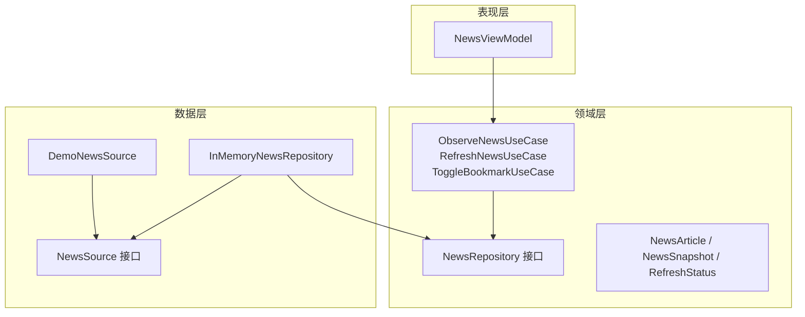
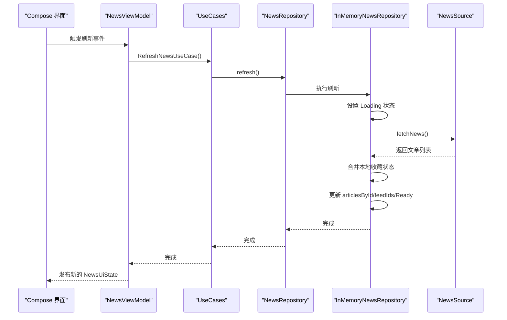
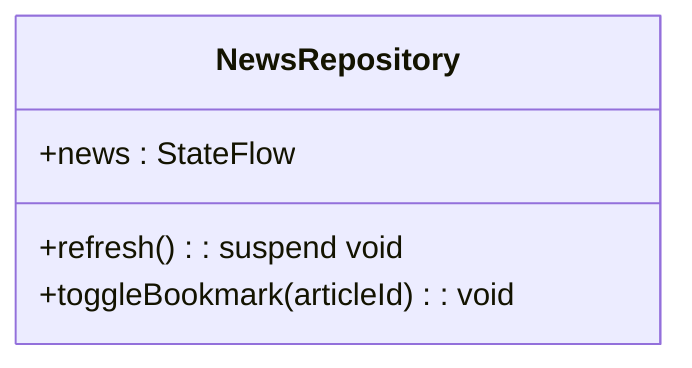
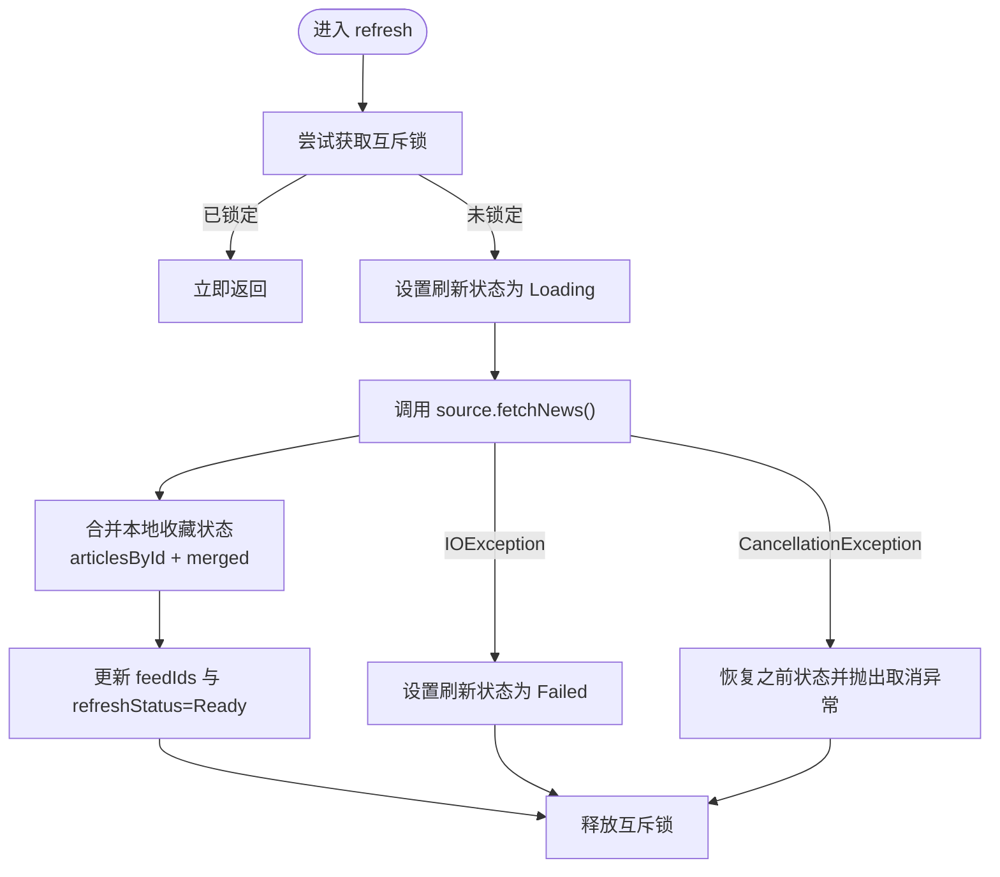
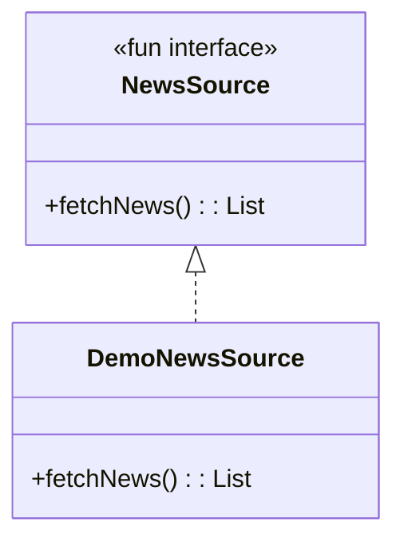
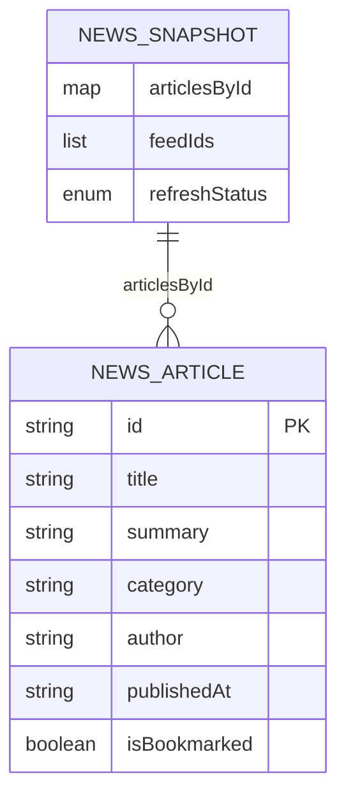
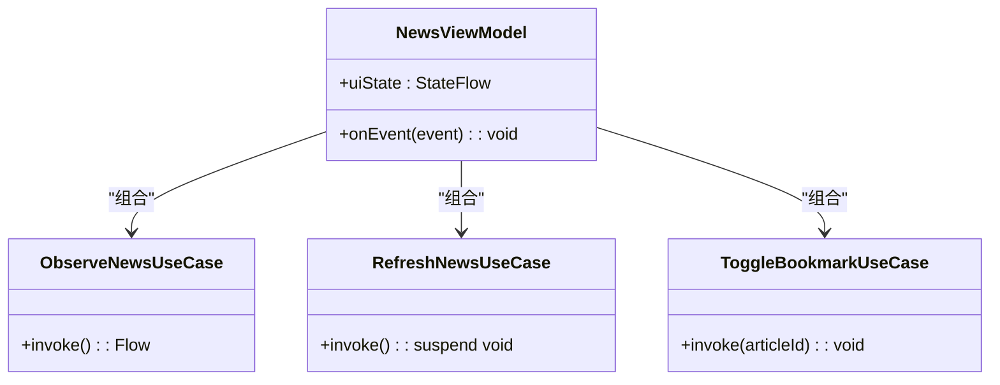
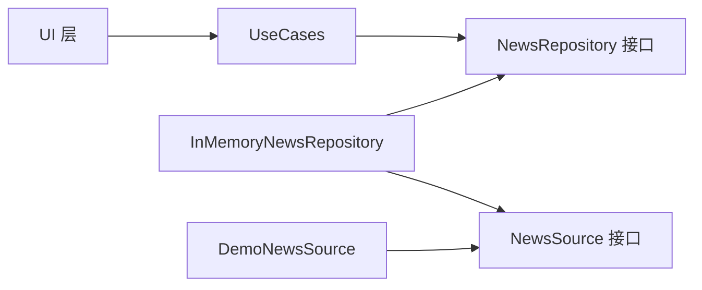
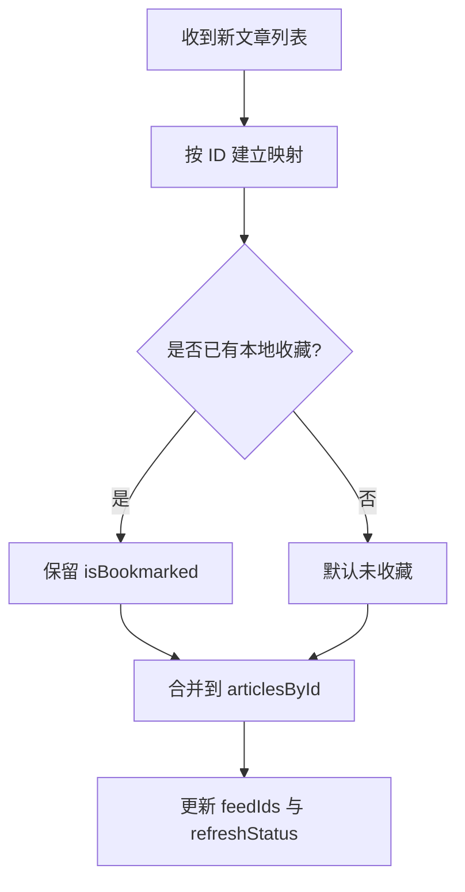

# Repository 模式

<cite>
**本文引用的文件**   
- [NewsRepository.kt](file://app/src/main/java/com/example/composeup/architecture/domain/NewsRepository.kt)
- [InMemoryNewsRepository.kt](file://app/src/main/java/com/example/composeup/architecture/data/InMemoryNewsRepository.kt)
- [DemoNewsSource.kt](file://app/src/main/java/com/example/composeup/architecture/data/DemoNewsSource.kt)
- [NewsModels.kt](file://app/src/main/java/com/example/composeup/architecture/domain/NewsModels.kt)
- [NewsUseCases.kt](file://app/src/main/java/com/example/composeup/architecture/domain/NewsUseCases.kt)
- [NewsViewModel.kt](file://app/src/main/java/com/example/composeup/architecture/ui/NewsViewModel.kt)
- [InMemoryNewsRepositoryTest.kt](file://app/src/test/java/com/example/composeup/architecture/InMemoryNewsRepositoryTest.kt)
</cite>

## 目录
1. [引言](#引言)
2. [项目结构](#项目结构)
3. [核心组件](#核心组件)
4. [架构总览](#架构总览)
5. [详细组件分析](#详细组件分析)
6. [依赖关系分析](#依赖关系分析)
7. [性能与并发特性](#性能与并发特性)
8. [数据源切换与聚合策略](#数据源切换与聚合策略)
9. [故障排查指南](#故障排查指南)
10. [结论](#结论)

## 引言
本文围绕新闻模块中的 Repository 模式展开，重点说明：
- NewsRepository 接口的设计目标与抽象层次。
- InMemoryNewsRepository 如何通过统一抽象封装内存、网络和本地存储等数据源。
- 数据源的切换方式与数据聚合逻辑。
- Repository 模式在解耦业务逻辑与数据访问方面的优势。

该示例采用分层架构：UI 层通过 ViewModel 调用领域用例（UseCase），用例再委托给 Repository；Repository 负责数据获取、状态归一化、缓存与并发控制，对外暴露不可变快照和协程流。

## 项目结构
本仓库中与 Repository 模式直接相关的代码位于 architecture 子包中，按领域、数据、UI 分层组织：
- domain：领域模型、Repository 接口、用例。
- data：数据源抽象与内存实现。
- ui：界面状态与 ViewModel。

**图表来源**
- [NewsRepository.kt:5-11](file://app/src/main/java/com/example/composeup/architecture/domain/NewsRepository.kt#L5-L11)
- [NewsModels.kt:3-20](file://app/src/main/java/com/example/composeup/architecture/domain/NewsModels.kt#L3-L20)
- [NewsUseCases.kt:5-15](file://app/src/main/java/com/example/composeup/architecture/domain/NewsUseCases.kt#L5-L15)
- [DemoNewsSource.kt:6-8](file://app/src/main/java/com/example/composeup/architecture/data/DemoNewsSource.kt#L6-L8)
- [InMemoryNewsRepository.kt:13-53](file://app/src/main/java/com/example/composeup/architecture/data/InMemoryNewsRepository.kt#L13-L53)
- [NewsViewModel.kt:14-50](file://app/src/main/java/com/example/composeup/architecture/ui/NewsViewModel.kt#L14-L50)

**章节来源**
- [NewsRepository.kt:1-12](file://app/src/main/java/com/example/composeup/architecture/domain/NewsRepository.kt#L1-L12)
- [InMemoryNewsRepository.kt:1-54](file://app/src/main/java/com/example/composeup/architecture/data/InMemoryNewsRepository.kt#L1-L54)
- [DemoNewsSource.kt:1-82](file://app/src/main/java/com/example/composeup/architecture/data/DemoNewsSource.kt#L1-L82)
- [NewsModels.kt:1-21](file://app/src/main/java/com/example/composeup/architecture/domain/NewsModels.kt#L1-L21)
- [NewsUseCases.kt:1-16](file://app/src/main/java/com/example/composeup/architecture/domain/NewsUseCases.kt#L1-L16)
- [NewsViewModel.kt:1-57](file://app/src/main/java/com/example/composeup/architecture/ui/NewsViewModel.kt#L1-L57)

## 核心组件
- NewsRepository：定义新闻数据的统一访问契约，包括只读快照流、刷新操作与收藏切换。
- InMemoryNewsRepository：基于内存的仓库实现，维护归一化的 NewsSnapshot，协调数据源、合并本地收藏状态、处理加载与失败状态，并保证并发安全。
- NewsSource：数据源抽象，允许注入不同实现（如演示数据、网络、本地数据库）。
- DemoNewsSource：返回演示用文章列表，用于快速验证 UI 与仓库逻辑。
- NewsModels：领域模型与状态枚举，包含文章实体、刷新状态与归一化快照。
- UseCases：将用户意图映射为对 Repository 的调用，保持 UI 与数据层解耦。
- NewsViewModel：组合 UseCases，生成 UI 状态，响应交互事件。

**章节来源**
- [NewsRepository.kt:5-11](file://app/src/main/java/com/example/composeup/architecture/domain/NewsRepository.kt#L5-L11)
- [InMemoryNewsRepository.kt:13-53](file://app/src/main/java/com/example/composeup/architecture/data/InMemoryNewsRepository.kt#L13-L53)
- [DemoNewsSource.kt:6-8](file://app/src/main/java/com/example/composeup/architecture/data/DemoNewsSource.kt#L6-L8)
- [NewsModels.kt:3-20](file://app/src/main/java/com/example/composeup/architecture/domain/NewsModels.kt#L3-L20)
- [NewsUseCases.kt:5-15](file://app/src/main/java/com/example/composeup/architecture/domain/NewsUseCases.kt#L5-L15)
- [NewsViewModel.kt:14-50](file://app/src/main/java/com/example/composeup/architecture/ui/NewsViewModel.kt#L14-L50)

## 架构总览
Repository 模式在本项目中承担以下职责：
- 抽象数据访问：对外暴露统一的 NewsRepository 接口，隐藏数据来源差异。
- 状态归一化：使用 NewsSnapshot 集中管理文章索引、顺序与刷新状态，避免多份副本不一致。
- 并发控制：通过互斥锁防止重复刷新，确保请求去重与状态一致性。
- 错误与取消处理：区分失败与取消，保留已有内容，支持重试。
- 可测试性：通过 NewsSource 注入不同数据源，便于单元测试与模拟行为。

**图表来源**
- [NewsViewModel.kt:38-50](file://app/src/main/java/com/example/composeup/architecture/ui/NewsViewModel.kt#L38-L50)
- [NewsUseCases.kt:9-11](file://app/src/main/java/com/example/composeup/architecture/domain/NewsUseCases.kt#L9-L11)
- [NewsRepository.kt:5-11](file://app/src/main/java/com/example/composeup/architecture/domain/NewsRepository.kt#L5-L11)
- [InMemoryNewsRepository.kt:18-42](file://app/src/main/java/com/example/composeup/architecture/data/InMemoryNewsRepository.kt#L18-L42)
- [DemoNewsSource.kt:10-80](file://app/src/main/java/com/example/composeup/architecture/data/DemoNewsSource.kt#L10-L80)

## 详细组件分析

### NewsRepository 接口设计
- 暴露只读的 StateFlow<NewsSnapshot>，供 UI 订阅最新快照。
- 提供 suspend fun refresh()，用于拉取新数据并合并到本地状态。
- 提供 toggleBookmark(articleId)，用于切换收藏状态。

设计理念：
- 以“快照 + 流”的方式表达不可变状态变化，符合单向数据流原则。
- 将数据获取、状态合并、错误处理集中在仓库层，UI 与业务层无需关心具体实现细节。

**图表来源**
- [NewsRepository.kt:5-11](file://app/src/main/java/com/example/composeup/architecture/domain/NewsRepository.kt#L5-L11)

**章节来源**
- [NewsRepository.kt:1-12](file://app/src/main/java/com/example/composeup/architecture/domain/NewsRepository.kt#L1-L12)

### InMemoryNewsRepository 实现要点
- 内部维护 MutableStateFlow<NewsSnapshot>，对外暴露不可变的 news 流。
- 使用 Mutex 保护 refresh()，避免并发重复请求。
- 刷新流程：
  - 设置 Loading 状态。
  - 从 NewsSource.fetchNews() 获取文章列表。
  - 将新文章与现有 articlesById 合并，保留本地收藏状态。
  - 更新 feedIds 与 refreshStatus 为 Ready。
- 异常与取消：
  - CancellationException 恢复之前的刷新状态并重新抛出。
  - IOException 将状态置为 Failed，不清空已有数据。
- 收藏切换：
  - 若 articleId 不存在则无操作。
  - 否则翻转 isBookmarked 并更新快照。

**图表来源**
- [InMemoryNewsRepository.kt:18-42](file://app/src/main/java/com/example/composeup/architecture/data/InMemoryNewsRepository.kt#L18-L42)

**章节来源**
- [InMemoryNewsRepository.kt:13-53](file://app/src/main/java/com/example/composeup/architecture/data/InMemoryNewsRepository.kt#L13-L53)

### NewsSource 与 DemoNewsSource
- NewsSource 是函数式接口，定义 suspend fun fetchNews(): List<NewsArticle>。
- DemoNewsSource 返回一组演示文章，适合快速验证 UI 与仓库逻辑。
- 真实场景可替换为网络或本地存储实现，例如 Retrofit 客户端或 Room DAO。

**图表来源**
- [DemoNewsSource.kt:6-8](file://app/src/main/java/com/example/composeup/architecture/data/DemoNewsSource.kt#L6-L8)
- [DemoNewsSource.kt:10-80](file://app/src/main/java/com/example/composeup/architecture/data/DemoNewsSource.kt#L10-L80)

**章节来源**
- [DemoNewsSource.kt:1-82](file://app/src/main/java/com/example/composeup/architecture/data/DemoNewsSource.kt#L1-L82)

### 领域模型与状态
- NewsArticle：文章实体，包含 id、标题、摘要、正文段落、分类、作者、发布时间与收藏状态。
- RefreshStatus：刷新状态枚举，包含 Idle、Loading、Ready、Failed。
- NewsSnapshot：归一化快照，包含 articlesById（按 ID 索引的文章表）、feedIds（顺序）与 refreshStatus。

**图表来源**
- [NewsModels.kt:3-20](file://app/src/main/java/com/example/composeup/architecture/domain/NewsModels.kt#L3-L20)

**章节来源**
- [NewsModels.kt:1-21](file://app/src/main/java/com/example/composeup/architecture/domain/NewsModels.kt#L1-L21)

### UseCases 与 ViewModel
- ObserveNewsUseCase：包装 repository.news 流，供 UI 订阅。
- RefreshNewsUseCase：封装 refresh() 调用。
- ToggleBookmarkUseCase：封装收藏切换。
- NewsViewModel：组合上述用例，结合筛选条件与当前选中文章 ID，生成 NewsUiState。

**图表来源**
- [NewsUseCases.kt:5-15](file://app/src/main/java/com/example/composeup/architecture/domain/NewsUseCases.kt#L5-L15)
- [NewsViewModel.kt:14-50](file://app/src/main/java/com/example/composeup/architecture/ui/NewsViewModel.kt#L14-L50)

**章节来源**
- [NewsUseCases.kt:1-16](file://app/src/main/java/com/example/composeup/architecture/domain/NewsUseCases.kt#L1-L16)
- [NewsViewModel.kt:1-57](file://app/src/main/java/com/example/composeup/architecture/ui/NewsViewModel.kt#L1-L57)

## 依赖关系分析
- UI 层依赖 UseCases，不直接依赖 Repository 或数据源。
- UseCases 依赖 NewsRepository 接口，不感知具体实现。
- InMemoryNewsRepository 依赖 NewsSource 接口，可注入 DemoNewsSource 或其他实现。
- 领域模型与状态由 domain 层定义，被 data 与 ui 共同消费。

**图表来源**
- [NewsViewModel.kt:14-50](file://app/src/main/java/com/example/composeup/architecture/ui/NewsViewModel.kt#L14-L50)
- [NewsUseCases.kt:5-15](file://app/src/main/java/com/example/composeup/architecture/domain/NewsUseCases.kt#L5-L15)
- [NewsRepository.kt:5-11](file://app/src/main/java/com/example/composeup/architecture/domain/NewsRepository.kt#L5-L11)
- [InMemoryNewsRepository.kt:13-53](file://app/src/main/java/com/example/composeup/architecture/data/InMemoryNewsRepository.kt#L13-L53)
- [DemoNewsSource.kt:6-8](file://app/src/main/java/com/example/composeup/architecture/data/DemoNewsSource.kt#L6-L8)

**章节来源**
- [NewsViewModel.kt:1-57](file://app/src/main/java/com/example/composeup/architecture/ui/NewsViewModel.kt#L1-L57)
- [NewsUseCases.kt:1-16](file://app/src/main/java/com/example/composeup/architecture/domain/NewsUseCases.kt#L1-L16)
- [NewsRepository.kt:1-12](file://app/src/main/java/com/example/composeup/architecture/domain/NewsRepository.kt#L1-L12)
- [InMemoryNewsRepository.kt:1-54](file://app/src/main/java/com/example/composeup/architecture/data/InMemoryNewsRepository.kt#L1-L54)
- [DemoNewsSource.kt:1-82](file://app/src/main/java/com/example/composeup/architecture/data/DemoNewsSource.kt#L1-L82)

## 性能与并发特性
- 并发去重：使用互斥锁确保同一时刻只有一个刷新请求生效，其他请求立即返回，减少不必要的网络或 I/O 开销。
- 状态合并：仅更新变化的字段（articlesById、feedIds、refreshStatus），避免全量重建导致 UI 抖动。
- 取消恢复：遇到取消时恢复之前的刷新状态，避免 UI 显示错误的中间态。
- 失败容错：网络失败不会清空已有数据，支持用户重试。

这些特性在单元测试中有覆盖，包括并发刷新、取消恢复、失败重试与空结果处理等场景。

**章节来源**
- [InMemoryNewsRepository.kt:18-42](file://app/src/main/java/com/example/composeup/architecture/data/InMemoryNewsRepository.kt#L18-L42)
- [InMemoryNewsRepositoryTest.kt:125-141](file://app/src/test/java/com/example/composeup/architecture/InMemoryNewsRepositoryTest.kt#L125-L141)
- [InMemoryNewsRepositoryTest.kt:92-123](file://app/src/test/java/com/example/composeup/architecture/InMemoryNewsRepositoryTest.kt#L92-L123)
- [InMemoryNewsRepositoryTest.kt:68-90](file://app/src/test/java/com/example/composeup/architecture/InMemoryNewsRepositoryTest.kt#L68-L90)
- [InMemoryNewsRepositoryTest.kt:162-178](file://app/src/test/java/com/example/composeup/architecture/InMemoryNewsRepositoryTest.kt#L162-L178)

## 数据源切换与聚合策略
- 数据源切换：
  - 通过构造函数注入 NewsSource 的不同实现，例如 DemoNewsSource 用于演示，后续可替换为网络或本地存储。
  - ViewModel 与 UseCases 不感知数据源类型，仅依赖 NewsRepository 接口。
- 数据聚合：
  - 刷新时将新文章按 ID 合并到 articlesById，保留本地收藏状态。
  - feedIds 反映最新的数据顺序，UI 据此渲染列表。
  - 收藏切换仅影响对应文章的 isBookmarked，不影响其他字段。

**图表来源**
- [InMemoryNewsRepository.kt:23-33](file://app/src/main/java/com/example/composeup/architecture/data/InMemoryNewsRepository.kt#L23-L33)

**章节来源**
- [InMemoryNewsRepository.kt:18-42](file://app/src/main/java/com/example/composeup/architecture/data/InMemoryNewsRepository.kt#L18-L42)
- [NewsModels.kt:16-20](file://app/src/main/java/com/example/composeup/architecture/domain/NewsModels.kt#L16-L20)

## 故障排查指南
常见问题与定位建议：
- 刷新状态异常：
  - 检查 refresh() 是否正确设置 Loading/Ready/Failed。
  - 确认互斥锁的获取与释放路径，避免死锁或遗漏解锁。
- 收藏状态丢失：
  - 确认合并逻辑是否读取了 existing.isBookmarked。
  - 检查 toggleBookmark 是否对未知 articleId 做了无操作处理。
- 并发刷新问题：
  - 观察是否有多个 refresh() 同时发起，确认互斥锁是否生效。
  - 查看测试用例中并发刷新与取消恢复的行为是否符合预期。
- 数据不一致：
  - 核对 feedIds 与 articlesById 的一致性。
  - 确认 UI 订阅的是同一个 StateFlow 实例，避免多实例导致状态分裂。

相关断言与行为可在测试文件中找到，有助于复现与修复问题。

**章节来源**
- [InMemoryNewsRepositoryTest.kt:24-45](file://app/src/test/java/com/example/composeup/architecture/InMemoryNewsRepositoryTest.kt#L24-L45)
- [InMemoryNewsRepositoryTest.kt:47-66](file://app/src/test/java/com/example/composeup/architecture/InMemoryNewsRepositoryTest.kt#L47-L66)
- [InMemoryNewsRepositoryTest.kt:68-90](file://app/src/test/java/com/example/composeup/architecture/InMemoryNewsRepositoryTest.kt#L68-L90)
- [InMemoryNewsRepositoryTest.kt:92-123](file://app/src/test/java/com/example/composeup/architecture/InMemoryNewsRepositoryTest.kt#L92-L123)
- [InMemoryNewsRepositoryTest.kt:143-160](file://app/src/test/java/com/example/composeup/architecture/InMemoryNewsRepositoryTest.kt#L143-L160)

## 结论
Repository 模式在本项目中有效实现了数据访问的统一抽象与业务解耦：
- NewsRepository 定义了清晰的数据契约，使 UI 与业务层无需关心数据来源。
- InMemoryNewsRepository 通过归一化状态、并发控制与错误处理，提供了稳定可靠的数据访问能力。
- NewsSource 抽象使得数据源切换简单直观，便于扩展网络与本地存储实现。
- UseCases 进一步将用户意图与数据访问分离，提升可测试性与可维护性。

在实际工程中，可将 DemoNewsSource 替换为网络客户端或本地数据库实现，并在 InMemoryNewsRepository 中增加持久化策略（如先写本地再同步网络），从而构建更健壮的离线优先应用。