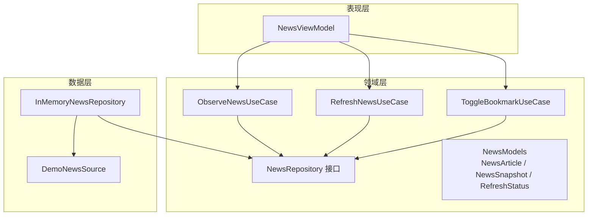
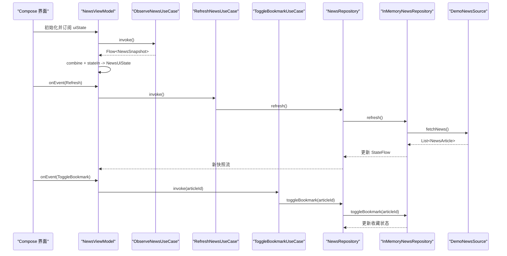
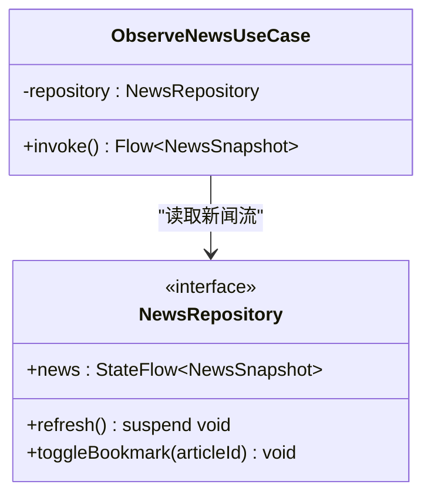
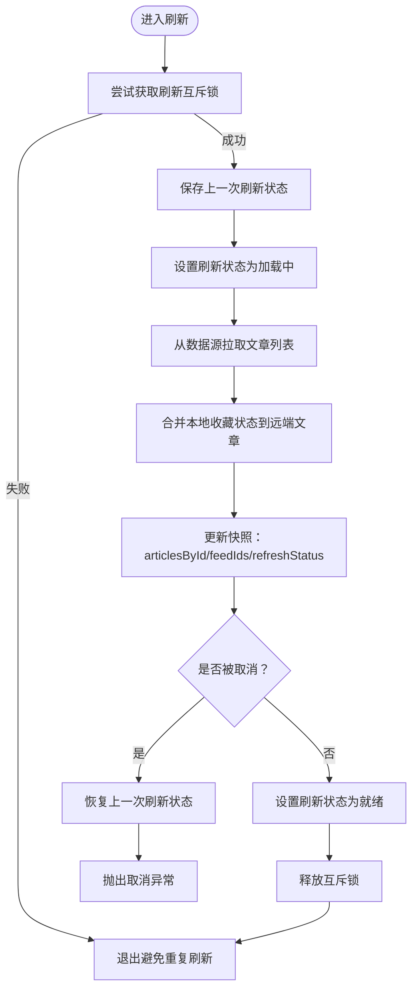
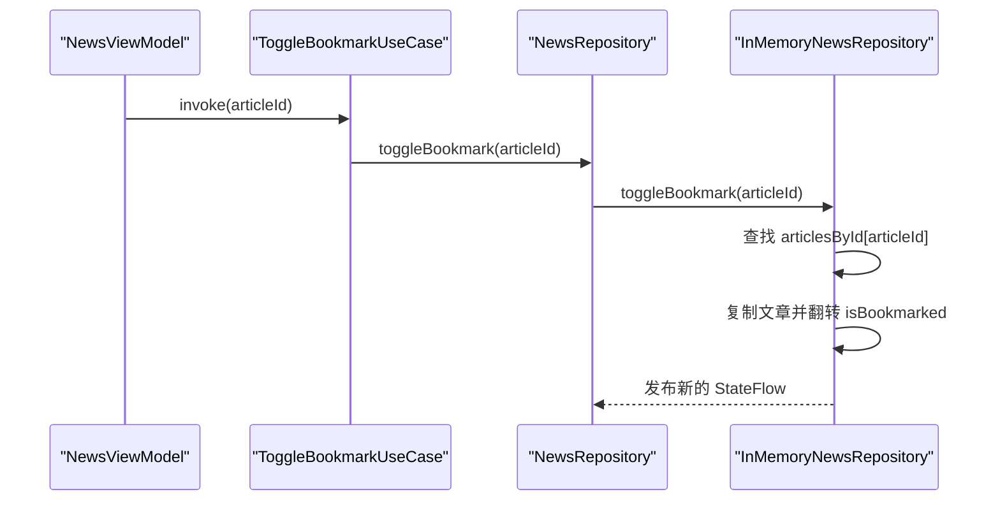
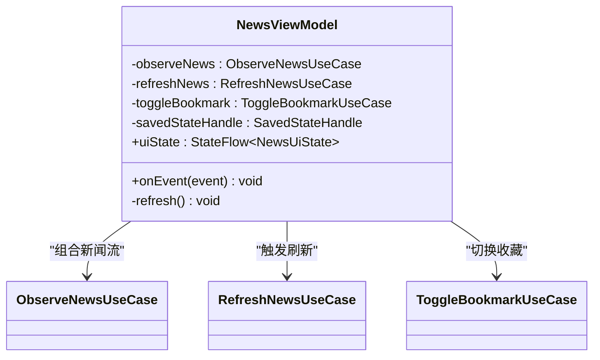
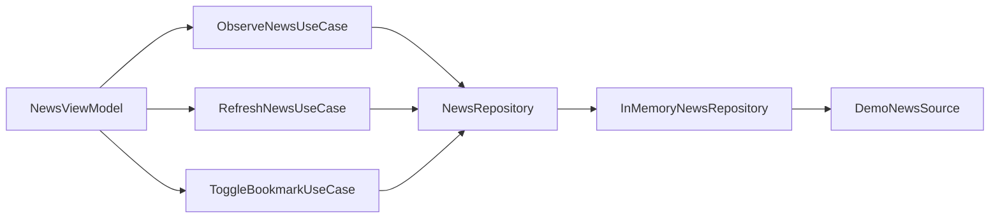

# UseCase 模式

<cite>
**本文引用的文件**   
- [NewsUseCases.kt](file://app/src/main/java/com/example/composeup/architecture/domain/NewsUseCases.kt)
- [NewsRepository.kt](file://app/src/main/java/com/example/composeup/architecture/domain/NewsRepository.kt)
- [InMemoryNewsRepository.kt](file://app/src/main/java/com/example/composeup/architecture/data/InMemoryNewsRepository.kt)
- [DemoNewsSource.kt](file://app/src/main/java/com/example/composeup/architecture/data/DemoNewsSource.kt)
- [NewsViewModel.kt](file://app/src/main/java/com/example/composeup/architecture/ui/NewsViewModel.kt)
- [NewsModels.kt](file://app/src/main/java/com/example/composeup/architecture/domain/NewsModels.kt)
</cite>

## 目录
1. [引言](#引言)
2. [项目结构](#项目结构)
3. [核心组件](#核心组件)
4. [架构总览](#架构总览)
5. [详细组件分析](#详细组件分析)
6. [依赖关系分析](#依赖关系分析)
7. [性能与并发特性](#性能与并发特性)
8. [测试与可维护性](#测试与可维护性)
9. [故障排查指南](#故障排查指南)
10. [结论](#结论)

## 引言
本文件围绕 UseCase 模式，结合新闻示例工程，系统说明如何将复杂业务逻辑拆分为单一职责的用例类，并通过 Repository 抽象数据访问边界。重点覆盖以下用例：
- ObserveNewsUseCase：观察新闻快照流
- RefreshNewsUseCase：刷新新闻数据
- ToggleBookmarkUseCase：切换文章收藏状态

UseCase 的职责是封装“用户目标”对应的业务流程入口，将 UI 事件转化为领域操作，并委托给 Repository 完成数据读写。该模式有助于提升代码的可测试性与可维护性，尤其在多页面共享数据、需要统一业务规则的场景中价值显著。

## 项目结构
该示例采用分层组织方式：
- domain：领域模型、仓库接口与用例实现
- data：数据源与仓库的具体实现
- ui：视图模型与界面状态组合

图表来源
- [NewsUseCases.kt:5-15](file://app/src/main/java/com/example/composeup/architecture/domain/NewsUseCases.kt#L5-L15)
- [NewsRepository.kt:5-11](file://app/src/main/java/com/example/composeup/architecture/domain/NewsRepository.kt#L5-L11)
- [InMemoryNewsRepository.kt:13-52](file://app/src/main/java/com/example/composeup/architecture/data/InMemoryNewsRepository.kt#L13-L52)
- [DemoNewsSource.kt:6-8](file://app/src/main/java/com/example/composeup/architecture/data/DemoNewsSource.kt#L6-L8)
- [NewsViewModel.kt:14-49](file://app/src/main/java/com/example/composeup/architecture/ui/NewsViewModel.kt#L14-L49)
- [NewsModels.kt:3-20](file://app/src/main/java/com/example/composeup/architecture/domain/NewsModels.kt#L3-L20)

章节来源
- [NewsUseCases.kt:1-16](file://app/src/main/java/com/example/composeup/architecture/domain/NewsUseCases.kt#L1-L16)
- [NewsRepository.kt:1-12](file://app/src/main/java/com/example/composeup/architecture/domain/NewsRepository.kt#L1-L12)
- [InMemoryNewsRepository.kt:1-54](file://app/src/main/java/com/example/composeup/architecture/data/InMemoryNewsRepository.kt#L1-L54)
- [DemoNewsSource.kt:1-82](file://app/src/main/java/com/example/composeup/architecture/data/DemoNewsSource.kt#L1-L82)
- [NewsViewModel.kt:1-57](file://app/src/main/java/com/example/composeup/architecture/ui/NewsViewModel.kt#L1-L57)
- [NewsModels.kt:1-21](file://app/src/main/java/com/example/composeup/architecture/domain/NewsModels.kt#L1-L21)

## 核心组件
- 领域模型与状态
  - NewsArticle：文章实体，包含 id、标题、摘要、正文段落、分类、作者、发布时间与收藏标记。
  - NewsSnapshot：归一化后的新闻快照，包含按 ID 索引的文章映射、列表顺序与刷新状态。
  - RefreshStatus：刷新生命周期状态（空闲、加载中、就绪、失败）。

- 仓库接口
  - NewsRepository：定义新闻数据流、刷新与收藏切换的契约，屏蔽具体数据源实现。

- 用例类
  - ObserveNewsUseCase：暴露新闻快照流，供 ViewModel 组合为 UI 状态。
  - RefreshNewsUseCase：触发数据刷新流程。
  - ToggleBookmarkUseCase：切换指定文章的收藏状态。

- 数据实现
  - InMemoryNewsRepository：内存实现，使用 MutableStateFlow 维护状态，提供线程安全的刷新与收藏更新。
  - DemoNewsSource：模拟网络数据源，返回演示用文章列表。

- 视图模型
  - NewsViewModel：组合用例与持久化状态，生成 NewsUiState，处理用户事件。

章节来源
- [NewsModels.kt:3-20](file://app/src/main/java/com/example/composeup/architecture/domain/NewsModels.kt#L3-L20)
- [NewsRepository.kt:5-11](file://app/src/main/java/com/example/composeup/architecture/domain/NewsRepository.kt#L5-L11)
- [NewsUseCases.kt:5-15](file://app/src/main/java/com/example/composeup/architecture/domain/NewsUseCases.kt#L5-L15)
- [InMemoryNewsRepository.kt:13-52](file://app/src/main/java/com/example/composeup/architecture/data/InMemoryNewsRepository.kt#L13-L52)
- [DemoNewsSource.kt:6-8](file://app/src/main/java/com/example/composeup/architecture/data/DemoNewsSource.kt#L6-L8)
- [NewsViewModel.kt:14-49](file://app/src/main/java/com/example/composeup/architecture/ui/NewsViewModel.kt#L14-L49)

## 架构总览
UseCase 作为领域层入口，遵循单一职责原则：每个用例只负责一个用户目标。UI 不直接依赖数据层，而是通过 ViewModel 调用用例；用例再委托给 Repository 接口，从而解耦 UI 与数据细节。

图表来源
- [NewsViewModel.kt:23-49](file://app/src/main/java/com/example/composeup/architecture/ui/NewsViewModel.kt#L23-L49)
- [NewsUseCases.kt:5-15](file://app/src/main/java/com/example/composeup/architecture/domain/NewsUseCases.kt#L5-L15)
- [InMemoryNewsRepository.kt:18-52](file://app/src/main/java/com/example/composeup/architecture/data/InMemoryNewsRepository.kt#L18-L52)
- [DemoNewsSource.kt:10-80](file://app/src/main/java/com/example/composeup/architecture/data/DemoNewsSource.kt#L10-L80)

## 详细组件分析

### ObserveNewsUseCase：观察新闻快照流
- 职责：将仓库发布的新闻快照流暴露给上层，避免 UI 或 ViewModel 直接持有仓库实例。
- 输入/输出：无参 invoke，返回 Flow<NewsSnapshot>。
- 协作关系：依赖 NewsRepository.news 的只读流，保证数据单向流动。

图表来源
- [NewsUseCases.kt:5-7](file://app/src/main/java/com/example/composeup/architecture/domain/NewsUseCases.kt#L5-L7)
- [NewsRepository.kt:5-11](file://app/src/main/java/com/example/composeup/architecture/domain/NewsRepository.kt#L5-L11)

章节来源
- [NewsUseCases.kt:5-7](file://app/src/main/java/com/example/composeup/architecture/domain/NewsUseCases.kt#L5-L7)
- [NewsRepository.kt:5-11](file://app/src/main/java/com/example/composeup/architecture/domain/NewsRepository.kt#L5-L11)

### RefreshNewsUseCase：刷新新闻数据
- 职责：封装一次完整的刷新流程，包括加载状态管理、数据合并与错误恢复。
- 输入/输出：挂起函数 invoke，无返回值，副作用由仓库内部状态变更体现。
- 关键逻辑：
  - 使用互斥锁防止重复刷新。
  - 在请求前保存上次刷新状态，取消时恢复。
  - 将远程数据与本地收藏状态合并，避免覆盖用户最新收藏。
  - 异常时设置失败状态，成功时设置为就绪。

图表来源
- [InMemoryNewsRepository.kt:18-42](file://app/src/main/java/com/example/composeup/architecture/data/InMemoryNewsRepository.kt#L18-L42)
- [NewsUseCases.kt:9-11](file://app/src/main/java/com/example/composeup/architecture/domain/NewsUseCases.kt#L9-L11)

章节来源
- [NewsUseCases.kt:9-11](file://app/src/main/java/com/example/composeup/architecture/domain/NewsUseCases.kt#L9-L11)
- [InMemoryNewsRepository.kt:18-42](file://app/src/main/java/com/example/composeup/architecture/data/InMemoryNewsRepository.kt#L18-L42)

### ToggleBookmarkUseCase：切换文章收藏状态
- 职责：根据文章 ID 切换收藏标记，保持 UI 与数据的一致性。
- 输入/输出：接收 articleId，调用仓库的 toggleBookmark。
- 数据一致性：仓库内部基于 articlesById 精确更新对应文章，避免全量替换导致的状态丢失。

图表来源
- [NewsUseCases.kt:13-15](file://app/src/main/java/com/example/composeup/architecture/domain/NewsUseCases.kt#L13-L15)
- [InMemoryNewsRepository.kt:44-52](file://app/src/main/java/com/example/composeup/architecture/data/InMemoryNewsRepository.kt#L44-L52)

章节来源
- [NewsUseCases.kt:13-15](file://app/src/main/java/com/example/composeup/architecture/domain/NewsUseCases.kt#L13-L15)
- [InMemoryNewsRepository.kt:44-52](file://app/src/main/java/com/example/composeup/architecture/data/InMemoryNewsRepository.kt#L44-L52)

### NewsViewModel：用例编排与 UI 状态组合
- 职责：
  - 组合 ObserveNewsUseCase 的输出与本地筛选条件、当前选中文章 ID，生成 NewsUiState。
  - 处理用户事件：刷新、切换收藏、打开/返回详情等。
  - 通过 SavedStateHandle 持久化筛选与导航状态。
- 关键点：
  - 使用 combine 与 stateIn 构建响应式 UI 状态。
  - 在 init 中触发首次刷新。
  - 所有业务动作都委托给用例，不直接访问仓库。

图表来源
- [NewsViewModel.kt:14-49](file://app/src/main/java/com/example/composeup/architecture/ui/NewsViewModel.kt#L14-L49)
- [NewsUseCases.kt:5-15](file://app/src/main/java/com/example/composeup/architecture/domain/NewsUseCases.kt#L5-L15)

章节来源
- [NewsViewModel.kt:14-49](file://app/src/main/java/com/example/composeup/architecture/ui/NewsViewModel.kt#L14-L49)

## 依赖关系分析
- 用例对仓库接口的依赖是单向且松耦合的，便于替换实现与单元测试。
- 仓库实现依赖数据源，但用例不感知数据源类型。
- ViewModel 仅依赖用例与 SavedStateHandle，不直接依赖数据层。

图表来源
- [NewsViewModel.kt:14-49](file://app/src/main/java/com/example/composeup/architecture/ui/NewsViewModel.kt#L14-L49)
- [NewsUseCases.kt:5-15](file://app/src/main/java/com/example/composeup/architecture/domain/NewsUseCases.kt#L5-L15)
- [InMemoryNewsRepository.kt:13-52](file://app/src/main/java/com/example/composeup/architecture/data/InMemoryNewsRepository.kt#L13-L52)
- [DemoNewsSource.kt:6-8](file://app/src/main/java/com/example/composeup/architecture/data/DemoNewsSource.kt#L6-L8)

章节来源
- [NewsViewModel.kt:14-49](file://app/src/main/java/com/example/composeup/architecture/ui/NewsViewModel.kt#L14-L49)
- [NewsUseCases.kt:5-15](file://app/src/main/java/com/example/composeup/architecture/domain/NewsUseCases.kt#L5-L15)
- [InMemoryNewsRepository.kt:13-52](file://app/src/main/java/com/example/composeup/architecture/data/InMemoryNewsRepository.kt#L13-L52)
- [DemoNewsSource.kt:6-8](file://app/src/main/java/com/example/composeup/architecture/data/DemoNewsSource.kt#L6-L8)

## 性能与并发特性
- 刷新互斥：使用 Mutex 防止并发刷新导致的竞态与状态不一致。
- 状态原子更新：使用 MutableStateFlow.update 进行不可变更新，确保并发安全与最小化重组。
- 取消恢复：捕获取消异常并恢复之前的刷新状态，避免 UI 显示错误的加载结果。
- 流式组合：ViewModel 使用 combine 与 stateIn 按需订阅，减少无效计算。

章节来源
- [InMemoryNewsRepository.kt:16-42](file://app/src/main/java/com/example/composeup/architecture/data/InMemoryNewsRepository.kt#L16-L42)
- [NewsViewModel.kt:23-32](file://app/src/main/java/com/example/composeup/architecture/ui/NewsViewModel.kt#L23-L32)

## 测试与可维护性
- 用例可独立测试：用例只依赖仓库接口，可用内存实现或 Mock 验证业务规则。
- 仓库实现可替换：InMemoryNewsRepository 便于快速验证与回归测试。
- ViewModel 行为可测：通过注入用例与 SavedStateHandle，断言 uiState 变化与事件处理。
- 领域模型清晰：NewsSnapshot 归一化设计减少状态副本，降低同步成本与出错概率。

章节来源
- [NewsUseCases.kt:5-15](file://app/src/main/java/com/example/composeup/architecture/domain/NewsUseCases.kt#L5-L15)
- [InMemoryNewsRepository.kt:13-52](file://app/src/main/java/com/example/composeup/architecture/data/InMemoryNewsRepository.kt#L13-L52)
- [NewsViewModel.kt:14-49](file://app/src/main/java/com/example/composeup/architecture/ui/NewsViewModel.kt#L14-L49)
- [NewsModels.kt:16-20](file://app/src/main/java/com/example/composeup/architecture/domain/NewsModels.kt#L16-L20)

## 故障排查指南
- 刷新后收藏状态丢失
  - 检查仓库是否在合并远端数据时保留了本地收藏标记。
  - 确认 articlesById 的合并策略是否正确覆盖旧条目。
- 重复刷新导致状态错乱
  - 确认互斥锁是否正确加锁与解锁。
  - 检查取消异常分支是否恢复之前状态。
- UI 未收到更新
  - 检查 ViewModel 是否正确组合 observeNews 流。
  - 确认 collectAsStateWithLifecycle 的生命周期绑定。

章节来源
- [InMemoryNewsRepository.kt:18-52](file://app/src/main/java/com/example/composeup/architecture/data/InMemoryNewsRepository.kt#L18-L52)
- [NewsViewModel.kt:23-32](file://app/src/main/java/com/example/composeup/architecture/ui/NewsViewModel.kt#L23-L32)

## 结论
UseCase 模式在本项目中有效分离了用户目标与数据访问细节，提升了代码的可测试性与可维护性。通过将 ObserveNewsUseCase、RefreshNewsUseCase、ToggleBookmarkUseCase 等用例独立出来，UI 与数据层之间的耦合度显著降低，业务规则集中在领域层，便于扩展与重构。配合归一化的 NewsSnapshot 与响应式状态组合，系统在复杂场景下仍能保持清晰的数据流向与一致的用户体验。