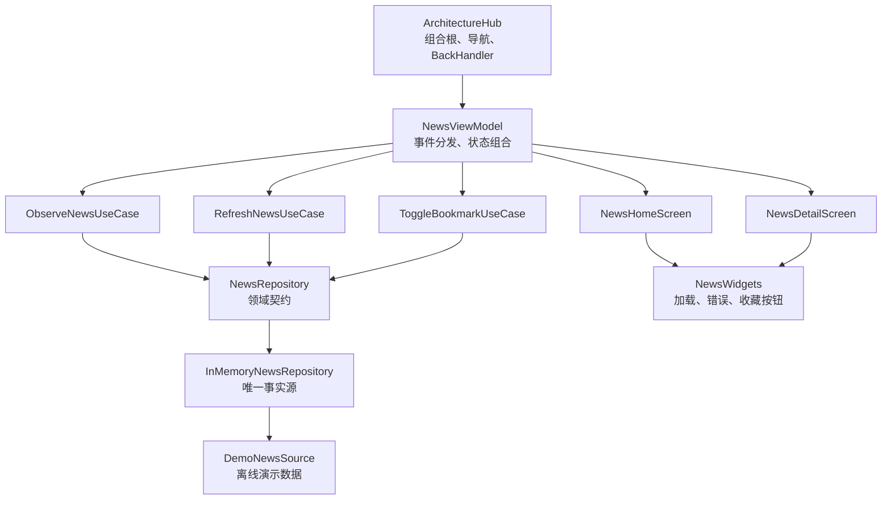
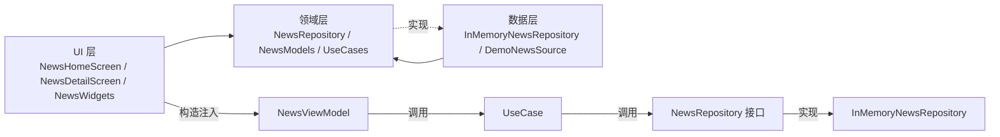
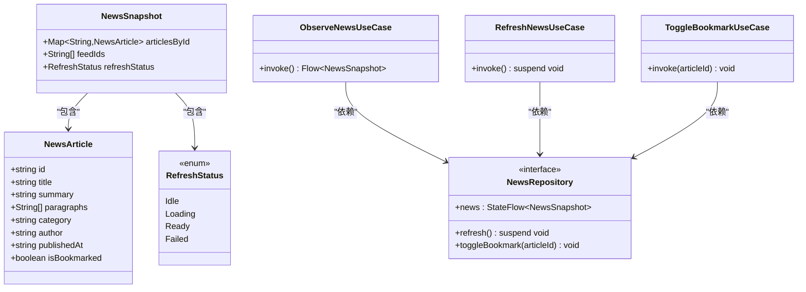
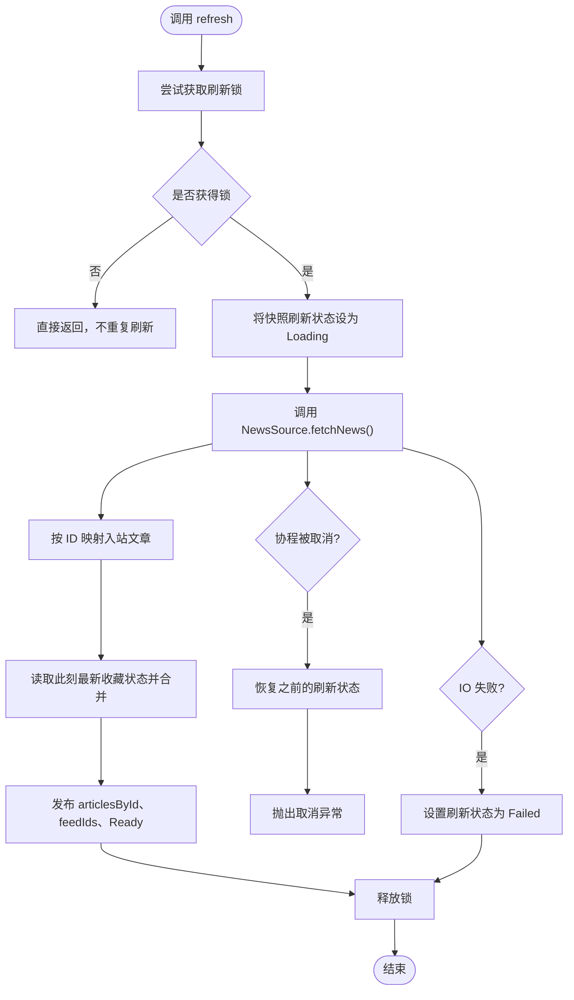
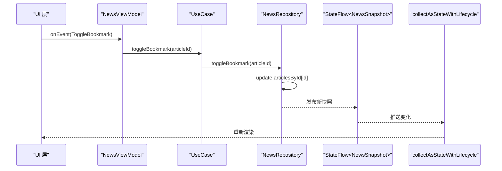
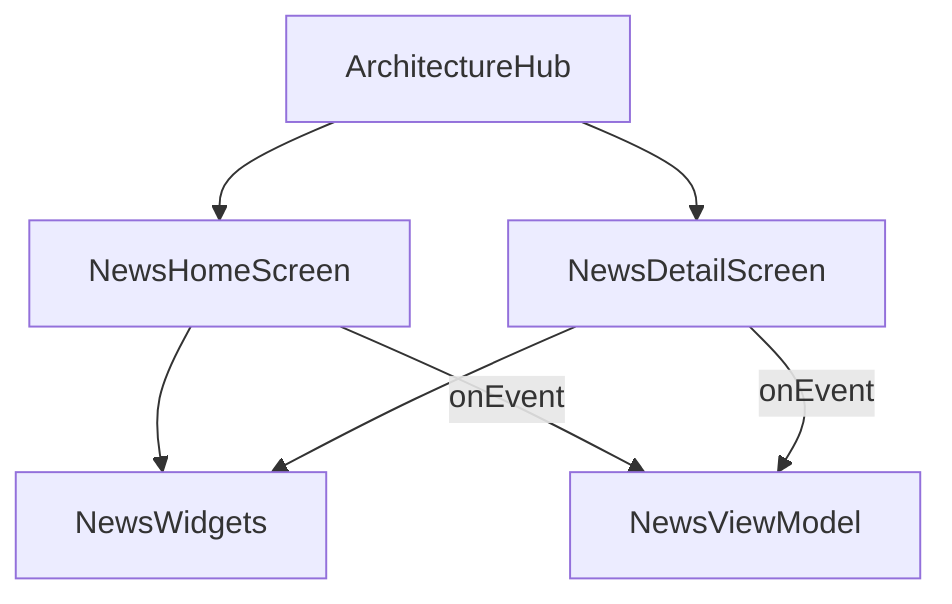
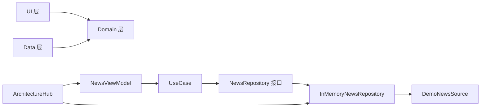
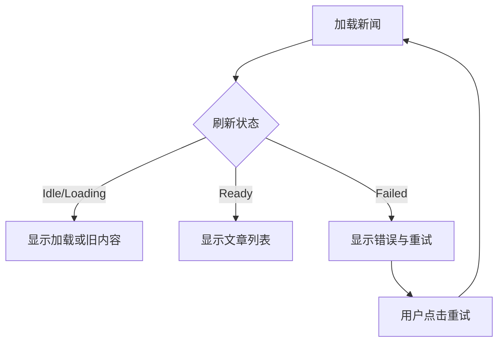

# 架构模式

<cite>
**本文引用的文件**   
- [README.md](file://app/src/main/java/com/example/composeup/architecture/README.md)
- [ArchitectureHub.kt](file://app/src/main/java/com/example/composeup/architecture/ArchitectureHub.kt)
- [NewsModels.kt](file://app/src/main/java/com/example/composeup/architecture/domain/NewsModels.kt)
- [NewsRepository.kt](file://app/src/main/java/com/example/composeup/architecture/domain/NewsRepository.kt)
- [NewsUseCases.kt](file://app/src/main/java/com/example/composeup/architecture/domain/NewsUseCases.kt)
- [DemoNewsSource.kt](file://app/src/main/java/com/example/composeup/architecture/data/DemoNewsSource.kt)
- [InMemoryNewsRepository.kt](file://app/src/main/java/com/example/composeup/architecture/data/InMemoryNewsRepository.kt)
- [NewsViewModel.kt](file://app/src/main/java/com/example/composeup/architecture/ui/NewsViewModel.kt)
- [NewsUiState.kt](file://app/src/main/java/com/example/composeup/architecture/ui/NewsUiState.kt)
- [NewsHomeScreen.kt](file://app/src/main/java/com/example/composeup/architecture/ui/NewsHomeScreen.kt)
- [NewsDetailScreen.kt](file://app/src/main/java/com/example/composeup/architecture/ui/NewsDetailScreen.kt)
- [NewsWidgets.kt](file://app/src/main/java/com/example/composeup/architecture/ui/NewsWidgets.kt)
</cite>

## 目录
1. [引言](#引言)
2. [项目结构](#项目结构)
3. [核心组件](#核心组件)
4. [架构总览](#架构总览)
5. [详细组件分析](#详细组件分析)
6. [依赖关系分析](#依赖关系分析)
7. [性能与并发特性](#性能与并发特性)
8. [故障排查指南](#故障排查指南)
9. [结论](#结论)
10. [附录：演进建议](#附录演进建议)

## 引言
本文件围绕一个“新闻主页 + 详情页”的 Compose 示例，系统化说明 MVVM、Repository、UseCase、状态归一化与单向数据流在真实代码中的落地方式。该示例不引入网络、数据库或第三方框架，重点回答三个问题：谁拥有数据、谁能修改数据、多个页面如何保持一致。

- 分层目标：UI 负责渲染和事件上报；Domain 表达用户目标；Data 维护唯一事实源。
- 数据目标：实体只存一份，列表顺序、详情选择、收藏筛选全部从快照派生。
- 交互目标：一次收藏操作从 UI 层进入 ViewModel，经 UseCase 到达 Repository，再通过 StateFlow 驱动界面重新渲染。

**章节来源**
- [README.md:1-24](file://app/src/main/java/com/example/composeup/architecture/README.md#L1-L24)

## 项目结构
该示例采用 `ui / domain / data` 显式分层，并通过 `ArchitectureHub` 作为组合入口，组装依赖、订阅状态、选择页面并处理返回。

**图表来源**
- [ArchitectureHub.kt:36-46](file://app/src/main/java/com/example/composeup/architecture/ArchitectureHub.kt#L36-L46)
- [NewsViewModel.kt:14-32](file://app/src/main/java/com/example/composeup/architecture/ui/NewsViewModel.kt#L14-L32)
- [NewsUseCases.kt:5-15](file://app/src/main/java/com/example/composeup/architecture/domain/NewsUseCases.kt#L5-L15)
- [NewsRepository.kt:5-11](file://app/src/main/java/com/example/composeup/architecture/domain/NewsRepository.kt#L5-L11)
- [InMemoryNewsRepository.kt:13-15](file://app/src/main/java/com/example/composeup/architecture/data/InMemoryNewsRepository.kt#L13-L15)
- [DemoNewsSource.kt:6-8](file://app/src/main/java/com/example/composeup/architecture/data/DemoNewsSource.kt#L6-L8)
- [NewsHomeScreen.kt:24-29](file://app/src/main/java/com/example/composeup/architecture/ui/NewsHomeScreen.kt#L24-L29)
- [NewsDetailScreen.kt:20-25](file://app/src/main/java/com/example/composeup/architecture/ui/NewsDetailScreen.kt#L20-L25)
- [NewsWidgets.kt:24-49](file://app/src/main/java/com/example/composeup/architecture/ui/NewsWidgets.kt#L24-L49)

**章节来源**
- [README.md:26-47](file://app/src/main/java/com/example/composeup/architecture/README.md#L26-L47)
- [ArchitectureHub.kt:48-100](file://app/src/main/java/com/example/composeup/architecture/ArchitectureHub.kt#L48-L100)

## 核心组件
- 领域模型与快照：`NewsArticle`、`RefreshStatus`、`NewsSnapshot` 定义文章实体、刷新阶段和归一化快照。
- 仓库契约：`NewsRepository` 暴露只读 `StateFlow<NewsSnapshot>`、挂起刷新和收藏切换接口。
- UseCase：`ObserveNewsUseCase`、`RefreshNewsUseCase`、`ToggleBookmarkUseCase` 以用户目标命名操作，委托给仓库。
- 数据实现：`InMemoryNewsRepository` 持有私有 `MutableStateFlow`，通过 `update` 原子更新，使用 `Mutex` 控制并发刷新。
- ViewModel：组合仓库快照、筛选条件和当前文章 ID，输出 `NewsUiState`，保存轻量页面状态。
- UI 层：`NewsHomeScreen`、`NewsDetailScreen`、`NewsWidgets` 仅消费状态并上报 `NewsEvent`。

**章节来源**
- [NewsModels.kt:3-20](file://app/src/main/java/com/example/composeup/architecture/domain/NewsModels.kt#L3-L20)
- [NewsRepository.kt:5-11](file://app/src/main/java/com/example/composeup/architecture/domain/NewsRepository.kt#L5-L11)
- [NewsUseCases.kt:5-15](file://app/src/main/java/com/example/composeup/architecture/domain/NewsUseCases.kt#L5-L15)
- [InMemoryNewsRepository.kt:13-52](file://app/src/main/java/com/example/composeup/architecture/data/InMemoryNewsRepository.kt#L13-L52)
- [NewsViewModel.kt:14-55](file://app/src/main/java/com/example/composeup/architecture/ui/NewsViewModel.kt#L14-L55)
- [NewsUiState.kt:7-36](file://app/src/main/java/com/example/composeup/architecture/ui/NewsUiState.kt#L7-L36)

## 架构总览
下图展示编译期依赖方向与运行时调用边界：UI 依赖 Domain 契约，Data 提供实现；ViewModel 通过构造函数注入 UseCase，不直接创建仓库。

**图表来源**
- [README.md:49-78](file://app/src/main/java/com/example/composeup/architecture/README.md#L49-L78)
- [ArchitectureHub.kt:36-46](file://app/src/main/java/com/example/composeup/architecture/ArchitectureHub.kt#L36-L46)
- [NewsViewModel.kt:14-19](file://app/src/main/java/com/example/composeup/architecture/ui/NewsViewModel.kt#L14-L19)
- [NewsRepository.kt:5-11](file://app/src/main/java/com/example/composeup/architecture/domain/NewsRepository.kt#L5-L11)
- [InMemoryNewsRepository.kt:13-15](file://app/src/main/java/com/example/composeup/architecture/data/InMemoryNewsRepository.kt#L13-L15)

**章节来源**
- [README.md:49-78](file://app/src/main/java/com/example/composeup/architecture/README.md#L49-L78)

## 详细组件分析

### 领域层：模型、仓库与用例
- `NewsArticle` 是领域实体，包含 ID、标题、摘要、正文段落、分类、作者、发布时间与收藏标记。
- `RefreshStatus` 用互斥阶段表达首次加载、加载中、就绪与失败。
- `NewsSnapshot` 将实体表、列表顺序与刷新状态聚合为单一快照，避免多份副本。
- `NewsRepository` 是领域契约，不感知 Android、Compose 或具体数据源。
- UseCase 以用户目标命名：观察、刷新、切换收藏；当前业务简单时主要做委托，保留依赖边界。

**图表来源**
- [NewsModels.kt:3-20](file://app/src/main/java/com/example/composeup/architecture/domain/NewsModels.kt#L3-L20)
- [NewsRepository.kt:5-11](file://app/src/main/java/com/example/composeup/architecture/domain/NewsRepository.kt#L5-L11)
- [NewsUseCases.kt:5-15](file://app/src/main/java/com/example/composeup/architecture/domain/NewsUseCases.kt#L5-L15)

**章节来源**
- [NewsModels.kt:3-20](file://app/src/main/java/com/example/composeup/architecture/domain/NewsModels.kt#L3-L20)
- [NewsRepository.kt:5-11](file://app/src/main/java/com/example/composeup/architecture/domain/NewsRepository.kt#L5-L11)
- [NewsUseCases.kt:5-15](file://app/src/main/java/com/example/composeup/architecture/domain/NewsUseCases.kt#L5-L15)

### 数据层：仓库实现与数据源
- `NewsSource` 是函数式接口，定义异步获取文章列表的能力。
- `DemoNewsSource` 模拟 700ms 延迟并返回本地文章集合，用于教学演示。
- `InMemoryNewsRepository` 是唯一事实源：
  - 私有 `MutableStateFlow<NewsSnapshot>` 对外暴露只读 `asStateFlow()`。
  - 刷新流程先置 `Loading`，再合并响应与现有收藏，最后发布 `Ready`。
  - 使用 `Mutex.tryLock()` 防止重复刷新；取消异常恢复之前状态；IO 失败设置 `Failed`。
  - 收藏切换通过 `update` 原子替换对应实体，无外部副作用。

**图表来源**
- [InMemoryNewsRepository.kt:18-42](file://app/src/main/java/com/example/composeup/architecture/data/InMemoryNewsRepository.kt#L18-L42)
- [DemoNewsSource.kt:10-80](file://app/src/main/java/com/example/composeup/architecture/data/DemoNewsSource.kt#L10-L80)

**章节来源**
- [DemoNewsSource.kt:6-82](file://app/src/main/java/com/example/composeup/architecture/data/DemoNewsSource.kt#L6-L82)
- [InMemoryNewsRepository.kt:13-52](file://app/src/main/java/com/example/composeup/architecture/data/InMemoryNewsRepository.kt#L13-L52)

### ViewModel 与状态管理
- `NewsViewModel` 接收三个 UseCase 和 `SavedStateHandle`。
- 轻量页面状态：`bookmarkedOnly` 与 `selectedArticleId` 由 `SavedStateHandle` 持久化。
- `uiState` 通过 `combine` 组合仓库快照、筛选条件与当前文章 ID，并使用 `stateIn(WhileSubscribed(5_000))` 控制上游订阅生命周期。
- `onEvent` 统一处理刷新、筛选、打开详情、收藏切换与返回。
- `NewsUiState` 提供派生属性：可见文章、选中文章、收藏数量、加载与错误标志。

**图表来源**
- [NewsViewModel.kt:23-45](file://app/src/main/java/com/example/composeup/architecture/ui/NewsViewModel.kt#L23-L45)
- [NewsUiState.kt:7-28](file://app/src/main/java/com/example/composeup/architecture/ui/NewsUiState.kt#L7-L28)
- [NewsUseCases.kt:13-15](file://app/src/main/java/com/example/composeup/architecture/domain/NewsUseCases.kt#L13-L15)
- [InMemoryNewsRepository.kt:44-52](file://app/src/main/java/com/example/composeup/architecture/data/InMemoryNewsRepository.kt#L44-L52)

**章节来源**
- [NewsViewModel.kt:14-55](file://app/src/main/java/com/example/composeup/architecture/ui/NewsViewModel.kt#L14-L55)
- [NewsUiState.kt:7-36](file://app/src/main/java/com/example/composeup/architecture/ui/NewsUiState.kt#L7-L36)

### UI 层：主页、详情与通用控件
- `NewsHomeScreen` 展示介绍、筛选、加载、错误、空态与文章卡片；点击卡片打开详情，点击收藏图标触发收藏事件。
- `NewsDetailScreen` 根据 `selectedArticleId` 显示详情；不存在时提示并允许返回；支持收藏切换。
- `NewsWidgets` 提供架构说明块、收藏按钮、加载与错误组件，保持 UI 组件无业务依赖。
- `ArchitectureHub` 负责组合 ViewModel、订阅状态、选择页面、处理系统返回键与工具栏刷新。

**图表来源**
- [ArchitectureHub.kt:54-99](file://app/src/main/java/com/example/composeup/architecture/ArchitectureHub.kt#L54-L99)
- [NewsHomeScreen.kt:24-96](file://app/src/main/java/com/example/composeup/architecture/ui/NewsHomeScreen.kt#L24-L96)
- [NewsDetailScreen.kt:20-66](file://app/src/main/java/com/example/composeup/architecture/ui/NewsDetailScreen.kt#L20-L66)
- [NewsWidgets.kt:24-83](file://app/src/main/java/com/example/composeup/architecture/ui/NewsWidgets.kt#L24-L83)

**章节来源**
- [NewsHomeScreen.kt:24-125](file://app/src/main/java/com/example/composeup/architecture/ui/NewsHomeScreen.kt#L24-L125)
- [NewsDetailScreen.kt:20-67](file://app/src/main/java/com/example/composeup/architecture/ui/NewsDetailScreen.kt#L20-L67)
- [NewsWidgets.kt:24-83](file://app/src/main/java/com/example/composeup/architecture/ui/NewsWidgets.kt#L24-L83)
- [ArchitectureHub.kt:48-100](file://app/src/main/java/com/example/composeup/architecture/ArchitectureHub.kt#L48-L100)

## 依赖关系分析
- 编译期依赖方向：UI → Domain ← Data。
- ViewModel 通过构造函数注入 UseCase，UseCase 依赖 Repository 接口。
- InMemoryNewsRepository 实现 Repository，并依赖 NewsSource。
- ArchitectureHub 在组合根创建仓库实现，并通过 viewModelFactory 注入到 ViewModel。

**图表来源**
- [README.md:49-78](file://app/src/main/java/com/example/composeup/architecture/README.md#L49-L78)
- [ArchitectureHub.kt:36-46](file://app/src/main/java/com/example/composeup/architecture/ArchitectureHub.kt#L36-L46)
- [NewsViewModel.kt:14-19](file://app/src/main/java/com/example/composeup/architecture/ui/NewsViewModel.kt#L14-L19)
- [NewsUseCases.kt:5-15](file://app/src/main/java/com/example/composeup/architecture/domain/NewsUseCases.kt#L5-L15)
- [NewsRepository.kt:5-11](file://app/src/main/java/com/example/composeup/architecture/domain/NewsRepository.kt#L5-L11)
- [InMemoryNewsRepository.kt:13-15](file://app/src/main/java/com/example/composeup/architecture/data/InMemoryNewsRepository.kt#L13-L15)
- [DemoNewsSource.kt:6-8](file://app/src/main/java/com/example/composeup/architecture/data/DemoNewsSource.kt#L6-L8)

**章节来源**
- [README.md:49-78](file://app/src/main/java/com/example/composeup/architecture/README.md#L49-L78)

## 性能与并发特性
- 刷新并发控制：`Mutex.tryLock()` 防止重复刷新产生并行请求；进行中的请求不排队重跑。
- 状态原子更新：使用 `update` 保证快照字段同时变更，避免订阅者看到半更新状态。
- 收藏合并策略：响应只更新文章内容，收藏字段从合并时的当前快照读取，避免覆盖用户刚完成的收藏。
- 生命周期优化：`stateIn(WhileSubscribed(5_000))` 与 `collectAsStateWithLifecycle()` 在不可见时停止上游收集，减少不必要计算。
- 内存成本：示例使用内存仓库，进程结束后收藏丢失；生产环境应使用数据库与缓存策略管理实体与收藏。

**章节来源**
- [InMemoryNewsRepository.kt:18-52](file://app/src/main/java/com/example/composeup/architecture/data/InMemoryNewsRepository.kt#L18-L52)
- [NewsViewModel.kt:23-32](file://app/src/main/java/com/example/composeup/architecture/ui/NewsViewModel.kt#L23-L32)
- [README.md:80-99](file://app/src/main/java/com/example/composeup/architecture/README.md#L80-L99)
- [README.md:185-194](file://app/src/main/java/com/example/composeup/architecture/README.md#L185-L194)

## 故障排查指南
- 刷新失败：仓库捕获 IO 异常并设置 `Failed`；UI 显示错误区域并提供重试入口。
- 取消异常：协程取消时恢复之前的刷新状态并重新抛出取消异常，不伪装成业务失败。
- 空数据与空收藏：首页在成功但无文章时显示暂无新闻；仅看收藏为空时提示可切回全部。
- 详情不存在：恢复后若 `selectedArticleId` 对应的文章不存在，详情页显示不存在提示并可返回主页。
- 重复刷新：通过 Mutex 避免重复刷新；已有数据时刷新保留旧内容并显示进度条。

**图表来源**
- [InMemoryNewsRepository.kt:34-42](file://app/src/main/java/com/example/composeup/architecture/data/InMemoryNewsRepository.kt#L34-L42)
- [NewsHomeScreen.kt:61-88](file://app/src/main/java/com/example/composeup/architecture/ui/NewsHomeScreen.kt#L61-L88)
- [NewsDetailScreen.kt:31-43](file://app/src/main/java/com/example/composeup/architecture/ui/NewsDetailScreen.kt#L31-L43)

**章节来源**
- [README.md:167-184](file://app/src/main/java/com/example/composeup/architecture/README.md#L167-L184)
- [NewsHomeScreen.kt:61-88](file://app/src/main/java/com/example/composeup/architecture/ui/NewsHomeScreen.kt#L61-L88)
- [NewsDetailScreen.kt:31-43](file://app/src/main/java/com/example/composeup/architecture/ui/NewsDetailScreen.kt#L31-L43)

## 结论
该示例以清晰的 MVVM 分层、Repository 唯一事实源、UseCase 用户目标命名、状态归一化和单向数据流为核心，展示了从 UI 到数据层的完整数据流。关键设计原则可总结为：实体只存一份，页面只持有引用，操作有统一入口，状态由事实派生。对于真实业务，可在保持 UI 与 UseCase 边界不变的前提下，将网络、数据库、分页与权限逻辑下沉到 Data 层。

[无需章节来源，因为本节为总结性内容]

## 附录：演进建议
- 将 `NewsSource` 接入网络层，映射 DTO 到领域模型。
- 将 `InMemoryNewsRepository` 改为 Room 或其他持久化存储，并以数据库查询流作为唯一事实源。
- 将收藏独立持久化，并在事务中合并网络数据与本地收藏。
- 为复杂业务在 UseCase 中组合多个仓库、落实业务规则，并用普通单元测试验证。
- 导航框架中仍只传递文章 ID，并为新闻流程明确 ViewModel/Repository 作用域。

**章节来源**
- [README.md:217-223](file://app/src/main/java/com/example/composeup/architecture/README.md#L217-L223)