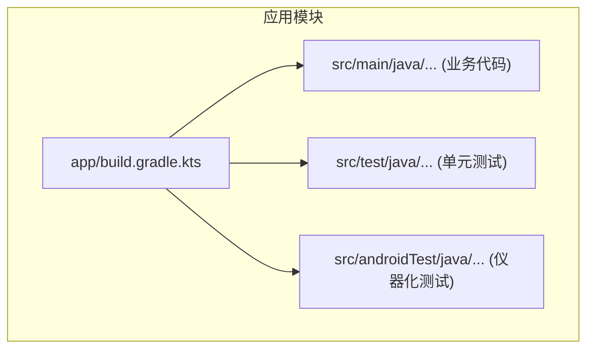
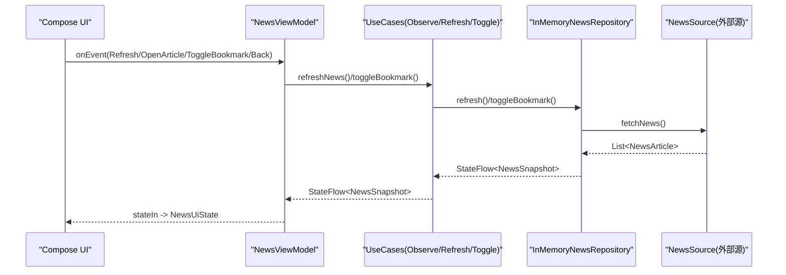
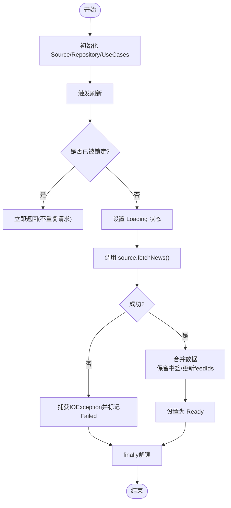
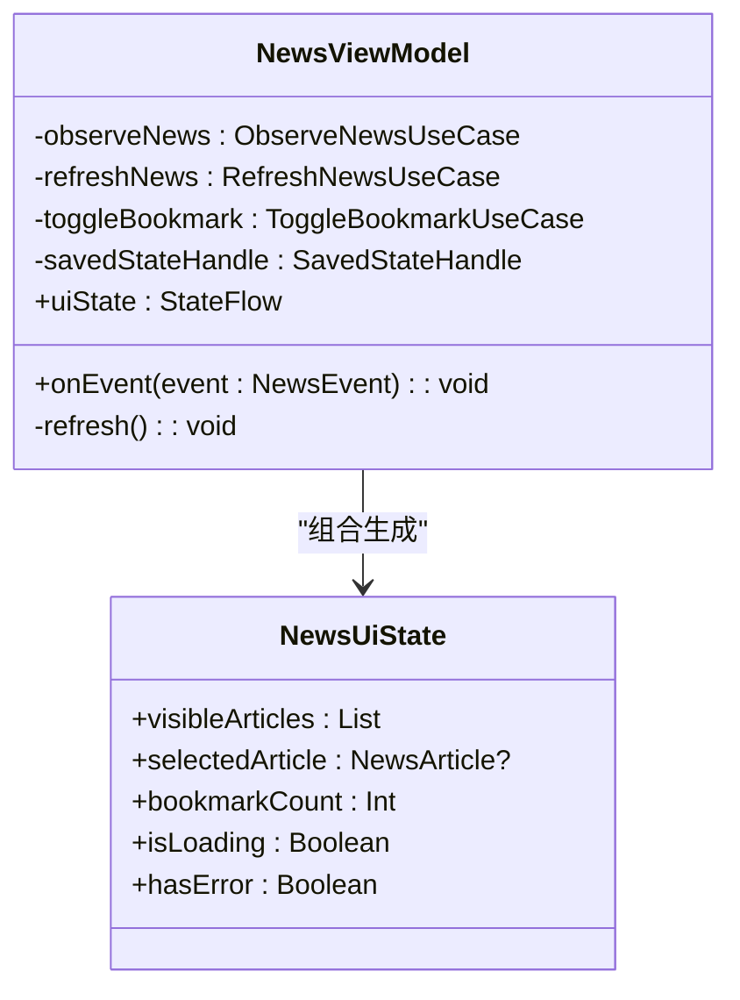
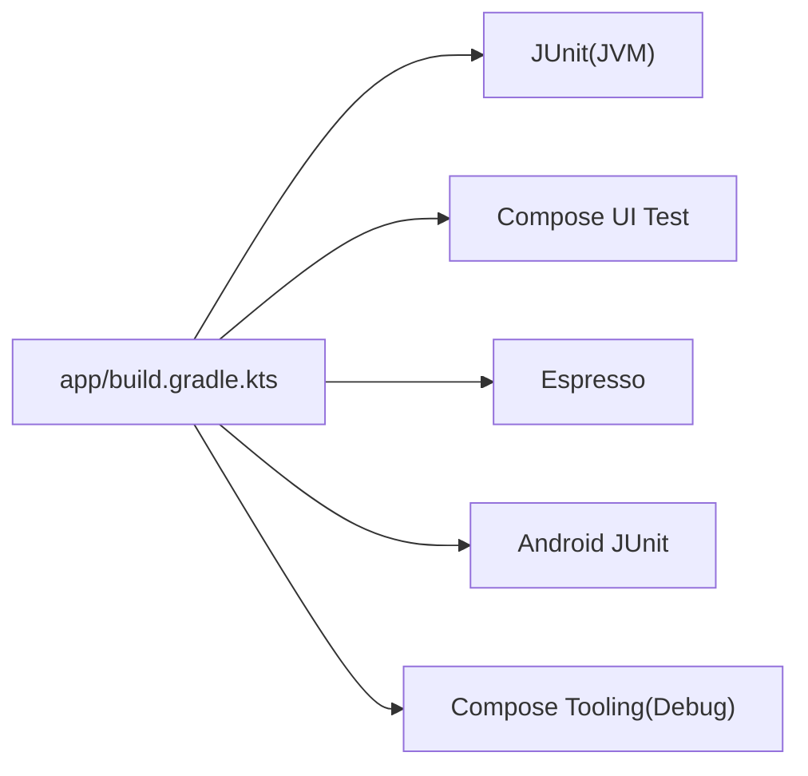

# 测试指南

<cite>
**本文引用的文件**   
- [app/build.gradle.kts](file://app/build.gradle.kts)
- [ExampleUnitTest.kt](file://app/src/test/java/com/example/composeup/ExampleUnitTest.kt)
- [InMemoryNewsRepositoryTest.kt](file://app/src/test/java/com/example/composeup/architecture/InMemoryNewsRepositoryTest.kt)
- [NewsUiStateTest.kt](file://app/src/test/java/com/example/composeup/architecture/NewsUiStateTest.kt)
- [ExampleInstrumentedTest.kt](file://app/src/androidTest/java/com/example/composeup/ExampleInstrumentedTest.kt)
- [InMemoryNewsRepository.kt](file://app/src/main/java/com/example/composeup/architecture/data/InMemoryNewsRepository.kt)
- [NewsModels.kt](file://app/src/main/java/com/example/composeup/architecture/domain/NewsModels.kt)
- [NewsUiState.kt](file://app/src/main/java/com/example/composeup/architecture/ui/NewsUiState.kt)
- [NewsViewModel.kt](file://app/src/main/java/com/example/composeup/architecture/ui/NewsViewModel.kt)
</cite>

## 目录
1. [简介](#简介)
2. [项目结构](#项目结构)
3. [核心组件](#核心组件)
4. [架构总览](#架构总览)
5. [详细组件分析](#详细组件分析)
6. [依赖分析](#依赖分析)
7. [性能考虑](#性能考虑)
8. [故障排查指南](#故障排查指南)
9. [结论](#结论)
10. [附录](#附录)

## 简介
本指南面向 ComposeUp 项目的测试实践，覆盖单元测试、集成测试与 UI 测试的实施策略。重点包括：
- ViewModel 测试方法（事件驱动、状态组合）
- Repository 测试方法（并发、取消、失败恢复）
- Composable 组件测试思路（基于现有工程扩展）
- Mock 对象、测试数据与测试环境搭建
- 测试覆盖率、持续集成与自动化流程建议
- 最佳实践与常见问题解决方案

## 项目结构
当前仓库已包含基础测试骨架：
- 单元测试位于 app/src/test，示例包含对领域模型与 UI 状态的断言
- 仪器化测试位于 app/src/androidTest，提供 Android 运行环境的基础用例
- 构建脚本中已声明 JUnit、Espresso 与 Compose Test 依赖

图表来源
- [app/build.gradle.kts:1-95](file://app/build.gradle.kts#L1-L95)

章节来源
- [app/build.gradle.kts:1-95](file://app/build.gradle.kts#L1-L95)

## 核心组件
本节聚焦测试相关的核心类与接口，明确被测目标与可测点：
- InMemoryNewsRepository：实现新闻数据的刷新、书签切换、并发控制与错误处理
- NewsModels：领域模型与刷新状态枚举
- NewsUiState：UI 层派生状态与可见文章计算逻辑
- NewsViewModel：将 UseCase 与 SavedStateHandle 组合为 uiState，并处理用户事件

章节来源
- [InMemoryNewsRepository.kt:1-54](file://app/src/main/java/com/example/composeup/architecture/data/InMemoryNewsRepository.kt#L1-L54)
- [NewsModels.kt:1-21](file://app/src/main/java/com/example/composeup/architecture/domain/NewsModels.kt#L1-L21)
- [NewsUiState.kt:1-37](file://app/src/main/java/com/example/composeup/architecture/ui/NewsUiState.kt#L1-L37)
- [NewsViewModel.kt:1-57](file://app/src/main/java/com/example/composeup/architecture/ui/NewsViewModel.kt#L1-L57)

## 架构总览
下图展示从 UI 到数据层的调用链与状态流转，便于理解测试边界与协作关系。

图表来源
- [NewsViewModel.kt:14-50](file://app/src/main/java/com/example/composeup/architecture/ui/NewsViewModel.kt#L14-L50)
- [InMemoryNewsRepository.kt:13-52](file://app/src/main/java/com/example/composeup/architecture/data/InMemoryNewsRepository.kt#L13-L52)

## 详细组件分析

### Repository 测试策略（InMemoryNewsRepository）
目标
- 验证刷新去重、缓存保留、最新书签合并
- 验证首次失败与重试行为
- 验证取消时恢复先前状态、释放锁
- 验证并发刷新只发起一次请求
- 验证未知 ID 的书签切换为无操作且可逆
- 验证空列表刷新保持已有实体

关键测试要点
- 使用自定义 NewsSource 模拟网络/数据源返回结果或异常
- 使用协程 runBlocking + launch/yield 控制时序
- 通过 CompletableDeferred 精确控制异步结果与异常
- 断言 NewsSnapshot 的 feedIds、articlesById、refreshStatus

图表来源
- [InMemoryNewsRepository.kt:18-52](file://app/src/main/java/com/example/composeup/architecture/data/InMemoryNewsRepository.kt#L18-L52)

章节来源
- [InMemoryNewsRepositoryTest.kt:24-191](file://app/src/test/java/com/example/composeup/architecture/InMemoryNewsRepositoryTest.kt#L24-L191)
- [InMemoryNewsRepository.kt:13-52](file://app/src/main/java/com/example/composeup/architecture/data/InMemoryNewsRepository.kt#L13-L52)

### ViewModel 测试策略（NewsViewModel）
目标
- 验证 uiState 由 observeNews、bookmarkedOnly、selectedArticleId 组合而成
- 验证事件分发：Refresh 触发刷新；ToggleBookmark 调用 UseCase；OpenArticle/Back 修改 selectedArticleId
- 验证初始刷新在 init 中执行

推荐测试方法
- 注入 ObserveNewsUseCase、RefreshNewsUseCase、ToggleBookmarkUseCase 的 Mock 实现
- 使用 SavedStateHandle 的测试构造方式（如 createSavedStateHandle）
- 收集 uiState 流，断言 visibleArticles、bookmarkCount、isLoading、hasError
- 发送事件后断言 UiState 变化与 UseCase 被调用次数

图表来源
- [NewsViewModel.kt:14-50](file://app/src/main/java/com/example/composeup/architecture/ui/NewsViewModel.kt#L14-L50)
- [NewsUiState.kt:7-28](file://app/src/main/java/com/example/composeup/architecture/ui/NewsUiState.kt#L7-L28)

章节来源
- [NewsViewModel.kt:14-50](file://app/src/main/java/com/example/composeup/architecture/ui/NewsViewModel.kt#L14-L50)
- [NewsUiState.kt:7-28](file://app/src/main/java/com/example/composeup/architecture/ui/NewsUiState.kt#L7-L28)

### Composable 组件测试策略
虽然当前仓库未包含 Composable 测试用例，但建议在以下方向补充：
- 使用 androidx.compose.ui.test.junit4 提供的 composeTestRule
- 编写屏幕级测试：渲染首页、点击刷新、切换“仅收藏”、打开文章详情
- 使用 Semantics 匹配器断言文本、按钮状态与导航结果
- 使用 Fake/Stub 替换 ViewModel，注入固定 uiState 以验证 UI 分支

步骤概览
- 在 androidTest 下创建 Screen 测试类
- 使用 createComposeRule().setContent 挂载待测 Composable
- 通过 findNodeByContentDescription/findNodeWithText 定位控件
- 断言 UI 状态与交互反馈

章节来源
- [app/build.gradle.kts:82-88](file://app/build.gradle.kts#L82-L88)

### 单元测试与仪器化测试现状
- 单元测试示例：ExampleUnitTest 提供 JUnit 基础用法
- 领域与 UI 状态测试：NewsUiStateTest 验证派生状态与过滤逻辑
- 仪器化测试示例：ExampleInstrumentedTest 验证应用上下文

章节来源
- [ExampleUnitTest.kt:1-17](file://app/src/test/java/com/example/composeup/ExampleUnitTest.kt#L1-L17)
- [NewsUiStateTest.kt:1-71](file://app/src/test/java/com/example/composeup/architecture/NewsUiStateTest.kt#L1-L71)
- [ExampleInstrumentedTest.kt:1-24](file://app/src/androidTest/java/com/example/composeup/ExampleInstrumentedTest.kt#L1-L24)

## 依赖分析
构建脚本中测试相关依赖如下：
- testImplementation(libs.junit)：JVM 单元测试框架
- androidTestImplementation(libs.androidx.compose.ui.test.junit4)：Compose UI 测试
- androidTestImplementation(libs.androidx.espresso.core)：传统 UI 测试
- androidTestImplementation(libs.androidx.junit)：Android 测试支持库
- debugImplementation(libs.androidx.compose.ui.tooling)：调试工具

图表来源
- [app/build.gradle.kts:82-88](file://app/build.gradle.kts#L82-L88)

章节来源
- [app/build.gradle.kts:82-88](file://app/build.gradle.kts#L82-L88)

## 性能考虑
- 单元测试应快速稳定，避免真实 I/O；使用内存仓库与自定义 Source 模拟
- 合理使用协程调度器与 yield，避免死锁与竞态条件
- 对 UI 测试尽量精简页面树，减少布局复杂度以提升稳定性
- 避免在测试中启动不必要的服务或后台任务

## 故障排查指南
常见问题与对策
- 并发刷新导致多次网络请求
  - 现象：多次刷新同时触发多个请求
  - 排查：检查 Mutex 加锁与 tryLock 逻辑
  - 参考：[InMemoryNewsRepository.kt:18-41](file://app/src/main/java/com/example/composeup/architecture/data/InMemoryNewsRepository.kt#L18-L41)
- 取消刷新后状态不一致
  - 现象：取消后仍显示 Loading 或 Failed
  - 排查：确认 catch(CancellationException) 分支恢复 previousStatus
  - 参考：[InMemoryNewsRepository.kt:34-36](file://app/src/main/java/com/example/composeup/architecture/data/InMemoryNewsRepository.kt#L34-L36)
- 书签切换无效或不可逆
  - 现象：对不存在 ID 切换书签影响状态
  - 排查：确保 toggleBookmark 对缺失 ID 直接返回原快照
  - 参考：[InMemoryNewsRepository.kt:44-52](file://app/src/main/java/com/example/composeup/architecture/data/InMemoryNewsRepository.kt#L44-L52)
- ViewModel 事件未生效
  - 现象：刷新未触发或书签未更新
  - 排查：检查 onEvent 分支与 UseCase 注入是否正确
  - 参考：[NewsViewModel.kt:38-50](file://app/src/main/java/com/example/composeup/architecture/ui/NewsViewModel.kt#L38-L50)

章节来源
- [InMemoryNewsRepository.kt:18-52](file://app/src/main/java/com/example/composeup/architecture/data/InMemoryNewsRepository.kt#L18-L52)
- [NewsViewModel.kt:38-50](file://app/src/main/java/com/example/composeup/architecture/ui/NewsViewModel.kt#L38-L50)

## 结论
本项目已具备清晰的测试分层与基础用例。建议继续完善：
- 补充 ViewModel 的事件与状态组合测试
- 增加 Composable 组件测试，覆盖主要交互路径
- 引入 MockK/Mockito 等 Mock 框架简化依赖注入
- 配置测试覆盖率统计与 CI 自动化流水线

## 附录

### 测试环境与 Mock 搭建建议
- 单元测试
  - 使用 JUnit 与 Kotlin 协程 runBlocking
  - 自定义 NewsSource 返回 CompletableDeferred 控制结果与异常
- ViewModel 测试
  - 注入 Mock 的 ObserveNewsUseCase、RefreshNewsUseCase、ToggleBookmarkUseCase
  - 使用 createSavedStateHandle 构造 SavedStateHandle
- Composable 测试
  - 使用 createComposeRule 挂载界面
  - 使用 Fake ViewModel 注入固定 uiState

章节来源
- [InMemoryNewsRepositoryTest.kt:180-191](file://app/src/test/java/com/example/composeup/architecture/InMemoryNewsRepositoryTest.kt#L180-L191)
- [app/build.gradle.kts:82-88](file://app/build.gradle.kts#L82-L88)

### 测试覆盖率与持续集成
- 覆盖率
  - 建议使用 JaCoCo 统计 JVM 单元测试覆盖率
  - UI 测试通常不计入覆盖率，但需保证关键路径用例
- 持续集成
  - 在 CI 中并行执行 JVM 测试与仪器化测试
  - 缓存 Gradle 依赖与构建产物，缩短构建时间
  - 失败时输出测试报告与日志，便于定位问题