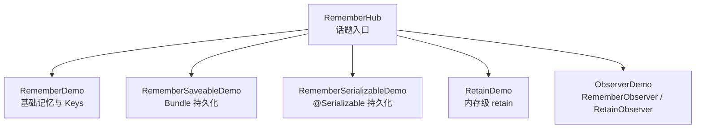
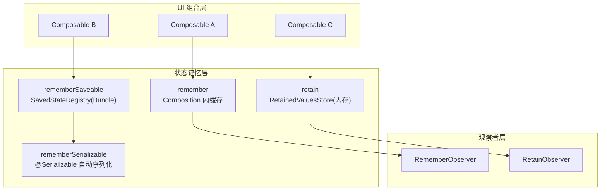
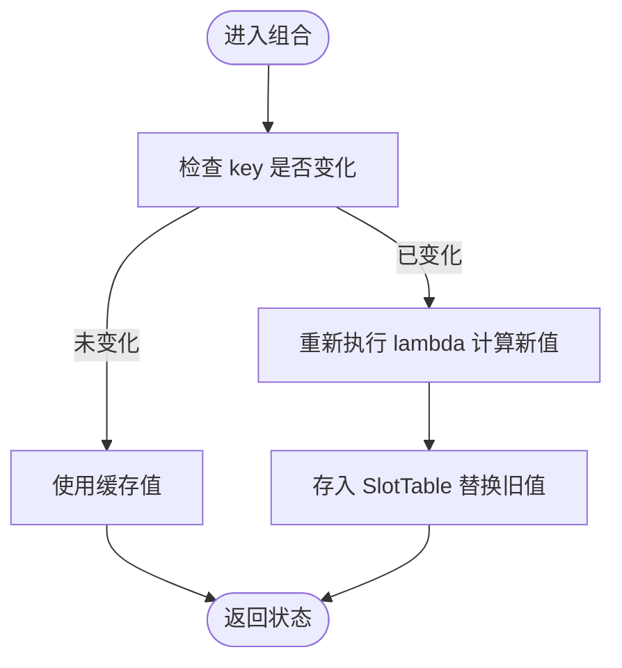
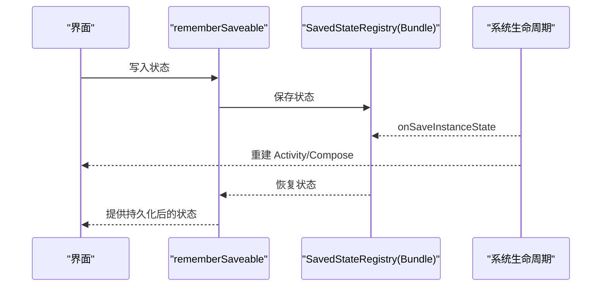
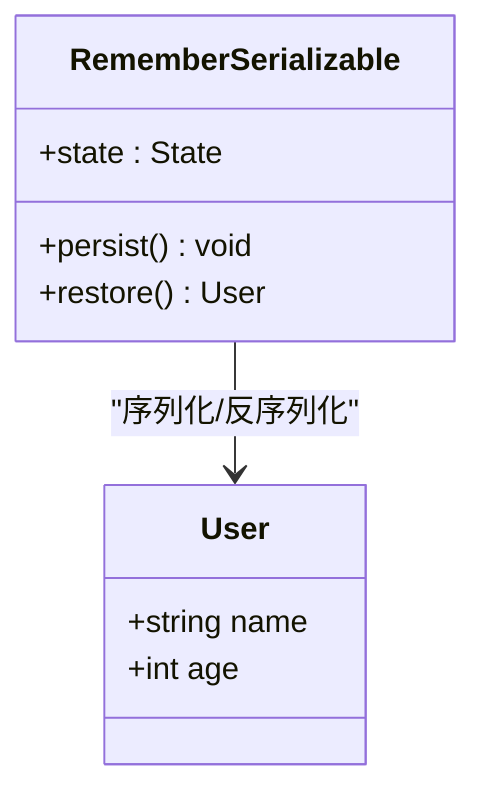
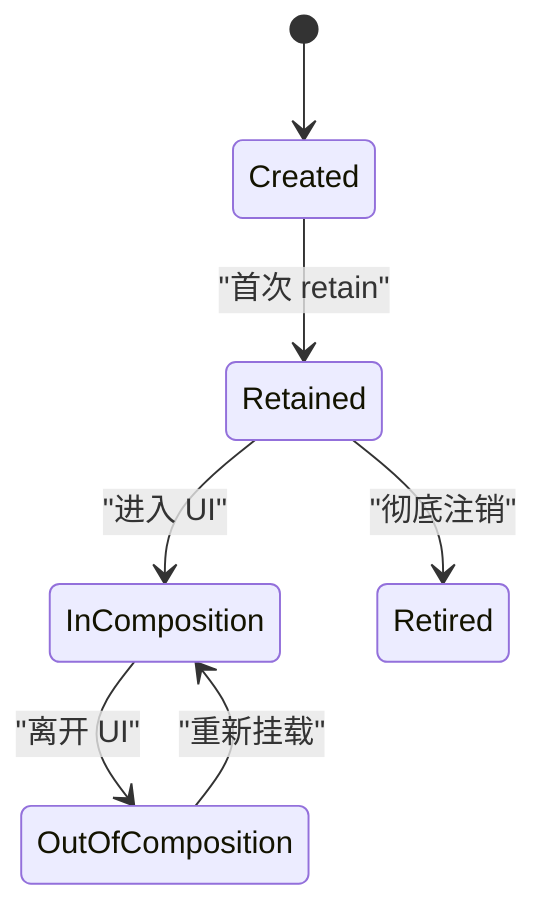
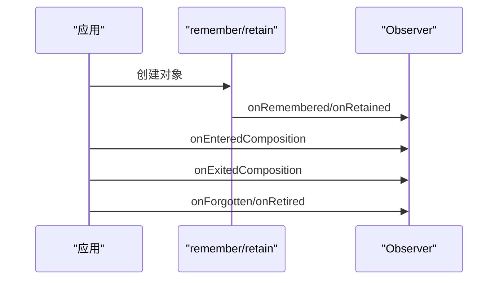
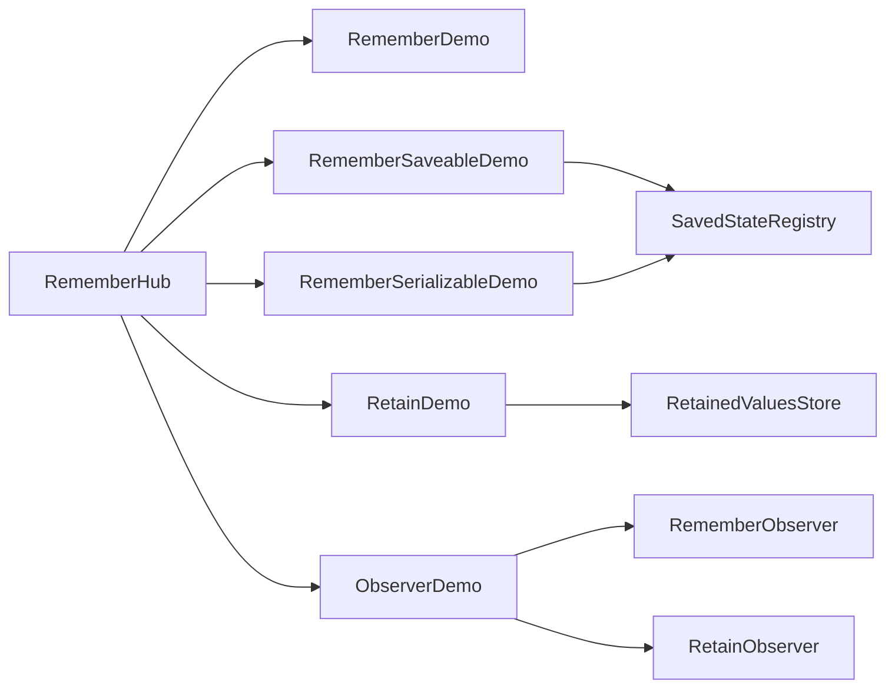

# Remember 基础

<cite>
**本文引用的文件**   
- [RememberHub.kt](file://app/src/main/java/com/example/composeup/remember/RememberHub.kt)
- [RememberDemo.kt](file://app/src/main/java/com/example/composeup/remember/RememberDemo.kt)
- [RememberSaveableDemo.kt](file://app/src/main/java/com/example/composeup/remember/RememberSaveableDemo.kt)
- [RememberSerializableDemo.kt](file://app/src/main/java/com/example/composeup/remember/RememberSerializableDemo.kt)
- [RetainDemo.kt](file://app/src/main/java/com/example/composeup/remember/RetainDemo.kt)
- [ObserverDemo.kt](file://app/src/main/java/com/example/composeup/remember/ObserverDemo.kt)
</cite>

## 目录
1. [引言](#引言)
2. [项目结构](#项目结构)
3. [核心组件](#核心组件)
4. [架构总览](#架构总览)
5. [详细组件分析](#详细组件分析)
6. [依赖关系分析](#依赖关系分析)
7. [性能考虑](#性能考虑)
8. [故障排查指南](#故障排查指南)
9. [结论](#结论)
10. [附录：API 速查与最佳实践](#附录api-速查与最佳实践)

## 引言
本文件围绕 Compose 的 remember 基础概念，系统讲解其工作原理、生命周期、存储机制与键（Keys）参数对状态记忆和重组行为的影响。文档结合仓库中的示例代码，展示在不同组合函数中的使用模式与最佳实践，并提供性能优化技巧与常见陷阱规避方法。读者可据此掌握如何在 UI 层安全、高效地管理状态，并在配置变更、进程重启等场景下选择合适的状态持久化策略。

## 项目结构
本项目的 remember 相关示例集中在 app/src/main/java/com/example/composeup/remember 目录下，包含入口导航与多个主题演示：
- RememberHub.kt：话题入口与导航，聚合 remember 系列示例页面。
- RememberDemo.kt：基础 remember、keys 与 rememberUpdatedState 的使用。
- RememberSaveableDemo.kt：跨配置变更的状态持久化。
- RememberSerializableDemo.kt：基于 kotlinx.serialization 的可序列化对象持久化。
- RetainDemo.kt：内存级 retain 保留状态，跨越配置变更但不跨进程。
- ObserverDemo.kt：RememberObserver 与 RetainObserver 的生命周期观察。

**图表来源**
- [RememberHub.kt:53-72](file://app/src/main/java/com/example/composeup/remember/RememberHub.kt#L53-L72)

**章节来源**
- [RememberHub.kt:38-72](file://app/src/main/java/com/example/composeup/remember/RememberHub.kt#L38-L72)

## 核心组件
- remember：在 Composition 树中缓存计算结果或对象实例；当组合节点从树中移除时释放。
- remember(keys, block)：通过 key 参数控制重新计算时机；key 变化会触发 lambda 重新执行并替换旧值。
- rememberSaveable：将状态保存到 SavedStateRegistry（Bundle），支持配置变更与进程重启恢复。
- rememberSerializable：对 rememberSaveable 的高级封装，直接支持 @Serializable 类型，无需自定义 Saver。
- retain：在 RetainedValuesStore 中保留对象，跨越配置变更与导航回退，但不跨进程重启。
- RememberObserver / RetainObserver：为 remember/retain 创建的对象提供生命周期回调钩子。

**章节来源**
- [RememberDemo.kt:30-39](file://app/src/main/java/com/example/composeup/remember/RememberDemo.kt#L30-L39)
- [RememberSaveableDemo.kt:18-27](file://app/src/main/java/com/example/composeup/remember/RememberSaveableDemo.kt#L18-L27)
- [RememberSerializableDemo.kt:23-33](file://app/src/main/java/com/example/composeup/remember/RememberSerializableDemo.kt#L23-L33)
- [RetainDemo.kt:16-27](file://app/src/main/java/com/example/composeup/remember/RetainDemo.kt#L16-L27)
- [ObserverDemo.kt:17-34](file://app/src/main/java/com/example/composeup/remember/ObserverDemo.kt#L17-L34)

## 架构总览
下图展示了 remember 生态在 UI 层的职责分工与数据流向：
- remember 负责 Composition 内的轻量缓存。
- rememberSaveable/rememberSerializable 对接系统保存恢复机制。
- retain 提供内存级长生命周期对象。
- Observer 接口用于资源管理与清理。

**图表来源**
- [RememberDemo.kt:30-39](file://app/src/main/java/com/example/composeup/remember/RememberDemo.kt#L30-L39)
- [RememberSaveableDemo.kt:18-27](file://app/src/main/java/com/example/composeup/remember/RememberSaveableDemo.kt#L18-L27)
- [RememberSerializableDemo.kt:23-33](file://app/src/main/java/com/example/composeup/remember/RememberSerializableDemo.kt#L23-L33)
- [RetainDemo.kt:16-27](file://app/src/main/java/com/example/composeup/remember/RetainDemo.kt#L16-L27)
- [ObserverDemo.kt:17-34](file://app/src/main/java/com/example/composeup/remember/ObserverDemo.kt#L17-L34)

## 详细组件分析

### remember 与 keys 的工作原理
- 工作原理：
  - remember 将计算结果或对象实例存储在 Composition 的 SlotTable 中，绑定到当前组合节点。
  - 重组期间，已记住的值保持不变，除非该节点被移除或 key 发生变化。
- Key 参数的影响：
  - 当传入一个或多个 key 且 key 发生变化时，remember 会重新执行 lambda，生成新值并替换旧值。
  - 典型用法：根据 userId、配置项等外部输入初始化资源，确保 key 变化后资源正确重建。
- rememberUpdatedState：
  - 在 Effect 或异步回调中引用频繁变化的状态时，使用 rememberUpdatedState 获取最新值，避免闭包捕获旧值。

**图表来源**
- [RememberDemo.kt:45-49](file://app/src/main/java/com/example/composeup/remember/RememberDemo.kt#L45-L49)
- [RememberDemo.kt:81-98](file://app/src/main/java/com/example/composeup/remember/RememberDemo.kt#L81-L98)

**章节来源**
- [RememberDemo.kt:30-39](file://app/src/main/java/com/example/composeup/remember/RememberDemo.kt#L30-L39)
- [RememberDemo.kt:45-49](file://app/src/main/java/com/example/composeup/remember/RememberDemo.kt#L45-L49)
- [RememberDemo.kt:81-98](file://app/src/main/java/com/example/composeup/remember/RememberDemo.kt#L81-L98)

### rememberSaveable 的持久化机制
- 适用场景：
  - 配置变更（旋转屏幕、语言切换、深浅色模式）。
  - 进程终止后重启恢复用户输入或中间态。
- 限制：
  - Bundle 大小有限，需选择可序列化的基本类型或 Parcelable。
- 内部机制：
  - 通过 SavedStateRegistry 与 onSaveInstanceState 挂钩，自动打包/解包状态。

**图表来源**
- [RememberSaveableDemo.kt:18-27](file://app/src/main/java/com/example/composeup/remember/RememberSaveableDemo.kt#L18-L27)
- [RememberSaveableDemo.kt:67-73](file://app/src/main/java/com/example/composeup/remember/RememberSaveableDemo.kt#L67-L73)

**章节来源**
- [RememberSaveableDemo.kt:18-27](file://app/src/main/java/com/example/composeup/remember/RememberSaveableDemo.kt#L18-L27)
- [RememberSaveableDemo.kt:67-73](file://app/src/main/java/com/example/composeup/remember/RememberSaveableDemo.kt#L67-L73)

### rememberSerializable 的序列化持久化
- 优势：
  - 零样板代码：无需手动定义 Saver。
  - 类型安全：利用 Kotlinx Serialization 处理复杂嵌套结构。
  - 跨配置变更存活：与 rememberSaveable 一样支持旋屏与进程重启。
- 使用方式：
  - 给数据类添加 @Serializable 注解，直接使用 rememberSerializable 包裹 mutableStateOf。

**图表来源**
- [RememberSerializableDemo.kt:23-33](file://app/src/main/java/com/example/composeup/remember/RememberSerializableDemo.kt#L23-L33)
- [RememberSerializableDemo.kt:82-84](file://app/src/main/java/com/example/composeup/remember/RememberSerializableDemo.kt#L82-L84)

**章节来源**
- [RememberSerializableDemo.kt:23-33](file://app/src/main/java/com/example/composeup/remember/RememberSerializableDemo.kt#L23-L33)
- [RememberSerializableDemo.kt:65-79](file://app/src/main/java/com/example/composeup/remember/RememberSerializableDemo.kt#L65-L79)
- [RememberSerializableDemo.kt:82-84](file://app/src/main/java/com/example/composeup/remember/RememberSerializableDemo.kt#L82-L84)

### retain 的内存级保留
- 特点：
  - 比 remember 生命周期更长，跨越配置变更与导航回退。
  - 不跨进程重启（进程重启会清空内存）。
  - 适合大型对象，无需序列化，性能更高。
- 对比：
  - remember：绑定当前组合。
  - retain：绑定 RetainedValuesStore。
  - rememberSaveable：绑定 Bundle，跨进程。

**图表来源**
- [RetainDemo.kt:16-27](file://app/src/main/java/com/example/composeup/remember/RetainDemo.kt#L16-L27)
- [RetainDemo.kt:55-69](file://app/src/main/java/com/example/composeup/remember/RetainDemo.kt#L55-L69)

**章节来源**
- [RetainDemo.kt:16-27](file://app/src/main/java/com/example/composeup/remember/RetainDemo.kt#L16-L27)
- [RetainDemo.kt:55-69](file://app/src/main/java/com/example/composeup/remember/RetainDemo.kt#L55-L69)

### RememberObserver 与 RetainObserver 的生命周期
- RememberObserver：
  - onRemembered：进入 UI 树。
  - onForgotten：离开 UI 树。
  - onAbandoned：记忆未成功完成。
- RetainObserver：
  - onRetained：首次被 retain 捕获并存入 Store。
  - onEnteredComposition：进入 UI 树。
  - onExitedComposition：离开 UI 树但仍保留在内存。
  - onRetired：对象从 Store 中彻底注销。
  - onUnused：对象被创建但未成功应用到 Composition。

**图表来源**
- [ObserverDemo.kt:17-34](file://app/src/main/java/com/example/composeup/remember/ObserverDemo.kt#L17-L34)
- [ObserverDemo.kt:89-127](file://app/src/main/java/com/example/composeup/remember/ObserverDemo.kt#L89-L127)

**章节来源**
- [ObserverDemo.kt:17-34](file://app/src/main/java/com/example/composeup/remember/ObserverDemo.kt#L17-L34)
- [ObserverDemo.kt:89-127](file://app/src/main/java/com/example/composeup/remember/ObserverDemo.kt#L89-L127)

## 依赖关系分析
- RememberHub 作为入口，按主题路由到各 Demo 页面。
- 各 Demo 页面独立展示 remember 的不同能力，彼此无强耦合。
- rememberSaveable 与 rememberSerializable 共享 SavedStateRegistry 机制。
- retain 与 RetainedValuesStore 提供内存级长生命周期。
- Observer 接口为 remember/retain 对象提供统一生命周期钩子。

**图表来源**
- [RememberHub.kt:53-72](file://app/src/main/java/com/example/composeup/remember/RememberHub.kt#L53-L72)
- [RememberSaveableDemo.kt:67-73](file://app/src/main/java/com/example/composeup/remember/RememberSaveableDemo.kt#L67-L73)
- [RetainDemo.kt:55-69](file://app/src/main/java/com/example/composeup/remember/RetainDemo.kt#L55-L69)
- [ObserverDemo.kt:89-127](file://app/src/main/java/com/example/composeup/remember/ObserverDemo.kt#L89-L127)

**章节来源**
- [RememberHub.kt:53-72](file://app/src/main/java/com/example/composeup/remember/RememberHub.kt#L53-L72)

## 性能考虑
- 合理使用 keys：
  - 仅在必要时传入 key，避免不必要的重新计算。
  - key 应稳定且唯一，避免频繁变化导致重复重建。
- 避免在 remember 中执行昂贵操作：
  - 将耗时逻辑下沉到 ViewModel 或 Repository，UI 层仅做展示。
- 优先使用 retain 处理大型对象：
  - 避免序列化开销，提升性能。
- 谨慎使用 rememberSaveable：
  - Bundle 大小受限，避免存储大对象；优先使用 rememberSerializable 或自定义 Saver。
- 使用 rememberUpdatedState：
  - 在 Effect 或回调中引用最新状态，避免闭包捕获旧值导致的额外重建或错误逻辑。

[本节为通用指导，不直接分析具体文件]

## 故障排查指南
- 随机值未按预期更新：
  - 检查是否使用了带 key 的 remember；若需要随外部输入重建，请传入相应 key。
- 闭包捕获旧值：
  - 在 LaunchedEffect 或定时器回调中使用 rememberUpdatedState 包装状态变量。
- 旋屏后状态丢失：
  - 确认是否使用 rememberSaveable 或 rememberSerializable；普通 remember 会在 Activity 重建时丢失。
- 内存泄漏或资源未释放：
  - 实现 RememberObserver/RetainObserver，在 onForgotten/onRetired 中释放资源。
- 进程重启后状态未恢复：
  - 确认状态类型是否可序列化；对于复杂对象，优先使用 rememberSerializable 或自定义 Saver。

**章节来源**
- [RememberDemo.kt:81-98](file://app/src/main/java/com/example/composeup/remember/RememberDemo.kt#L81-L98)
- [RememberSaveableDemo.kt:18-27](file://app/src/main/java/com/example/composeup/remember/RememberSaveableDemo.kt#L18-L27)
- [RememberSerializableDemo.kt:23-33](file://app/src/main/java/com/example/composeup/remember/RememberSerializableDemo.kt#L23-L33)
- [ObserverDemo.kt:89-127](file://app/src/main/java/com/example/composeup/remember/ObserverDemo.kt#L89-L127)

## 结论
remember 是 Compose 状态管理的基石，理解其生命周期、存储机制与 key 参数对重组行为的影响至关重要。在实际开发中，应根据场景选择合适的记忆策略：
- 短期状态：使用 remember。
- 配置变更与进程重启：使用 rememberSaveable 或 rememberSerializable。
- 大型对象与跨配置变更：使用 retain。
- 资源管理：实现 RememberObserver/RetainObserver 进行生命周期感知与清理。

通过合理组织状态与资源，结合性能优化与常见陷阱规避，可以构建健壮、高效的 Compose UI。

[本节为总结性内容，不直接分析具体文件]

## 附录：API 速查与最佳实践
- remember：
  - 用途：Composition 内轻量缓存。
  - 最佳实践：避免昂贵计算；必要时使用 key。
- remember(keys, block)：
  - 用途：根据 key 控制重新计算。
  - 最佳实践：key 稳定且唯一；避免频繁变化。
- rememberSaveable：
  - 用途：Bundle 持久化，支持配置变更与进程重启。
  - 最佳实践：仅存储可序列化的小对象；避免超大 Bundle。
- rememberSerializable：
  - 用途：@Serializable 对象的自动持久化。
  - 最佳实践：为复杂对象提供 @Serializable 注解。
- retain：
  - 用途：内存级长生命周期对象。
  - 最佳实践：用于大型对象；注意不跨进程。
- RememberObserver/RetainObserver：
  - 用途：生命周期钩子，资源管理。
  - 最佳实践：在 onForgotten/onRetired 中释放资源。

[本节为速查与最佳实践汇总，不直接分析具体文件]