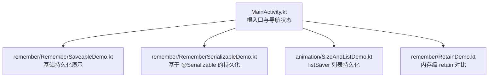
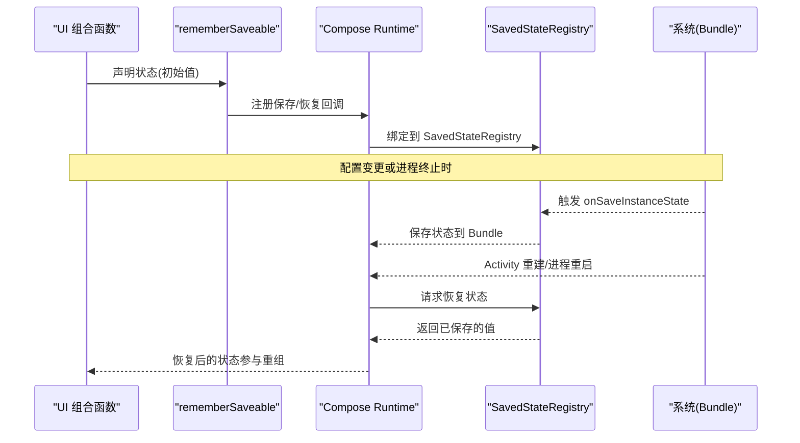
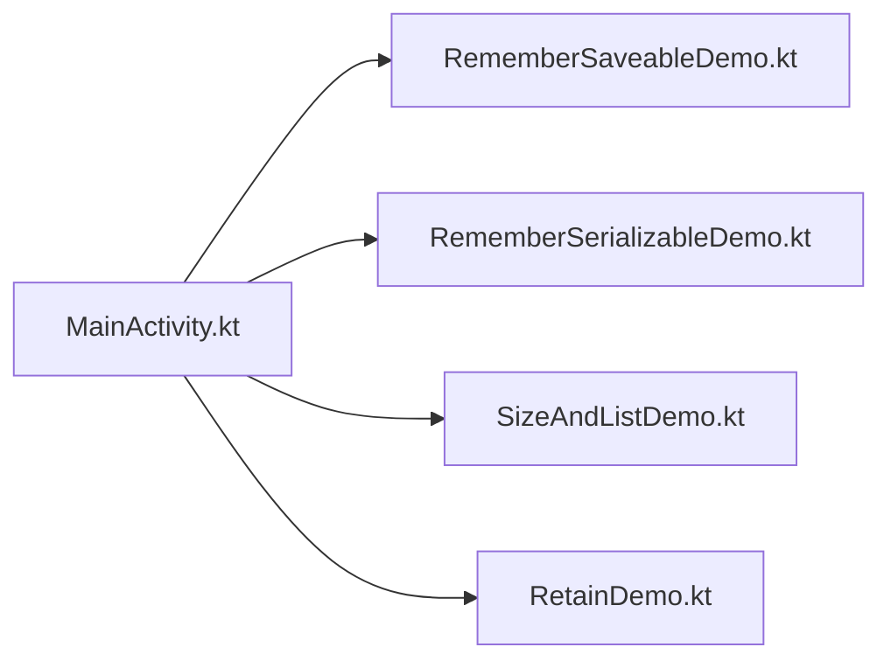

# RememberSaveable 持久化

<cite>
**本文引用的文件**   
- [RememberSaveableDemo.kt](file://app/src/main/java/com/example/composeup/remember/RememberSaveableDemo.kt)
- [RememberSerializableDemo.kt](file://app/src/main/java/com/example/composeup/remember/RememberSerializableDemo.kt)
- [SizeAndListDemo.kt](file://app/src/main/java/com/example/composeup/animation/SizeAndListDemo.kt)
- [RetainDemo.kt](file://app/src/main/java/com/example/composeup/remember/RetainDemo.kt)
- [MainActivity.kt](file://app/src/main/java/com/example/composeup/MainActivity.kt)
</cite>

## 目录
1. [引言](#引言)
2. [项目结构](#项目结构)
3. [核心组件](#核心组件)
4. [架构总览](#架构总览)
5. [详细组件分析](#详细组件分析)
6. [依赖关系分析](#依赖关系分析)
7. [性能考虑](#性能考虑)
8. [故障排查指南](#故障排查指南)
9. [结论](#结论)
10. [附录：代码示例索引](#附录代码示例索引)

## 引言
本技术文档围绕 Compose 中的 rememberSaveable 状态持久化机制展开，重点解释其在配置变更（如屏幕旋转）与进程重启时的保存与恢复行为；梳理默认序列化器支持类型、自定义 Saver 的实现方式；给出复杂对象的状态持久化策略与性能考量；并提供最佳实践与常见问题解决方案。文档同时结合仓库中的演示代码，帮助读者快速定位可运行的示例与参考实现。

## 项目结构
本项目在 app 模块中提供了多个与 remember 家族相关的演示页面，其中与 rememberSaveable 直接相关的文件包括：
- remember 包下的基础演示与可序列化演示
- animation 包下使用 listSaver 的列表持久化示例
- MainActivity 中多处使用 rememberSaveable 维持导航与 UI 状态

**图表来源**
- [MainActivity.kt:121-138](file://app/src/main/java/com/example/composeup/MainActivity.kt#L121-L138)
- [RememberSaveableDemo.kt:18-85](file://app/src/main/java/com/example/composeup/remember/RememberSaveableDemo.kt#L18-L85)
- [RememberSerializableDemo.kt:23-84](file://app/src/main/java/com/example/composeup/remember/RememberSerializableDemo.kt#L23-L84)
- [SizeAndListDemo.kt:108-116](file://app/src/main/java/com/example/composeup/animation/SizeAndListDemo.kt#L108-L116)
- [RetainDemo.kt:16-34](file://app/src/main/java/com/example/composeup/remember/RetainDemo.kt#L16-L34)

**章节来源**
- [MainActivity.kt:121-138](file://app/src/main/java/com/example/composeup/MainActivity.kt#L121-L138)

## 核心组件
- rememberSaveable：用于在配置变更和进程重启后恢复状态，底层通过 SavedStateRegistry 将值写入 Bundle。
- rememberSerializable：对 rememberSaveable 的高级封装，配合 kotlinx.serialization 自动处理复杂对象的序列化与反序列化。
- listSaver：为 List/MutableList 提供默认的保存与恢复逻辑，常用于列表项集合的持久化。
- retain：与 rememberSaveable 不同，retain 仅保留在内存中，不跨进程重启，适合大型对象且追求更高性能的场景。

这些组件共同构成了 Compose 状态持久化的常用工具集，覆盖从简单基本类型到复杂对象的不同场景。

**章节来源**
- [RememberSaveableDemo.kt:18-85](file://app/src/main/java/com/example/composeup/remember/RememberSaveableDemo.kt#L18-L85)
- [RememberSerializableDemo.kt:23-84](file://app/src/main/java/com/example/composeup/remember/RememberSerializableDemo.kt#L23-L84)
- [SizeAndListDemo.kt:108-116](file://app/src/main/java/com/example/composeup/animation/SizeAndListDemo.kt#L108-L116)
- [RetainDemo.kt:16-34](file://app/src/main/java/com/example/composeup/remember/RetainDemo.kt#L16-L34)

## 架构总览
下图展示了 rememberSaveable 在应用中的典型调用链与数据流：UI 层通过 rememberSaveable 声明状态，Compose Runtime 将其与 SavedStateRegistry 绑定，系统在 onSaveInstanceState 时触发保存，并在 Activity 重建或进程重启后恢复状态。

**图表来源**
- [RememberSaveableDemo.kt:67-73](file://app/src/main/java/com/example/composeup/remember/RememberSaveableDemo.kt#L67-L73)

## 详细组件分析

### rememberSaveable 基础用法与原理
- 作用范围：适用于需要在配置变更（旋屏、语言切换、深浅色模式切换）与进程重启后保持的状态。
- 限制：Bundle 大小有限，类型需可序列化（基本类型、String、Parcelable 等）。
- 内部机制：通过 SavedStateRegistry 与系统的 onSaveInstanceState 挂钩，自动打包进 Bundle。

典型用法：
- 普通文本输入框在旋屏后是否保留，可通过对比 remember 与 rememberSaveable 的行为来验证。
- 常见用途包括搜索关键字、表单中间态、滚动位置等。

**章节来源**
- [RememberSaveableDemo.kt:18-85](file://app/src/main/java/com/example/composeup/remember/RememberSaveableDemo.kt#L18-L85)

### rememberSerializable 与 @Serializable
- 优势：零样板代码、类型安全、可直接记忆被 @Serializable 注解的复杂对象。
- 适用场景：当业务模型已经使用 kotlinx.serialization 时，优先选择 rememberSerializable，避免手写 Saver。
- 与 rememberSaveable 的关系：是对 rememberSaveable 的高级封装，专门为 kotlinx.serialization 优化。

示例要点：
- 给数据类加上 @Serializable 注解后，即可通过 rememberSerializable 直接持久化。
- 无需手动定义如何保存和恢复每个字段。

**章节来源**
- [RememberSerializableDemo.kt:23-84](file://app/src/main/java/com/example/composeup/remember/RememberSerializableDemo.kt#L23-L84)

### 自定义 Saver 与 listSaver
- 当需要持久化集合或自定义数据结构时，可使用 listSaver 或 mapSaver 等内置 saver，或编写自定义 Saver。
- listSaver 示例：在动画与列表演示中，使用 listSaver 保存 mutableStateListOf 的内容，确保列表在配置变更后恢复。

关键点：
- save 参数：将可变列表转换为不可变列表进行保存。
- restore 参数：将保存的数据恢复为可变列表以继续操作。

**章节来源**
- [SizeAndListDemo.kt:108-116](file://app/src/main/java/com/example/composeup/animation/SizeAndListDemo.kt#L108-L116)

### retain 与 rememberSaveable 的对比
- retain：在内存中保留状态，生命周期更长，适合大型对象；但不跨进程重启。
- rememberSaveable：跨配置变更与进程重启，但受限于 Bundle 大小与序列化成本。

建议：
- 若对象较大且不需要跨进程重启，优先考虑 retain 以获得更好的性能。
- 若需要跨进程重启，则必须使用 rememberSaveable 并选择合适的序列化方案。

**章节来源**
- [RetainDemo.kt:16-34](file://app/src/main/java/com/example/composeup/remember/RetainDemo.kt#L16-L34)

### 复杂对象的状态持久化策略
- 优先使用 @Serializable + rememberSerializable，减少样板代码并保证类型安全。
- 对于集合类型，使用 listSaver/mapSaver 或自定义 Saver。
- 对于超大对象或频繁更新的对象，评估 retain 的可行性，避免序列化开销。
- 注意 Bundle 大小限制，必要时拆分状态或将大对象下沉至 ViewModel/DataStore/Room。

**章节来源**
- [RememberSerializableDemo.kt:23-84](file://app/src/main/java/com/example/composeup/remember/RememberSerializableDemo.kt#L23-L84)
- [SizeAndListDemo.kt:108-116](file://app/src/main/java/com/example/composeup/animation/SizeAndListDemo.kt#L108-L116)
- [RetainDemo.kt:16-34](file://app/src/main/java/com/example/composeup/remember/RetainDemo.kt#L16-L34)

## 依赖关系分析
- MainActivity 作为根入口，多处使用 rememberSaveable 维护导航与界面状态，体现该 API 在应用层面的广泛使用。
- remember 包与 animation 包分别展示了基础用法与集合持久化，形成从简单到复杂的渐进式示例体系。

**图表来源**
- [MainActivity.kt:121-138](file://app/src/main/java/com/example/composeup/MainActivity.kt#L121-L138)
- [RememberSaveableDemo.kt:18-85](file://app/src/main/java/com/example/composeup/remember/RememberSaveableDemo.kt#L18-L85)
- [RememberSerializableDemo.kt:23-84](file://app/src/main/java/com/example/composeup/remember/RememberSerializableDemo.kt#L23-L84)
- [SizeAndListDemo.kt:108-116](file://app/src/main/java/com/example/composeup/animation/SizeAndListDemo.kt#L108-L116)
- [RetainDemo.kt:16-34](file://app/src/main/java/com/example/composeup/remember/RetainDemo.kt#L16-L34)

**章节来源**
- [MainActivity.kt:121-138](file://app/src/main/java/com/example/composeup/MainActivity.kt#L121-L138)

## 性能考虑
- Bundle 大小限制：避免存储过大对象，必要时拆分状态或使用更合适的存储方案（DataStore/Room）。
- 序列化开销：@Serializable 与自定义 Saver 都会带来序列化/反序列化成本，应仅在必要时启用。
- retain vs rememberSaveable：retain 无序列化开销，适合大型对象与高频更新；但不能跨进程重启。
- 列表持久化：使用 listSaver 时注意只保存必要字段，避免冗余数据导致体积膨胀。

[本节为通用指导，不直接分析具体文件]

## 故障排查指南
- 旋屏后状态丢失：确认是否使用了 rememberSaveable；检查类型是否可序列化；避免在 rememberSaveable 中保存不可序列化的对象。
- Bundle 过大导致崩溃：拆分状态、移除不必要字段，或改用 ViewModel/DataStore/Room。
- 列表恢复异常：确保 listSaver 的 save/restore 逻辑正确；为列表项提供稳定唯一的 key，以便动画与识别正确。
- 进程重启后状态未恢复：确认 SavedStateRegistry 正常注册；检查是否在正确的生命周期阶段保存/恢复状态。

**章节来源**
- [RememberSaveableDemo.kt:67-73](file://app/src/main/java/com/example/composeup/remember/RememberSaveableDemo.kt#L67-L73)
- [SizeAndListDemo.kt:108-116](file://app/src/main/java/com/example/composeup/animation/SizeAndListDemo.kt#L108-L116)

## 结论
rememberSaveable 是 Compose 中处理配置变更与进程重启状态的核心 API。对于简单类型与轻量对象，直接使用 rememberSaveable 即可；对于复杂对象，优先采用 @Serializable + rememberSerializable；对于集合，使用 listSaver/mapSaver 或自定义 Saver。在性能敏感场景中，可考虑 retain 以避免序列化开销，但需注意其不跨进程重启的限制。合理拆分状态、控制 Bundle 大小、选择合适序列化方案，是构建健壮状态持久化体系的关键。

[本节为总结性内容，不直接分析具体文件]

## 附录：代码示例索引
- 基础 rememberSaveable 演示：[RememberSaveableDemo.kt:18-85](file://app/src/main/java/com/example/composeup/remember/RememberSaveableDemo.kt#L18-L85)
- 基于 @Serializable 的持久化演示：[RememberSerializableDemo.kt:23-84](file://app/src/main/java/com/example/composeup/remember/RememberSerializableDemo.kt#L23-L84)
- 使用 listSaver 的列表持久化示例：[SizeAndListDemo.kt:108-116](file://app/src/main/java/com/example/composeup/animation/SizeAndListDemo.kt#L108-L116)
- retain 与 rememberSaveable 的对比说明：[RetainDemo.kt:16-34](file://app/src/main/java/com/example/composeup/remember/RetainDemo.kt#L16-L34)
- MainActivity 中多处 rememberSaveable 的使用：[MainActivity.kt:121-138](file://app/src/main/java/com/example/composeup/MainActivity.kt#L121-L138)