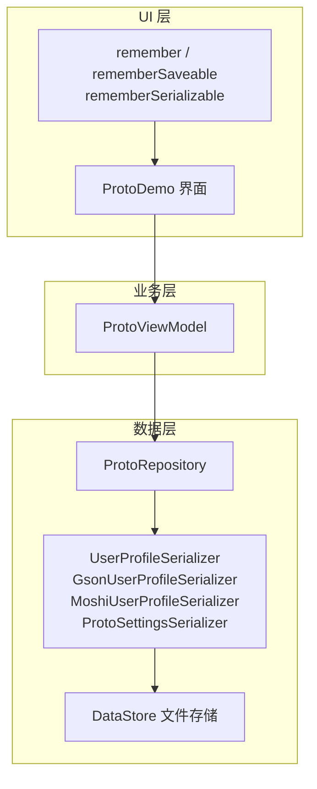
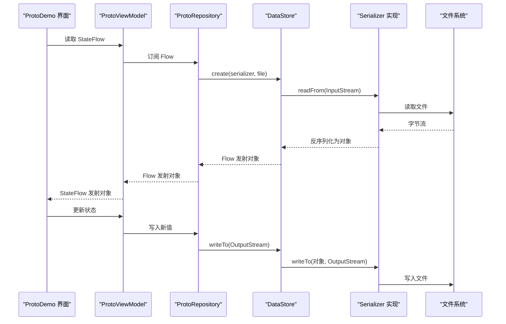
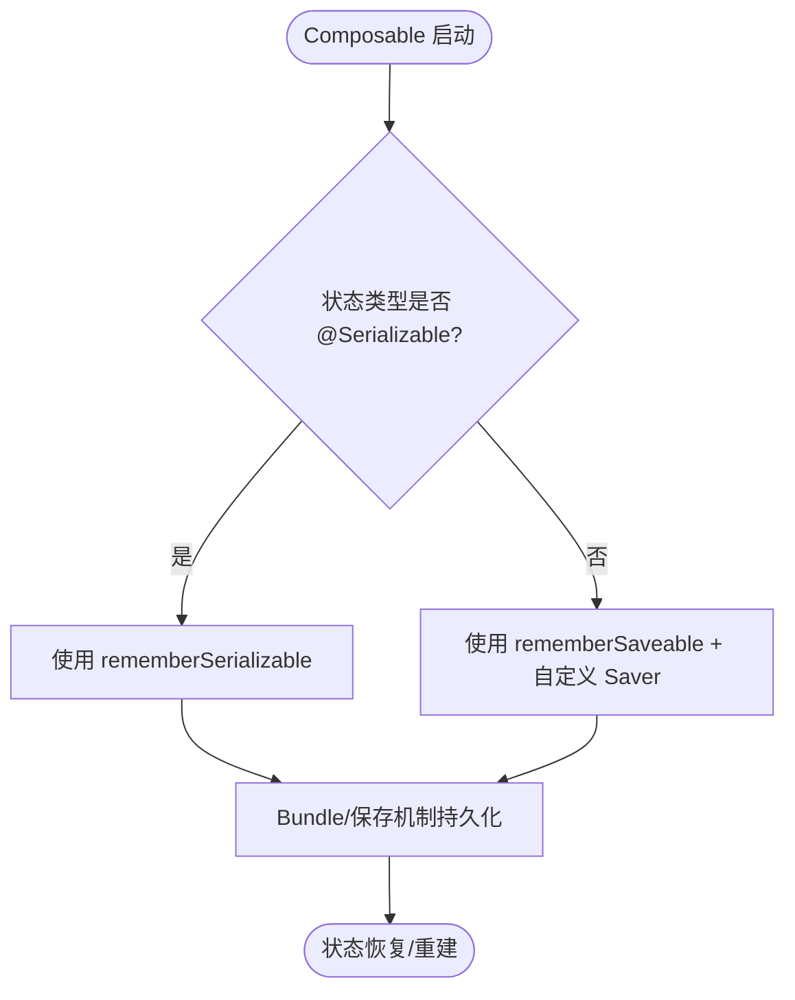
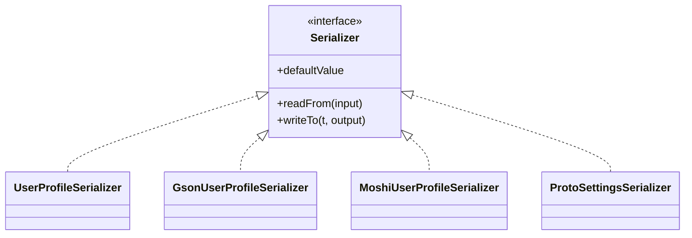
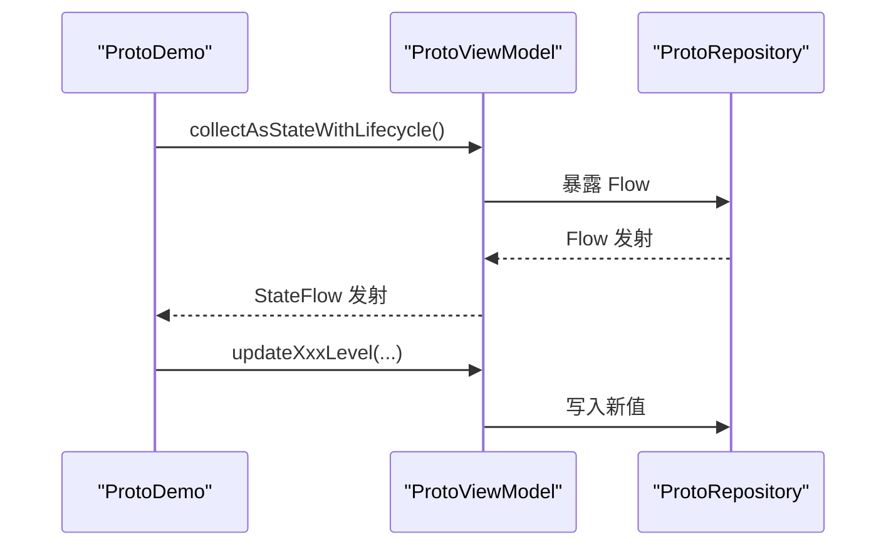
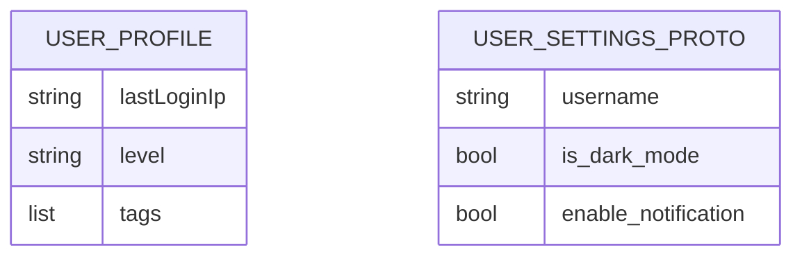
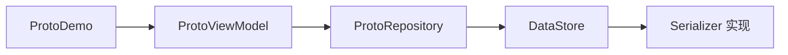

# 可序列化状态

<cite>
**本文引用的文件**   
- [RememberSerializableDemo.kt](file://app/src/main/java/com/example/composeup/remember/RememberSerializableDemo.kt)
- [RememberSaveableDemo.kt](file://app/src/main/java/com/example/composeup/remember/RememberSaveableDemo.kt)
- [UserProfileSerializer.kt](file://app/src/main/java/com/example/composeup/datastore/data/local/datastore/UserProfileSerializer.kt)
- [GsonUserProfileSerializer.kt](file://app/src/main/java/com/example/composeup/datastore/data/local/datastore/GsonUserProfileSerializer.kt)
- [MoshiUserProfileSerializer.kt](file://app/src/main/java/com/example/composeup/datastore/data/local/datastore/MoshiUserProfileSerializer.kt)
- [ProtoSettingsSerializer.kt](file://app/src/main/java/com/example/composeup/datastore/data/local/datastore/ProtoSettingsSerializer.kt)
- [ProtoRepository.kt](file://app/src/main/java/com/example/composeup/datastore/data/repository/ProtoRepository.kt)
- [ProtoViewModel.kt](file://app/src/main/java/com/example/composeup/datastore/ui/viewmodel/ProtoViewModel.kt)
- [ProtoDemo.kt](file://app/src/main/java/com/example/composeup/datastore/ProtoDemo.kt)
- [user_prefs.proto](file://app/src/main/proto/user_prefs.proto)
- [UserProfile.kt](file://app/src/main/java/com/example/composeup/datastore/data/model/UserProfile.kt)
</cite>

## 目录
1. [简介](#简介)
2. [项目结构](#项目结构)
3. [核心组件](#核心组件)
4. [架构总览](#架构总览)
5. [详细组件分析](#详细组件分析)
6. [依赖关系分析](#依赖关系分析)
7. [性能与优化](#性能与优化)
8. [故障排查](#故障排查)
9. [结论](#结论)
10. [附录：集成模式与最佳实践](#附录集成模式与最佳实践)

## 简介
本技术文档围绕 Compose 中的“可序列化状态”展开，重点说明如何通过自定义 Saver 和 rememberSerializable 实现复杂 Data Class 或序列化对象的记忆与持久化。同时结合 DataStore 的多种序列化方案（Kotlinx Serialization、Gson、Moshi、原生 ProtoBuf），展示在 UI 状态与本地持久化之间的统一建模方式，并给出大对象处理、版本兼容性与性能优化的实践建议。

## 项目结构
本项目将“UI 层状态记忆”与“数据层持久化”解耦：
- UI 层使用 remember / rememberSaveable / rememberSerializable 管理 Composable 的状态生命周期。
- 数据层通过 DataStore + Serializer 将状态持久化为 JSON 或 ProtoBuf。
- ViewModel 暴露 StateFlow，供 UI 消费。

图表来源
- [ProtoDemo.kt:32-153](file://app/src/main/java/com/example/composeup/datastore/ProtoDemo.kt#L32-L153)
- [ProtoViewModel.kt:13-33](file://app/src/main/java/com/example/composeup/datastore/ui/viewmodel/ProtoViewModel.kt#L13-L33)
- [ProtoRepository.kt:17-29](file://app/src/main/java/com/example/composeup/datastore/data/repository/ProtoRepository.kt#L17-L29)
- [UserProfileSerializer.kt:33-52](file://app/src/main/java/com/example/composeup/datastore/data/local/datastore/UserProfileSerializer.kt#L33-L52)
- [GsonUserProfileSerializer.kt:11-27](file://app/src/main/java/com/example/composeup/datastore/data/local/datastore/GsonUserProfileSerializer.kt#L11-L27)
- [MoshiUserProfileSerializer.kt:11-29](file://app/src/main/java/com/example/composeup/datastore/data/local/datastore/MoshiUserProfileSerializer.kt#L11-L29)
- [ProtoSettingsSerializer.kt:12-27](file://app/src/main/java/com/example/composeup/datastore/data/local/datastore/ProtoSettingsSerializer.kt#L12-L27)

章节来源
- [ProtoDemo.kt:32-153](file://app/src/main/java/com/example/composeup/datastore/ProtoDemo.kt#L32-L153)
- [ProtoViewModel.kt:13-33](file://app/src/main/java/com/example/composeup/datastore/ui/viewmodel/ProtoViewModel.kt#L13-L33)
- [ProtoRepository.kt:17-29](file://app/src/main/java/com/example/composeup/datastore/data/repository/ProtoRepository.kt#L17-L29)

## 核心组件
- remember / rememberSaveable / rememberSerializable：用于 UI 状态的生命周期管理与跨配置变更存活。
- DataStore Serializer：负责对象与字节流之间的编解码，支持 Kotlinx Serialization、Gson、Moshi、ProtoBuf。
- Repository 与 ViewModel：封装数据访问与状态流，向 UI 暴露稳定的 StateFlow。

章节来源
- [RememberSaveableDemo.kt:18-84](file://app/src/main/java/com/example/composeup/remember/RememberSaveableDemo.kt#L18-L84)
- [RememberSerializableDemo.kt:23-84](file://app/src/main/java/com/example/composeup/remember/RememberSerializableDemo.kt#L23-L84)
- [UserProfileSerializer.kt:33-52](file://app/src/main/java/com/example/composeup/datastore/data/local/datastore/UserProfileSerializer.kt#L33-L52)
- [GsonUserProfileSerializer.kt:11-27](file://app/src/main/java/com/example/composeup/datastore/data/local/datastore/GsonUserProfileSerializer.kt#L11-L27)
- [MoshiUserProfileSerializer.kt:11-29](file://app/src/main/java/com/example/composeup/datastore/data/local/datastore/MoshiUserProfileSerializer.kt#L11-L29)
- [ProtoSettingsSerializer.kt:12-27](file://app/src/main/java/com/example/composeup/datastore/data/local/datastore/ProtoSettingsSerializer.kt#L12-L27)

## 架构总览
下图展示了从 UI 到持久化的完整调用链，以及多序列化方案的并存策略。

图表来源
- [ProtoDemo.kt:32-153](file://app/src/main/java/com/example/composeup/datastore/ProtoDemo.kt#L32-L153)
- [ProtoViewModel.kt:13-33](file://app/src/main/java/com/example/composeup/datastore/ui/viewmodel/ProtoViewModel.kt#L13-L33)
- [ProtoRepository.kt:17-29](file://app/src/main/java/com/example/composeup/datastore/data/repository/ProtoRepository.kt#L17-L29)
- [UserProfileSerializer.kt:33-52](file://app/src/main/java/com/example/composeup/datastore/data/local/datastore/UserProfileSerializer.kt#L33-L52)
- [GsonUserProfileSerializer.kt:11-27](file://app/src/main/java/com/example/composeup/datastore/data/local/datastore/GsonUserProfileSerializer.kt#L11-L27)
- [MoshiUserProfileSerializer.kt:11-29](file://app/src/main/java/com/example/composeup/datastore/data/local/datastore/MoshiUserProfileSerializer.kt#L11-L29)
- [ProtoSettingsSerializer.kt:12-27](file://app/src/main/java/com/example/composeup/datastore/data/local/datastore/ProtoSettingsSerializer.kt#L12-L27)

## 详细组件分析

### remember / rememberSaveable / rememberSerializable
- remember：仅在当前 Composition 内有效，重建即丢失。
- rememberSaveable：基于 SavedStateRegistry，支持旋屏与进程重启后的恢复；Bundle 大小有限，适合轻量状态。
- rememberSerializable：对 rememberSaveable 的高级封装，直接支持 @Serializable 类型，零样板代码，类型安全，适合复杂嵌套结构。

图表来源
- [RememberSaveableDemo.kt:18-84](file://app/src/main/java/com/example/composeup/remember/RememberSaveableDemo.kt#L18-L84)
- [RememberSerializableDemo.kt:23-84](file://app/src/main/java/com/example/composeup/remember/RememberSerializableDemo.kt#L23-L84)

章节来源
- [RememberSaveableDemo.kt:18-84](file://app/src/main/java/com/example/composeup/remember/RememberSaveableDemo.kt#L18-L84)
- [RememberSerializableDemo.kt:23-84](file://app/src/main/java/com/example/composeup/remember/RememberSerializableDemo.kt#L23-L84)

### DataStore 序列化器实现
- UserProfileSerializer：基于 kotlinx.serialization 的 Json，提供默认值与异常回退。
- GsonUserProfileSerializer：基于 Gson 的 JSON 编解码。
- MoshiUserProfileSerializer：基于 Moshi 的 JSON 编解码。
- ProtoSettingsSerializer：原生 ProtoBuf 编解码，抛出 CorruptionException 以适配 DataStore 的错误模型。

图表来源
- [UserProfileSerializer.kt:33-52](file://app/src/main/java/com/example/composeup/datastore/data/local/datastore/UserProfileSerializer.kt#L33-L52)
- [GsonUserProfileSerializer.kt:11-27](file://app/src/main/java/com/example/composeup/datastore/data/local/datastore/GsonUserProfileSerializer.kt#L11-L27)
- [MoshiUserProfileSerializer.kt:11-29](file://app/src/main/java/com/example/composeup/datastore/data/local/datastore/MoshiUserProfileSerializer.kt#L11-L29)
- [ProtoSettingsSerializer.kt:12-27](file://app/src/main/java/com/example/composeup/datastore/data/local/datastore/ProtoSettingsSerializer.kt#L12-L27)

章节来源
- [UserProfileSerializer.kt:33-52](file://app/src/main/java/com/example/composeup/datastore/data/local/datastore/UserProfileSerializer.kt#L33-L52)
- [GsonUserProfileSerializer.kt:11-27](file://app/src/main/java/com/example/composeup/datastore/data/local/datastore/GsonUserProfileSerializer.kt#L11-L27)
- [MoshiUserProfileSerializer.kt:11-29](file://app/src/main/java/com/example/composeup/datastore/data/local/datastore/MoshiUserProfileSerializer.kt#L11-L29)
- [ProtoSettingsSerializer.kt:12-27](file://app/src/main/java/com/example/composeup/datastore/data/local/datastore/ProtoSettingsSerializer.kt#L12-L27)

### ViewModel 与 UI 集成
- ProtoViewModel 暴露多个 StateFlow，分别对应不同序列化方案的数据源。
- ProtoDemo 根据用户选择切换显示不同的序列化结果。

图表来源
- [ProtoViewModel.kt:13-33](file://app/src/main/java/com/example/composeup/datastore/ui/viewmodel/ProtoViewModel.kt#L13-L33)
- [ProtoDemo.kt:32-153](file://app/src/main/java/com/example/composeup/datastore/ProtoDemo.kt#L32-L153)

章节来源
- [ProtoViewModel.kt:13-33](file://app/src/main/java/com/example/composeup/datastore/ui/viewmodel/ProtoViewModel.kt#L13-L33)
- [ProtoDemo.kt:32-153](file://app/src/main/java/com/example/composeup/datastore/ProtoDemo.kt#L32-L153)

### 模型与 ProtoBuf 定义
- UserProfile：使用 @Serializable 与 Moshi 注解，作为 JSON 与 Proto 场景的统一领域模型。
- user_prefs.proto：定义 UserSettingsProto 的结构，用于原生 ProtoBuf 存储。

图表来源
- [UserProfile.kt:1-14](file://app/src/main/java/com/example/composeup/datastore/data/model/UserProfile.kt#L1-L14)
- [user_prefs.proto:1-10](file://app/src/main/proto/user_prefs.proto#L1-L10)

章节来源
- [UserProfile.kt:1-14](file://app/src/main/java/com/example/composeup/datastore/data/model/UserProfile.kt#L1-L14)
- [user_prefs.proto:1-10](file://app/src/main/proto/user_prefs.proto#L1-L10)

## 依赖关系分析
- UI 层依赖 ViewModel 暴露的 StateFlow。
- ViewModel 依赖 Repository 提供的 Flow。
- Repository 依赖 DataStore 与具体 Serializer 实现。
- Serializer 依赖具体的序列化库（kotlinx.serialization、Gson、Moshi、ProtoBuf）。

图表来源
- [ProtoDemo.kt:32-153](file://app/src/main/java/com/example/composeup/datastore/ProtoDemo.kt#L32-L153)
- [ProtoViewModel.kt:13-33](file://app/src/main/java/com/example/composeup/datastore/ui/viewmodel/ProtoViewModel.kt#L13-L33)
- [ProtoRepository.kt:17-29](file://app/src/main/java/com/example/composeup/datastore/data/repository/ProtoRepository.kt#L17-L29)

章节来源
- [ProtoDemo.kt:32-153](file://app/src/main/java/com/example/composeup/datastore/ProtoDemo.kt#L32-L153)
- [ProtoViewModel.kt:13-33](file://app/src/main/java/com/example/composeup/datastore/ui/viewmodel/ProtoViewModel.kt#L13-L33)
- [ProtoRepository.kt:17-29](file://app/src/main/java/com/example/composeup/datastore/data/repository/ProtoRepository.kt#L17-L29)

## 性能与优化
- 大对象处理
  - 避免在 Bundle 中存放超大对象；优先使用 DataStore 进行持久化，UI 侧使用 rememberSerializable 做内存缓存。
  - 对列表字段进行分页或懒加载，减少一次性序列化体积。
- 版本兼容性
  - 为 JSON 字段添加默认值，并在升级时保留旧字段，逐步迁移。
  - ProtoBuf 新增字段需保持向后兼容，避免破坏已有数据。
- 性能优化
  - 使用 Dispatchers.IO 执行 IO 操作，避免阻塞主线程。
  - 对于频繁读写的热点数据，可在 ViewModel 层做短期缓存。
  - 对比序列化方案：ProtoBuf 体积更小、解析更快；JSON 可读性更好，便于调试。

[本节为通用指导，不直接分析具体文件]

## 故障排查
- 读取失败回退
  - 当 JSON 或 ProtoBuf 解析失败时，返回默认值，保证 UI 稳定。
- 异常映射
  - ProtoBuf 解析异常应转换为 DataStore 的 CorruptionException，以便上层正确处理。
- 日志与监控
  - 建议在 Serializer 中增加关键路径的日志埋点，便于定位问题。

章节来源
- [UserProfileSerializer.kt:36-50](file://app/src/main/java/com/example/composeup/datastore/data/local/datastore/UserProfileSerializer.kt#L36-L50)
- [GsonUserProfileSerializer.kt:14-25](file://app/src/main/java/com/example/composeup/datastore/data/local/datastore/GsonUserProfileSerializer.kt#L14-L25)
- [MoshiUserProfileSerializer.kt:16-27](file://app/src/main/java/com/example/composeup/datastore/data/local/datastore/MoshiUserProfileSerializer.kt#L16-L27)
- [ProtoSettingsSerializer.kt:15-26](file://app/src/main/java/com/example/composeup/datastore/data/local/datastore/ProtoSettingsSerializer.kt#L15-L26)

## 结论
通过 rememberSerializable 与自定义 Saver，Compose 可以优雅地处理复杂 Data Class 的记忆与持久化。结合 DataStore 的多序列化方案，可以在 UI 层获得一致的状态体验，同时在数据层灵活选择 JSON 或 ProtoBuf 以满足性能与可读性的需求。配合合理的版本兼容策略与性能优化手段，系统能够在复杂场景下保持稳定与高效。

[本节为总结性内容，不直接分析具体文件]

## 附录：集成模式与最佳实践
- UI 状态记忆
  - 简单基础类型：使用 rememberSaveable。
  - 复杂嵌套结构：优先使用 rememberSerializable，减少样板代码。
  - 需要精细控制：实现自定义 Saver，明确保存与恢复逻辑。
- 数据持久化
  - 统一领域模型：使用 @Serializable 与 JSON 注解，使同一模型可用于多种序列化方案。
  - 多序列化并存：通过 Repository 抽象，按需切换 JsonSerializer 或 ProtoSerializer。
  - 错误处理：在 Serializer 中捕获异常并返回默认值，确保 UI 稳定性。
- 性能与体积
  - 大数据集：采用分页、增量更新与压缩策略。
  - 序列化选型：ProtoBuf 更适合高性能与低体积；JSON 更适合可读性与调试。

[本节为概念性指导，不直接分析具体文件]