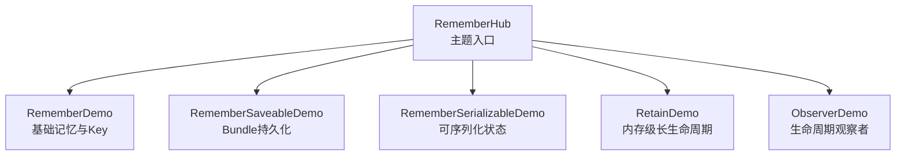
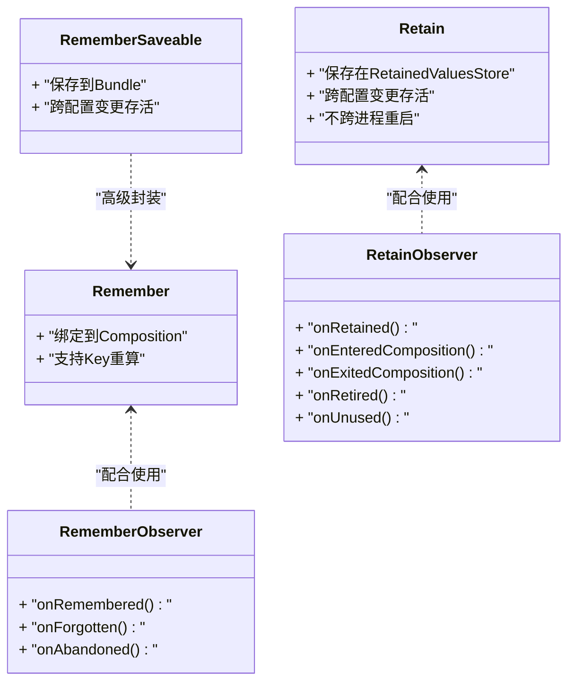
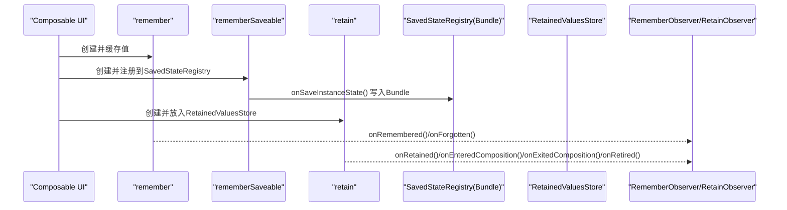
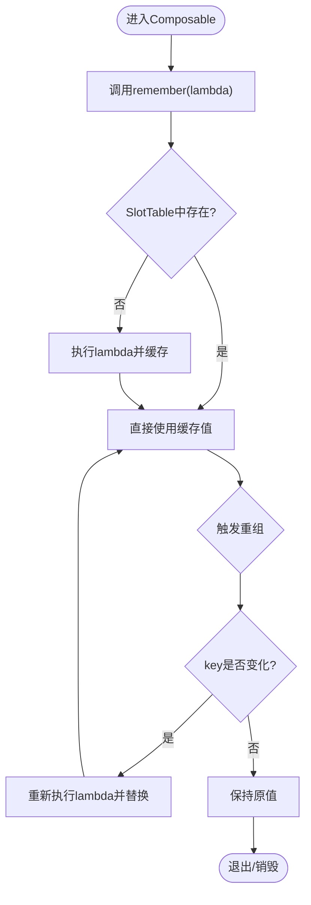
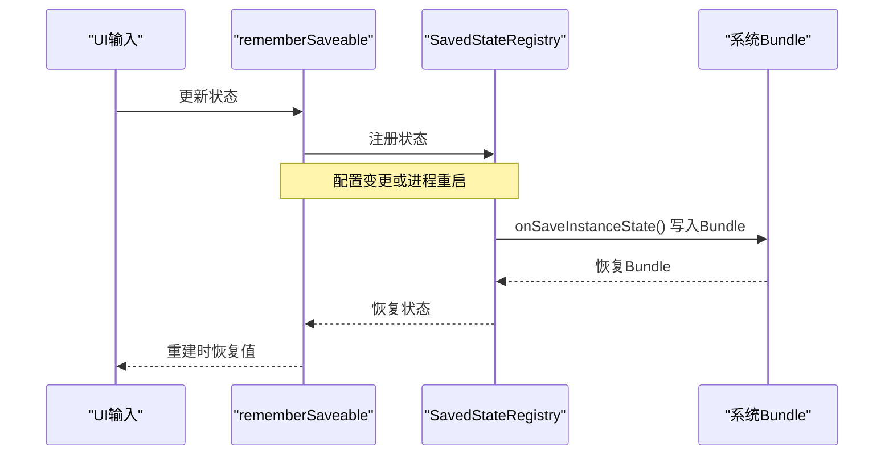
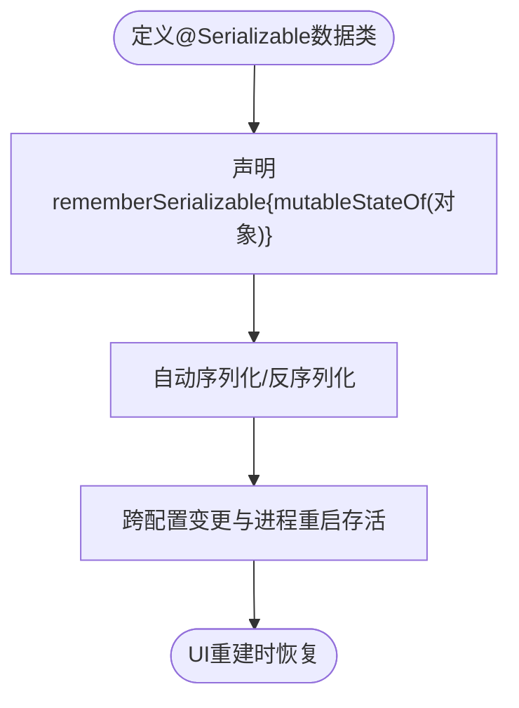
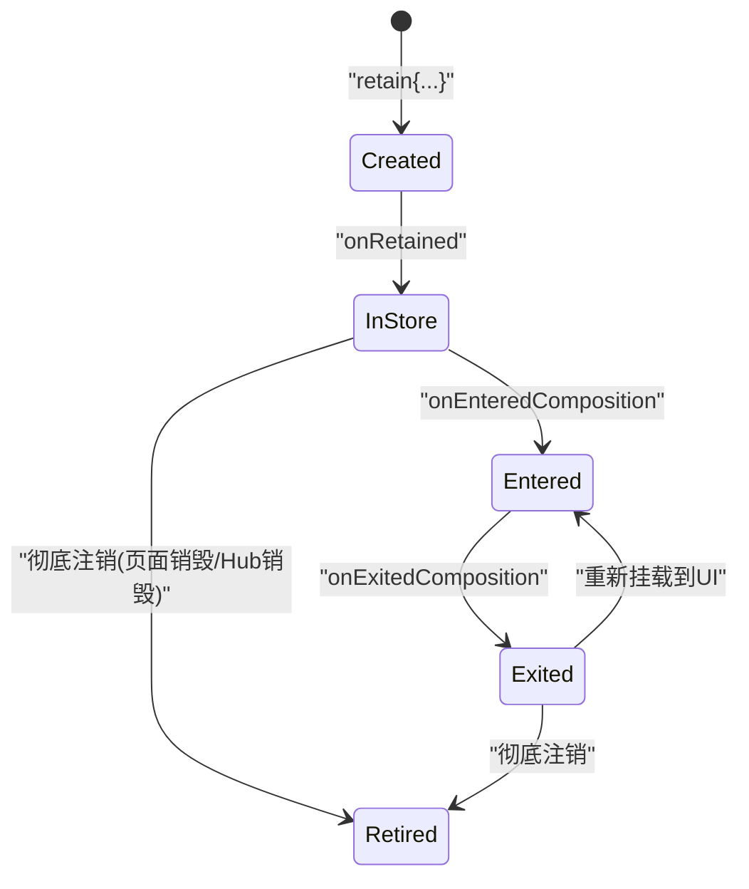
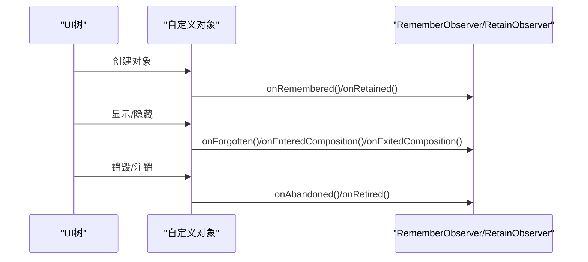
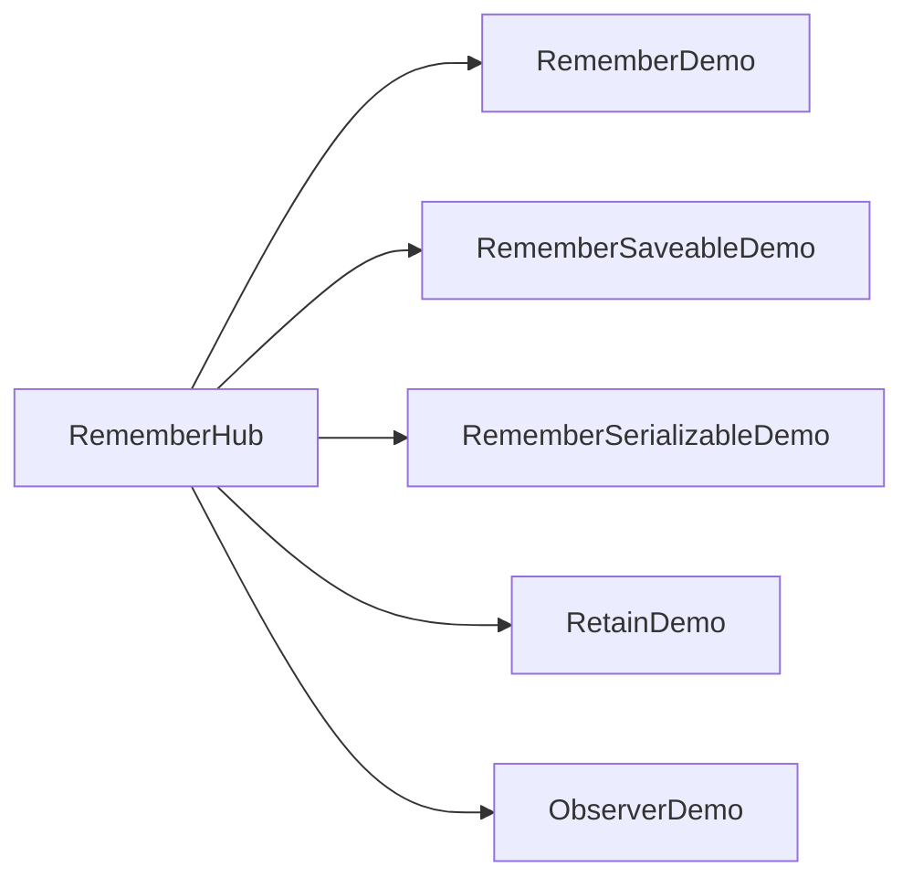

# 状态管理

<cite>
**本文引用的文件**   
- [RememberHub.kt](file://app/src/main/java/com/example/composeup/remember/RememberHub.kt)
- [RememberDemo.kt](file://app/src/main/java/com/example/composeup/remember/RememberDemo.kt)
- [RememberSaveableDemo.kt](file://app/src/main/java/com/example/composeup/remember/RememberSaveableDemo.kt)
- [RememberSerializableDemo.kt](file://app/src/main/java/com/example/composeup/remember/RememberSerializableDemo.kt)
- [RetainDemo.kt](file://app/src/main/java/com/example/composeup/remember/RetainDemo.kt)
- [ObserverDemo.kt](file://app/src/main/java/com/example/composeup/remember/ObserverDemo.kt)
</cite>

## 目录
1. [引言](#引言)
2. [项目结构](#项目结构)
3. [核心组件](#核心组件)
4. [架构总览](#架构总览)
5. [详细组件分析](#详细组件分析)
6. [依赖关系分析](#依赖关系分析)
7. [性能与优化](#性能与优化)
8. [故障排查指南](#故障排查指南)
9. [结论](#结论)
10. [附录：最佳实践清单](#附录最佳实践清单)

## 引言
本技术文档围绕 Compose 状态管理的核心机制展开，重点解释 remember、rememberSaveable、Retain 的生命周期与存储机制，说明状态提升与观察者模式的实现方式，展示可序列化状态的保存与恢复流程，并给出状态优化、重组控制与性能调优的最佳实践。同时提供复杂状态管理的架构模式与重构策略，以及状态同步与一致性保证机制的落地建议。

## 项目结构
本项目在 app 模块下按主题组织示例代码，其中 remember 子包集中展示了状态记忆、持久化、保留与观察等能力：
- RememberHub：主题入口，聚合 remember 相关演示页面
- RememberDemo：基础 remember 与 key、rememberUpdatedState
- RememberSaveableDemo：跨配置变更的状态持久化
- RememberSerializableDemo：基于 kotlinx.serialization 的可序列化状态
- RetainDemo：内存级长生命周期 retain
- ObserverDemo：RememberObserver 与 RetainObserver 生命周期回调

**图表来源**
- [RememberHub.kt:53-72](file://app/src/main/java/com/example/composeup/remember/RememberHub.kt#L53-L72)

**章节来源**
- [RememberHub.kt:38-72](file://app/src/main/java/com/example/composeup/remember/RememberHub.kt#L38-L72)

## 核心组件
本节从系统层面梳理 remember、rememberSaveable、Retain、观察者接口之间的关系与职责边界。

- remember
  - 作用：将值存入 Composition 的 SlotTable，绑定当前组合生存期
  - Key 语义：当传入 key 变化时，重新计算 lambda 并替换旧值
  - 典型用法：缓存计算结果、初始化资源、避免重复创建对象
- rememberSaveable
  - 作用：通过 SavedStateRegistry 与 onSaveInstanceState 挂钩，将状态写入 Bundle
  - 适用场景：配置变更（旋转、语言切换）、进程重启后恢复
  - 限制：类型需可序列化；Bundle 大小有限
- Retain
  - 作用：将对象保存在 RetainedValuesStore，跨越配置变更和导航回退
  - 优势：无需序列化，适合大型对象；不跨进程重启
- 观察者
  - RememberObserver：配合 remember，监听 onRemembered/onForgotten/onAbandoned
  - RetainObserver：配合 retain，监听 onRetained/onEnteredComposition/onExitedComposition/onRetired/onUnused

**图表来源**
- [RememberDemo.kt:30-39](file://app/src/main/java/com/example/composeup/remember/RememberDemo.kt#L30-L39)
- [RememberSaveableDemo.kt:18-27](file://app/src/main/java/com/example/composeup/remember/RememberSaveableDemo.kt#L18-L27)
- [RetainDemo.kt:16-27](file://app/src/main/java/com/example/composeup/remember/RetainDemo.kt#L16-L27)
- [ObserverDemo.kt:17-34](file://app/src/main/java/com/example/composeup/remember/ObserverDemo.kt#L17-L34)

**章节来源**
- [RememberDemo.kt:30-39](file://app/src/main/java/com/example/composeup/remember/RememberDemo.kt#L30-L39)
- [RememberSaveableDemo.kt:18-27](file://app/src/main/java/com/example/composeup/remember/RememberSaveableDemo.kt#L18-L27)
- [RetainDemo.kt:16-27](file://app/src/main/java/com/example/composeup/remember/RetainDemo.kt#L16-L27)
- [ObserverDemo.kt:17-34](file://app/src/main/java/com/example/composeup/remember/ObserverDemo.kt#L17-L34)

## 架构总览
下图展示 remember 系列 API 在 UI 层与系统层之间的交互关系，包括 Bundle 持久化、内存保留与观察者回调。

**图表来源**
- [RememberSaveableDemo.kt:67-73](file://app/src/main/java/com/example/composeup/remember/RememberSaveableDemo.kt#L67-L73)
- [RetainDemo.kt:55-69](file://app/src/main/java/com/example/composeup/remember/RetainDemo.kt#L55-L69)
- [ObserverDemo.kt:89-127](file://app/src/main/java/com/example/composeup/remember/ObserverDemo.kt#L89-L127)

## 详细组件分析

### remember 与 Key 机制
- 生命周期
  - 值在重组期间保持不变，直到该 Composable 从树中移除
- Key 语义
  - 当 key 变化时，重新执行 lambda 并替换旧值
- rememberUpdatedState
  - 在 Effect 或异步回调中引用最新状态，避免闭包捕获旧值

**图表来源**
- [RememberDemo.kt:45-49](file://app/src/main/java/com/example/composeup/remember/RememberDemo.kt#L45-L49)
- [RememberDemo.kt:81-98](file://app/src/main/java/com/example/composeup/remember/RememberDemo.kt#L81-L98)

**章节来源**
- [RememberDemo.kt:30-39](file://app/src/main/java/com/example/composeup/remember/RememberDemo.kt#L30-L39)
- [RememberDemo.kt:45-49](file://app/src/main/java/com/example/composeup/remember/RememberDemo.kt#L45-L49)
- [RememberDemo.kt:81-98](file://app/src/main/java/com/example/composeup/remember/RememberDemo.kt#L81-L98)

### rememberSaveable 与 Bundle 持久化
- 生命周期
  - 通过 SavedStateRegistry 与 onSaveInstanceState 挂钩，支持配置变更与进程重启恢复
- 适用数据类型
  - 基本类型、String、Parcelable 等可序列化类型
- 常见用途
  - 搜索关键字、表单中间态、滚动位置（LazyListState 内部已实现）

**图表来源**
- [RememberSaveableDemo.kt:18-27](file://app/src/main/java/com/example/composeup/remember/RememberSaveableDemo.kt#L18-L27)
- [RememberSaveableDemo.kt:67-73](file://app/src/main/java/com/example/composeup/remember/RememberSaveableDemo.kt#L67-L73)

**章节来源**
- [RememberSaveableDemo.kt:18-27](file://app/src/main/java/com/example/composeup/remember/RememberSaveableDemo.kt#L18-L27)
- [RememberSaveableDemo.kt:67-73](file://app/src/main/java/com/example/composeup/remember/RememberSaveableDemo.kt#L67-L73)

### rememberSerializable 与可序列化状态
- 优势
  - 零样板代码，直接对 @Serializable 数据类进行持久化
  - 类型安全，自动处理嵌套结构
- 与 rememberSaveable 的关系
  - 是对 rememberSaveable 的高级封装，针对 kotlinx.serialization 优化

**图表来源**
- [RememberSerializableDemo.kt:23-33](file://app/src/main/java/com/example/composeup/remember/RememberSerializableDemo.kt#L23-L33)
- [RememberSerializableDemo.kt:65-79](file://app/src/main/java/com/example/composeup/remember/RememberSerializableDemo.kt#L65-L79)

**章节来源**
- [RememberSerializableDemo.kt:23-33](file://app/src/main/java/com/example/composeup/remember/RememberSerializableDemo.kt#L23-L33)
- [RememberSerializableDemo.kt:65-79](file://app/src/main/java/com/example/composeup/remember/RememberSerializableDemo.kt#L65-L79)

### Retain 与 RetainedValuesStore
- 生命周期
  - 比 remember 更长，跨越配置变更与导航回退
  - 不跨进程重启（内存被清空）
- 优势
  - 无需序列化，适合大型对象
  - 结合 RetainObserver 进行资源释放

**图表来源**
- [RetainDemo.kt:16-27](file://app/src/main/java/com/example/composeup/remember/RetainDemo.kt#L16-L27)
- [RetainDemo.kt:55-69](file://app/src/main/java/com/example/composeup/remember/RetainDemo.kt#L55-L69)
- [ObserverDemo.kt:105-127](file://app/src/main/java/com/example/composeup/remember/ObserverDemo.kt#L105-L127)

**章节来源**
- [RetainDemo.kt:16-27](file://app/src/main/java/com/example/composeup/remember/RetainDemo.kt#L16-L27)
- [RetainDemo.kt:55-69](file://app/src/main/java/com/example/composeup/remember/RetainDemo.kt#L55-L69)
- [ObserverDemo.kt:105-127](file://app/src/main/java/com/example/composeup/remember/ObserverDemo.kt#L105-L127)

### 观察者模式：RememberObserver 与 RetainObserver
- RememberObserver
  - onRemembered：进入 UI 树
  - onForgotten：离开 UI 树
  - onAbandoned：记忆未成功完成
- RetainObserver
  - onRetained：首次被 retain 捕获并存入 Store
  - onEnteredComposition：进入 UI 树
  - onExitedComposition：离开 UI 树但仍保留在内存
  - onRetired：对象从 Store 中彻底注销
  - onUnused：对象被创建但未成功应用到 Composition

**图表来源**
- [ObserverDemo.kt:17-34](file://app/src/main/java/com/example/composeup/remember/ObserverDemo.kt#L17-L34)
- [ObserverDemo.kt:89-127](file://app/src/main/java/com/example/composeup/remember/ObserverDemo.kt#L89-L127)

**章节来源**
- [ObserverDemo.kt:17-34](file://app/src/main/java/com/example/composeup/remember/ObserverDemo.kt#L17-L34)
- [ObserverDemo.kt:89-127](file://app/src/main/java/com/example/composeup/remember/ObserverDemo.kt#L89-L127)

## 依赖关系分析
- RememberHub 作为入口，根据选择路由到具体 Demo 页面
- 各 Demo 页面依赖 Compose Runtime API（remember、rememberSaveable、retain、rememberSerializable）
- ObserverDemo 依赖 RememberObserver 与 RetainObserver 接口以监听生命周期事件

**图表来源**
- [RememberHub.kt:53-72](file://app/src/main/java/com/example/composeup/remember/RememberHub.kt#L53-L72)

**章节来源**
- [RememberHub.kt:53-72](file://app/src/main/java/com/example/composeup/remember/RememberHub.kt#L53-L72)

## 性能与优化
- 状态优化
  - 使用 remember(key) 避免不必要的重复计算
  - 使用 rememberUpdatedState 在 Effect 中获取最新状态，避免闭包陷阱
  - 使用 rememberSerializable 减少 Saver 样板代码，提高可读性与维护性
- 重组控制
  - 拆分 Composable，缩小重组范围
  - 使用稳定类型与不可变数据结构，减少无效重组
- 性能调优
  - 优先使用 retain 保存大型对象，避免 Bundle 序列化开销
  - 合理使用 rememberSaveable，仅对必要的小体积状态进行持久化
  - 利用 RetainObserver.onRetired 释放重型资源，防止内存泄漏

[本节为通用指导，不直接分析具体文件]

## 故障排查指南
- 常见问题
  - remember 的值在旋屏后丢失：应改用 rememberSaveable 或 retain
  - rememberSaveable 无法保存复杂对象：改用 rememberSerializable 或自定义 Saver
  - retain 在进程重启后丢失：这是预期行为，如需跨进程重启请使用 rememberSaveable/rememberSerializable
  - Effect 中读取到旧值：使用 rememberUpdatedState 包装状态
- 诊断方法
  - 使用 ObserverDemo 中的日志输出，确认 RememberObserver/RetainObserver 回调顺序
  - 检查 Bundle 大小限制与可序列化类型要求
  - 验证 key 是否正确传递到 remember，确保关键依赖变化能触发重新计算

**章节来源**
- [RememberDemo.kt:81-98](file://app/src/main/java/com/example/composeup/remember/RememberDemo.kt#L81-L98)
- [RememberSaveableDemo.kt:18-27](file://app/src/main/java/com/example/composeup/remember/RememberSaveableDemo.kt#L18-L27)
- [RetainDemo.kt:16-27](file://app/src/main/java/com/example/composeup/remember/RetainDemo.kt#L16-L27)
- [ObserverDemo.kt:89-127](file://app/src/main/java/com/example/composeup/remember/ObserverDemo.kt#L89-L127)

## 结论
- remember 是 Compose 状态的基础，适用于短期、组合内状态
- rememberSaveable 通过 Bundle 持久化，适合小体积、可序列化的中间态
- retain 提供内存级长生命周期，适合大型对象与跨配置变更场景
- rememberSerializable 简化了复杂对象的持久化流程
- 观察者模式帮助我们在对象进入/离开 UI 树时进行资源管理与调试
- 合理选择状态存储策略并结合重组控制与性能优化，可显著提升应用体验与稳定性

[本节为总结性内容，不直接分析具体文件]

## 附录：最佳实践清单
- 状态提升模式
  - 将状态提升到最近的共同父级，避免深层传递
  - 使用不可变数据模型，配合派生状态减少冗余计算
- 观察者模式
  - 使用 RememberObserver/RetainObserver 管理资源生命周期
  - 在 onRetired/onForgotten 中释放网络、IO、定时器等资源
- 状态同步与一致性
  - 使用 rememberUpdatedState 保证 Effect 中读取最新状态
  - 使用 remember(key) 确保依赖变化时正确重建资源
- 复杂状态管理架构
  - 将 UI 状态与业务状态分离，UI 状态尽量小而纯
  - 使用 ViewModel 或 Repository 管理业务状态，UI 层只负责展示与用户交互
- 重构策略
  - 逐步将 rememberSaveable 迁移到 rememberSerializable，降低样板代码
  - 对大型对象使用 retain，并在 RetainObserver 中管理资源

[本节为通用指导，不直接分析具体文件]