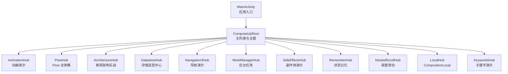
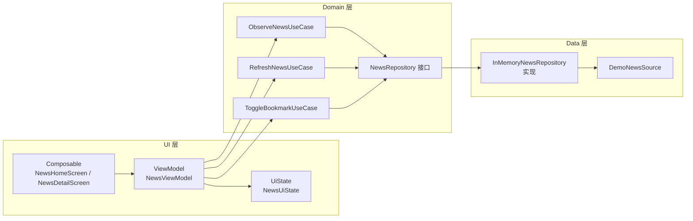
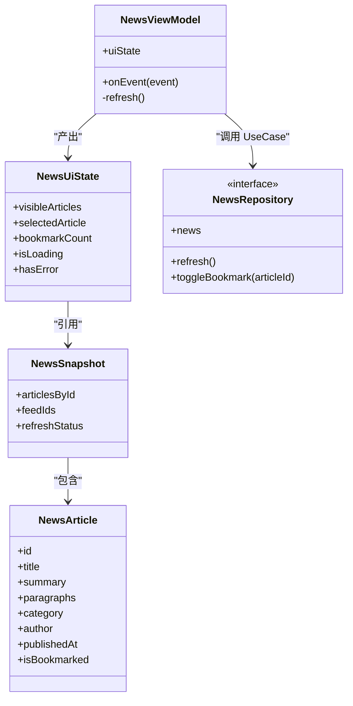
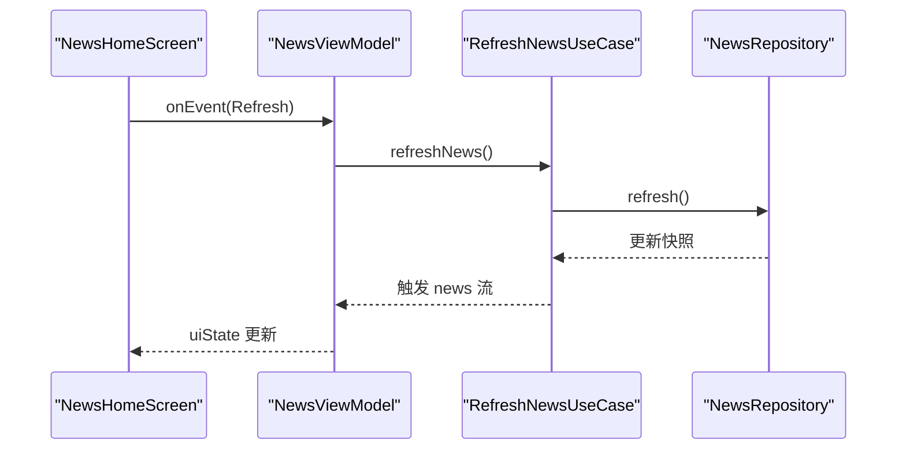
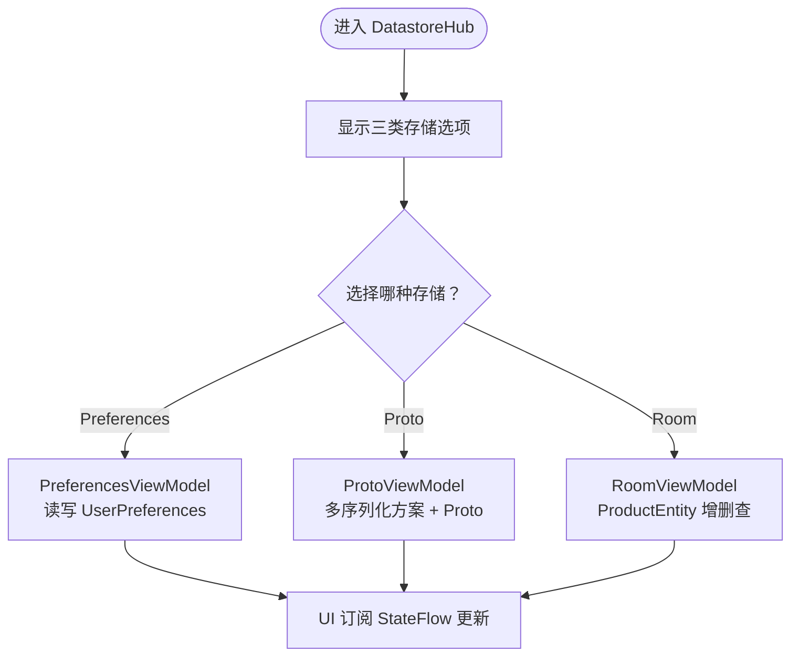
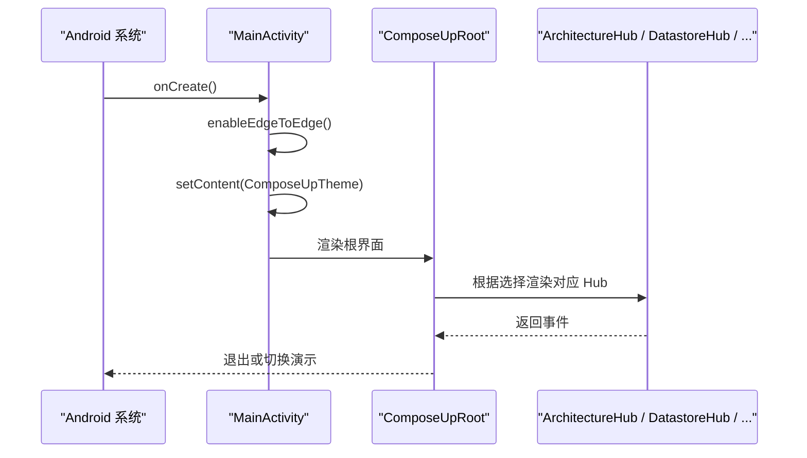
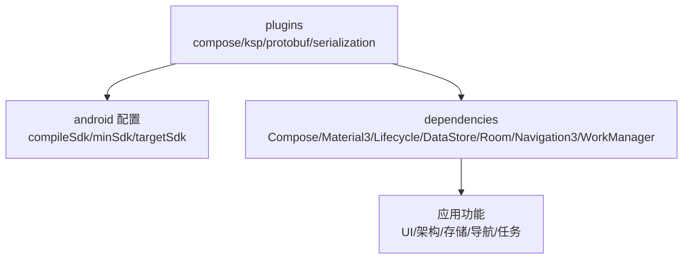

# 项目概述

<cite>
**本文引用的文件**   
- [MainActivity.kt](file://app/src/main/java/com/example/composeup/MainActivity.kt)
- [build.gradle.kts](file://app/build.gradle.kts)
- [settings.gradle.kts](file://settings.gradle.kts)
- [ArchitectureHub.kt](file://app/src/main/java/com/example/composeup/architecture/ArchitectureHub.kt)
- [NewsModels.kt](file://app/src/main/java/com/example/composeup/architecture/domain/NewsModels.kt)
- [NewsRepository.kt](file://app/src/main/java/com/example/composeup/architecture/domain/NewsRepository.kt)
- [NewsViewModel.kt](file://app/src/main/java/com/example/composeup/architecture/ui/NewsViewModel.kt)
- [NewsUiState.kt](file://app/src/main/java/com/example/composeup/architecture/ui/NewsUiState.kt)
- [DatastoreHub.kt](file://app/src/main/java/com/example/composeup/datastore/DatastoreHub.kt)
- [PreferencesViewModel.kt](file://app/src/main/java/com/example/composeup/datastore/ui/viewmodel/PreferencesViewModel.kt)
- [RoomViewModel.kt](file://app/src/main/java/com/example/composeup/datastore/ui/viewmodel/RoomViewModel.kt)
- [ProtoViewModel.kt](file://app/src/main/java/com/example/composeup/datastore/ui/viewmodel/ProtoViewModel.kt)
- [user_prefs.proto](file://app/src/main/proto/user_prefs.proto)
</cite>

## 目录
1. [简介](#简介)
2. [项目结构](#项目结构)
3. [核心组件](#核心组件)
4. [架构总览](#架构总览)
5. [详细组件分析](#详细组件分析)
6. [依赖关系分析](#依赖关系分析)
7. [性能与可维护性](#性能与可维护性)
8. [故障排查指南](#故障排查指南)
9. [结论](#结论)
10. [附录：公共接口与使用模式](#附录公共接口与使用模式)

## 简介
ComposeUp 是一个基于 Jetpack Compose 的综合性学习示例项目，围绕现代 Android UI 开发的最佳实践展开。它通过“入口 Hub + 专题演示”的方式，系统性地展示了动画、架构模式、异步编程、数据存储、导航、后台任务等核心能力。项目采用 Material Design 3 主题、单向数据流、状态归一化、分层架构（UI / Domain / Data）以及协程与 Flow 驱动的状态管理，适合初学者循序渐进学习，也为有经验的开发者提供可复用的工程范式与参考实现。

## 项目结构
项目为单模块 Android 应用，根模块仅包含插件声明；业务代码集中在 app 模块中，按功能域组织为多个包，每个包通常包含：
- Hub 入口：负责组合子页面、处理返回与路由
- 领域模型与用例：定义数据契约与业务规则
- UI 层：Composable 界面、ViewModel 与事件模型
- README 或说明文档：解释运行方式与设计要点

图表来源
- [MainActivity.kt:94-169](file://app/src/main/java/com/example/composeup/MainActivity.kt#L94-L169)

章节来源
- [MainActivity.kt:94-169](file://app/src/main/java/com/example/composeup/MainActivity.kt#L94-L169)
- [settings.gradle.kts:25-26](file://settings.gradle.kts#L25-L26)

## 核心组件
- 应用入口与主题
  - MainActivity 负责启用边缘到边布局、设置 Compose 内容并注入主题。
  - ComposeUpRoot 作为根界面，维护当前演示目标，根据选择渲染对应 Hub。
- 演示入口 Hub
  - 各功能 Hub（如 ArchitectureHub、DatastoreHub、AnimationHub 等）统一以 Composable 形式暴露，接收 Modifier 与可选回调，内部再组合具体页面。
- 新闻架构示例
  - 展示分层架构、UseCase、Repository、单向数据流与状态归一化的完整流程。
- 本地存储示例
  - Preferences DataStore、Proto DataStore、Room 数据库三套方案对比与演示。

章节来源
- [MainActivity.kt:94-169](file://app/src/main/java/com/example/composeup/MainActivity.kt#L94-L169)
- [ArchitectureHub.kt:48-100](file://app/src/main/java/com/example/composeup/architecture/ArchitectureHub.kt#L48-L100)
- [DatastoreHub.kt:67-141](file://app/src/main/java/com/example/composeup/datastore/DatastoreHub.kt#L67-L141)

## 架构总览
ComposeUp 在典型示例中遵循以下架构原则：
- 分层清晰：UI 不直接依赖数据实现，Domain 定义契约，Data 提供实现。
- 单向数据流：UI 发出事件，ViewModel 调用 UseCase/Repository，数据变化通过 StateFlow 回推 UI。
- 状态归一化：将分散状态合并为单一 UiState，派生属性减少重复计算。
- 可测试性：ViewModel 与 UseCase 纯函数化，便于单元测试。

图表来源
- [NewsViewModel.kt:14-56](file://app/src/main/java/com/example/composeup/architecture/ui/NewsViewModel.kt#L14-L56)
- [NewsUiState.kt:7-36](file://app/src/main/java/com/example/composeup/architecture/ui/NewsUiState.kt#L7-L36)
- [NewsRepository.kt:5-11](file://app/src/main/java/com/example/composeup/architecture/domain/NewsRepository.kt#L5-L11)
- [NewsModels.kt:3-20](file://app/src/main/java/com/example/composeup/architecture/domain/NewsModels.kt#L3-L20)

## 详细组件分析

### 新闻架构示例（ArchitectureHub）
该示例通过一个可交互的新闻主页与详情页，演示分层架构与状态管理。

- 关键职责
  - ArchitectureHub：组装 ViewModel、处理返回逻辑、承载 Scaffold 与 TopAppBar。
  - NewsViewModel：组合 UseCase，分发事件，维护 SavedStateHandle 持久化选中文章与筛选状态。
  - NewsUiState：归一化 UI 状态，提供可见文章、选中文章、收藏计数、加载与错误判断等派生属性。
  - NewsRepository 接口与 NewsSnapshot/NewsArticle 模型：定义数据契约与实体。

图表来源
- [NewsViewModel.kt:14-56](file://app/src/main/java/com/example/composeup/architecture/ui/NewsViewModel.kt#L14-L56)
- [NewsUiState.kt:7-36](file://app/src/main/java/com/example/composeup/architecture/ui/NewsUiState.kt#L7-L36)
- [NewsRepository.kt:5-11](file://app/src/main/java/com/example/composeup/architecture/domain/NewsRepository.kt#L5-L11)
- [NewsModels.kt:3-20](file://app/src/main/java/com/example/composeup/architecture/domain/NewsModels.kt#L3-L20)

#### 刷新与收藏流程（序列图）

图表来源
- [NewsViewModel.kt:38-50](file://app/src/main/java/com/example/composeup/architecture/ui/NewsViewModel.kt#L38-L50)
- [NewsRepository.kt:5-11](file://app/src/main/java/com/example/composeup/architecture/domain/NewsRepository.kt#L5-L11)

章节来源
- [ArchitectureHub.kt:48-100](file://app/src/main/java/com/example/composeup/architecture/ArchitectureHub.kt#L48-L100)
- [NewsViewModel.kt:14-56](file://app/src/main/java/com/example/composeup/architecture/ui/NewsViewModel.kt#L14-L56)
- [NewsUiState.kt:7-36](file://app/src/main/java/com/example/composeup/architecture/ui/NewsUiState.kt#L7-L36)
- [NewsRepository.kt:5-11](file://app/src/main/java/com/example/composeup/architecture/domain/NewsRepository.kt#L5-L11)
- [NewsModels.kt:3-20](file://app/src/main/java/com/example/composeup/architecture/domain/NewsModels.kt#L3-L20)

### 本地存储选型（DatastoreHub）
DatastoreHub 集中演示三种本地持久化方案：Preferences DataStore、Proto DataStore、Room 数据库，并通过 ViewModel 暴露 StateFlow 给 UI 消费。

- 关键职责
  - DatastoreHub：展示三类存储的对比与入口，支持返回。
  - PreferencesViewModel：封装用户偏好读写，暴露 userPreferencesFlow。
  - ProtoViewModel：封装多种序列化方案与 Proto 对象读写。
  - RoomViewModel：封装产品数据的查询、添加与清空，结合搜索词进行流式查询。

图表来源
- [DatastoreHub.kt:67-141](file://app/src/main/java/com/example/composeup/datastore/DatastoreHub.kt#L67-L141)
- [PreferencesViewModel.kt:12-32](file://app/src/main/java/com/example/composeup/datastore/ui/viewmodel/PreferencesViewModel.kt#L12-L32)
- [ProtoViewModel.kt:13-46](file://app/src/main/java/com/example/composeup/datastore/ui/viewmodel/ProtoViewModel.kt#L13-L46)
- [RoomViewModel.kt:12-40](file://app/src/main/java/com/example/composeup/datastore/ui/viewmodel/RoomViewModel.kt#L12-L40)

章节来源
- [DatastoreHub.kt:67-141](file://app/src/main/java/com/example/composeup/datastore/DatastoreHub.kt#L67-L141)
- [PreferencesViewModel.kt:12-32](file://app/src/main/java/com/example/composeup/datastore/ui/viewmodel/PreferencesViewModel.kt#L12-L32)
- [ProtoViewModel.kt:13-46](file://app/src/main/java/com/example/composeup/datastore/ui/viewmodel/ProtoViewModel.kt#L13-L46)
- [RoomViewModel.kt:12-40](file://app/src/main/java/com/example/composeup/datastore/ui/viewmodel/RoomViewModel.kt#L12-L40)

### 应用入口与主题（MainActivity）
- MainActivity 启用 Edge-to-Edge 并设置 Compose 内容，注入 ComposeUpTheme。
- ComposeUpRoot 维护当前演示目标，点击列表项进入对应 Hub；在演示页按系统返回键回到主列表。
- 同时内置基础示例（问候卡片、引导页、下拉菜单预览等），用于快速验证 UI 与主题。

图表来源
- [MainActivity.kt:94-169](file://app/src/main/java/com/example/composeup/MainActivity.kt#L94-L169)

章节来源
- [MainActivity.kt:94-169](file://app/src/main/java/com/example/composeup/MainActivity.kt#L94-L169)

## 依赖关系分析
- Gradle 配置
  - 启用 Compose、KSP、Protobuf、Serialization 等插件。
  - 引入 Compose BOM、Material3、Activity Compose、Lifecycle、DataStore、Room、Gson、Moshi、Navigation3、WorkManager 等依赖。
  - protobuf 生成 Java/Kotlin lite 类，供 Proto DataStore 使用。

图表来源
- [build.gradle.kts:1-95](file://app/build.gradle.kts#L1-L95)

章节来源
- [build.gradle.kts:1-95](file://app/build.gradle.kts#L1-L95)
- [settings.gradle.kts:1-26](file://settings.gradle.kts#L1-L26)

## 性能与可维护性
- 性能
  - 使用 LazyColumn 与 rememberSaveable 优化列表与状态保存。
  - 使用 SharingStarted.WhileSubscribed 控制 StateFlow 生命周期，避免不必要的后台计算。
  - 使用 deriveStateOf 与派生属性减少重复计算（见 NewsUiState）。
- 可维护性
  - 分层清晰，UI 与数据解耦，便于替换数据源与扩展用例。
  - 事件模型（NewsEvent）明确输入输出，利于测试与重构。
  - 存储方案模块化，便于按需引入与对比评估。

[本节为通用指导，不直接分析具体文件]

## 故障排查指南
- 常见问题
  - 状态未更新：检查 StateFlow 的收集范围与 SharingStarted 策略是否合理。
  - 返回行为异常：确认 BackHandler 的启用条件与回调逻辑是否正确。
  - 存储写入失败：检查 DataStore/Room 初始化与协程作用域是否正确。
  - 动画卡顿：检查 animateContentSize 与 spring 参数是否合适，避免过度重组。
- 定位建议
  - 在 ViewModel 中打印事件与状态变更日志。
  - 使用 Compose Preview 与调试工具观察重组次数。
  - 针对 Repository 层增加异常分支与重试逻辑。

[本节为通用指导，不直接分析具体文件]

## 结论
ComposeUp 通过“入口 Hub + 专题演示”的结构，系统展示了现代 Android UI 开发的关键技术栈与实践方法。项目强调分层、单向数据流与状态归一化，提供了从动画、Flow、架构到存储、导航、后台任务的完整学习路径。无论是初学者入门还是经验开发者参考，都能从中获得清晰的工程范式与可直接复用的组件设计。

[本节为总结性内容，不直接分析具体文件]

## 附录：公共接口与使用模式

### 入口与主题
- MainActivity
  - 作用：启动应用、启用 Edge-to-Edge、设置 Compose 内容与主题。
  - 使用方式：无需额外配置，直接作为 Activity 入口。
- ComposeUpRoot
  - 作用：维护演示目标，渲染主列表与对应 Hub，处理返回逻辑。
  - 使用方式：由 MainActivity 调用。

章节来源
- [MainActivity.kt:94-169](file://app/src/main/java/com/example/composeup/MainActivity.kt#L94-L169)

### 新闻架构示例
- NewsViewModel
  - 公开成员：uiState（StateFlow<NewsUiState>）、onEvent(NewsEvent)。
  - 行为：组合 UseCase，分发事件，维护 SavedStateHandle。
- NewsUiState
  - 公开成员：visibleArticles、selectedArticle、bookmarkCount、isLoading、hasError。
  - 行为：派生属性，简化 UI 侧逻辑。
- NewsRepository（接口）
  - 公开成员：news（StateFlow<NewsSnapshot>）、refresh()、toggleBookmark(articleId)。
- NewsSnapshot / NewsArticle
  - 作用：定义新闻快照与文章实体。

章节来源
- [NewsViewModel.kt:14-56](file://app/src/main/java/com/example/composeup/architecture/ui/NewsViewModel.kt#L14-L56)
- [NewsUiState.kt:7-36](file://app/src/main/java/com/example/composeup/architecture/ui/NewsUiState.kt#L7-L36)
- [NewsRepository.kt:5-11](file://app/src/main/java/com/example/composeup/architecture/domain/NewsRepository.kt#L5-L11)
- [NewsModels.kt:3-20](file://app/src/main/java/com/example/composeup/architecture/domain/NewsModels.kt#L3-L20)

### 本地存储示例
- DatastoreHub
  - 作用：展示 Preferences/Proto/Room 三类存储的对比与入口。
- PreferencesViewModel
  - 公开成员：uiState（StateFlow<UserPreferences>）、updateUsername(name)、toggleDarkMode()、toggleNotification()。
- ProtoViewModel
  - 公开成员：kotlinxState/gsonState/moshiState/trueProtoState（StateFlow...）、updateXxx(...)。
- RoomViewModel
  - 公开成员：searchQuery（StateFlow<String>）、productList（StateFlow<List<ProductEntity>>）、updateSearchQuery(query)、addProduct(...)、clearAll()。

章节来源
- [DatastoreHub.kt:67-141](file://app/src/main/java/com/example/composeup/datastore/DatastoreHub.kt#L67-L141)
- [PreferencesViewModel.kt:12-32](file://app/src/main/java/com/example/composeup/datastore/ui/viewmodel/PreferencesViewModel.kt#L12-L32)
- [ProtoViewModel.kt:13-46](file://app/src/main/java/com/example/composeup/datastore/ui/viewmodel/ProtoViewModel.kt#L13-L46)
- [RoomViewModel.kt:12-40](file://app/src/main/java/com/example/composeup/datastore/ui/viewmodel/RoomViewModel.kt#L12-L40)

### Protobuf 模型
- user_prefs.proto
  - 作用：定义 UserSettingsProto 消息体，供 Proto DataStore 使用。
  - 字段：username、is_dark_mode、enable_notification。

章节来源
- [user_prefs.proto:1-11](file://app/src/main/proto/user_prefs.proto#L1-L11)