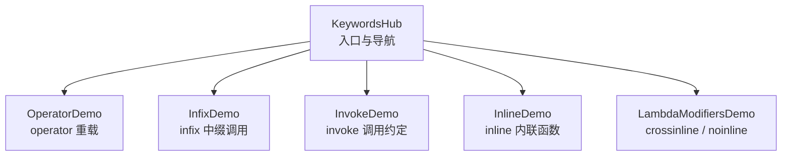
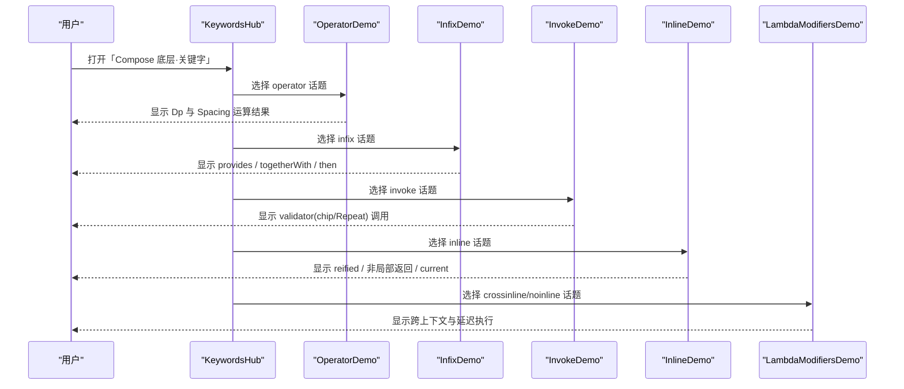
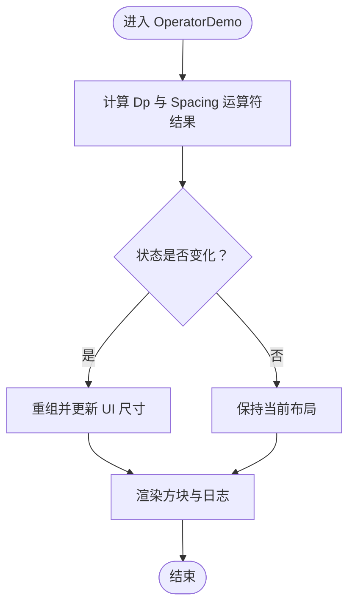
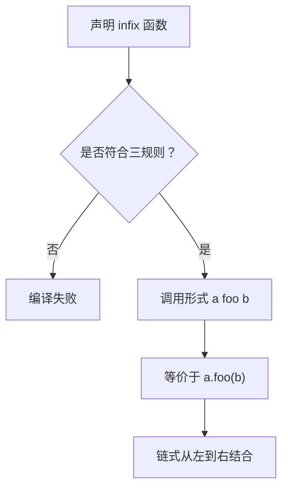
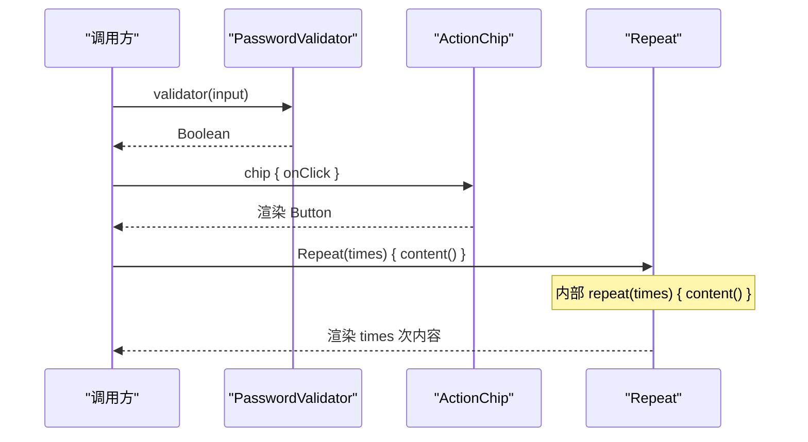
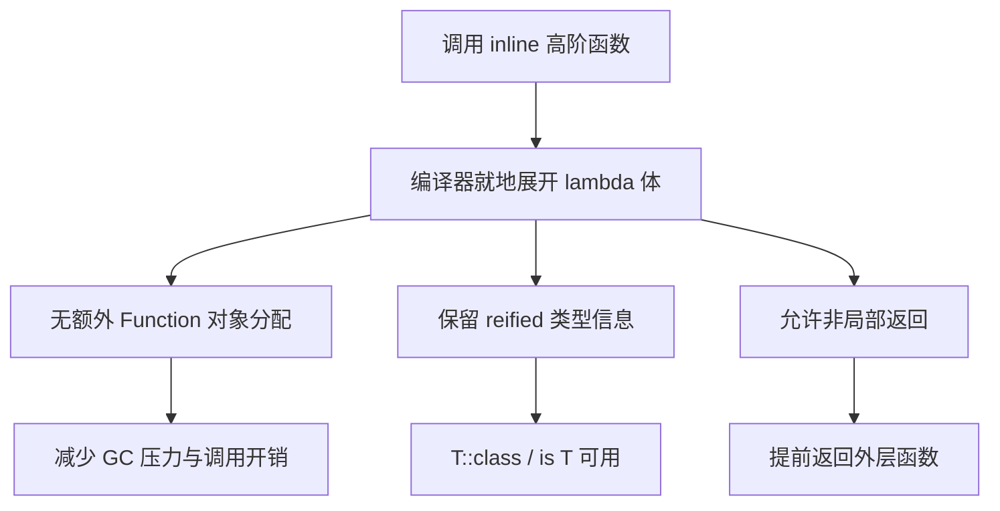
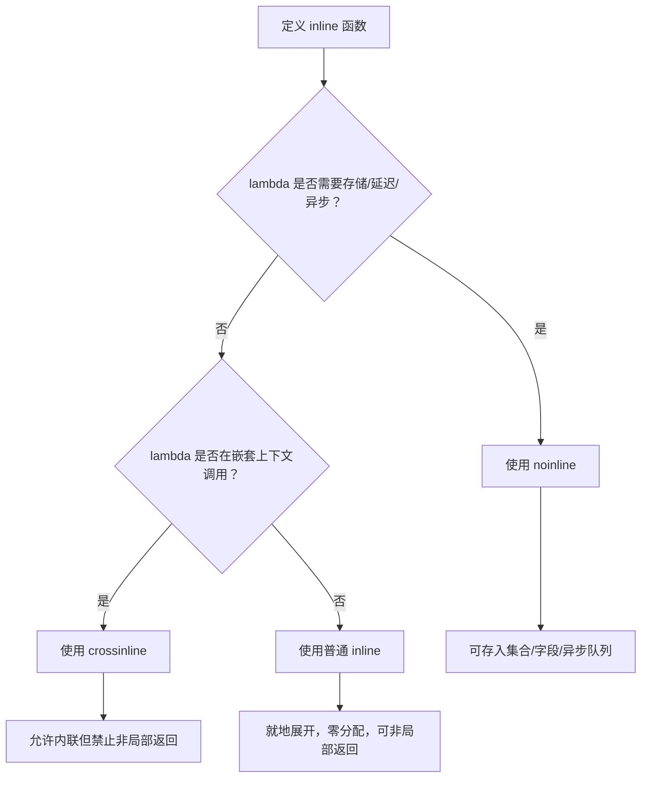
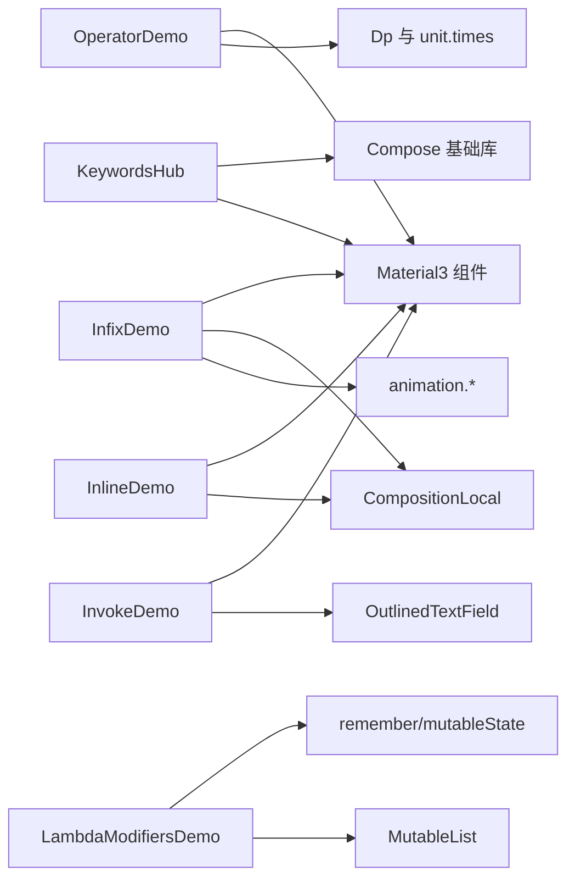

# Compose 关键字

<cite>
**本文引用的文件**   
- [KeywordsHub.kt](file://app/src/main/java/com/example/composeup/keywords/KeywordsHub.kt)
- [OperatorDemo.kt](file://app/src/main/java/com/example/composeup/keywords/OperatorDemo.kt)
- [InfixDemo.kt](file://app/src/main/java/com/example/composeup/keywords/InfixDemo.kt)
- [InvokeDemo.kt](file://app/src/main/java/com/example/composeup/keywords/InvokeDemo.kt)
- [InlineDemo.kt](file://app/src/main/java/com/example/composeup/keywords/InlineDemo.kt)
- [LambdaModifiersDemo.kt](file://app/src/main/java/com/example/composeup/keywords/LambdaModifiersDemo.kt)
</cite>

## 目录
1. [引言](#引言)
2. [项目结构](#项目结构)
3. [核心组件](#核心组件)
4. [架构总览](#架构总览)
5. [详细组件分析](#详细组件分析)
6. [依赖关系分析](#依赖关系分析)
7. [性能考量](#性能考量)
8. [故障排查指南](#故障排查指南)
9. [结论](#结论)
10. [附录：API 与最佳实践速查](#附录api-与最佳实践速查)

## 引言
本技术文档围绕 Compose 底层 Kotlin 关键字展开，聚焦以下主题：
- operator 重载在 Modifier、Dp、动画等场景中的应用模式
- infix 中缀调用如何提升 DSL 可读性，以及成员 vs 扩展 infix 的使用差异
- invoke 操作符如何实现函数式组件与可调用对象模式
- inline 内联函数的性能优化原理（零分配、reified、非局部返回）
- crossinline / noinline 对 inline lambda 的约束与取舍
- Lambda 修饰符的高级用法与自定义 Modifier 的组合模式

这些示例位于 app 模块的 keywords 包中，通过一个入口页面串联五个子示例，帮助读者从“语法特性”走向“Compose API 设计”。

## 项目结构
keywords 包采用“入口 Hub + 专题 Demo”的组织方式：
- KeywordsHub.kt：话题导航与页面路由
- OperatorDemo.kt：operator 运算符重载
- InfixDemo.kt：infix 中缀调用
- InvokeDemo.kt：invoke 调用约定
- InlineDemo.kt：inline 内联函数
- LambdaModifiersDemo.kt：crossinline / noinline 约束

图表来源
- [KeywordsHub.kt:78-156](file://app/src/main/java/com/example/composeup/keywords/KeywordsHub.kt#L78-L156)

章节来源
- [KeywordsHub.kt:30-71](file://app/src/main/java/com/example/composeup/keywords/KeywordsHub.kt#L30-L71)
- [KeywordsHub.kt:78-156](file://app/src/main/java/com/example/composeup/keywords/KeywordsHub.kt#L78-L156)

## 核心组件
本节概述五个 Demo 的职责与关键实现点。

- OperatorDemo
  - 使用真实 Dp 的运算符（plus/times/unaryMinus/div/compareTo）驱动 UI 尺寸变化
  - 自定义 Spacing 类型演示 plus/minus/times/unaryMinus/compareTo/get/contains 等约定
  - 对比 Modifier 组合使用 infix then 而非 operator +

- InfixDemo
  - 展示自定义 infix 扩展函数 shouldBe
  - 演示 CompositionLocal.provides（成员 infix）与 EnterTransition.togetherWith（扩展 infix）
  - 强调 a then b 必须同行的编译器限制

- InvokeDemo
  - PasswordValidator 提供多个 invoke 重载
  - ActionChip 以 @Composable operator fun invoke 封装可调用组件
  - Repeat 内部用 content() 执行插槽，体现 Compose 的 content 执行机制

- InlineDemo
  - reified 泛型具体化 T::class
  - forEach 的非局部返回
  - inline 包装 measure 就地展开 block
  - CompositionLocal.current 为 inline val

- LambdaModifiersDemo
  - runWrapped(crossinline body) 将 lambda 转发进 Runnable 嵌套上下文
  - enqueue(普通 inline log, noinline task) 混合 inline 与存储需求
  - drainQueue 延迟执行队列中的 noinline lambda

章节来源
- [OperatorDemo.kt:34-72](file://app/src/main/java/com/example/composeup/keywords/OperatorDemo.kt#L34-L72)
- [OperatorDemo.kt:74-218](file://app/src/main/java/com/example/composeup/keywords/OperatorDemo.kt#L74-L218)
- [InfixDemo.kt:30-47](file://app/src/main/java/com/example/composeup/keywords/InfixDemo.kt#L30-L47)
- [InfixDemo.kt:48-180](file://app/src/main/java/com/example/composeup/keywords/InfixDemo.kt#L48-L180)
- [InvokeDemo.kt:22-69](file://app/src/main/java/com/example/composeup/keywords/InvokeDemo.kt#L22-L69)
- [InvokeDemo.kt:71-167](file://app/src/main/java/com/example/composeup/keywords/InvokeDemo.kt#L71-L167)
- [InlineDemo.kt:20-55](file://app/src/main/java/com/example/composeup/keywords/InlineDemo.kt#L20-L55)
- [InlineDemo.kt:63-161](file://app/src/main/java/com/example/composeup/keywords/InlineDemo.kt#L63-L161)
- [LambdaModifiersDemo.kt:16-62](file://app/src/main/java/com/example/composeup/keywords/LambdaModifiersDemo.kt#L16-L62)
- [LambdaModifiersDemo.kt:74-157](file://app/src/main/java/com/example/composeup/keywords/LambdaModifiersDemo.kt#L74-L157)

## 架构总览
下图展示入口到各 Demo 的控制流，以及每个 Demo 内部的典型调用链。

图表来源
- [KeywordsHub.kt:78-156](file://app/src/main/java/com/example/composeup/keywords/KeywordsHub.kt#L78-L156)
- [OperatorDemo.kt:74-218](file://app/src/main/java/com/example/composeup/keywords/OperatorDemo.kt#L74-L218)
- [InfixDemo.kt:53-180](file://app/src/main/java/com/example/composeup/keywords/InfixDemo.kt#L53-L180)
- [InvokeDemo.kt:71-167](file://app/src/main/java/com/example/composeup/keywords/InvokeDemo.kt#L71-L167)
- [InlineDemo.kt:63-161](file://app/src/main/java/com/example/composeup/keywords/InlineDemo.kt#L63-L161)
- [LambdaModifiersDemo.kt:74-157](file://app/src/main/java/com/example/composeup/keywords/LambdaModifiersDemo.kt#L74-L157)

## 详细组件分析

### operator 重载：Modifier 与 Dp 的符号语义
- 目标
  - 让自定义类型具备自然符号语法（+、*、[]、in、比较等）
  - 说明 Modifier 组合并非使用 operator +，而是 infix then
- 关键点
  - Dp 的 plus/times/unaryMinus/div/compareTo 均为 inline operator
  - 自定义 Spacing 实现 plus/minus/times/unaryMinus/compareTo/get/contains
  - 通过按钮调整基准单位，UI 方块尺寸随运算符结果变化
- 复杂度与性能
  - Dp 运算为 inline operator，无额外对象分配
  - Spacing 为不可变值对象，配合 remember/base/gap 参数缓存，避免重复计算
- 错误处理与边界
  - 尺寸需 coerceIn 防止极端值导致布局异常
  - contains 区间判断需考虑 0.dp 下界

图表来源
- [OperatorDemo.kt:74-119](file://app/src/main/java/com/example/composeup/keywords/OperatorDemo.kt#L74-L119)
- [OperatorDemo.kt:121-199](file://app/src/main/java/com/example/composeup/keywords/OperatorDemo.kt#L121-L199)

章节来源
- [OperatorDemo.kt:34-72](file://app/src/main/java/com/example/composeup/keywords/OperatorDemo.kt#L34-L72)
- [OperatorDemo.kt:74-218](file://app/src/main/java/com/example/composeup/keywords/OperatorDemo.kt#L74-L218)

### infix 中缀调用：可读性与规则
- 目标
  - 用 infix 把 a.foo(b) 写成 a foo b，提升 DSL 可读性
  - 区分成员 infix（Modifier.then、CompositionLocal.provides）与扩展 infix（EnterTransition.togetherWith）
- 关键点
  - 三条硬性规则：必须有接收者；仅一个参数；不能 vararg 或默认值
  - 链式从左到右结合：a f b g c == (a f b) g c
  - a then b 必须同一行，否则编译报错
- 实际用例
  - LocalAccent provides color 提供强调色
  - fadeIn() togetherWith fadeOut() 构建 ContentTransform
  - modifierA then modifierB 组合修饰符

图表来源
- [InfixDemo.kt:30-47](file://app/src/main/java/com/example/composeup/keywords/InfixDemo.kt#L30-L47)
- [InfixDemo.kt:102-114](file://app/src/main/java/com/example/composeup/keywords/InfixDemo.kt#L102-L114)
- [InfixDemo.kt:143-162](file://app/src/main/java/com/example/composeup/keywords/InfixDemo.kt#L143-L162)

章节来源
- [InfixDemo.kt:30-47](file://app/src/main/java/com/example/composeup/keywords/InfixDemo.kt#L30-L47)
- [InfixDemo.kt:48-180](file://app/src/main/java/com/example/composeup/keywords/InfixDemo.kt#L48-L180)

### invoke 调用约定：函数式组件与插槽执行
- 目标
  - 让对象像函数一样被调用（obj(args) → obj.invoke(args)）
  - 展示多签名 invoke 重载与 @Composable invoke
  - 解释 Compose 的 content 插槽本质是函数类型的 invoke
- 关键点
  - PasswordValidator 提供两个 invoke 重载
  - ActionChip 以 @Composable operator fun invoke 封装按钮组件
  - Repeat(times, content) 内部 repeat(times) { content() } 多次执行插槽
- 调用序列

图表来源
- [InvokeDemo.kt:35-69](file://app/src/main/java/com/example/composeup/keywords/InvokeDemo.kt#L35-L69)
- [InvokeDemo.kt:71-167](file://app/src/main/java/com/example/composeup/keywords/InvokeDemo.kt#L71-L167)

章节来源
- [InvokeDemo.kt:22-69](file://app/src/main/java/com/example/composeup/keywords/InvokeDemo.kt#L22-L69)
- [InvokeDemo.kt:71-167](file://app/src/main/java/com/example/composeup/keywords/InvokeDemo.kt#L71-L167)

### inline 内联函数：零开销抽象与 reified
- 目标
  - 消除 lambda 对象分配与非局部返回限制
  - 使用 reified 获取运行时类型信息
  - 理解 CompositionLocal.current 为 inline val
- 关键点
  - describe<T>(value: T) 使用 reified T::class
  - firstPositive 利用 forEach 的 inline 支持非局部 return
  - measure(label, block) 就地展开 block
  - CompositionLocalProvider(LocalGreeting provides ...) 提供值，子组件读取 .current
- 性能对比
  - 普通高阶函数：每次调用 new Function 对象 + 虚调用
  - inline 高阶函数：就地展开，零分配、零虚调用

图表来源
- [InlineDemo.kt:20-55](file://app/src/main/java/com/example/composeup/keywords/InlineDemo.kt#L20-L55)
- [InlineDemo.kt:63-161](file://app/src/main/java/com/example/composeup/keywords/InlineDemo.kt#L63-L161)

章节来源
- [InlineDemo.kt:20-55](file://app/src/main/java/com/example/composeup/keywords/InlineDemo.kt#L20-L55)
- [InlineDemo.kt:63-161](file://app/src/main/java/com/example/composeup/keywords/InlineDemo.kt#L63-L161)

### crossinline / noinline：inline lambda 的约束与取舍
- 目标
  - 明确 crossinline 与 noinline 的使用场景与限制
- 关键点
  - runWrapped(crossinline body)：body 在 Runnable 嵌套上下文中执行，禁止非局部返回
  - enqueue(log, noinline task)：log 就地展开，task 需存储并延迟执行
  - drainQueue(queue)：稍后逐个执行队列中的 noinline lambda
- 选型建议
  - 就地执行且需要非局部返回 → 普通 inline
  - 转发到另一层 lambda 再执行 → crossinline
  - 需要存储/延迟/异步调用 → noinline

图表来源
- [LambdaModifiersDemo.kt:16-62](file://app/src/main/java/com/example/composeup/keywords/LambdaModifiersDemo.kt#L16-L62)
- [LambdaModifiersDemo.kt:74-157](file://app/src/main/java/com/example/composeup/keywords/LambdaModifiersDemo.kt#L74-L157)

章节来源
- [LambdaModifiersDemo.kt:16-62](file://app/src/main/java/com/example/composeup/keywords/LambdaModifiersDemo.kt#L16-L62)
- [LambdaModifiersDemo.kt:74-157](file://app/src/main/java/com/example/composeup/keywords/LambdaModifiersDemo.kt#L74-L157)

## 依赖关系分析
- 入口依赖
  - KeywordsHub 依赖 Material3 组件（Scaffold、TopAppBar、IconButton、Icon、Text）、Compose 基础库（Modifier、Column、Row、Box、LazyColumn、PaddingValues、fillMaxSize、padding、verticalScroll、rememberSaveable、mutableStateOf、setValue、getValue）
- 各 Demo 依赖
  - OperatorDemo：Dp、unit.times、abs、MaterialTheme、RoundedCornerShape、background、border、size、padding、verticalScroll
  - InfixDemo：animation.fadeIn/fadeOut/togetherWith、CompositionLocalProvider、staticCompositionLocalOf、MaterialTheme、RoundedCornerShape、background、size、padding、verticalScroll
  - InvokeDemo：OutlinedTextField、MaterialTheme、fillMaxWidth、padding、verticalScroll
  - InlineDemo：CompositionLocalProvider、staticCompositionLocalOf、MaterialTheme、fillMaxSize、padding、verticalScroll
  - LambdaModifiersDemo：MutableList、remember、rememberSaveable、mutableIntStateOf、mutableStateOf、verticalScroll

图表来源
- [KeywordsHub.kt:3-28](file://app/src/main/java/com/example/composeup/keywords/KeywordsHub.kt#L3-L28)
- [OperatorDemo.kt:3-32](file://app/src/main/java/com/example/composeup/keywords/OperatorDemo.kt#L3-L32)
- [InfixDemo.kt:3-28](file://app/src/main/java/com/example/composeup/keywords/InfixDemo.kt#L3-L28)
- [InvokeDemo.kt:3-20](file://app/src/main/java/com/example/composeup/keywords/InvokeDemo.kt#L3-L20)
- [InlineDemo.kt:3-18](file://app/src/main/java/com/example/composeup/keywords/InlineDemo.kt#L3-L18)
- [LambdaModifiersDemo.kt:3-14](file://app/src/main/java/com/example/composeup/keywords/LambdaModifiersDemo.kt#L3-L14)

章节来源
- [KeywordsHub.kt:3-28](file://app/src/main/java/com/example/composeup/keywords/KeywordsHub.kt#L3-L28)
- [OperatorDemo.kt:3-32](file://app/src/main/java/com/example/composeup/keywords/OperatorDemo.kt#L3-L32)
- [InfixDemo.kt:3-28](file://app/src/main/java/com/example/composeup/keywords/InfixDemo.kt#L3-L28)
- [InvokeDemo.kt:3-20](file://app/src/main/java/com/example/composeup/keywords/InvokeDemo.kt#L3-L20)
- [InlineDemo.kt:3-18](file://app/src/main/java/com/example/composeup/keywords/InlineDemo.kt#L3-L18)
- [LambdaModifiersDemo.kt:3-14](file://app/src/main/java/com/example/composeup/keywords/LambdaModifiersDemo.kt#L3-L14)

## 性能考量
- operator 与 Dp
  - Dp 的 plus/times/unaryMinus/div/compareTo 为 inline operator，零分配
  - 自定义 Spacing 作为不可变值对象，配合 remember(base/gap) 缓存，避免重复计算
- infix
  - infix 只是语法糖，不引入新语义；链式从左到右结合，注意换行限制
- invoke
  - 函数类型 invoke 本身无额外开销；@Composable operator fun invoke 在组合阶段执行
- inline
  - 消除 lambda 对象分配与虚调用；reified 保留类型信息；非局部返回提升控制流表达力
  - 代价：代码膨胀；不能递归；不能将 inline lambda 存到字段/集合再异步调用
- crossinline / noinline
  - crossinline 允许内联到嵌套上下文但禁止非局部返回
  - noinline 保留 lambda 为真实对象，可存储/延迟/异步，但失去 inline 收益

[本节为通用性能讨论，不直接分析具体文件]

## 故障排查指南
- infix 换行问题
  - 现象：Unresolved reference 'then'
  - 原因：a then b 必须写在同一行；换行以 then 开头会被视为上一条语句结束
  - 解决：确保 infix 调用在同一行，或使用点号链式写法
  - 参考
    - [InfixDemo.kt:143-162](file://app/src/main/java/com/example/composeup/keywords/InfixDemo.kt#L143-L162)

- crossinline 非局部返回
  - 现象：在 Runnable 或其他嵌套 lambda 中使用 return 跳出外层函数
  - 原因：crossinline 禁止非局部返回
  - 解决：移除非局部 return，或改用返回值/状态变量传递结果
  - 参考
    - [LambdaModifiersDemo.kt:38-41](file://app/src/main/java/com/example/composeup/keywords/LambdaModifiersDemo.kt#L38-L41)
    - [LambdaModifiersDemo.kt:64-72](file://app/src/main/java/com/example/composeup/keywords/LambdaModifiersDemo.kt#L64-L72)

- noinline 存储失败
  - 现象：无法将 lambda 存入 MutableList 或传给其他函数
  - 原因：lambda 未标记 noinline，仍为 inline 就地展开
  - 解决：对需要存储/延迟/异步调用的 lambda 使用 noinline
  - 参考
    - [LambdaModifiersDemo.kt:48-55](file://app/src/main/java/com/example/composeup/keywords/LambdaModifiersDemo.kt#L48-L55)

- Dp 尺寸越界
  - 现象：方块尺寸过小或过大导致布局异常
  - 原因：运算符结果未做范围限制
  - 解决：使用 coerceIn 限制最小/最大尺寸
  - 参考
    - [OperatorDemo.kt:202-218](file://app/src/main/java/com/example/composeup/keywords/OperatorDemo.kt#L202-L218)

章节来源
- [InfixDemo.kt:143-162](file://app/src/main/java/com/example/composeup/keywords/InfixDemo.kt#L143-L162)
- [LambdaModifiersDemo.kt:38-55](file://app/src/main/java/com/example/composeup/keywords/LambdaModifiersDemo.kt#L38-L55)
- [LambdaModifiersDemo.kt:64-72](file://app/src/main/java/com/example/composeup/keywords/LambdaModifiersDemo.kt#L64-L72)
- [OperatorDemo.kt:202-218](file://app/src/main/java/com/example/composeup/keywords/OperatorDemo.kt#L202-L218)

## 结论
- operator 让类型具备自然符号语义，是 Dp、动画、偏移等的基础
- infix 提升 DSL 可读性，需注意成员 vs 扩展与链式结合规则
- invoke 实现函数式组件与插槽执行，是 Compose content 的核心机制
- inline 提供零开销抽象、reified 与非局部返回，是 Compose 性能的关键
- crossinline / noinline 精细控制 inline lambda 的行为，平衡性能与灵活性

[本节为总结性内容，不直接分析具体文件]

## 附录：API 与最佳实践速查
- operator 常用约定
  - plus(-)、times(/)、unaryMinus(-a)、compareTo(< > <= >=)、get/set(a[i])、contains(x in a)
  - 适用：Dp、Spacing、Offset、Transition 等
- infix 使用要点
  - 成员 infix：Modifier.then、CompositionLocal.provides
  - 扩展 infix：EnterTransition.togetherWith、ContentTransform.using
  - 规则：有接收者、单参、非 vararg、非默认值；链式从左到右；同行为宜
- invoke 模式
  - 多签名 invoke 重载；@Composable operator fun invoke 封装组件
  - content() 即 content.invoke()，所有插槽执行均基于此
- inline 与 reified
  - 零分配、零虚调用；reified 获取 T::class/is T；非局部返回
  - 注意：代码膨胀、不可递归、不可存储 inline lambda
- crossinline / noinline
  - crossinline：允许内联到嵌套上下文，禁止非局部返回
  - noinline：保留 lambda 为对象，可存储/延迟/异步

[本节为概念性速查，不直接分析具体文件]