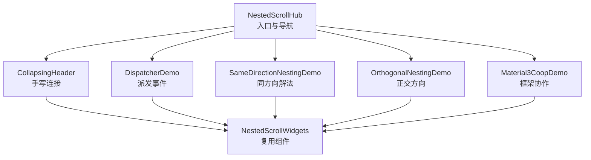
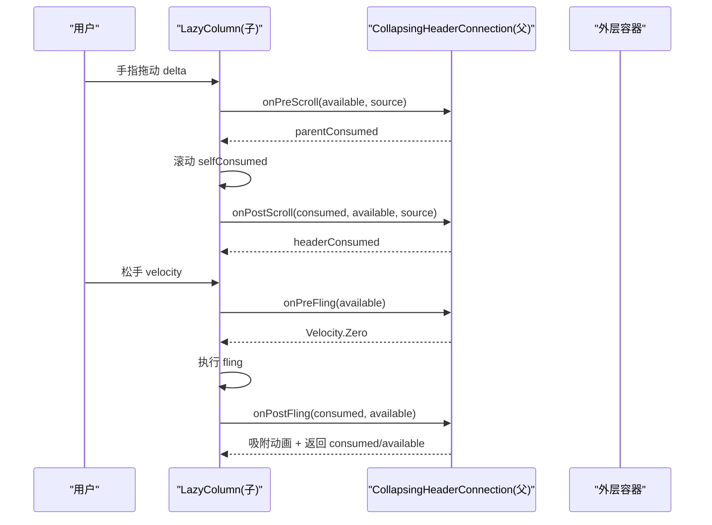
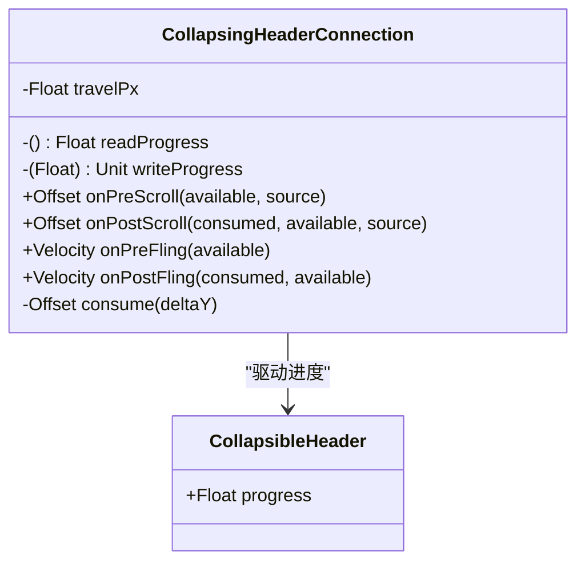
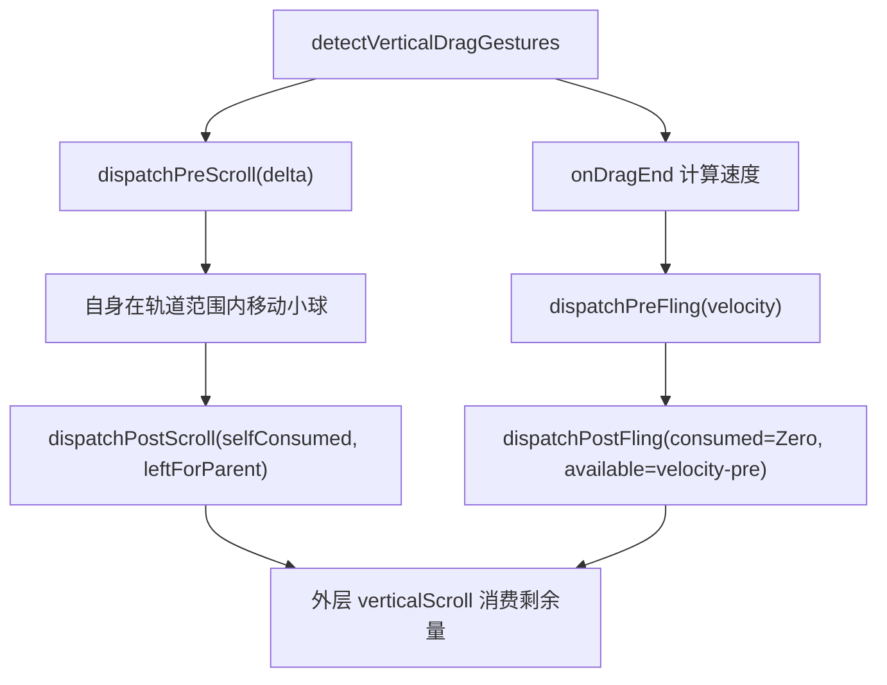
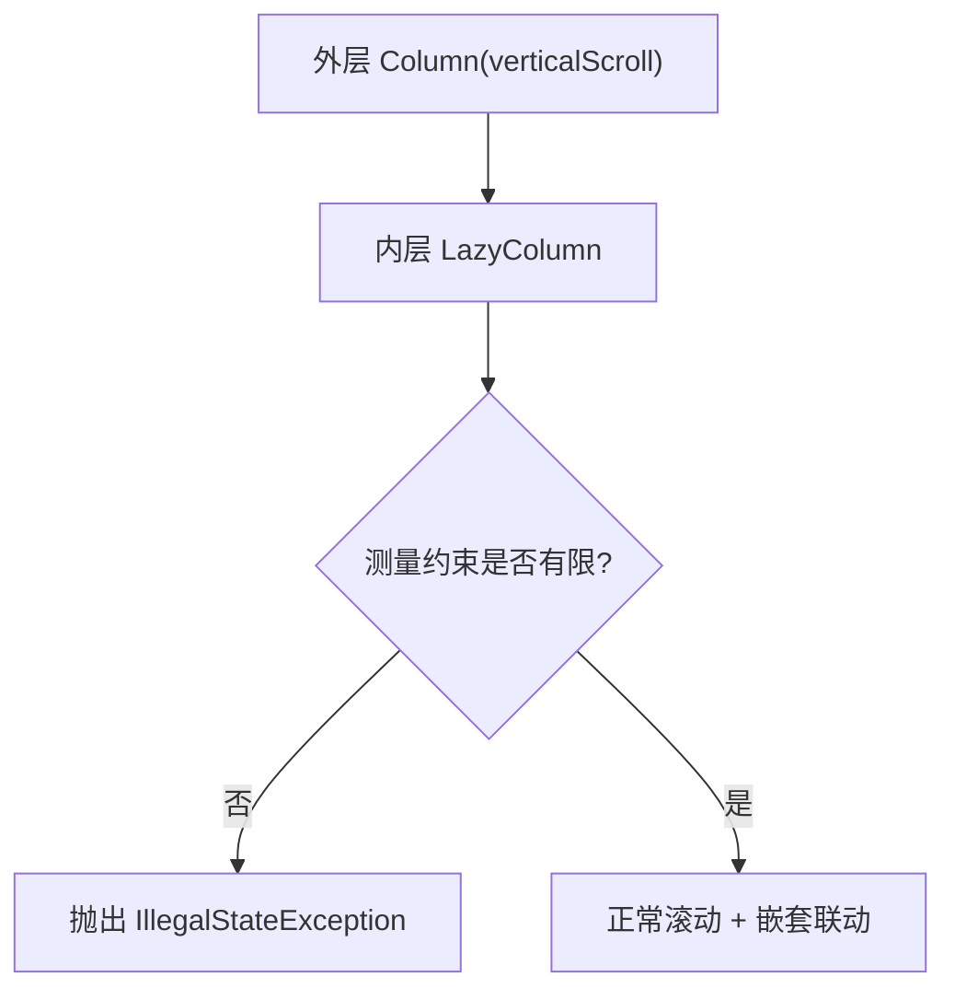
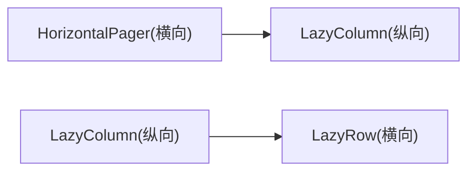
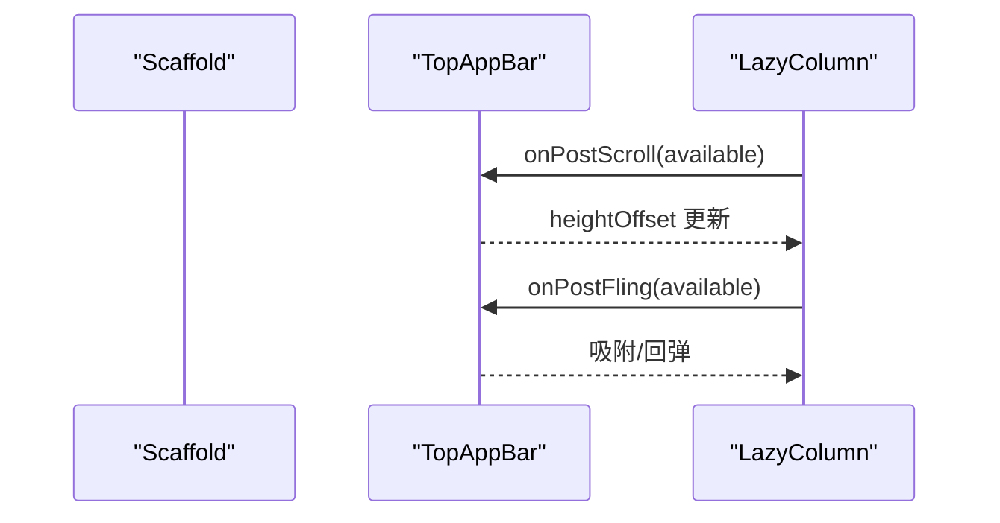
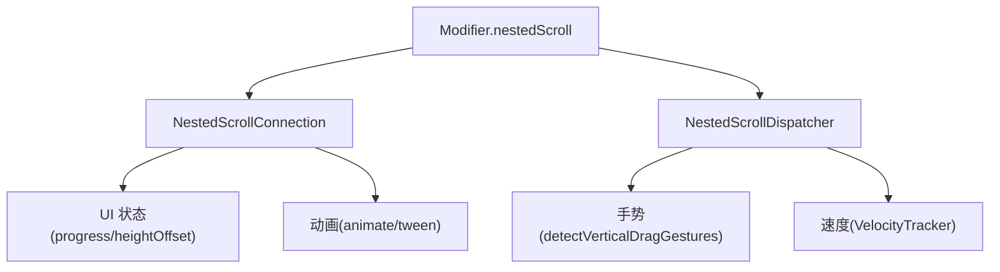

# 嵌套滚动系统

<cite>
**本文引用的文件**   
- [NestedScrollHub.kt](file://app/src/main/java/com/example/composeup/nestedscroll/NestedScrollHub.kt)
- [CollapsingHeader.kt](file://app/src/main/java/com/example/composeup/nestedscroll/CollapsingHeader.kt)
- [DispatcherDemo.kt](file://app/src/main/java/com/example/composeup/nestedscroll/DispatcherDemo.kt)
- [SameDirectionNestingDemo.kt](file://app/src/main/java/com/example/composeup/nestedscroll/SameDirectionNestingDemo.kt)
- [OrthogonalNestingDemo.kt](file://app/src/main/java/com/example/composeup/nestedscroll/OrthogonalNestingDemo.kt)
- [Material3CoopDemo.kt](file://app/src/main/java/com/example/composeup/nestedscroll/Material3CoopDemo.kt)
- [NestedScrollWidgets.kt](file://app/src/main/java/com/example/composeup/nestedscroll/NestedScrollWidgets.kt)
- [README.md](file://app/src/main/java/com/example/composeup/nestedscroll/README.md)
</cite>

## 目录
1. [引言](#引言)
2. [项目结构](#项目结构)
3. [核心组件](#核心组件)
4. [架构总览](#架构总览)
5. [详细组件分析](#详细组件分析)
6. [依赖关系分析](#依赖关系分析)
7. [性能考量](#性能考量)
8. [故障排查指南](#故障排查指南)
9. [结论](#结论)
10. [附录：API 与阶段速查](#附录api-与阶段速查)

## 引言
本技术文档围绕 Compose 的嵌套滚动系统展开，目标是在不直接粘贴代码的前提下，帮助读者理解并实现以下能力：
- 深入掌握 NestedScrollConnection 的四个阶段：onPreScroll、onPostScroll、onPreFling、onPostFling。
- 手写可折叠 Header，完整走通四阶段协作。
- 使用 NestedScrollDispatcher 让自绘控件参与嵌套滚动。
- 处理同方向嵌套滚动的崩溃原因与四种解法。
- 理解正交方向（横向 Pager + 纵向列表）为何天然互不干扰。
- 使用 Material3 内置的 TopAppBar、ModalBottomSheet、PullToRefreshBox 等组件的嵌套滚动协作。
- 获得性能优化建议与常见问题解决方案。

## 项目结构
嵌套滚动示例位于 app 模块的 nestedscroll 包中，采用“入口 Hub + 多示例页面”的组织方式：
- NestedScrollHub：话题入口页，负责展示五个进阶主题并跳转到具体示例。
- CollapsingHeader：手写 NestedScrollConnection 的可折叠 Header。
- DispatcherDemo：用 NestedScrollDispatcher 派发手势给外层滚动容器。
- SameDirectionNestingDemo：同方向嵌套滚动的坑与四种解法。
- OrthogonalNestingDemo：正交方向嵌套的三种常见结构。
- Material3CoopDemo：TopAppBar、ModalBottomSheet、PullToRefreshBox 的内置协作。
- NestedScrollWidgets：包内复用的小组件（卡片、说明文字、占位块）。
- README.md：完整的概念说明、版本提示与实践清单。

图表来源
- [NestedScrollHub.kt:75-145](file://app/src/main/java/com/example/composeup/nestedscroll/NestedScrollHub.kt#L75-L145)
- [CollapsingHeader.kt:75-117](file://app/src/main/java/com/example/composeup/nestedscroll/CollapsingHeader.kt#L75-L117)
- [DispatcherDemo.kt:78-113](file://app/src/main/java/com/example/composeup/nestedscroll/DispatcherDemo.kt#L78-L113)
- [SameDirectionNestingDemo.kt:98-127](file://app/src/main/java/com/example/composeup/nestedscroll/SameDirectionNestingDemo.kt#L98-L127)
- [OrthogonalNestingDemo.kt:71-98](file://app/src/main/java/com/example/composeup/nestedscroll/OrthogonalNestingDemo.kt#L71-L98)
- [Material3CoopDemo.kt:69-99](file://app/src/main/java/com/example/composeup/nestedscroll/Material3CoopDemo.kt#L69-L99)
- [NestedScrollWidgets.kt:25-95](file://app/src/main/java/com/example/composeup/nestedscroll/NestedScrollWidgets.kt#L25-L95)

章节来源
- [NestedScrollHub.kt:30-145](file://app/src/main/java/com/example/composeup/nestedscroll/NestedScrollHub.kt#L30-L145)
- [README.md:141-153](file://app/src/main/java/com/example/composeup/nestedscroll/README.md#L141-L153)

## 核心组件
本节聚焦嵌套滚动协议的核心角色与职责：
- 派发子级：真正接收手势并滚动的组件（如 LazyColumn、verticalScroll），通过 NestedScrollDispatcher 把增量抛给祖先。
- 链条成员：任意挂载 Modifier.nestedScroll(connection) 的祖先节点，通过 NestedScrollConnection 决定消费或透传。
- 协议载体：Offset 与 Velocity，均为二维向量，同时携带 x、y 分量。

关键要点：
- Modifier.nestedScroll 的 connection 必填；dispatcher 可选，只有“自己会动且要通知父级”的组件才需要它。
- 一次拖动 + 松手会依次触发 onPreScroll → 子级滚动 → onPostScroll → onPreFling → 子级 fling → onPostFling。
- 必须区分 NestedScrollSource.UserInput 与 SideEffect，避免惯性阶段被重复处理。
- 协议是“与方向无关”的：每个可滚动组件只消费自己方向的分量，另一个分量原样透传。

章节来源
- [README.md:42-138](file://app/src/main/java/com/example/composeup/nestedscroll/README.md#L42-L138)

## 架构总览
嵌套滚动在 UI 层表现为一条从子到父的事件链。以“可折叠 Header + 列表”为例：

图表来源
- [CollapsingHeader.kt:127-202](file://app/src/main/java/com/example/composeup/nestedscroll/CollapsingHeader.kt#L127-L202)
- [README.md:57-87](file://app/src/main/java/com/example/composeup/nestedscroll/README.md#L57-L87)

## 详细组件分析

### 手写可折叠 Header（NestedScrollConnection 四阶段）
该示例从零实现一个可折叠 Header，覆盖四个阶段：
- onPreScroll：在上滑（y < 0）时抢先消费，先折叠 Header。
- onPostScroll：在列表已到顶且仍有向下位移时展开 Header。
- onPreFling：故意不抢速度，保证快速甩动列表顺滑。
- onPostFling：根据剩余速度做吸附动画，避免停在半路。

图表来源
- [CollapsingHeader.kt:127-202](file://app/src/main/java/com/example/composeup/nestedscroll/CollapsingHeader.kt#L127-L202)
- [CollapsingHeader.kt:204-241](file://app/src/main/java/com/example/composeup/nestedscroll/CollapsingHeader.kt#L204-L241)

实现要点：
- 状态设计：用 progress（0f 展开 / 1f 折叠）而非像素偏移，配合 rememberSaveable 保存比例，旋转屏幕/DPI 不丢状态。
- connection 复用：必须 remember 稳定实例，避免每次重组重建嵌套滚动图。
- 符号处理：available.y < 0 表示上滑，progress 应增大；返回值需还原为与 available.y 同号的 Offset。
- 阶段分配：onPreScroll 仅处理 UserInput 的上滑；onPostScroll 仅处理 UserInput 的下滑；onPreFling 返回零速度；onPostFling 做吸附动画。
- 渲染：高度随 progress 变化，配合 clipToBounds 做出卷起效果；生产环境更推荐 graphicsLayer/offset 提升帧率。

章节来源
- [CollapsingHeader.kt:41-49](file://app/src/main/java/com/example/composeup/nestedscroll/CollapsingHeader.kt#L41-L49)
- [CollapsingHeader.kt:75-117](file://app/src/main/java/com/example/composeup/nestedscroll/CollapsingHeader.kt#L75-L117)
- [CollapsingHeader.kt:127-202](file://app/src/main/java/com/example/composeup/nestedscroll/CollapsingHeader.kt#L127-L202)
- [CollapsingHeader.kt:204-241](file://app/src/main/java/com/example/composeup/nestedscroll/CollapsingHeader.kt#L204-L241)
- [README.md:159-231](file://app/src/main/java/com/example/composeup/nestedscroll/README.md#L159-L231)

### 使用 NestedScrollDispatcher 派发滚动事件
场景：自定义拖拽控件没有 ScrollState，Compose 不知道它在滚动。需要通过 dispatcher 主动把 pre/post scroll 与 fling 事件派发给外层页面。

图表来源
- [DispatcherDemo.kt:118-210](file://app/src/main/java/com/example/composeup/nestedscroll/DispatcherDemo.kt#L118-L210)
- [README.md:232-284](file://app/src/main/java/com/example/composeup/nestedscroll/README.md#L232-L284)

实现要点：
- 空连接占位：Modifier.nestedScroll 的 connection 必填，即使不做任何消费也要挂一个空实现。
- 手势接管：detectVerticalDragGestures 中 change.consume() 防止祖先 scrollable 同时抢走拖动。
- 速度追踪：使用 VelocityTracker 记录位置并在 onDragEnd 计算速度。
- suspend 调用：dispatchPreFling/dispatchPostFling 必须在协程中调用，建议使用 dispatcher.coroutineScope。
- 日志输出：打印 Δ、父预吃、自吃、父后吃，直观观察增量如何被瓜分。

章节来源
- [DispatcherDemo.kt:47-76](file://app/src/main/java/com/example/composeup/nestedscroll/DispatcherDemo.kt#L47-L76)
- [DispatcherDemo.kt:118-210](file://app/src/main/java/com/example/composeup/nestedscroll/DispatcherDemo.kt#L118-L210)
- [README.md:232-284](file://app/src/main/java/com/example/composeup/nestedscroll/README.md#L232-L284)

### 同方向嵌套滚动：崩溃原因与四种解法
问题：Column(verticalScroll) 内嵌 LazyColumn 会崩溃，因为 verticalScroll 会把子级最大高度约束改为 Infinity，而 LazyColumn 需要有限高度才能测量可视区项数。

图表来源
- [SameDirectionNestingDemo.kt:64-96](file://app/src/main/java/com/example/composeup/nestedscroll/SameDirectionNestingDemo.kt#L64-L96)

四种解法：
- 合并成一个 LazyColumn：头部 item、吸顶 stickyHeader、正文 items 全部放入同一懒列表，官方推荐。
- 内层固定高度：给内层 LazyColumn 确定高度，使其能测量；内外各自滚动，边界处自动冒泡联动。
- 内层退化为普通 Column：放弃懒加载，适合少量条目；注意 userScrollEnabled=false 不能解决测量崩溃。
- 阻断冒泡：插入自定义 NestedScrollConnection，在 onPostScroll/onPostFling 返回 available，假装全消费掉，阻止外层滚动。

章节来源
- [SameDirectionNestingDemo.kt:35-62](file://app/src/main/java/com/example/composeup/nestedscroll/SameDirectionNestingDemo.kt#L35-L62)
- [SameDirectionNestingDemo.kt:64-96](file://app/src/main/java/com/example/composeup/nestedscroll/SameDirectionNestingDemo.kt#L64-L96)
- [SameDirectionNestingDemo.kt:129-171](file://app/src/main/java/com/example/composeup/nestedscroll/SameDirectionNestingDemo.kt#L129-L171)
- [SameDirectionNestingDemo.kt:186-242](file://app/src/main/java/com/example/composeup/nestedscroll/SameDirectionNestingDemo.kt#L186-L242)
- [SameDirectionNestingDemo.kt:244-306](file://app/src/main/java/com/example/composeup/nestedscroll/SameDirectionNestingDemo.kt#L244-L306)
- [README.md:285-339](file://app/src/main/java/com/example/composeup/nestedscroll/README.md#L285-L339)

### 正交方向嵌套：为什么“不用管”就是最好的处理
正交方向（横向 Pager + 纵向列表）天然互不干扰，因为协议基于屏幕坐标 (x, y)，每个可滚动组件只消费自己方向的分量。

常见结构：
- Tab + 列表：PrimaryTabRow 与 HorizontalPager 联动，每页一个撑满的 LazyColumn。
- 列表内嵌横向 Pager：外层纵向 LazyColumn，某个 item 是固定高度的 HorizontalPager，每页又是一个 LazyColumn。
- 列表内嵌 LazyRow：横向懒列表本身有确定高度，不存在约束冲突；手势分流自动完成。

图表来源
- [OrthogonalNestingDemo.kt:38-69](file://app/src/main/java/com/example/composeup/nestedscroll/OrthogonalNestingDemo.kt#L38-L69)
- [OrthogonalNestingDemo.kt:117-152](file://app/src/main/java/com/example/composeup/nestedscroll/OrthogonalNestingDemo.kt#L117-L152)
- [OrthogonalNestingDemo.kt:157-200](file://app/src/main/java/com/example/composeup/nestedscroll/OrthogonalNestingDemo.kt#L157-L200)
- [OrthogonalNestingDemo.kt:205-250](file://app/src/main/java/com/example/composeup/nestedscroll/OrthogonalNestingDemo.kt#L205-L250)

章节来源
- [OrthogonalNestingDemo.kt:58-69](file://app/src/main/java/com/example/composeup/nestedscroll/OrthogonalNestingDemo.kt#L58-L69)
- [OrthogonalNestingDemo.kt:117-152](file://app/src/main/java/com/example/composeup/nestedscroll/OrthogonalNestingDemo.kt#L117-L152)
- [OrthogonalNestingDemo.kt:157-200](file://app/src/main/java/com/example/composeup/nestedscroll/OrthogonalNestingDemo.kt#L157-L200)
- [OrthogonalNestingDemo.kt:205-250](file://app/src/main/java/com/example/composeup/nestedscroll/OrthogonalNestingDemo.kt#L205-L250)
- [README.md:340-349](file://app/src/main/java/com/example/composeup/nestedscroll/README.md#L340-L349)

### Material3 组件的内置嵌套滚动协作
大多数业务场景无需手写协议，Material3 主流组件已内置 NestedScrollConnection：
- TopAppBar：提供 pinned、enterAlways、exitUntilCollapsed 三种行为，只需将 scrollBehavior.nestedScrollConnection 挂到内容根节点。
- ModalBottomSheet：内部列表优先滚动，到顶后剩余增量交给 Sheet 下滑关闭，拖过阈值松手 dismiss。
- PullToRefreshBox：只有子列表已在顶部且继续下拉时才拉出指示器。

图表来源
- [Material3CoopDemo.kt:109-182](file://app/src/main/java/com/example/composeup/nestedscroll/Material3CoopDemo.kt#L109-L182)
- [Material3CoopDemo.kt:189-231](file://app/src/main/java/com/example/composeup/nestedscroll/Material3CoopDemo.kt#L189-L231)
- [Material3CoopDemo.kt:235-271](file://app/src/main/java/com/example/composeup/nestedscroll/Material3CoopDemo.kt#L235-L271)
- [README.md:351-368](file://app/src/main/java/com/example/composeup/nestedscroll/README.md#L351-L368)

章节来源
- [Material3CoopDemo.kt:41-59](file://app/src/main/java/com/example/composeup/nestedscroll/Material3CoopDemo.kt#L41-L59)
- [Material3CoopDemo.kt:109-182](file://app/src/main/java/com/example/composeup/nestedscroll/Material3CoopDemo.kt#L109-L182)
- [Material3CoopDemo.kt:189-231](file://app/src/main/java/com/example/composeup/nestedscroll/Material3CoopDemo.kt#L189-L231)
- [Material3CoopDemo.kt:235-271](file://app/src/main/java/com/example/composeup/nestedscroll/Material3CoopDemo.kt#L235-L271)
- [README.md:351-368](file://app/src/main/java/com/example/composeup/nestedscroll/README.md#L351-L368)

## 依赖关系分析
嵌套滚动涉及三类依赖：
- UI 层：Modifier.nestedScroll、NestedScrollConnection、NestedScrollDispatcher。
- 手势层：PointerInput、detectVerticalDragGestures、VelocityTracker。
- 动画层：animate、tween、graphicsLayer/offset。

图表来源
- [CollapsingHeader.kt:75-117](file://app/src/main/java/com/example/composeup/nestedscroll/CollapsingHeader.kt#L75-L117)
- [DispatcherDemo.kt:118-210](file://app/src/main/java/com/example/composeup/nestedscroll/DispatcherDemo.kt#L118-L210)
- [README.md:42-138](file://app/src/main/java/com/example/composeup/nestedscroll/README.md#L42-L138)

章节来源
- [CollapsingHeader.kt:75-117](file://app/src/main/java/com/example/composeup/nestedscroll/CollapsingHeader.kt#L75-L117)
- [DispatcherDemo.kt:118-210](file://app/src/main/java/com/example/composeup/nestedscroll/DispatcherDemo.kt#L118-L210)
- [README.md:42-138](file://app/src/main/java/com/example/composeup/nestedscroll/README.md#L42-L138)

## 性能考量
- 状态与渲染：
  - 使用 rememberSaveable 保存比例型状态（如 progress），避免旋转/DPI 变化导致错乱。
  - 优先使用 graphicsLayer/offset 的 lambda 版本进行绘制阶段位移，避免重组与重测量。
- connection/dispatcher 复用：
  - 必须 remember 稳定实例，避免每次重组重建嵌套滚动图，减少事件丢失风险。
- 手势与速度：
  - 使用 VelocityTracker 准确计算速度，避免抖动与卡顿。
- 布局约束：
  - 避免同方向无限高嵌套；必要时给内层固定高度或改用单一 LazyColumn。
- 动画规格：
  - 合理设置 tween(durationMillis) 与吸附阈值，兼顾手感与性能。

章节来源
- [CollapsingHeader.kt:75-117](file://app/src/main/java/com/example/composeup/nestedscroll/CollapsingHeader.kt#L75-L117)
- [CollapsingHeader.kt:191-202](file://app/src/main/java/com/example/composeup/nestedscroll/CollapsingHeader.kt#L191-L202)
- [DispatcherDemo.kt:123-127](file://app/src/main/java/com/example/composeup/nestedscroll/DispatcherDemo.kt#L123-L127)
- [SameDirectionNestingDemo.kt:186-242](file://app/src/main/java/com/example/composeup/nestedscroll/SameDirectionNestingDemo.kt#L186-L242)
- [README.md:371-388](file://app/src/main/java/com/example/composeup/nestedscroll/README.md#L371-L388)

## 故障排查指南
常见问题与对策：
- 同方向嵌套崩溃：
  - 现象：Column(verticalScroll) 内嵌 LazyColumn 抛出 IllegalStateException。
  - 原因：verticalScroll 把子级最大高度设为 Infinity，LazyColumn 无法测量可视区。
  - 对策：合并为单一 LazyColumn、给内层固定高度、退化为普通 Column、或阻断冒泡。
- 手势冲突：
  - 现象：祖先 scrollable 与自定义手势同时响应。
  - 对策：在 detectVerticalDragGestures 中 change.consume()，明确接管手势。
- 惯性重复处理：
  - 现象：列表滑到底仍抖动。
  - 对策：区分 NestedScrollSource.UserInput 与 SideEffect，拖动与惯性分开处理。
- 修饰符顺序错误：
  - 现象：nestedScroll 未拦到事件。
  - 对策：确保 nestedScroll 挂在 LazyColumn 自身的 modifier 链上，成为其内部 scrollable 节点的祖先。
- 旧 API 误用：
  - 现象：引用 androidx.compose.foundation.nestedscroll 包名或 consumeWithinBounds 等已移除 API。
  - 对策：使用 androidx.compose.ui.input.nestedscroll 包名，并用自定义 connection 替代旧 API。

章节来源
- [SameDirectionNestingDemo.kt:64-96](file://app/src/main/java/com/example/composeup/nestedscroll/SameDirectionNestingDemo.kt#L64-L96)
- [DispatcherDemo.kt:141-144](file://app/src/main/java/com/example/composeup/nestedscroll/DispatcherDemo.kt#L141-L144)
- [README.md:94-107](file://app/src/main/java/com/example/composeup/nestedscroll/README.md#L94-L107)
- [README.md:371-388](file://app/src/main/java/com/example/composeup/nestedscroll/README.md#L371-L388)

## 结论
Compose 的嵌套滚动是一套“二维、双向、四阶段”的事件协议。通过手写 NestedScrollConnection 与 NestedScrollDispatcher，可以精确控制父子滚动协作；而 Material3 的主流组件已经内置了这些能力，日常开发通常只需按官方组合方式拼装即可。理解四个阶段的语义、正确处理符号与方向、复用 connection/dispatcher、以及规避测量约束问题，是实现流畅嵌套滚动的关键。

## 附录：API 与阶段速查
- 四个阶段：
  - onPreScroll：父级先消费，子级只剩剩余可用量。
  - onPostScroll：子级消费后，父级消费剩余量。
  - onPreFling：父级先抢一部分速度。
  - onPostFling：子级 fling 结束后，父级消费剩余速度。
- 关键类型：
  - NestedScrollConnection：定义四个阶段的回调。
  - NestedScrollDispatcher：主动派发 pre/post scroll 与 fling。
  - NestedScrollSource：区分 UserInput 与 SideEffect。
  - Offset/Velocity：二维向量，携带 x/y 分量。
- 实践清单：
  - connection/dispatcher 一律 remember 复用。
  - onPreScroll/onPostScroll 里判断 source。
  - 返回值符号与 available 一致。
  - 换算像素用 LocalDensity 在组合期算好。
  - 避免同方向无限高嵌套。

章节来源
- [README.md:42-138](file://app/src/main/java/com/example/composeup/nestedscroll/README.md#L42-L138)
- [README.md:371-388](file://app/src/main/java/com/example/composeup/nestedscroll/README.md#L371-L388)