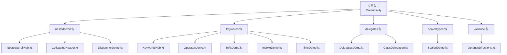
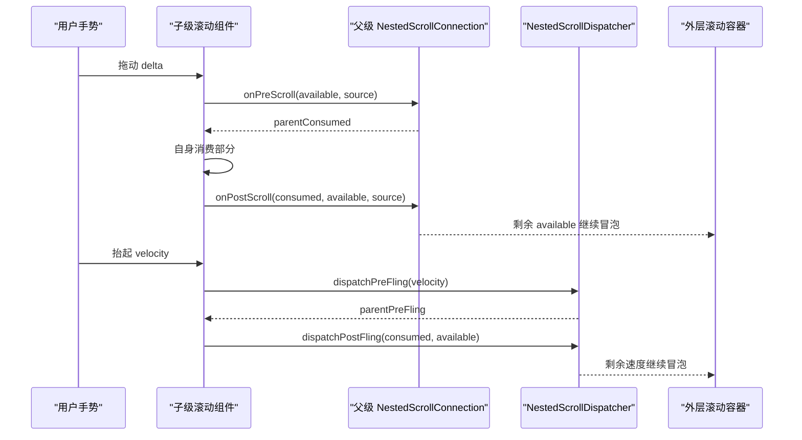
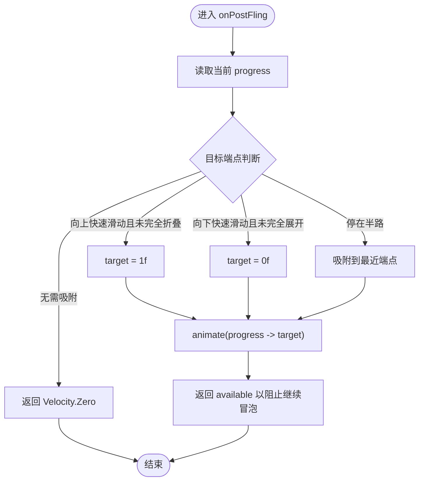
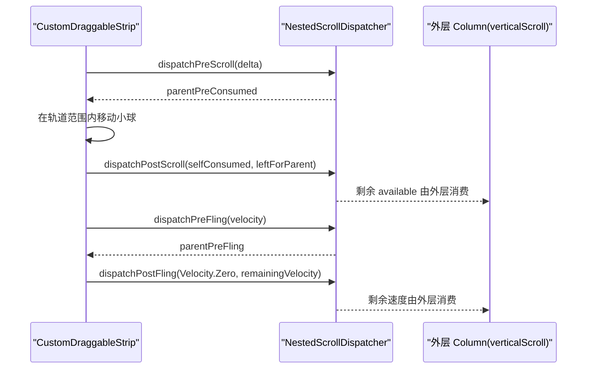
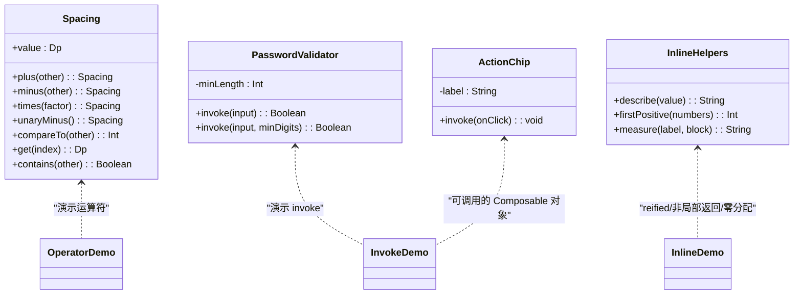
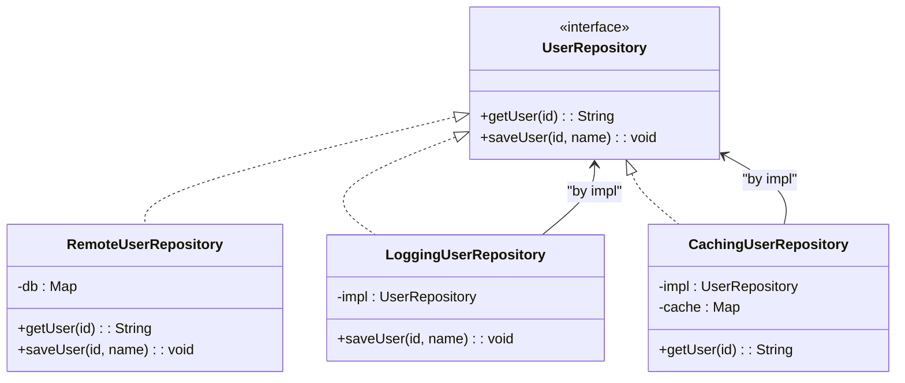
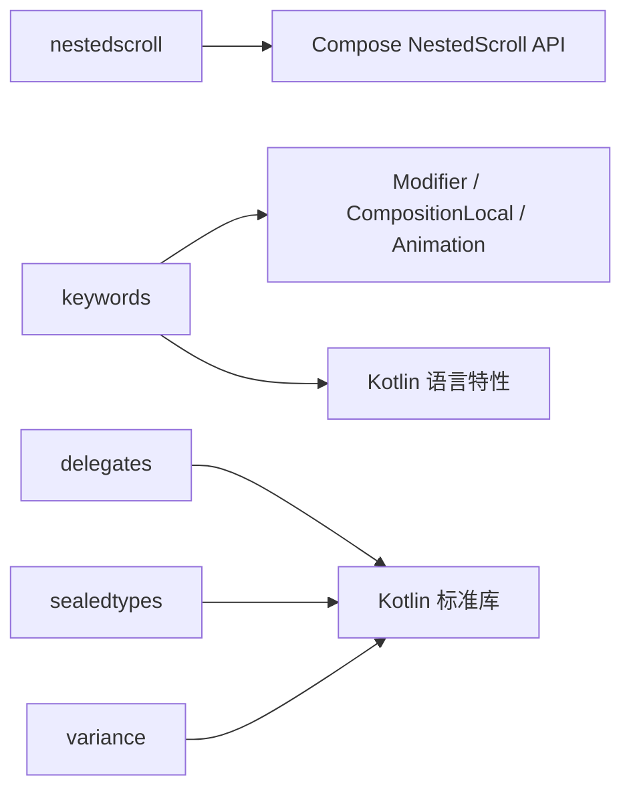

# 高级特性

<cite>
**本文引用的文件**   
- [NestedScrollHub.kt](file://app/src/main/java/com/example/composeup/nestedscroll/NestedScrollHub.kt)
- [CollapsingHeader.kt](file://app/src/main/java/com/example/composeup/nestedscroll/CollapsingHeader.kt)
- [DispatcherDemo.kt](file://app/src/main/java/com/example/composeup/nestedscroll/DispatcherDemo.kt)
- [KeywordsHub.kt](file://app/src/main/java/com/example/composeup/keywords/KeywordsHub.kt)
- [OperatorDemo.kt](file://app/src/main/java/com/example/composeup/keywords/OperatorDemo.kt)
- [InfixDemo.kt](file://app/src/main/java/com/example/composeup/keywords/InfixDemo.kt)
- [InvokeDemo.kt](file://app/src/main/java/com/example/composeup/keywords/InvokeDemo.kt)
- [InlineDemo.kt](file://app/src/main/java/com/example/composeup/keywords/InlineDemo.kt)
- [DelegatesDemo.kt](file://app/src/main/java/com/example/composeup/delegates/DelegatesDemo.kt)
- [ClassDelegation.kt](file://app/src/main/java/com/example/composeup/delegates/ClassDelegation.kt)
- [SealedDemo.kt](file://app/src/main/java/com/example/composeup/sealedtypes/SealedDemo.kt)
- [VarianceDirections.kt](file://app/src/main/java/com/example/composeup/variance/VarianceDirections.kt)
</cite>

## 目录
1. [引言](#引言)
2. [项目结构](#项目结构)
3. [核心组件](#核心组件)
4. [架构总览](#架构总览)
5. [详细组件分析](#详细组件分析)
6. [依赖关系分析](#依赖关系分析)
7. [性能与内存优化](#性能与内存优化)
8. [调试与排错指南](#调试与排错指南)
9. [结论](#结论)
10. [附录：复杂交互模式与最佳实践](#附录复杂交互模式与最佳实践)

## 引言
本技术文档围绕 Compose 高级特性展开，聚焦以下主题：
- 嵌套滚动系统：从手写 NestedScrollConnection 到自定义 NestedScrollDispatcher。
- Kotlin 底层关键字在 Compose 中的真实用法：operator、infix、invoke、inline。
- 委托模式、密封类与泛型方差的高级用法。
- 性能优化、内存管理与调试技巧。
- 复杂交互场景的实现模式与最佳实践。

这些内容均来自仓库中 nestedscroll、keywords、delegates、sealedtypes、variance 等示例包，通过可运行的演示代码展示原理与实践。

## 项目结构
本项目采用按“特性/主题”分包的工程组织方式，每个包包含入口 Hub 页面与若干具体示例：
- nestedscroll：嵌套滚动协议、自绘控件派发、Material3 协作。
- keywords：Kotlin 语言特性如何支撑 Compose DSL。
- delegates：属性委托与类委托（装饰器）。
- sealedtypes：密封类型与 when 穷尽性。
- variance：协变 out、逆变 in、不变 invariant。



图表来源
- [NestedScrollHub.kt:30-66](file://app/src/main/java/com/example/composeup/nestedscroll/NestedScrollHub.kt#L30-L66)
- [KeywordsHub.kt:30-71](file://app/src/main/java/com/example/composeup/keywords/KeywordsHub.kt#L30-L71)
- [DelegatesDemo.kt:1-76](file://app/src/main/java/com/example/composeup/delegates/DelegatesDemo.kt#L1-L76)
- [SealedDemo.kt:1-92](file://app/src/main/java/com/example/composeup/sealedtypes/SealedDemo.kt#L1-L92)
- [VarianceDirections.kt:1-64](file://app/src/main/java/com/example/composeup/variance/VarianceDirections.kt#L1-L64)

章节来源
- [NestedScrollHub.kt:30-66](file://app/src/main/java/com/example/composeup/nestedscroll/NestedScrollHub.kt#L30-L66)
- [KeywordsHub.kt:30-71](file://app/src/main/java/com/example/composeup/keywords/KeywordsHub.kt#L30-L71)

## 核心组件
- 嵌套滚动入口与示例导航：NestedScrollHub 提供话题列表与返回处理，并分发到 CollapsingHeader、DispatcherDemo、同方向/正交嵌套、Material3 协作等示例。
- 折叠 Header：通过实现 NestedScrollConnection 的四个阶段，完成上滑折叠、下滑展开、惯性吸附等交互。
- 自定义 dispatcher：无 ScrollState 的自绘控件通过 NestedScrollDispatcher 将 pre/post scroll/fling 事件派发给外层页面。
- 关键字示例：OperatorDemo、InfixDemo、InvokeDemo、InlineDemo 分别演示 operator/infix/invoke/inline 在 UI 与 DSL 中的使用。
- 委托与密封类型：DelegatesDemo 与 ClassDelegation 演示属性委托与类委托；SealedDemo 演示密封类型的穷尽性与智能转换。
- 泛型方差：VarianceDirections 演示 out/in/invariant 的使用与限制。

章节来源
- [NestedScrollHub.kt:73-146](file://app/src/main/java/com/example/composeup/nestedscroll/NestedScrollHub.kt#L73-L146)
- [CollapsingHeader.kt:74-117](file://app/src/main/java/com/example/composeup/nestedscroll/CollapsingHeader.kt#L74-L117)
- [DispatcherDemo.kt:77-113](file://app/src/main/java/com/example/composeup/nestedscroll/DispatcherDemo.kt#L77-L113)
- [KeywordsHub.kt:78-156](file://app/src/main/java/com/example/composeup/keywords/KeywordsHub.kt#L78-L156)

## 架构总览
嵌套滚动是二维、双向、四阶段的协议。上层组件通过 NestedScrollConnection 参与消费，子级组件的事件会冒泡到父级连接；自定义控件若无滚动状态，则用 NestedScrollDispatcher 扮演“派发子级”的角色，把增量交给外层。



图表来源
- [CollapsingHeader.kt:127-202](file://app/src/main/java/com/example/composeup/nestedscroll/CollapsingHeader.kt#L127-L202)
- [DispatcherDemo.kt:118-210](file://app/src/main/java/com/example/composeup/nestedscroll/DispatcherDemo.kt#L118-L210)

## 详细组件分析

### 嵌套滚动：可折叠 Header
该示例完整实现了 NestedScrollConnection 的四个阶段：
- onPreScroll：在上滑时优先折叠 Header，避免列表先滚导致手感割裂。
- onPostScroll：在列表已到顶且仍有向下位移时展开 Header。
- onPreFling：不抢占速度，让列表惯性自然进行。
- onPostFling：根据速度与当前位置做吸附动画，避免停在中间态。

关键设计点：
- connection 必须 remember 稳定实例，避免重组重建导致事件丢失或性能浪费。
- 进度与像素换算：用 travelPx 将 progress 映射为像素偏移，保证旋转屏幕/DPI 变化后行为一致。
- 吸附阈值：当惯性速度超过阈值时直接吸附到端点，否则按距离最近端点吸附。



图表来源
- [CollapsingHeader.kt:182-201](file://app/src/main/java/com/example/composeup/nestedscroll/CollapsingHeader.kt#L182-L201)

章节来源
- [CollapsingHeader.kt:74-117](file://app/src/main/java/com/example/composeup/nestedscroll/CollapsingHeader.kt#L74-L117)
- [CollapsingHeader.kt:127-202](file://app/src/main/java/com/example/composeup/nestedscroll/CollapsingHeader.kt#L127-L202)

### 自定义 dispatcher：自绘控件向外派发
自绘控件没有 ScrollState，无法被 Compose 识别为滚动源。正确做法：
- 同时挂载空 NestedScrollConnection（占位）与 NestedScrollDispatcher（派发）。
- 在 pointerInput 中接管手势，调用 dispatcher.dispatchPreScroll/dispatchPostScroll。
- 在手指抬起时，使用 dispatcher.coroutineScope.launch 调用 suspend 的 fling 派发方法。

关键点：
- dispatcher 和 connection 都必须 remember 复用。
- 小球在有限轨道内移动，超出边界后将剩余位移交给外层。
- fling 派发必须在协程作用域中进行，确保组件销毁后动画仍能完成。



图表来源
- [DispatcherDemo.kt:118-210](file://app/src/main/java/com/example/composeup/nestedscroll/DispatcherDemo.kt#L118-L210)

章节来源
- [DispatcherDemo.kt:46-76](file://app/src/main/java/com/example/composeup/nestedscroll/DispatcherDemo.kt#L46-L76)
- [DispatcherDemo.kt:118-210](file://app/src/main/java/com/example/composeup/nestedscroll/DispatcherDemo.kt#L118-L210)

### Kotlin 关键字：operator / infix / invoke / inline
- operator：让自定义类型支持符号运算，如 Spacing 的 plus/times/unaryMinus/compareTo/get/contains。Compose 中 Dp、EnterTransition 大量使用 operator。
- infix：中缀调用语法糖，如 Modifier.then、CompositionLocal.provides、EnterTransition.togetherWith。
- invoke：对象像函数一样被调用，Compose 插槽 content() 即 invoke；可调用的 @Composable 对象也基于此。
- inline：消除 lambda 分配、支持 reified 与非局部返回；Dp 运算、CompositionLocal.current、内部节点查找均依赖 inline。



图表来源
- [OperatorDemo.kt:47-72](file://app/src/main/java/com/example/composeup/keywords/OperatorDemo.kt#L47-L72)
- [InvokeDemo.kt:39-69](file://app/src/main/java/com/example/composeup/keywords/InvokeDemo.kt#L39-L69)
- [InlineDemo.kt:38-52](file://app/src/main/java/com/example/composeup/keywords/InlineDemo.kt#L38-L52)

章节来源
- [OperatorDemo.kt:34-46](file://app/src/main/java/com/example/composeup/keywords/OperatorDemo.kt#L34-L46)
- [InfixDemo.kt:30-47](file://app/src/main/java/com/example/composeup/keywords/InfixDemo.kt#L30-L47)
- [InvokeDemo.kt:22-33](file://app/src/main/java/com/example/composeup/keywords/InvokeDemo.kt#L22-L33)
- [InlineDemo.kt:20-37](file://app/src/main/java/com/example/composeup/keywords/InlineDemo.kt#L20-L37)

### 委托模式：属性委托与类委托
- 属性委托：lazy、observable、vetoable、notNull、by map、provideDelegate 等，用于延迟初始化、监听变化、校验赋值、动态解析数据、绑定即注册/校验。
- 类委托：通过 by impl 自动转发接口方法，叠加日志、缓存等装饰器，形成装饰器模式。



图表来源
- [ClassDelegation.kt:15-57](file://app/src/main/java/com/example/composeup/delegates/ClassDelegation.kt#L15-L57)

章节来源
- [DelegatesDemo.kt:1-76](file://app/src/main/java/com/example/composeup/delegates/DelegatesDemo.kt#L1-L76)
- [ClassDelegation.kt:1-57](file://app/src/main/java/com/example/composeup/delegates/ClassDelegation.kt#L1-L57)

### 密封类与泛型方差
- 密封类：when 穷尽性、智能转换、递归表达式求值。新增子类时编译期强制补全分支，提升安全性。
- 泛型方差：out 协变（生产者/只读）、in 逆变（消费者/只写）、不变（可读可写禁止转型）。标准库 List/Comparator/MutableList 体现不同方向。

```mermaid
erDiagram
NETWORK_RESULT {
enum status
string data
int code
string message
}
UI_STATE {
enum state
int progress
list items
string message
}
PLAYER_STATE {
enum state
int percent
int positionMs
string cause
boolean canPlay
}
BUTTON {
string label
string icon
}
COMPONENT {
+log(message): void
}
NETWORK_RESULT ||--o{ UI_STATE : "UI 层使用"
UI_STATE ||--o{ PLAYER_STATE : "播放器状态机"
BUTTON ||--o{ COMPONENT : "继承基类能力"
```

图表来源
- [SealedDemo.kt:11-92](file://app/src/main/java/com/example/composeup/sealedtypes/SealedDemo.kt#L11-L92)
- [VarianceDirections.kt:20-64](file://app/src/main/java/com/example/composeup/variance/VarianceDirections.kt#L20-L64)

章节来源
- [SealedDemo.kt:1-92](file://app/src/main/java/com/example/composeup/sealedtypes/SealedDemo.kt#L1-L92)
- [VarianceDirections.kt:1-64](file://app/src/main/java/com/example/composeup/variance/VarianceDirections.kt#L1-L64)

## 依赖关系分析
- nestedscroll 包依赖 Compose 的 nestedscroll API（NestedScrollConnection、NestedScrollDispatcher、Modifier.nestedScroll）。
- keywords 包依赖 Compose 的 Modifier、CompositionLocal、Animation 等 API，并通过 Kotlin 语言特性构建 DSL。
- delegates 包与业务解耦，仅演示 Kotlin 委托机制。
- sealedtypes 与 variance 包为纯 Kotlin 类型系统与语义演示。



图表来源
- [NestedScrollHub.kt:3-28](file://app/src/main/java/com/example/composeup/nestedscroll/NestedScrollHub.kt#L3-L28)
- [KeywordsHub.kt:3-28](file://app/src/main/java/com/example/composeup/keywords/KeywordsHub.kt#L3-L28)

章节来源
- [NestedScrollHub.kt:3-28](file://app/src/main/java/com/example/composeup/nestedscroll/NestedScrollHub.kt#L3-L28)
- [KeywordsHub.kt:3-28](file://app/src/main/java/com/example/composeup/keywords/KeywordsHub.kt#L3-L28)

## 性能与内存优化
- 使用 inline 减少 lambda 分配与虚调用开销，Compose 的 Dp 运算、CompositionLocal.current、内部节点查找都依赖 inline。
- 对高频组合的 Modifier 与动画 Spec 使用 inline operator/infix，避免额外对象创建。
- connection/dispatcher 必须 remember 复用，避免重组重建导致事件丢失与性能抖动。
- 在 fling 场景中，尽量让子级先消费惯性，父级再收尾，保持顺滑手感。
- 使用 rememberSaveable 保存比例而非像素，避免旋转屏幕/DPI 变化导致的布局异常。

[本节为通用指导，不直接分析具体文件]

## 调试与排错指南
- 嵌套滚动崩溃：Column(verticalScroll) 嵌套 LazyColumn 会抛异常，需合并为单个 LazyColumn、固定内层高度、退化为 Column 或阻断冒泡。
- 事件丢失：connection/dispatcher 未 remember 或每次重组新建，会导致事件链断裂。
- fling 中断：fling 派发需在协程作用域中进行，建议使用 dispatcher.coroutineScope.launch。
- 吸附异常：onPostFling 中目标端点判断逻辑需考虑速度与当前位置，避免停在尴尬中间态。
- 类型安全：密封类新增子类时 when 分支缺失会编译报错，及时补全。
- 方差错误：MutableList<Dog> 不能赋给 MutableList<Animal>，应使用只读 List<out T> 或明确不变类型。

章节来源
- [NestedScrollHub.kt:48-53](file://app/src/main/java/com/example/composeup/nestedscroll/NestedScrollHub.kt#L48-L53)
- [CollapsingHeader.kt:86-94](file://app/src/main/java/com/example/composeup/nestedscroll/CollapsingHeader.kt#L86-L94)
- [DispatcherDemo.kt:172-188](file://app/src/main/java/com/example/composeup/nestedscroll/DispatcherDemo.kt#L172-L188)
- [VarianceDirections.kt:45-57](file://app/src/main/java/com/example/composeup/variance/VarianceDirections.kt#L45-L57)

## 结论
本仓库通过一系列可运行示例，系统展示了 Compose 高级特性的实现原理与最佳实践：
- 嵌套滚动协议的四阶段设计与自定义 dispatcher 的派发策略。
- Kotlin 关键字在 Compose DSL 中的关键作用：operator、infix、invoke、inline。
- 委托模式与密封类的类型安全与扩展性。
- 泛型方差在标准库与业务模型中的应用与约束。
结合性能优化与调试技巧，可在复杂交互场景中构建高性能、可维护的 Compose 界面。

[本节为总结性内容，不直接分析具体文件]

## 附录：复杂交互模式与最佳实践
- 折叠 Header：上滑折叠、下滑展开、惯性吸附；注意进度与像素换算、connection 复用。
- 自绘控件派发：无 ScrollState 时使用 NestedScrollDispatcher，接管手势并派发 pre/post scroll/fling。
- 同方向嵌套：避免 Column(verticalScroll) 嵌套 LazyColumn，采用单一 LazyColumn 或隔离滚动。
- 正交方向嵌套：横向 Pager 与纵向列表天然互不干扰，利用二维 Offset 分量消费。
- Material3 协作：TopAppBar 的 scrollBehavior、ModalBottomSheet 优先级、PullToRefreshBox 只在列表到顶响应。
- 关键字 DSL：用 operator 表达数值运算，infix 表达组合语义，invoke 表达插槽执行，inline 保障性能。
- 委托与密封类型：用委托封装横切关注点，用密封类型建模状态机与表达式树。
- 方差与类型安全：合理使用 out/in/invariant，避免运行时类型错误。

[本节为概念性指导，不直接分析具体文件]